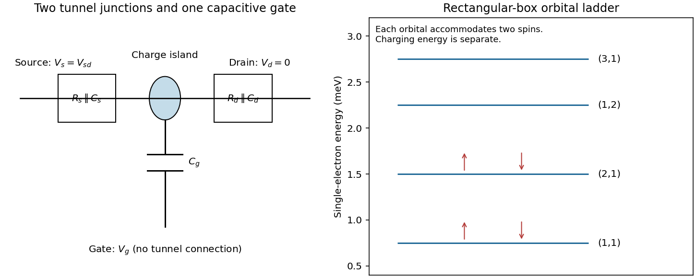

<h1 id="section-b/21/i/solution">Solution</h1>

↑ **Parent:** [I](../i.md)

The pattern is characteristic of a [single-electron transistor](../../../../../../single-electron-transistor.md): a small conducting island is connected to source and drain by two [tunnel junctions](../../../../../../tunnel-junction.md), and to a gate through a capacitance. Inside a [Coulomb diamond](../../../../../../coulomb-diamond.md), changing the island's integer charge costs more energy than the leads can supply, so sequential tunnelling is blocked. Outside it, an island electrochemical potential lies in the transport window and current can flow.

For clear [Coulomb blockade](../../../../../../coulomb-blockade.md), the island charging scale must exceed thermal broadening, and the tunnel junctions must be sufficiently resistive to preserve well-defined charge states:

$$
E_C=\frac{e^2}{2C_\Sigma}\gg k_BT,\qquad
R_s,R_d\gg\frac{h}{e^2},
\qquad C_\Sigma=C_s+C_d+C_g
$$

in the simplest circuit. Stray capacitances should be included in $C_\Sigma$ if appreciable. The gate changes electrostatic energy but should not provide a conducting leakage path. Lifetime broadening and cotunnelling should be small enough not to wash out the blocked regions.

**[Figure 9](#section-b/21/i/image-single-electron-transport-circuit-and-the-inferred-rectangular-box-orbital-ladder). Single-electron transport circuit and the inferred rectangular-box orbital ladder**. [Source](paper-2-single-electron-device.py). Original equivalent circuit and energy-level reconstruction. Each boxed junction combines tunnelling resistance and junction capacitance in parallel; the gate has only a capacitive connection. The right panel is used in part (iv), with charging energy treated separately.

The almost identical unconfined diamonds are consistent with a [constant interaction model](../../../../../../constant-interaction-model.md) having negligible or unresolved changes in single-particle level spacing.

## ↑ Ancestors (11)

1. [I](../i.md)
2. [21](../../21.md)
3. [Section B](../../../section-b.md)
4. [Paper 2](../../../../paper-2-split.md)
5. [2023](../../../../split.md)
6. [Past exam of the MPhil in micro- and nanotechnology enterprise course of the University of Cambridge](../../../../../split.md)
7. [MPhil in micro- and nanotechnology enterprise course of the University of Cambridge](../../../../../../mphil-in-micro-and-nanotechnology-enterprise-course-of-the-university-of-cambridge.md)
8. [Course of the University of Cambridge](../../../../../../course-of-the-university-of-cambridge.md)
9. [University of Cambridge](../../../../../../university-of-cambridge-split.md)
10. [List of universities](../../../../../../list-of-universities.md)
11. [Codex Wiki](../../../../../../split.md)
