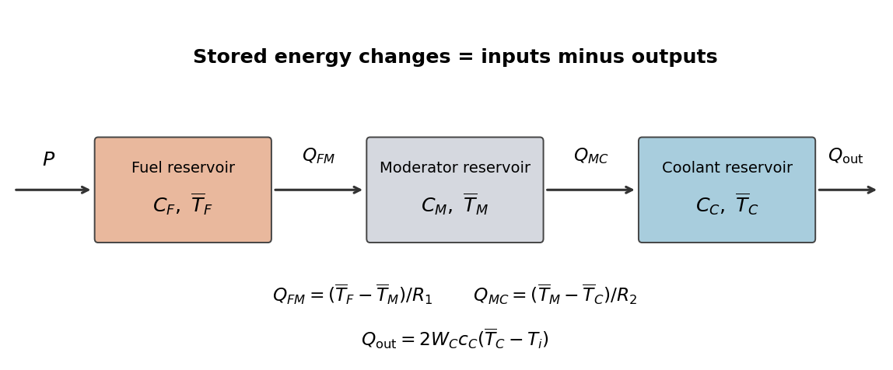

# Module NE1

↑ **Parent:** [2019](../2019.md)

[Original public PDF, physical pages 2–7](https://www.whatdotheyknow.com/request/past_exam_papers_16/response/2088673/attach/3/FOI%202022%20471%20Smith%20materials.pdf?cookie_passthrough=1#page=2)

**Table of contents**

- [1](#1)
  - [a](#1/a)
    - [Solution](#1/a/solution)
  - [b](#1/b)
    - [Solution](#1/b/solution)
  - [c](#1/c)
    - [Solution](#1/c/solution)
  - [d](#1/d)
    - [Solution](#1/d/solution)
- [2](#2)
  - [a](#2/a)
    - [Solution](#2/a/solution)
  - [b](#2/b)
    - [Solution](#2/b/solution)
  - [c](#2/c)
    - [i](#2/c/i)
      - [Solution](#2/c/i/solution)
    - [ii](#2/c/ii)
      - [Solution](#2/c/ii/solution)
  - [d](#2/d)
    - [Solution](#2/d/solution)
- [3](#3)
  - [a](#3/a)
    - [Solution](#3/a/solution)
  - [b](#3/b)
    - [Solution](#3/b/solution)
  - [c](#3/c)
    - [i](#3/c/i)
      - [Solution](#3/c/i/solution)
    - [ii](#3/c/ii)
      - [Solution](#3/c/ii/solution)
  - [d](#3/d)
    - [Solution](#3/d/solution)
  - [e](#3/e)
    - [Solution](#3/e/solution)
- [4](#4)
  - [a](#4/a)
    - [Solution](#4/a/solution)
  - [b](#4/b)
    - [i](#4/b/i)
      - [Solution](#4/b/i/solution)
    - [ii](#4/b/ii)
      - [Solution](#4/b/ii/solution)
    - [iii](#4/b/iii)
      - [Solution](#4/b/iii/solution)

## 1

↑ **Parent:** [Module NE1](paper-ne1.md)

<h3 id="1/a">a</h3>

↑ **Parent:** [1](#1)

<h4 id="1/a/solution">Solution</h4>

↑ **Parent:** [A](#1/a)

**Reduce time, increase distance and use radiation-appropriate shielding.** At fixed conditions, accumulated [absorbed dose](../../physics.md#absorbed-dose) is proportional to exposure time. For an approximately isotropic point source, the [inverse-square law](../../physics.md#inverse-square-law) reduces the uncollided radiation field as distance increases. Confinement of radioactive material prevents contamination; it addresses a different pathway from attenuation of an external field.

For [alpha particles](../../atomic-nucleus.md#alpha-particle), short stopping ranges make light barriers sufficient against external particles, but confinement remains important. For [beta particles](../../physics.md#beta-particle), a low-[atomic number](../../chemical-substance.md#atomic-number) shield such as plastic limits both penetration and secondary [bremsstrahlung](../../electromagnetic-radiation.md#bremsstrahlung); high-[atomic number](../../chemical-substance.md#atomic-number) material can then attenuate residual photons. For penetrating [gamma rays](../../quantum-mechanics.md#gamma-ray), dense material such as [lead](../../chemical-substance.md#lead), or a thicker bulk shield such as concrete, provides attenuation. **One shield material is not equally appropriate for every radiation type.**[Time, distance and shielding; alpha, beta and gamma examples](../../physics-bibliography.md#minimize-your-exposure-by-united-states-nuclear-regulatory-commission)[Appendix I, printed page I-2: low-atomic-number beta shielding and an outer high-atomic-number layer for bremsstrahlung](../../physics-bibliography.md#consolidated-guidance-about-materials-licenses-volume-12-by-united-states-nuclear-regulatory-commission)

<h3 id="1/b">b</h3>

↑ **Parent:** [1](#1)

<h4 id="1/b/solution">Solution</h4>

↑ **Parent:** [B](#1/b)

**The cobalt-60 mass is approximately $5.73\times10^{-8}\ \mathrm{kg}$.** The [nuclear decay constant](../../physics.md#nuclear-decay-constant) follows from the [half-life](../../analysis.md#half-life), using a $365.25$-day year:

$$
\lambda=\frac{\ln2}{5.27(365.25)(86400)}
=4.16784\times10^{-9}\ \mathrm{s^{-1}}.
$$

Since [radioactive activity](../../physics.md#radioactive-activity) is $A=\lambda N$, the parent population at certification is

$$
N=\frac{2.4\times10^9}{4.16784\times10^{-9}}
=5.75838\times10^{17}.
$$

Convert the supplied [atomic mass](../../chemical-substance.md#atomic-mass) into [molar mass](../../chemistry.md#molar-mass), $M=0.05993382\ \mathrm{kg\,mol^{-1}}$, and use the [Avogadro constant](../../physics.md#avogadro-constant):

$$
\boxed{m=\frac{NM}{N_A}
=\frac{(5.75838\times10^{17})(0.05993382)}
{6.02214076\times10^{23}}
=5.73088\times10^{-8}\ \mathrm{kg}.}
$$

This is about $57.3\ \mathrm{\mu g}$ of the specified [isotope](../../chemical-substance.md#isotope). It is not the total [mass](../../classical-mechanics.md#mass) of the pellets or capsule, which can also contain other material.

<h3 id="1/c">c</h3>

↑ **Parent:** [1](#1)

<h4 id="1/c/solution">Solution</h4>

↑ **Parent:** [C](#1/c)

**The idealized external photon estimate is approximately $0.557\ \mathrm{mSv\,h^{-1}}$ at one metre.** First apply [radioactive decay](../../physics.md#radioactive-decay) to the certified [radioactive activity](../../physics.md#radioactive-activity):

$$
A=2.4\times10^9\,2^{-3/5.27}
=1.61751\times10^9\ \mathrm{Bq}.
$$

Treat the source as isotropic and small compared with the observation distance. Neglect photon self-absorption, capsule attenuation and attenuation in air. The metal and capsule stop the primary [beta particles](../../physics.md#beta-particle), so the direct external contribution is taken to be the two [gamma rays](../../quantum-mechanics.md#gamma-ray); secondary [bremsstrahlung](../../electromagnetic-radiation.md#bremsstrahlung) is neglected. Their total energy per transformation is

$$
E_\gamma=(1.17+1.33)\ \mathrm{MeV}
=4.00544\times10^{-13}\ \mathrm J.
$$

The incident photon energy flow per area at distance $r$ is therefore

$$
\Psi_E(r)=\frac{AE_\gamma}{4\pi r^2}.
$$

Interpret the given $3\ \mathrm{m^{-1}}$ as the [linear energy-absorption coefficient](../../electromagnetic-radiation.md#linear-energy-absorption-coefficient) $\mu_{\rm en}$, rather than a total photon-removal coefficient. For an absorbing medium of [mass density](../../fluid-mechanics.md#density) $\rho$, a thin volume $S\,dx$ absorbs energy per time $\Psi_E S\mu_{\rm en}\,dx$ and has [mass](../../classical-mechanics.md#mass) $\rho S\,dx$. Its [absorbed dose](../../physics.md#absorbed-dose) rate is consequently

$$
\dot D=\Psi_E\frac{\mu_{\rm en}}{\rho}.
$$

For the estimate assume a water-like $\rho=10^3\ \mathrm{kg\,m^{-3}}$ and local deposition of the secondary charged-particle energy. At $r=1\ \mathrm m$,

$$
\boxed{
\dot D=
\frac{(1.61751\times10^9)(4.00544\times10^{-13})}{4\pi}
\frac{3}{1000}
=1.54671\times10^{-7}\ \mathrm{Gy\,s^{-1}}
=0.556815\ \mathrm{mGy\,h^{-1}}.
}
$$

For [gamma rays](../../quantum-mechanics.md#gamma-ray), the [radiation weighting factor](../../physics.md#radiation-weighting-factor) is one, giving **$\dot H=0.556815\ \mathrm{mSv\,h^{-1}}$** under these assumptions.[More Details: photon radiation weighting factor one and the distinction between absorbed and equivalent dose](../../physics-bibliography.md#absorbed-equivalent-and-effective-dose-by-international-commission-on-radiological-protection)

The phrase “equivalent absorbed dose” mixes two quantity names: [absorbed dose](../../physics.md#absorbed-dose) is measured in [gray](../../physics.md#gray), while [equivalent dose](../../physics.md#equivalent-dose) is measured in [sievert](../../physics.md#sievert). Their rates are numerically equal here because the weighting factor is one. The estimate is a physical energy-deposition calculation; the assumed [mass density](../../fluid-mechanics.md#density) is essential, and the stated inverse-length coefficient must not be used as if it already had area-per-mass units.

<h3 id="1/d">d</h3>

↑ **Parent:** [1](#1)

<h4 id="1/d/solution">Solution</h4>

↑ **Parent:** [D](#1/d)

**In the stated model, the limiting thicknesses are about $0.163\ \mathrm m$ of lead or $0.780\ \mathrm m$ of concrete.** Use the unshielded [equivalent dose](../../physics.md#equivalent-dose) rate from part (c), $\dot H_0=556.815\ \mathrm{\mu Sv\,h^{-1}}$. Let $x=\mu t$, where $\mu$ is the supplied total [linear attenuation coefficient](../../electromagnetic-radiation.md#linear-attenuation-coefficient). The stipulated [radiation buildup factor](../../engineering.md#radiation-buildup-factor) gives the requirement

$$
\dot H_0(1+x)e^{-x}<3\ \mathrm{\mu Sv\,h^{-1}},
\qquad
(1+x)e^{-x}<\frac{3}{556.815}=0.00538778.
$$

The left side decreases for $x>0$ because its derivative is $-xe^{-x}$. Solving the equality gives a unique threshold,

$$
x_*=7.34532.
$$

Thus, with the source-to-observation distance kept at one metre,

$$
\boxed{t_{\rm Pb}>\frac{x_*}{45.2}=0.162507\ \mathrm m,
\qquad
t_{\rm concrete}>\frac{x_*}{9.42}=0.779758\ \mathrm m.}
$$

For example, rounding upward to $0.17\ \mathrm m$ of [lead](../../chemical-substance.md#lead) or $0.80\ \mathrm m$ of concrete satisfies the stipulated inequality. Equality at the threshold is not sufficient for the strictly smaller target.

A compact surrounding shield favours [lead](../../chemical-substance.md#lead); concrete trades much greater thickness for a common structural material. The densities permit a useful planar comparison: the threshold areal masses $\rho t$ are about $1.84\times10^3$ and $1.87\times10^3\ \mathrm{kg\,m^{-2}}$, respectively. **The thinner shield is not proportionately lighter per equal projected area.** Total enclosure [mass](../../classical-mechanics.md#mass) also depends on geometry.

The idealized outline is continuous coverage around the source with the required material path length, including the closure; a direct unshielded line through a gap would invalidate this attenuation estimate. The calculation assumes the quoted observation distance, the fixed effective photon coefficients and the prescribed [radiation buildup factor](../../engineering.md#radiation-buildup-factor). It is not based on the more optimistic uncollided [exponential attenuation](../../electromagnetic-radiation.md#exponential-attenuation) alone.

## 2

↑ **Parent:** [Module NE1](paper-ne1.md)

<h3 id="2/a">a</h3>

↑ **Parent:** [2](#2)

<h4 id="2/a/solution">Solution</h4>

↑ **Parent:** [A](#2/a)

**One energy group and a nearly isotropic local neutron distribution are the main approximations.** The [one-group neutron diffusion equation](../../thermodynamics.md#one-group-neutron-diffusion-equation) replaces the full energy-dependent transport problem by one scalar [neutron flux](../../neutron.md#neutron-flux) and averaged coefficients. A single group cannot resolve spectral changes, resonance absorption or differences between rapidly moving and [thermal neutrons](../../neutron.md#thermal-neutron); its effective parameters depend on the spectrum used for averaging.

The [diffusion approximation](../../thermodynamics.md#diffusion-approximation) also replaces angular transport by a current proportional to the negative [neutron flux](../../neutron.md#neutron-flux) gradient. It works best where repeated scattering makes the angular distribution nearly isotropic over distances comparable to the field's variation length. It is less reliable close to a sharply localized source, a vacuum boundary, a strong absorber or an abrupt material interface, and in weakly scattering regions. Approximate boundary extrapolation does not restore the lost angular information.

Thus an apparently smooth solution of the [one-group neutron diffusion equation](../../thermodynamics.md#one-group-neutron-diffusion-equation) need not accurately represent a transport field outside the assumptions that produced its coefficients and [boundary conditions](../../differential-equation.md#boundary-condition).

<h3 id="2/b">b</h3>

↑ **Parent:** [2](#2)

<h4 id="2/b/solution">Solution</h4>

↑ **Parent:** [B](#2/b)

The one-group particle balance with a prescribed external volume source $S$ can be written

$$
\frac1v\frac{\partial\phi}{\partial t}
=-\nabla\cdot\mathbf J-\Sigma_a\phi+\nu\Sigma_f\phi+S,
\qquad
\mathbf J=-D\nabla\phi.
$$

Here $\phi$ is scalar [neutron flux](../../neutron.md#neutron-flux), $D$ is the [neutron diffusion coefficient](../../thermodynamics.md#neutron-diffusion-coefficient), and $\Sigma_a,\Sigma_f$ are [macroscopic cross sections](../../physics.md#macroscopic-nuclear-reaction-cross-section). The terms describe accumulation, current divergence, absorption, [nuclear fission](../../physics.md#nuclear-fission) production and external input.

For a [steady state](../../dynamical-systems.md#steady-state), set $\partial_t\phi=0$; source-free means $S=0$. In a homogeneous medium $D$ is spatially constant, so substitution gives

$$
D\nabla^2\phi+(\nu\Sigma_f-\Sigma_a)\phi=0.
$$

The supplied notation defines $\eta$ as the effective production per absorption, $\eta=\nu\Sigma_f/\Sigma_a$. Therefore

$$
\boxed{\nabla^2\phi+\frac{(\eta-1)\Sigma_a}{D}\phi=0.}
$$

This identification uses the absorption accounting for the homogeneous model; a fuel-only reproduction factor with other absorbers excluded would not automatically equal this $\eta$. The derivation assumes one prescribed energy group, constant effective coefficients and the [diffusion approximation](../../thermodynamics.md#diffusion-approximation); all neutron production included here is represented by the steady [nuclear fission](../../physics.md#nuclear-fission) term.

<h3 id="2/c">c</h3>

↑ **Parent:** [2](#2)

<h4 id="2/c/i">i</h4>

↑ **Parent:** [C](#2/c)

<h5 id="2/c/i/solution">Solution</h5>

↑ **Parent:** [I](#2/c/i)

**The fundamental nonnegative mode is $\phi_0J_0(2.405r/R)\cos(\pi z/H)$.** Put the origin at the centre of the [cylinder](../../geometry-and-topology.md#cylinder-geometry), so $-H/2\leq z\leq H/2$. Neglecting extrapolation imposes zero [neutron flux](../../neutron.md#neutron-flux) at $r=R$ and $z=\pm H/2$. Write

$$
B_m^2=\frac{(\eta-1)\Sigma_a}{D},
\qquad
\phi(r,z)=F(r)Z(z).
$$

For an axisymmetric field, [separation of variables](../../partial-differential-equation.md#separation-of-variables) in [cylindrical coordinates](../../multivariable-calculus.md#cylindrical-coordinate-system) gives

$$
\frac{F''+r^{-1}F'}F+\frac{Z''}Z+B_m^2=0.
$$

Choose the axial separation constant so $Z''+\beta^2Z=0$. Midplane symmetry and the lowest positive axial mode give $Z(z)=\cos(\beta z)$, with

$$
\beta H/2=\pi/2,\qquad \beta=\pi/H.
$$

The radial equation is

$$
F''+\frac1rF'+\alpha^2F=0,
\qquad \alpha^2=B_m^2-\beta^2.
$$

The solution regular on the axis is the zero-order [Bessel function of the first kind](../../bessel-function.md#bessel-function-of-the-first-kind), $F(r)\propto J_0(\alpha r)$; the independent second-kind solution is singular there. The first radial zero gives $\alpha R=j_{0,1}\simeq2.405$. Higher zeros would introduce sign changes and do not describe the fundamental nonnegative [neutron flux](../../neutron.md#neutron-flux). Normalize by the central value, using $J_0(0)=1$:

$$
\boxed{\phi(r,z)=\phi_0J_0(\alpha r)\cos(\beta z),
\qquad \alpha\simeq\frac{2.405}{R},\quad\beta=\frac{\pi}{H}.}
$$

The printed $2.405$ is a rounded [Bessel function](../../bessel-function.md) zero, rather than an exact root.

<h4 id="2/c/ii">ii</h4>

↑ **Parent:** [C](#2/c)

<h5 id="2/c/ii/solution">Solution</h5>

↑ **Parent:** [Ii](#2/c/ii)

Substitute the separated solution into the [one-group neutron diffusion equation](../../thermodynamics.md#one-group-neutron-diffusion-equation). The radial and axial [Laplacian](../../multivariable-calculus.md#laplacian) contributions are $-\alpha^2\phi$ and $-\beta^2\phi$. A nonzero solution therefore requires

$$
\boxed{\alpha^2+\beta^2
=\frac{(\eta-1)\Sigma_a}{D}
=\frac{\nu\Sigma_f-\Sigma_a}{D}.}
$$

The left side is the [geometric buckling](../../thermodynamics.md#geometric-buckling); the right side is fixed by the stipulated homogeneous material. Their equality is the model's [nuclear criticality](../../physics.md#nuclear-criticality) condition, expressing the balance of production, absorption and leakage. Both sides have inverse-length-squared units.

<h3 id="2/d">d</h3>

↑ **Parent:** [2](#2)

<h4 id="2/d/solution">Solution</h4>

↑ **Parent:** [D](#2/d)

**The minimum-volume aspect ratio is $H/R\simeq1.847$.** Keep the material parameter $B_m^2=(\eta-1)\Sigma_a/D$ fixed and positive. Write $a=2.405$ and $x=H/R$. The constraint from part (c) gives

$$
\frac{a^2}{R^2}+\frac{\pi^2}{H^2}=B_m^2,
\qquad
R^2=\frac{a^2+\pi^2/x^2}{B_m^2}.
$$

The [cylinder](../../geometry-and-topology.md#cylinder-geometry) [volume](../../geometry-and-topology.md#volume) is consequently

$$
V(x)=\frac{\pi x}{B_m^3}
\left(a^2+\frac{\pi^2}{x^2}\right)^{3/2},
\qquad x>0.
$$

Its logarithmic derivative is

$$
\frac{d\ln V}{dx}
=\frac1x-\frac{3\pi^2}{x(a^2x^2+\pi^2)}
=\frac{a^2x^2-2\pi^2}{x(a^2x^2+\pi^2)}.
$$

The denominator is positive. The derivative changes from negative to positive exactly once, and $V$ diverges as $x\to0$ or $x\to\infty$. Hence this stationary point is the global minimum:

$$
\boxed{\frac HR=x_*=\frac{\sqrt2\,\pi}{2.405}=1.84735.}
$$

Equivalently $H/(2R)\simeq0.924$. This is an aspect ratio in the supplied idealized [boundary value problem](../../boundary-value-problem.md); it does not determine an absolute size without a specified material parameter.

## 3

↑ **Parent:** [Module NE1](paper-ne1.md)

<h3 id="3/a">a</h3>

↑ **Parent:** [3](#3)

<h4 id="3/a/solution">Solution</h4>

↑ **Parent:** [A](#3/a)

**Each equation is stored thermal energy changing at the rate “input minus output”.** Define the three [heat capacities](../../heat.md#heat-capacity) $C_j=M_jc_j$, and introduce the internal heat-transfer rates

$$
Q_{FM}=\frac{\overline T_F-\overline T_M}{R_1},
\qquad
Q_{MC}=\frac{\overline T_M-\overline T_C}{R_2}.
$$

In the fuel balance, $C_F\dot{\overline T}_F$ is accumulation, $P$ is thermal [power](../../energy.md#power) generation and $Q_{FM}$ is transfer to the [neutron moderator](../../neutron.md#neutron-moderator). In the moderator balance, $Q_{FM}$ enters, $Q_{MC}$ leaves and $C_M\dot{\overline T}_M$ is accumulation. In the coolant balance, $Q_{MC}$ enters, $C_C\dot{\overline T}_C$ is accumulation and $2W_Cc_C(\overline T_C-T_i)$ is net energy carried away by flowing [coolant](../../engineering.md#coolant).

The factor two follows the model's arithmetic-mean approximation $\overline T_C=(T_i+T_o)/2$, since the advective energy removal is $W_Cc_C(T_o-T_i)$. The parameters $R_1$ and $R_2$ are effective [thermal resistances](../../heat.md#thermal-resistance), in $\mathrm{K\,W^{-1}}$, for fuel-to-moderator and moderator-to-coolant transfer. They summarize the relevant geometry and heat-transfer mechanisms; they are not [heat capacities](../../heat.md#heat-capacity).

**[Figure 1](#3/a/image-original-three-reservoir-energy-balance-diagram). Original three-reservoir energy-balance diagram**.

<h3 id="3/b">b</h3>

↑ **Parent:** [3](#3)

<h4 id="3/b/solution">Solution</h4>

↑ **Parent:** [B](#3/b)

At a [steady state](../../dynamical-systems.md#steady-state), all three accumulation terms vanish. The fuel balance gives $Q_{FM}=P$, the moderator balance then gives $Q_{MC}=P$, and the coolant balance equates that input to its advective output. Therefore

$$
\boxed{
\begin{aligned}
\overline T_C&=T_i+\frac{P}{2W_Cc_C},\\
\overline T_M&=T_i+P\left(R_2+\frac1{2W_Cc_C}\right),\\
\overline T_F&=T_i+P\left(R_1+R_2+\frac1{2W_Cc_C}\right).
\end{aligned}}
$$

Each successive region adds the temperature drop needed to carry the same thermal [power](../../energy.md#power) through its [thermal resistance](../../heat.md#thermal-resistance). Summing the original balances cancels both internal transfers, providing the independent total energy balance $P=W_Cc_C(T_o-T_i)$.

<h3 id="3/c">c</h3>

↑ **Parent:** [3](#3)

<h4 id="3/c/i">i</h4>

↑ **Parent:** [C](#3/c)

<h5 id="3/c/i/solution">Solution</h5>

↑ **Parent:** [I](#3/c/i)

**The coolant mass flow rate is approximately $983\ \mathrm{kg\,s^{-1}}$.** All thermal [power](../../energy.md#power) leaves in the steady coolant energy rise:

$$
P=W_Cc_C(T_o-T_i).
$$

With the stated constant [specific heat capacity](../../heat.md#specific-heat-capacity),

$$
\boxed{W_C=\frac{236\times10^6}
{2400(700-600)}
=983.33\ \mathrm{kg\,s^{-1}}.}
$$

The $100\,{}^\circ\mathrm C$ difference equals a $100\ \mathrm K$ difference. Thermal [power](../../energy.md#power) is used directly; no electrical conversion efficiency enters.

<h4 id="3/c/ii">ii</h4>

↑ **Parent:** [C](#3/c)

<h5 id="3/c/ii/solution">Solution</h5>

↑ **Parent:** [Ii](#3/c/ii)

**The average moderator temperature is $725\,{}^\circ\mathrm C$.** First the mean coolant temperature in the [lumped thermal model](../../heat.md#lumped-thermal-model) is

$$
\overline T_C=\frac{600+700}{2}=650\,{}^\circ\mathrm C.
$$

At a [steady state](../../dynamical-systems.md#steady-state), the same thermal [power](../../energy.md#power) crosses both [thermal resistances](../../heat.md#thermal-resistance). If $R_1=R_2$, then

$$
\overline T_F-\overline T_M
=\overline T_M-\overline T_C.
$$

Thus

$$
\boxed{\overline T_M=\frac{800+650}{2}=725\,{}^\circ\mathrm C.}
$$

In particular $R_1=R_2=(800-650)/(2P)=3.17797\times10^{-7}\ \mathrm{K\,W^{-1}}$ at the specified state.

<h3 id="3/d">d</h3>

↑ **Parent:** [3](#3)

<h4 id="3/d/solution">Solution</h4>

↑ **Parent:** [D](#3/d)

**Differentiate the family of steady states, keeping $T_i$, $W_C$, $c_C$, $R_1$ and $R_2$ fixed.** A [quasistatic process](../../thermodynamics.md#quasistatic-process) uses the temperature responses from part (b):

$$
\frac{d\overline T_C}{dP}=\frac1{2W_Cc_C},
\quad
\frac{d\overline T_M}{dP}=R_2+\frac1{2W_Cc_C},
\quad
\frac{d\overline T_F}{dP}=R_1+R_2+\frac1{2W_Cc_C}.
$$

Apply the [chain rule](../../calculus.md#chain-rule) to [reactor reactivity](../../physics.md#reactivity-nuclear-engineering) along that family, weighting each response by its [temperature coefficient of reactivity](../../physics.md#temperature-coefficient-of-reactivity). Collecting terms gives the [power coefficient of reactivity](../../physics.md#power-coefficient-of-reactivity)

$$
\boxed{
\alpha_P
=\alpha_FR_1+(\alpha_F+\alpha_M)R_2
+\frac{\alpha_F+\alpha_M+\alpha_C}{2W_Cc_C}.
}
$$

Its unit is inverse [power](../../energy.md#power). If the [thermal resistances](../../heat.md#thermal-resistance), coolant flow or inlet condition varied appreciably with [power](../../energy.md#power), their derivatives would contribute additional terms; those changes are excluded by the stipulated constant-parameter model.

<h3 id="3/e">e</h3>

↑ **Parent:** [3](#3)

<h4 id="3/e/solution">Solution</h4>

↑ **Parent:** [E](#3/e)

**The power coefficient is approximately $-2.28\times10^{-11}\ \mathrm{W^{-1}}$, or $-2.28\times10^{-5}\ \mathrm{MW^{-1}}$.** From part (c),

$$
R_1=R_2=\frac{75}{236\times10^6}
=3.17797\times10^{-7}\ \mathrm{K\,W^{-1}},
\qquad
\frac1{2W_Cc_C}=2.11864\times10^{-7}\ \mathrm{K\,W^{-1}}.
$$

Substituting in the [power coefficient of reactivity](../../physics.md#power-coefficient-of-reactivity) gives

$$
\begin{aligned}
\alpha_P={}&(-2.0\times10^{-5})(3.17797\times10^{-7})\\
&+(-1.5\times10^{-5})(3.17797\times10^{-7})\\
&+(-5.5\times10^{-5})(2.11864\times10^{-7})\\
={}&-2.27754\times10^{-11}\ \mathrm{W^{-1}}.
\end{aligned}
$$

The negative sign means that a slow increase in thermal [power](../../energy.md#power) produces a decrease in [reactor reactivity](../../physics.md#reactivity-nuclear-engineering) along this family. This is a restoring thermal [feedback control](../../control-theory.md#closed-loop-control) effect despite the positive moderator coefficient. **A negative quasistatic slope alone does not prove stability of every transient:** the separate [heat capacities](../../heat.md#heat-capacity), transport delays and neutron-population dynamics matter for a time-dependent stability analysis.

## 4

↑ **Parent:** [Module NE1](paper-ne1.md)

<h3 id="4/a">a</h3>

↑ **Parent:** [4](#4)

<h4 id="4/a/solution">Solution</h4>

↑ **Parent:** [A](#4/a)

[Xenon poisoning](../../physics.md#xenon-poisoning) is neutron removal by xenon-135, which reduces [reactor reactivity](../../physics.md#reactivity-nuclear-engineering). Its important precursor is iodine-135. At a long-established constant [neutron flux](../../neutron.md#neutron-flux), production through precursor decay is balanced by xenon [radioactive decay](../../physics.md#radioactive-decay) and [neutron capture](../../physics.md#neutron-capture). A steady model must account for that additional absorber in its neutron balance.

After a rapid removal of the imposed [neutron flux](../../neutron.md#neutron-flux), capture removal becomes small immediately, while the existing iodine population continues supplying xenon. The xenon population can therefore rise before eventually falling as the precursor reservoir is exhausted. The resulting extra negative [reactor reactivity](../../physics.md#reactivity-nuclear-engineering) is a delayed effect, rather than an instantaneous disappearance of the absorber when [nuclear fission](../../physics.md#nuclear-fission) stops.

**An intermediate post-shutdown maximum is possible.** This explains why the reactivity associated with a previously operating system can differ substantially from its long-time shutdown value. The population model below quantifies that mechanism; a population maximum is not by itself an operating or restart prescription.

<h3 id="4/b">b</h3>

↑ **Parent:** [4](#4)

<h4 id="4/b/i">i</h4>

↑ **Parent:** [B](#4/b)

<h5 id="4/b/i/solution">Solution</h5>

↑ **Parent:** [I](#4/b/i)

Let $G=\gamma_I\Sigma_f\phi$ be the constant precursor production rate per volume. Here $\gamma_I$ is the precursor yield per [nuclear fission](../../physics.md#nuclear-fission), and $I$ and $X$ are [number densities](../../statistical-physics.md#number-density). At a [steady state](../../dynamical-systems.md#steady-state),

$$
I_0=\frac{G}{\lambda_I},
\qquad
X_0=\frac{G}{\lambda_X+\phi\sigma_{aX}}.
$$

For fixed homogeneous coefficients and spatial shape, the reactivity contribution of an added absorption coefficient $\Sigma_{aX}=\sigma_{aX}X_0$ is $-\Sigma_{aX}/(\nu\Sigma_f)$. Thus the model gives

$$
\Delta\rho_X
=-\frac{\gamma_I}{\nu}
\frac{\phi\sigma_{aX}}{\lambda_X+\phi\sigma_{aX}}.
$$

When capture removal dominates xenon [radioactive decay](../../physics.md#radioactive-decay), $\phi\sigma_{aX}\gg\lambda_X$, and hence

$$
\boxed{\Delta\rho_X\longrightarrow-\frac{\gamma_I}{\nu}.}
$$

The limit is independent of the xenon [neutron absorption cross section](../../physics.md#neutron-absorption-cross-section): at high [neutron flux](../../neutron.md#neutron-flux), nearly every xenon atom supplied by the precursor ultimately consumes a [neutron](../../neutron.md). The assumptions include constant pre-shutdown [neutron flux](../../neutron.md#neutron-flux), sufficient time for precursor and xenon equilibrium, the supplied single-precursor model with no direct xenon fission source, and fixed parameters for translating absorption into [reactor reactivity](../../physics.md#reactivity-nuclear-engineering).

<h4 id="4/b/ii">ii</h4>

↑ **Parent:** [B](#4/b)

<h5 id="4/b/ii/solution">Solution</h5>

↑ **Parent:** [Ii](#4/b/ii)

**The general solution contains both decay of the initial xenon and continued feeding from the initial iodine.** Use $t=0$ for removal of the flux, and retain $\phi$ as the pre-shutdown value in the initial conditions. Neglect post-shutdown [nuclear fission](../../physics.md#nuclear-fission) and [neutron capture](../../physics.md#neutron-capture). Then

$$
I(t)=I_0e^{-\lambda_It},
\qquad
\dot X+\lambda_XX=\lambda_II_0e^{-\lambda_It}.
$$

Multiply this [first-order linear differential equation](../../linear-ordinary-differential-equation.md#first-order-linear-differential-equation) by the [integrating factor](../../linear-ordinary-differential-equation.md#integrating-factor) $e^{\lambda_Xt}$ and integrate:

$$
\boxed{
X(t)=X_0e^{-\lambda_Xt}
+\frac{\lambda_II_0}{\lambda_X-\lambda_I}
\left(e^{-\lambda_It}-e^{-\lambda_Xt}\right).
}
$$

With the preceding steady initial conditions, $\lambda_II_0=G=\gamma_I\Sigma_f\phi$ and $X_0=G/(\lambda_X+\phi\sigma_{aX})$, this is

$$
X(t)=G\left[
\frac{e^{-\lambda_Xt}}{\lambda_X+\phi\sigma_{aX}}
+\frac{e^{-\lambda_It}-e^{-\lambda_Xt}}{\lambda_X-\lambda_I}
\right].
$$

If $\lambda_X+\phi\sigma_{aX}\gg|\lambda_X-\lambda_I|$, the coefficient of the first exponential term is small compared with the coefficients of the feeding term, yielding

$$
\boxed{
X(t)\simeq
\frac{\gamma_I\Sigma_f\phi}{\lambda_X-\lambda_I}
\left(e^{-\lambda_It}-e^{-\lambda_Xt}\right).
}
$$

This approximation neglects the finite initial xenon population and is consequently not a small relative error at $t=0$, where its value is zero while the exact $X_0$ is positive. The exact expression supplies the initial value and satisfies $\dot X(0)=G-\lambda_XX_0$. For equal [nuclear decay constants](../../physics.md#nuclear-decay-constant), the continuous limit of the exact solution is $X(t)=(X_0+\lambda_II_0t)e^{-\lambda_It}$.

<h4 id="4/b/iii">iii</h4>

↑ **Parent:** [B](#4/b)

<h5 id="4/b/iii/solution">Solution</h5>

↑ **Parent:** [Iii](#4/b/iii)

**The approximate population peaks about $11.3\ \mathrm h$ after flux removal.** Differentiate the preceding difference of exponentials. The stationary condition is

$$
-\lambda_Ie^{-\lambda_It}+\lambda_Xe^{-\lambda_Xt}=0,
$$

so for distinct [nuclear decay constants](../../physics.md#nuclear-decay-constant),

$$
\boxed{
t_{\max}=\frac{\ln(\lambda_I/\lambda_X)}{\lambda_I-\lambda_X}.
}
$$

Using hours consistently,

$$
\lambda_I=\frac{\ln2}{6.7}=0.103455\ \mathrm{h^{-1}},
\qquad
\lambda_X=\frac{\ln2}{9.2}=0.0753421\ \mathrm{h^{-1}},
$$

and therefore

$$
\boxed{t_{\max}=11.2794\ \mathrm h\simeq11.3\ \mathrm h.}
$$

The approximate population is positive for $t>0$, starts at zero, tends back to zero and has only this one stationary point, so it is a maximum.

**[Figure 2](#4/b/iii/image-normalized-precursor-fed-absorber-response-after-source-removal). Normalized precursor-fed absorber response after source removal**.

The delayed maximum corresponds to a delayed maximum in the magnitude of the absorber's negative contribution to [reactor reactivity](../../physics.md#reactivity-nuclear-engineering), within the fixed model. It does not determine a permissible restart time, which would require information absent here. The estimate also inherits the high-flux initial-population approximation of part (ii); the exact solution can peak at a different time when that approximation is unsuitable.

## ↑ Ancestors (7)

1. [2019](../2019.md)
2. [Past exam of the MPhil in nuclear energy course of the University of Cambridge](../../past-exam-of-the-mphil-in-nuclear-energy-course-of-the-university-of-cambridge.md)
3. [MPhil in nuclear energy course of the University of Cambridge](../../university-of-cambridge.md#mphil-in-nuclear-energy-course-of-the-university-of-cambridge)
4. [Course of the University of Cambridge](../../university-of-cambridge.md#course-of-the-university-of-cambridge)
5. [University of Cambridge](../../university-of-cambridge.md)
6. [List of universities](../../README.md#list-of-universities)
7. [Codex Wiki](../../README.md)
