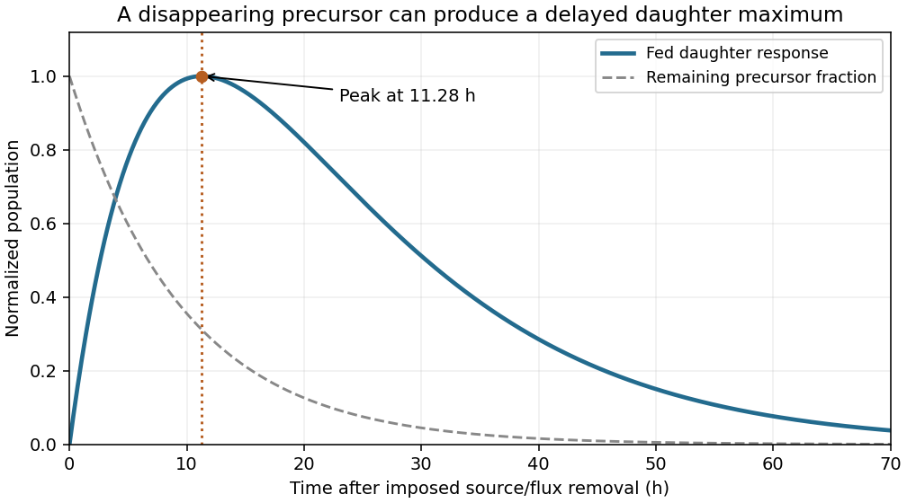

<h1 id="4/b/iii/solution">Solution</h1>

↑ **Parent:** [Iii](../iii.md)

**The approximate population peaks about $11.3\ \mathrm h$ after flux removal.** Differentiate the preceding difference of exponentials. The stationary condition is

$$
-\lambda_Ie^{-\lambda_It}+\lambda_Xe^{-\lambda_Xt}=0,
$$

so for distinct [nuclear decay constants](../../../../../../nuclear-decay-constant.md),

$$
\boxed{
t_{\max}=\frac{\ln(\lambda_I/\lambda_X)}{\lambda_I-\lambda_X}.
}
$$

Using hours consistently,

$$
\lambda_I=\frac{\ln2}{6.7}=0.103455\ \mathrm{h^{-1}},
\qquad
\lambda_X=\frac{\ln2}{9.2}=0.0753421\ \mathrm{h^{-1}},
$$

and therefore

$$
\boxed{t_{\max}=11.2794\ \mathrm h\simeq11.3\ \mathrm h.}
$$

The approximate population is positive for $t>0$, starts at zero, tends back to zero and has only this one stationary point, so it is a maximum.

**[Figure 2](#4/b/iii/image-normalized-precursor-fed-absorber-response-after-source-removal). Normalized precursor-fed absorber response after source removal**.

The delayed maximum corresponds to a delayed maximum in the magnitude of the absorber's negative contribution to [reactor reactivity](../../../../../../reactivity-nuclear-engineering.md), within the fixed model. It does not determine a permissible restart time, which would require information absent here. The estimate also inherits the high-flux initial-population approximation of part (ii); the exact solution can peak at a different time when that approximation is unsuitable.

## ↑ Ancestors (11)

1. [Iii](../iii.md)
2. [B](../../b.md)
3. [4](../../../4.md)
4. [Module NE1](../../../../paper-ne1-split.md)
5. [2019](../../../../split.md)
6. [Past exam of the MPhil in nuclear energy course of the University of Cambridge](../../../../../split.md)
7. [MPhil in nuclear energy course of the University of Cambridge](../../../../../../mphil-in-nuclear-energy-course-of-the-university-of-cambridge.md)
8. [Course of the University of Cambridge](../../../../../../course-of-the-university-of-cambridge.md)
9. [University of Cambridge](../../../../../../university-of-cambridge-split.md)
10. [List of universities](../../../../../../list-of-universities.md)
11. [Codex Wiki](../../../../../../split.md)
