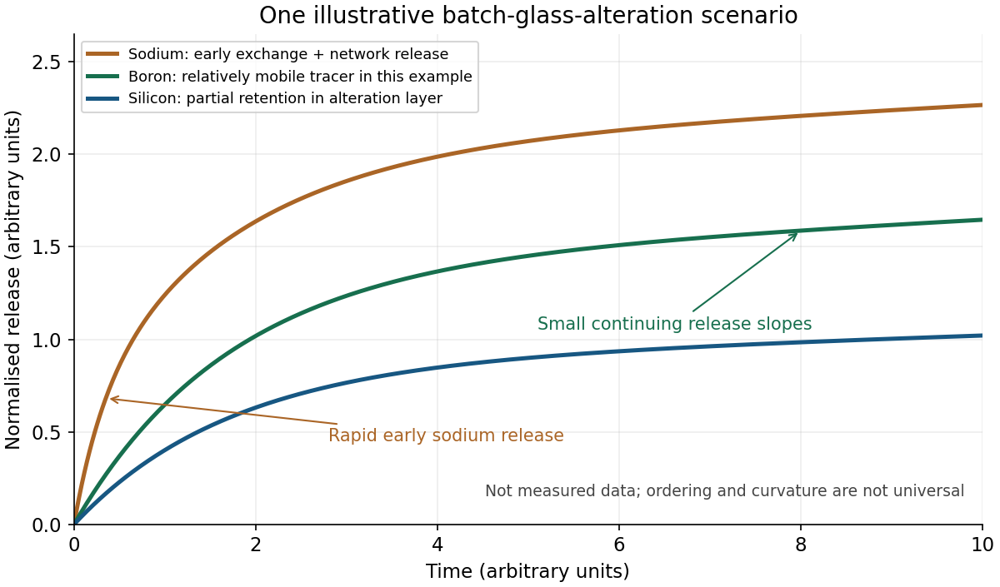

<h1 id="4/c/solution">Solution</h1>

↑ **Parent:** [C](../c.md)

[water](../../../../../water.md) first interacts with accessible surface sites and enters the near-surface region. Exchange of alkali ions with hydrogen-bearing species can release [sodium](../../../../../sodium.md) before the silicate network has dissolved in bulk. A schematic site exchange is

$$
\mathrm{\equiv SiO^-Na^+}+\mathrm{H^+}\longrightarrow\mathrm{\equiv SiOH}+\mathrm{Na^+}.
$$

[hydrolysis](../../../../../hydrolysis.md) also breaks network linkages, illustrated by

$$
\mathrm{\equiv Si-O-Si\equiv}+\mathrm{H_2O}
\rightleftharpoons2\,\mathrm{\equiv SiOH}.
$$

Boron-containing linkages and the rest of the network react in a composition- and pH-dependent way. Alkali exchange changes the [water](../../../../../water.md) chemistry, and network [hydrolysis](../../../../../hydrolysis.md) releases or rearranges constituents rather than simply removing an intact molecular [glass](../../../../../glass.md) unit.

In a finite batch of initially deionised [water](../../../../../water.md), dissolved products accumulate and [pH](../../../../../ph.md) evolves. [silicon](../../../../../silicon.md) can be retained in a hydrated alteration gel, and condensation or restructuring changes that layer's connectivity and transport properties. Reduced chemical driving force and a less permeable interfacial layer can lower the rate; a [residual glass alteration rate](../../../../../residual-glass-alteration-rate.md) can persist rather than all reaction stopping at an apparent plateau. Atomistic work published before the examination provides one account of how gel restructuring can hinder hydrated-species transport, without making that account universal for all [glasses](../../../../../glass.md).[npj Materials Degradation 3, 6, 7 February 2019; hydrated-gel restructuring and transport simulations](../../../../../atomistic-origin-of-the-passivation-effect-in-hydrated-silicate-glasses-by-tao-du-and-others.md)

**[Figure 1](#4/c/image-illustrative-normalised-sodium-boron-and-silicon-releases-in-one-batch-glass-alteration-scenario). Illustrative normalised sodium, boron and silicon releases in one batch-glass-alteration scenario**.

The original sketch shows **one plausible scenario, not measured data or a universal ordering**. [sodium](../../../../../sodium.md) initially rises rapidly through exchange. [boron](../../../../../boron.md) acts as a relatively mobile tracer of network alteration, while a smaller solution [silicon](../../../../../silicon.md) release reflects retention in an alteration layer. The slopes subsequently decrease as batch chemistry and the layer evolve; small continuing slopes represent residual release. Offsets can remain even if later release rates become similar. Initial deionised [water](../../../../../water.md) does not imply that the solution remains neutral or dilute throughout the test.

[boron](../../../../../boron.md) need not be an ideal fully released tracer: it can be retained in some gels, changing the relation between aqueous [boron](../../../../../boron.md) and the depth of alteration. A later study, published in **2020**, explicitly compared solution release with solid depth profiles and demonstrated that limitation; it is cited as a subsequent qualification, not evidence available to a student in May 2019.[npj Materials Degradation 4, 41, 11 December 2020; results comparing boron release with alteration-layer profiles](../../../../../insights-into-the-mechanisms-controlling-the-residual-corrosion-rate-of-borosilicate-glasses-by-stephane-gin-and-others.md)

Secondary phases can further modify dissolved inventories and, by consuming solution components, sometimes accelerate alteration again. Neither a permanently flat terminal curve nor a later acceleration is compulsory. Without a specified [glass](../../../../../glass.md), [temperature](../../../../../temperature-split.md), area/volume ratio and solution history, the defensible sketch communicates exchange, network reaction and evolving retention, with those assumptions stated.

## ↑ Ancestors (10)

1. [C](../c.md)
2. [4](../../4.md)
3. [Module NE4](../../../paper-ne4-split.md)
4. [2019](../../../split.md)
5. [Past exam of the MPhil in nuclear energy course of the University of Cambridge](../../../../split.md)
6. [MPhil in nuclear energy course of the University of Cambridge](../../../../../mphil-in-nuclear-energy-course-of-the-university-of-cambridge.md)
7. [Course of the University of Cambridge](../../../../../course-of-the-university-of-cambridge.md)
8. [University of Cambridge](../../../../../university-of-cambridge-split.md)
9. [List of universities](../../../../../list-of-universities.md)
10. [Codex Wiki](../../../../../split.md)
