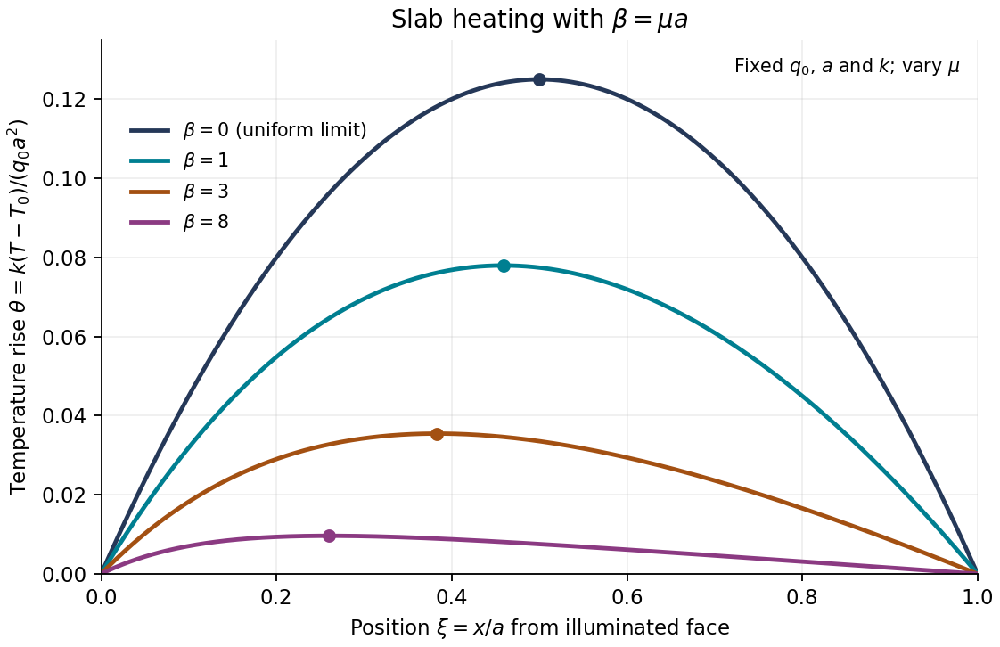

<h1 id="1/b/solution">Solution</h1>

↑ **Parent:** [B](../b.md)

At the maximum found in part(a), $e^{-\mu x_m}=C$ and $(1-e^{-\beta})x_m/a=C\mu x_m=-C\ln C$. Substitution into the [exponential slab heating](../../../../../slab-conduction-with-exponentially-decaying-heat-generation.md) solution gives

$$
\boxed{T_{\max}-T_0=\frac{q_0}{k\mu^2}\left(1-C+C\ln C\right),
\qquad C=\frac{1-e^{-\mu a}}{\mu a}.}
$$

For $0<C<1$, the function $1-C+C\ln C$ is positive: it vanishes at $C=1$ and has derivative $\ln C<0$. Thus the interior [temperature](../../../../../temperature-split.md) exceeds the common surface [temperature](../../../../../temperature-split.md), consistently with positive internal heating.

A convenient dimensionless form uses $\xi=x/a$:

$$
\theta(\xi)=\frac{k(T-T_0)}{q_0a^2}
=\frac{1-e^{-\beta\xi}-(1-e^{-\beta})\xi}{\beta^2}.
$$

As $\beta\to0$, $\theta\to\xi(1-\xi)/2$, giving the check

$$
\boxed{T_{\max}-T_0\longrightarrow\frac{q_0a^2}{8k}.}
$$

**[Figure 1](#1/b/image-original-normalized-slab-temperature-profiles-calculated-from-the-exponential-slab-heating-solution-markers-indicate-the-maxima). Original normalized slab temperature profiles calculated from the exponential slab heating solution; markers indicate the maxima**.

The graph holds the normalization $q_0a^2/k$ fixed. Its decreasing peaks with increasing $\beta$ reflect a decreasing source away from the illuminated face under that comparison; they do not assert the same trend at fixed total absorbed power.

## ↑ Ancestors (10)

1. [B](../b.md)
2. [1](../../1.md)
3. [Module NE2](../../../paper-ne2-split.md)
4. [2020](../../../split.md)
5. [Past exam of the MPhil in nuclear energy course of the University of Cambridge](../../../../split.md)
6. [MPhil in nuclear energy course of the University of Cambridge](../../../../../mphil-in-nuclear-energy-course-of-the-university-of-cambridge.md)
7. [Course of the University of Cambridge](../../../../../course-of-the-university-of-cambridge.md)
8. [University of Cambridge](../../../../../university-of-cambridge-split.md)
9. [List of universities](../../../../../list-of-universities.md)
10. [Codex Wiki](../../../../../split.md)
