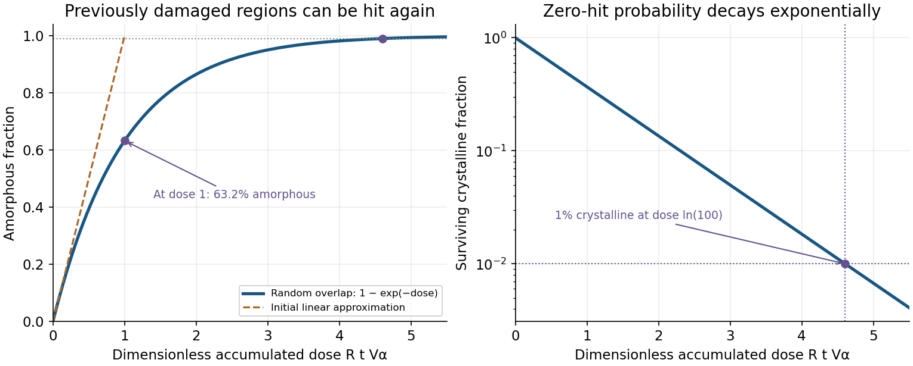

<h1 id="2/b/solution">Solution</h1>

↑ **Parent:** [B](../b.md)

Consider a representative bulk volume $\mathcal V$ and let $f_a(t)$ be its [amorphous fraction](../../../../../amorphous-fraction.md). With [alpha-decay event rate density](../../../../../alpha-decay-event-rate-density.md) $R$, during $dt$ the expected number of independent [alpha decay](../../../../../alpha-decay.md) events is $R\mathcal V\,dt$. Each produces [effective amorphization volume per decay](../../../../../effective-amorphization-volume-per-decay.md) $V_\alpha$, but only the fraction $1-f_a$ of a randomly placed damage region was previously crystalline. The expected _new_ amorphous volume is therefore

$$
d(f_a\mathcal V)=R\mathcal V\,dt\;V_\alpha(1-f_a).
$$

Dividing by $\mathcal V\,dt$ gives

$$
\frac{df_a}{dt}=RV_\alpha(1-f_a),\qquad f_a(0)=0.
$$

Separate variables and integrate:

$$
\int_0^{f_a}\frac{df}{1-f}=V_\alpha\int_0^tR\,ds,
\qquad -\ln(1-f_a)=RV_\alpha t.
$$

Hence, with [cumulative alpha-decay event density](../../../../../cumulative-alpha-decay-event-density.md) $D=Rt$,

$$
\boxed{f_a(D)=1-e^{-DV_\alpha}=1-e^{-RtV_\alpha}}.
$$

The product $RtV_\alpha$ is dimensionless: events per cubic metre accumulated over time multiply cubic metres damaged per event. Here “dose” is an **event density**, not an absorbed energy per kilogram.

An independent [probability](../../../../../probability.md) interpretation reaches the same result. A particular point is covered by a number of random damage events with a [Poisson distribution](../../../../../poisson-distribution.md) of mean $DV_\alpha$. Its [probability](../../../../../probability.md) of remaining crystalline is the zero-hit [probability](../../../../../probability.md) $e^{-DV_\alpha}$; the complementary fraction has been hit at least once. Overlapping events do not create a second copy of already amorphous material.

**[Figure 1](#2/b/image-direct-impact-amorphization-as-a-function-of-dimensionless-accumulated-alpha-decay-dose). Direct-impact amorphization as a function of dimensionless accumulated alpha-decay dose**.

At small dose, $f_a\simeq DV_\alpha$; at larger dose, overlap bends the curve towards one. For example, $DV_\alpha=1$ gives $f_a=0.6321$, not full [radiation-induced amorphization](../../../../../radiation-induced-amorphization.md), and $f_a=0.99$ requires $DV_\alpha=\ln100=4.6052$.

The derivation assumes a homogeneous, initially crystalline material; independent random event locations; one-event [radiation-induced amorphization](../../../../../radiation-induced-amorphization.md) of a fixed effective volume; and no recovery of that volume. It is the direct-impact model, not a model requiring several prior hits to cross a damage threshold. If $R$ varies while $V_\alpha$ stays fixed, replace $Rt$ by $\int_0^tR(s)\,ds$. If [annealing](../../../../../annealing-materials-science.md), material evolution or spatially correlated [actinide](../../../../../actinide.md) distributions matter, this simple law need not hold. The subscript on $V_\alpha$ indexes an **[alpha decay](../../../../../alpha-decay.md) event**: it does not require the emitted [alpha particle](../../../../../alpha-particle.md) itself to produce the damaged volume.

## ↑ Ancestors (10)

1. [B](../b.md)
2. [2](../../2.md)
3. [Module NE4](../../../paper-ne4-split.md)
4. [2020](../../../split.md)
5. [Past exam of the MPhil in nuclear energy course of the University of Cambridge](../../../../split.md)
6. [MPhil in nuclear energy course of the University of Cambridge](../../../../../mphil-in-nuclear-energy-course-of-the-university-of-cambridge.md)
7. [Course of the University of Cambridge](../../../../../course-of-the-university-of-cambridge.md)
8. [University of Cambridge](../../../../../university-of-cambridge-split.md)
9. [List of universities](../../../../../list-of-universities.md)
10. [Codex Wiki](../../../../../split.md)
