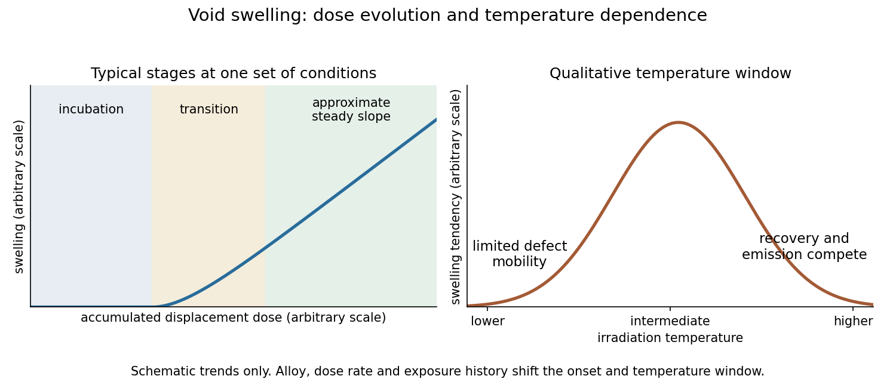

<h1 id="2/a/solution">Solution</h1>

↑ **Parent:** [A](../a.md)

At low accumulated [displacements per atom](../../../../../displacements-per-atom.md), a stainless steel can undergo substantial microscopic damage while its macroscopic volume changes little. Irradiation-generated [vacancies](../../../../../vacancy.md) and [self-interstitials](../../../../../self-interstitial.md) recombine, reach [defect sinks](../../../../../defect-sink.md), or form small clusters and [dislocation loops](../../../../../dislocation-loop.md). These processes can harden the steel before a large population of growing cavities appears. Thus dimensional stability during this interval does not imply an undamaged [microstructure](../../../../../microstructure.md).

[Void swelling](../../../../../void-swelling.md) commonly has an incubation interval, a transition into appreciable swelling, and a later interval with an approximately steady swelling rate per unit dose. The transition reflects the evolution of both stable cavity nuclei and the competing sink population. Gas atoms can help stabilize small cavities, but a [vacancy](../../../../../vacancy.md) void need not be filled with high-pressure gas.

The driving imbalance is a [vacancy supersaturation](../../../../../vacancy-supersaturation.md). [Dislocations](../../../../../dislocation.md) generally capture interstitial defects more efficiently than [vacancies](../../../../../vacancy.md), giving an [interstitial bias](../../../../../interstitial-bias.md). Once stable voids exist, the resulting excess [vacancy](../../../../../vacancy.md) supply can enlarge them. Growing and evolving [dislocation](../../../../../dislocation.md) structures compete with the cavities for defects. A roughly steady balance can give an approximately linear volume increase with dose over part of the exposure range, rather than proving indefinite linear growth.

If cavities occupy a fraction $f$ of the current volume and the matrix volume is otherwise unchanged, the [void swelling volume fraction relation](../../../../../void-swelling-volume-fraction-relation.md) is

$$
S=\frac{\Delta V}{V_0}=\frac{f}{1-f}\simeq f\qquad(f\ll1).
$$

Since cavity volume scales as radius cubed, numerous tiny clusters and a smaller population of larger voids can have very different dimensional consequences.

The original [Cawthorne-Fulton observation of voids in irradiated steel](../../../../../cawthorne-fulton-observation-of-voids-in-irradiated-steel.md) used thin-foil [electron microscopy](../../../../../electron-microscopy.md) on type316 stainless steel exposed in the Dounreay Fast Reactor. It connected microscopic cavities with the dimensional-instability problem that had emerged during fast-reactor fuel development.[Opening description: irradiated fuel cladding and mechanical-test specimens examined by the thin-foil electron-microscope technique](../../../../../voids-in-irradiated-stainless-steel-by-c-cawthorne-and-e-j-fulton.md)

**[Figure 1](#2/a/image-original-schematic-of-incubation-growing-swelling-rate-and-approximate-steady-swelling-no-measured-steel-data-are-reproduced). Original schematic of incubation, growing swelling rate and approximate steady swelling; no measured steel data are reproduced**.

## ↑ Ancestors (10)

1. [A](../a.md)
2. [2](../../2.md)
3. [Module NE3](../../../paper-ne3-split.md)
4. [2021](../../../split.md)
5. [Past exam of the MPhil in nuclear energy course of the University of Cambridge](../../../../split.md)
6. [MPhil in nuclear energy course of the University of Cambridge](../../../../../mphil-in-nuclear-energy-course-of-the-university-of-cambridge.md)
7. [Course of the University of Cambridge](../../../../../course-of-the-university-of-cambridge.md)
8. [University of Cambridge](../../../../../university-of-cambridge-split.md)
9. [List of universities](../../../../../list-of-universities.md)
10. [Codex Wiki](../../../../../split.md)
