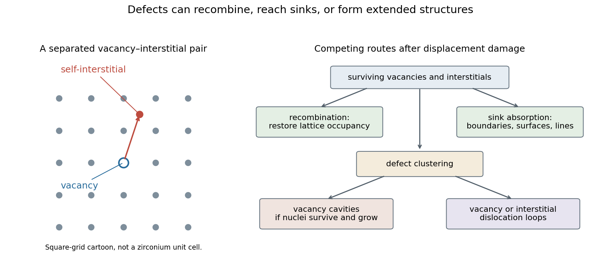

<h1 id="3/a/solution">Solution</h1>

↑ **Parent:** [A](../a.md)

An energetic neutron can collide with a lattice atom and create a [primary knock-on atom](../../../../../primary-knock-on-atom.md). That recoil transfers energy to other atoms in a [displacement cascade](../../../../../displacement-cascade.md). Some atoms leave their normal lattice sites, creating [Frenkel pairs](../../../../../frenkel-pair.md): a [vacancy](../../../../../vacancy.md) and an extra atom at an interstitial position.

Many nearby defects recombine during the cascade and its thermal relaxation. The surviving [point defects](../../../../../point-defect.md) are therefore fewer than a simple count of all displacement events. Some defects are already clustered within the cascade; others migrate and aggregate later.

A collection of [vacancies](../../../../../vacancy.md) can collapse into a platelet bounded by a vacancy-type [dislocation loop](../../../../../dislocation-loop.md). An aggregation of [self-interstitial](../../../../../self-interstitial.md) atoms can create an extra atomic platelet bounded by an interstitial-type [dislocation loop](../../../../../dislocation-loop.md). The boundary is a line defect because a circuit around it has a nonzero [Burgers vector](../../../../../burgers-vector.md). The allowed Burgers vectors and habit planes depend on the material's [crystal structure](../../../../../crystal-structure.md) and fault energies.

Loops can grow by absorbing mobile [point defects](../../../../../point-defect.md), shrink by emitting or absorbing the opposite defect type, and interact with existing [dislocations](../../../../../dislocation.md). Some remain faulted, while suitable loops can unfault or become part of a larger [dislocation](../../../../../dislocation.md) network. Repeated cascades and subsequent defect transport therefore create a population of extended defects even in material with a low initial [dislocation density](../../../../../dislocation-density.md).

This describes the main displacement-damage mechanism. Ionizing energy deposited in a material does not automatically create the same defect population as a neutron recoil cascade; recoil spectrum, displacement thresholds and material response matter.

**[Figure 2](#3/a/image-original-schematic-of-a-displaced-atom-a-frenkel-pair-and-the-competing-pathways-to-recombination-sinks-loops-and-voids). Original schematic of a displaced atom, a Frenkel pair, and the competing pathways to recombination, sinks, loops and voids**.

## ↑ Ancestors (10)

1. [A](../a.md)
2. [3](../../3.md)
3. [Module NE3](../../../paper-ne3-split.md)
4. [2021](../../../split.md)
5. [Past exam of the MPhil in nuclear energy course of the University of Cambridge](../../../../split.md)
6. [MPhil in nuclear energy course of the University of Cambridge](../../../../../mphil-in-nuclear-energy-course-of-the-university-of-cambridge.md)
7. [Course of the University of Cambridge](../../../../../course-of-the-university-of-cambridge.md)
8. [University of Cambridge](../../../../../university-of-cambridge-split.md)
9. [List of universities](../../../../../list-of-universities.md)
10. [Codex Wiki](../../../../../split.md)
