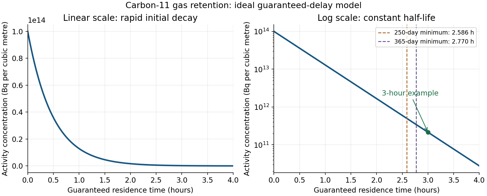

<h1 id="2/b/solution">Solution</h1>

↑ **Parent:** [B](../b.md)

The useful mechanism is [radioactive decay](../../../../../radioactive-decay.md) during retention, not chemical destruction of [carbon dioxide](../../../../../carbon-dioxide.md). With the time in seconds,

$$
\lambda=\frac{\ln 2}{20.3(60)}=5.69086\times10^{-4} \mathrm{s^{-1}},\qquad
a(t)=10^{14}e^{-\lambda t} \mathrm{Bq\,m^{-3}}.
$$

Here $a$ is a [radioactive activity concentration](../../../../../radioactive-activity-concentration.md); the supplied units are per volume rather than per mass. The original plot follows this [concentration](../../../../../concentration.md) over four hours.

**[Figure 1](#2/b/image-carbon-11-activity-concentration-during-ideal-radioactive-gas-holdup). Carbon-11 activity concentration during ideal radioactive gas holdup**.

A practical illustrative choice is **a three-hour guaranteed [residence time](../../../../../residence-time.md)**, at which $a/a_0=0.00214175$, giving about a factor $467$ reduction. On a plug-flow basis, the carbon-dioxide-equivalent hold-up volume is

$$
V_{\mathrm{CO_2}}=Q\tau=(3.7\times10^{-7})(3\times3600)=\boxed{3.996\times10^{-3} \mathrm{m^3}=4.00 \mathrm L}.
$$

Use a contained delay line or a validated retention arrangement that prevents early breakthrough, followed by monitored discharge. A retention bed could instead hold the radioactive [carbon dioxide](../../../../../carbon-dioxide.md), but its capacity and breakthrough performance would have to be established. Gas retention and monitored discharge are waste-treatment functions, independent of the eventual use of the [isotope](../../../../../isotope.md).[SSG-40, section 6, gaseous-waste treatment and selection of decay devices](../../../../../predisposal-management-of-radioactive-waste-from-nuclear-power-plants-and-research-reactors-by-the-international-atomic-energy-agency.md)

**The $4.00$ L result is a flow-delay volume, not a fill-and-immediately-dump tank specification.** It credits [radioactive decay](../../../../../radioactive-decay.md) during the guaranteed transit time and no subsequent storage after discharge from the delay system. Gas entering a filling tank near the end of filling has not aged for the entire filling time. For a literal tank filled for $T$ and immediately emptied, the [radioactive activity](../../../../../radioactive-activity.md) at emptying is instead

$$
A_{\rm fill}(T)=\int_0^T a_0Qe^{-\lambda(T-s)}\,ds=\frac{a_0Q}{\lambda}(1-e^{-\lambda T}).
$$

That alternative must not be analysed by multiplying the whole collected inventory by $e^{-\lambda T}$. If “no post filling [radioactive decay](../../../../../radioactive-decay.md)” is intended to prescribe this literal fill-and-dump arrangement, the three-hour calculation does not establish compliance for it.

The [nitrogen](../../../../../nitrogen.md) fraction is also unspecified. If $y$ is the [carbon dioxide](../../../../../carbon-dioxide.md) volume fraction at the stated volume reference conditions, a gas delay line requires $V_{\rm mixture}=V_{\mathrm{CO_2}}/y$, not necessarily $4.00$ L of physical vessel volume. The graph alone does not define a unique optimum: a cost objective, operating calendar and residence-time model are needed. Parts (c) and (d) quantify the discharge constraint for the stated guaranteed-delay design.

## ↑ Ancestors (10)

1. [B](../b.md)
2. [2](../../2.md)
3. [Module NE4](../../../paper-ne4-split.md)
4. [2021](../../../split.md)
5. [Past exam of the MPhil in nuclear energy course of the University of Cambridge](../../../../split.md)
6. [MPhil in nuclear energy course of the University of Cambridge](../../../../../mphil-in-nuclear-energy-course-of-the-university-of-cambridge.md)
7. [Course of the University of Cambridge](../../../../../course-of-the-university-of-cambridge.md)
8. [University of Cambridge](../../../../../university-of-cambridge-split.md)
9. [List of universities](../../../../../list-of-universities.md)
10. [Codex Wiki](../../../../../split.md)
