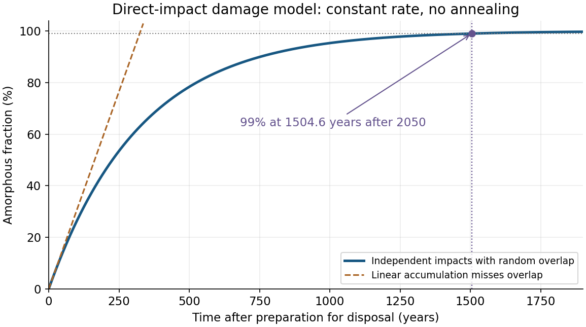

<h1 id="3/d/solution">Solution</h1>

↑ **Parent:** [D](../d.md)

Let $c(t)$ be the fraction still crystalline. Under the [direct-impact amorphization model](../../../../../direct-impact-amorphization-model.md), damage events occur randomly and independently; an event striking already amorphous material does not create that much additional amorphous volume. Only the crystalline fraction can be newly converted, so

$$
\frac{dc}{dt}=-Rvc,\qquad c(0)=1,\qquad f_a(t)=1-c(t)=1-e^{-Rvt}.
$$

The product of the given event rate density and damage volume has units of inverse time:

$$
k=Rv=(5.685\times10^{14})(1.706\times10^{-25})
=9.69861\times10^{-11} \mathrm{s^{-1}}.
$$

For $99\%$ [radiation-induced amorphization](../../../../../radiation-induced-amorphization.md), $c=0.01$, giving

$$
t_{99}=\frac{-\ln(0.01)}{k}=4.74828\times10^{10} \mathrm s
=\boxed{1504.64 \mathrm{yr}}.
$$

Using $365.25$ days per year, the corresponding calendar date is **approximately 3555 CE**, measured from disposal preparation in 2050.

**[Figure 2](#3/d/image-random-overlap-prediction-for-radiation-induced-amorphization-of-the-waste-form). Random-overlap prediction for radiation-induced amorphization of the waste form**.

A linear estimate $f_a=Rvt$ misses repeated hits to already damaged regions and therefore predicts too rapid an approach to $99\%$. The [exponential function](../../../../../exponential-function.md) model never reaches exactly $100\%$ in finite time. Its assumptions include constant dose rate, fixed effective damage volume, no [annealing](../../../../../annealing-materials-science.md) and no spatial correlation of damage. Actual [alpha decay](../../../../../alpha-decay.md) generates recoil damage as well as the [alpha particle](../../../../../alpha-particle.md)'s track; the stated damage volume must be understood as the effective volume per [radioactive decay](../../../../../radioactive-decay.md) for the chosen model.

**Amorphous is not synonymous with dissolved or failed containment.** Radiation damage can change swelling, connected [porosity](../../../../../porosity.md) and leach behaviour, so testing must compare structural evolution with element release. Accelerated self-irradiation and parallel dissolution measurements are useful precisely because crystallinity alone is not the performance endpoint.[1994 primary conference abstract, accelerated self-irradiation and parallel aqueous-dissolution investigations](../../../../../jaeri-ansto-co-operative-research-on-radiation-damage-and-actinide-behaviour-in-synroc-by-s-muraoka-and-others.md)

## ↑ Ancestors (10)

1. [D](../d.md)
2. [3](../../3.md)
3. [Module NE4](../../../paper-ne4-split.md)
4. [2021](../../../split.md)
5. [Past exam of the MPhil in nuclear energy course of the University of Cambridge](../../../../split.md)
6. [MPhil in nuclear energy course of the University of Cambridge](../../../../../mphil-in-nuclear-energy-course-of-the-university-of-cambridge.md)
7. [Course of the University of Cambridge](../../../../../course-of-the-university-of-cambridge.md)
8. [University of Cambridge](../../../../../university-of-cambridge-split.md)
9. [List of universities](../../../../../list-of-universities.md)
10. [Codex Wiki](../../../../../split.md)
