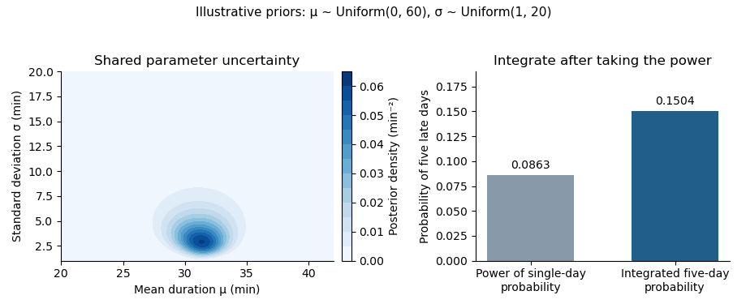

# Bayesian statistical probabilistic programming

↑ **Parent:** [2021](../2021.md)

Solutions to the single paper shared by the two printed routes, dated 8 June 2021. [Oxford examination source release](https://www.whatdotheyknow.com/request/ba_computer_science_past_papers/response/2577745/attach/2/202402%20183%20CS%20Papers.zip?cookie_passthrough=1). The [probabilistic programming](../../programming-language.md#probabilistic-programming) calculations below use only information supplied in the paper. Question 2 contains two notation or naming issues, identified at the affected parts; Question 3 requires an explicit choice of [prior distribution](../../bayesian-statistics.md#prior-probability).

**Table of contents**

- [1](#1)
  - [a](#1/a)
    - [Solution](#1/a/solution)
  - [b](#1/b)
    - [Solution](#1/b/solution)
  - [c](#1/c)
    - [Solution](#1/c/solution)
  - [d](#1/d)
    - [Solution](#1/d/solution)
  - [e](#1/e)
    - [Solution](#1/e/solution)
  - [f](#1/f)
    - [Solution](#1/f/solution)
- [2](#2)
  - [a](#2/a)
    - [Solution](#2/a/solution)
  - [b](#2/b)
    - [Solution](#2/b/solution)
  - [c](#2/c)
    - [Solution](#2/c/solution)
  - [d](#2/d)
    - [Solution](#2/d/solution)
- [3](#3)
  - [a](#3/a)
    - [Solution](#3/a/solution)
  - [b](#3/b)
    - [Solution](#3/b/solution)
  - [c](#3/c)
    - [Solution](#3/c/solution)
  - [d](#3/d)
    - [Solution](#3/d/solution)
  - [e](#3/e)
    - [Solution](#3/e/solution)

## 1

↑ **Parent:** [Bayesian statistical probabilistic programming](bayesian-statistical-probabilistic-programming.md)

<h3 id="1/a">a</h3>

↑ **Parent:** [1](#1)

<h4 id="1/a/solution">Solution</h4>

↑ **Parent:** [A](#1/a)

Assume $0<Z=\sum_xr(x)<\infty$, and work on the [support](../../function.md#support) $S=\{x:r(x)>0\}$. In [rejection sampling](../../monte-carlo-method.md#rejection-sampling), choose a normalized proposal [probability mass function](../../probability-distribution.md#probability-mass-function) $g$ and a known finite constant $M$ satisfying $r(x)\leq Mg(x)$ everywhere. Draw [independent random variables](../../random-variable.md#independent-random-variables) $Y\sim g$ and $U\sim\operatorname{Unif}(0,1)$, accepting $Y$ when $U\leq r(Y)/(Mg(Y))$. The joint [probability](../../probability-theory.md#probability) of proposing and accepting $x$ is $r(x)/M$, so the overall acceptance [probability](../../probability-theory.md#probability) is $Z/M$ and the accepted value has [probability mass function](../../probability-distribution.md#probability-mass-function) $r(x)/Z$. Fresh trials therefore produce [independent and identically distributed random variables](../../random-variable.md#independent-and-identically-distributed-random-variables) with the desired [probability distribution](../../probability-distribution.md). For a fixed positive number $N$ of accepted values, the sample average $N^{-1}\sum_{i=1}^Nf(Y_i)$ is an [unbiased estimator](../../statistical-modelling.md#unbiased-estimator) of the [expectation](../../expected-value.md) when that [expectation](../../expected-value.md) is finite. Its [variance](../../variance.md) is $\operatorname{Var}_p(f)/N$ if the second moment is finite. Finding a valid envelope can be difficult, and a small acceptance [probability](../../probability-theory.md#probability) makes the method expensive.

For the [Metropolis–Hastings algorithm](../../bayesian-statistics.md#metropolis-hastings-algorithm), choose a proposal [transition matrix](../../markov-chain.md#stochastic-matrix) $q$ and, at the current state $x$, propose $y\sim q(x,\cdot)$. Accept with the [Metropolis–Hastings acceptance probability](../../bayesian-statistics.md#metropolis-hastings-acceptance-probability)

$$
\alpha(x,y)=\min\left\{1,\frac{r(y)q(y,x)}{r(x)q(x,y)}\right\}.
$$

A proposal outside $S$ is rejected; an impossible proposal need not be assigned a ratio. Otherwise remain at $x$. This constructs a [Markov chain](../../markov-chain.md) satisfying [detailed balance](../../markov-chain.md#detailed-balance) with $p$, without computing $Z$ or a global envelope. Estimate the [expectation](../../expected-value.md) by averaging $f(X_i)$ over iterations, **including repeated states after rejections**. Keeping only accepted jumps generally changes the [stationary distribution](../../markov-chain.md#stationary-distribution) of the recorded process.

The [Metropolis–Hastings algorithm](../../bayesian-statistics.md#metropolis-hastings-algorithm) produces dependent samples, so the [variance](../../variance.md) of its average includes [autocovariances](../../time-series.md#autocovariance); starting outside [stationarity](../../time-series.md#stationary-process) can also cause finite-run [bias](../../statistical-modelling.md#bias-of-an-estimator). With [Markov chain irreducibility](../../markov-chain.md#irreducible-markov-chain), suitable recurrence and an integrable $f$, the [countable-state Markov chain ergodic theorem](../../markov-chain.md#countable-state-markov-chain-ergodic-theorem) gives consistency. [Aperiodicity](../../markov-chain.md#aperiodic-markov-chain) is additionally needed for the usual convergence of one-time [probability distributions](../../probability-distribution.md). In contrast, accepted [rejection sampling](../../monte-carlo-method.md#rejection-sampling) values need no initial transient. Neither method is universally faster: envelope rejection competes with the proposal quality and [mixing time](../../markov-chain.md#mixing-time-of-a-markov-chain) of the [Markov chain](../../markov-chain.md). Nonnegativity of $f$ alone does not guarantee a finite [expectation](../../expected-value.md) or [variance](../../variance.md).

<h3 id="1/b">b</h3>

↑ **Parent:** [1](#1)

<h4 id="1/b/solution">Solution</h4>

↑ **Parent:** [B](#1/b)

Here $q(x,y)=p(y)$, with fresh proposal randomness independent of the past. For $x,y\in S$, the [Metropolis–Hastings acceptance probability](../../bayesian-statistics.md#metropolis-hastings-acceptance-probability) is

$$
\alpha(x,y)=\min\left\{1,\frac{p(y)p(x)}{p(x)p(y)}\right\}=1.
$$

Thus $P(x,y)=p(y)$ is independent of $x$, and $X_1,\ldots,X_N$ are [independent and identically distributed random variables](../../random-variable.md#independent-and-identically-distributed-random-variables) with [probability distribution](../../probability-distribution.md) $p$, even if $X_0$ was chosen arbitrarily in $S$. **The method becomes ordinary [Monte Carlo method](../../monte-carlo-method.md) sampling from $p$.** The average of $f(X_1),\ldots,f(X_N)$ is an [unbiased estimator](../../statistical-modelling.md#unbiased-estimator), with the [variance](../../variance.md) stated in part (a). Including an arbitrary initial state would spoil this finite-sample property. This is the [independent stationary proposal lemma](../../bayesian-statistics.md#independent-stationary-proposal-lemma).

<h3 id="1/c">c</h3>

↑ **Parent:** [1](#1)

<h4 id="1/c/solution">Solution</h4>

↑ **Parent:** [C](#1/c)

**Neither [Markov chain irreducibility](../../markov-chain.md#irreducible-markov-chain) nor fast convergence follows from [detailed balance](../../markov-chain.md#detailed-balance).** On two states, the identity [transition matrix](../../markov-chain.md#stochastic-matrix) satisfies [detailed balance](../../markov-chain.md#detailed-balance) for the uniform [probability distribution](../../probability-distribution.md), but neither state can reach the other.

Even after imposing [Markov chain irreducibility](../../markov-chain.md#irreducible-markov-chain) and [aperiodicity](../../markov-chain.md#aperiodic-markov-chain), consider

$$
P_\varepsilon=\begin{pmatrix}1-\varepsilon&\varepsilon\\\varepsilon&1-\varepsilon\end{pmatrix},\qquad 0<\varepsilon<\tfrac12.
$$

It satisfies [detailed balance](../../markov-chain.md#detailed-balance) for $\pi=(1/2,1/2)$. Its nontrivial [eigenvalue](../../linear-operator-theory.md#eigenvalue) is $1-2\varepsilon$, and, from state zero, its [total variation distance](../../probability-and-statistics.md#total-variation-distance) from $\pi$ after $n$ steps is $\tfrac12(1-2\varepsilon)^n$. This approaches zero arbitrarily slowly as $\varepsilon$ decreases. [Detailed balance without rapid convergence](../../markov-chain.md#detailed-balance-without-rapid-convergence) separates correctness of a [stationary distribution](../../markov-chain.md#stationary-distribution) from reachability and speed.

<h3 id="1/d">d</h3>

↑ **Parent:** [1](#1)

<h4 id="1/d/solution">Solution</h4>

↑ **Parent:** [D](#1/d)

Put $a=p(x)q(x,y)$ and $b=p(y)q(y,x)$. For $a+b>0$, the off-diagonal [probability](../../probability-theory.md#probability) flux of the proposed rule is

$$
p(x)q(x,y)\beta(x,y)=a\frac{b}{a+b}=\frac{ab}{a+b}=b\frac{a}{a+b}=p(y)q(y,x)\beta(y,x).
$$

If $a=b=0$, define both acceptance [probabilities](../../probability-theory.md#probability) to be zero; both fluxes are zero. The diagonal [detailed balance equations](../../markov-chain.md#detailed-balance) hold automatically, including the [probability](../../probability-theory.md#probability) of rejected proposals. Summing the [detailed balance equations](../../markov-chain.md#detailed-balance) over $x$ gives [stationarity](../../time-series.md#stationary-process):

$$
\sum_xp(x)P(x,y)=\sum_xp(y)P(y,x)=p(y).
$$

**The alternative rule therefore preserves $p$.** The unknown [normalizing constant](../../continuous-probability-distribution.md#normalizing-constant) cancels after replacing $p$ by $r$. This [Barker acceptance probability](../../bayesian-statistics.md#barker-acceptance-probability) is no larger than the [Metropolis–Hastings acceptance probability](../../bayesian-statistics.md#metropolis-hastings-acceptance-probability) for the same proposed move: if $t=b/a>0$, then $t/(1+t)\leq\min(1,t)$. Preservation of $p$ still requires separate [Markov chain irreducibility](../../markov-chain.md#irreducible-markov-chain) and convergence checks before it guarantees useful sampling.

<h3 id="1/e">e</h3>

↑ **Parent:** [1](#1)

<h4 id="1/e/solution">Solution</h4>

↑ **Parent:** [E](#1/e)

Use the [Poisson distribution](../../discrete-probability-distribution.md#poisson-distribution) with [probability mass function](../../probability-distribution.md#probability-mass-function) $\pi_n=e^{-\lambda}\lambda^n/n!$ on $\mathbb N_0$. A symmetric nearest-neighbour proposal with a reflecting boundary is

$$
q(n,n+1)=\tfrac12\quad(n\geq0),\qquad q(n,n-1)=\tfrac12\quad(n\geq1),\qquad q(0,0)=\tfrac12.
$$

All other entries vanish. In particular, the boundary proposal does not force a move to one: retaining the [probability](../../probability-theory.md#probability) $q(0,0)=1/2$ makes $q(0,1)=q(1,0)$.

The adjacent ratios of the [Poisson distribution](../../discrete-probability-distribution.md#poisson-distribution) are $\pi_{n+1}/\pi_n=\lambda/(n+1)$ and $\pi_{n-1}/\pi_n=n/\lambda$. The [Metropolis–Hastings acceptance probability](../../bayesian-statistics.md#metropolis-hastings-acceptance-probability) consequently gives

$$
u_n=\tfrac12\min\{1,\lambda/(n+1)\},\qquad d_n=\tfrac12\min\{1,n/\lambda\}\ (n\geq1),\qquad d_0=0,
$$

where the symbol $u_n$ denotes the upward [transition probability](../../markov-chain.md#transition-probability). Thus the complete [transition matrix](../../markov-chain.md#stochastic-matrix) is

$$
\boxed{P(n,n+1)=u_n,\quad P(n,n-1)=d_n,\quad P(n,n)=1-u_n-d_n,}
$$

with no downward entry at zero and all other entries zero. In matrix form,

$$
P=\begin{pmatrix}
1-u_0&u_0&0&0&\cdots\\
d_1&1-u_1-d_1&u_1&0&\cdots\\
0&d_2&1-u_2-d_2&u_2&\cdots\\
\vdots&\vdots&\ddots&\ddots&\ddots
\end{pmatrix}.
$$

Every row is nonnegative and sums to one. An executable [Python](../../programming-language.md#python-programming-language) step of this [Poisson Metropolis chain](../../bayesian-statistics.md#poisson-metropolis-chain) is:

```
def poisson_step(n, lam, rng):
    if lam <= 0 or n < 0 or int(n) != n:
        raise ValueError("require lam > 0 and an integer n >= 0")
    y = n + 1 if rng.random() < 0.5 else max(0, n - 1)
    ratio = lam / (n + 1) if y > n else n / lam if y < n else 1.0
    return y if rng.random() < min(1.0, ratio) else n
```

Supply a [pseudorandom number generator](../../monte-carlo-method.md#pseudorandom-number-generator) such as `random.Random(2021)` and retain each returned state, including repeats. No [normalizing constant](../../continuous-probability-distribution.md#normalizing-constant) or evaluation of a [factorial](../../combinatorics.md#factorial) is needed by the algorithm.

<h3 id="1/f">f</h3>

↑ **Parent:** [1](#1)

<h4 id="1/f/solution">Solution</h4>

↑ **Parent:** [F](#1/f)

For each adjacent pair, the [detailed balance equations](../../markov-chain.md#detailed-balance) follows directly:

$$
\pi_nP(n,n+1)=\tfrac12\pi_n\min(1,\pi_{n+1}/\pi_n)=\tfrac12\min(\pi_n,\pi_{n+1})=\pi_{n+1}P(n+1,n).
$$

For nonadjacent distinct states both fluxes vanish, and diagonal fluxes agree trivially. Since $\sum_n\pi_n=e^{-\lambda}\sum_n\lambda^n/n!=1$, this is a genuine [stationary distribution](../../markov-chain.md#stationary-distribution), rather than merely an invariant measure of infinite mass.

Every upward and downward [transition probability](../../markov-chain.md#transition-probability) between neighbouring states is positive for $\lambda>0$. Any two states can therefore be joined by a finite path of positive [probability](../../probability-theory.md#probability): the [Markov chain](../../markov-chain.md) is [irreducible](../../representation-theory.md#irreducible-representation). Moreover,

$$
P(0,0)=1-\tfrac12\min(1,\lambda)\geq\tfrac12>0.
$$

State zero has period one; [Markov chain irreducibility](../../markov-chain.md#irreducible-markov-chain) makes every state [aperiodic](../../markov-chain.md#aperiodic-markov-chain). Finally, the standard countable-state recurrence theorem states that an [irreducible Markov chain](../../markov-chain.md#irreducible-markov-chain) admitting a [stationary distribution](../../markov-chain.md#stationary-distribution) of total mass one is [positive recurrent](../../markov-chain.md#positive-recurrent-markov-chain), with that [stationary distribution](../../markov-chain.md#stationary-distribution) unique. The [countable-state Markov chain convergence theorem](../../markov-chain.md#countable-state-markov-chain-convergence-theorem) then states that [Markov chain irreducibility](../../markov-chain.md#irreducible-markov-chain), [positive recurrence](../../markov-chain.md#positive-recurrent-markov-chain) and [aperiodicity](../../markov-chain.md#aperiodic-markov-chain) imply $P^k(i,j)\to\pi_j$ for all states $i,j$. The hypotheses just verified hold on the infinite [state space](../../dynamical-systems.md#state-space) $\mathbb N_0$, not merely on a numerical truncation.[Sections 1.7–1.8, invariant distributions and convergence to equilibrium](../../mathematics-bibliography.md#markov-chains-by-james-r-norris)

Consequently, **the unique [stationary distribution](../../markov-chain.md#stationary-distribution) and the [limiting distribution](../../convergence-of-random-variables.md#limiting-distribution) are both $\operatorname{Poisson}(\lambda)$**, from every initial state. The [countable-state Markov chain ergodic theorem](../../markov-chain.md#countable-state-markov-chain-ergodic-theorem) also gives $N^{-1}\sum_{k=1}^Nf(X_k)\to\sum_n\pi_nf(n)$ [almost surely](../../convergence-of-random-variables.md#almost-sure-convergence) whenever $\sum_n\pi_n|f(n)|<\infty$.[Section 1.10, ergodic theorem](../../mathematics-bibliography.md#markov-chains-by-james-r-norris)

## 2

↑ **Parent:** [Bayesian statistical probabilistic programming](bayesian-statistical-probabilistic-programming.md)

<h3 id="2/a">a</h3>

↑ **Parent:** [2](#2)

<h4 id="2/a/solution">Solution</h4>

↑ **Parent:** [A](#2/a)

[Variational inference](../../bayesian-statistics.md#variational-inference) replaces exact [Bayesian inference](../../bayesian-statistics.md) by an [optimization](../../mathematical-optimization.md) problem over a tractable family $q_\lambda(z)$. A [guide program](../../bayesian-statistics.md#guide-program) samples from this approximating family. Optimizing an [evidence lower bound](../../bayesian-statistics.md#evidence-lower-bound) is equivalent to minimizing $D_{\rm KL}(q_\lambda\Vert p(\cdot\mid x))$. Its appeal is that a fitted approximation can be cheap to sample and may scale well when an exact [posterior distribution](../../bayesian-statistics.md#bayesian-posterior) is inaccessible. A restricted family, such as [mean-field variational inference](../../bayesian-statistics.md#mean-field-variational-inference), can miss dependence or entire modes; a local optimum can add further error. More optimization cannot remove approximation error caused by an inadequate family.

[Monte Carlo method](../../monte-carlo-method.md) inference instead estimates posterior [expectations](../../expected-value.md) using simulated values or weighted values. Examples include [rejection sampling](../../monte-carlo-method.md#rejection-sampling), [importance sampling](../../monte-carlo-method.md#importance-sampling) and [Markov chain Monte Carlo](../../bayesian-statistics.md#markov-chain-monte-carlo). Under their respective support and convergence assumptions, increasing computation can yield consistent estimates without choosing a finite-dimensional posterior family. Their uncertainty includes simulation error; an inefficient proposal or slow [mixing time](../../markov-chain.md#mixing-time-of-a-markov-chain) can make that error large. [Markov chain Monte Carlo](../../bayesian-statistics.md#markov-chain-monte-carlo) additionally requires convergence and dependence diagnostics.

**The central trade-off is optimization within an approximate family versus simulation under a target [probability distribution](../../probability-distribution.md).** It is not an absolute distinction between deterministic and random computation: [variational inference](../../bayesian-statistics.md#variational-inference) often uses [Monte Carlo method](../../monte-carlo-method.md) estimates of its [gradient](../../multivariable-calculus.md#gradient), while [Monte Carlo method](../../monte-carlo-method.md) inference may use fitted proposals. Neither method automatically guarantees accurate uncertainty estimates or superiority at a fixed computational budget.

<h3 id="2/b">b</h3>

↑ **Parent:** [2](#2)

<h4 id="2/b/solution">Solution</h4>

↑ **Parent:** [B](#2/b)

Let $0<p(x)<\infty$, take $q_\lambda$ supported where $p(z,x)>0$, and assume the following [expectations](../../expected-value.md) exist. By the definition of [Kullback-Leibler divergence](../../f-divergence.md#kullback-leibler-divergence) and [Bayes' theorem](../../probability-theory.md#bayes-theorem),

$$
\begin{aligned}
D_{\rm KL}(q_\lambda\Vert p(\cdot\mid x))
&=\mathbb E_{q_\lambda}\left[\log q_\lambda(z)-\log\frac{p(z,x)}{p(x)}\right]\\
&=\log p(x)-\mathbb E_{q_\lambda}[\log p(z,x)-\log q_\lambda(z)].
\end{aligned}
$$

Therefore the [evidence lower bound](../../bayesian-statistics.md#evidence-lower-bound) is

$$
\boxed{\mathcal L(\lambda)=\mathbb E_{q_\lambda}[\log p(z,x)-\log q_\lambda(z)]=\log p(x)-D_{\rm KL}(q_\lambda\Vert p(\cdot\mid x)).}
$$

Nonnegativity of [Kullback-Leibler divergence](../../f-divergence.md#kullback-leibler-divergence) proves $\mathcal L(\lambda)\leq\log p(x)$. The [marginal likelihood](../../bayesian-statistics.md#bayesian-model-evidence) $p(x)$ is constant with respect to the variational parameter $\lambda$, so maximizing $\mathcal L$ minimizes the stated [Kullback-Leibler divergence](../../f-divergence.md#kullback-leibler-divergence).

The practical advantage is that evaluating [logarithms](../../calculus.md#logarithm) of joint [probabilities](../../probability-theory.md#probability) and $\log q_\lambda$ requires no evaluation of the usually intractable [marginal likelihood](../../bayesian-statistics.md#bayesian-model-evidence). One can estimate $\mathcal L$ and its [gradient](../../multivariable-calculus.md#gradient) with [Monte Carlo method](../../monte-carlo-method.md). Equality with the log [marginal likelihood](../../bayesian-statistics.md#bayesian-model-evidence) occurs only when $q_\lambda=p(\cdot\mid x)$ almost everywhere. Merely maximizing the [evidence lower bound](../../bayesian-statistics.md#evidence-lower-bound) over a restricted family neither computes the exact [posterior distribution](../../bayesian-statistics.md#bayesian-posterior) nor proves that the maximum attains this equality.

<h3 id="2/c">c</h3>

↑ **Parent:** [2](#2)

<h4 id="2/c/solution">Solution</h4>

↑ **Parent:** [C](#2/c)

The discrete base factors in the displayed construction inherit their variational parameters. Accordingly write **$s_\lambda(\varepsilon)$**, not a parameter-independent $s(\varepsilon)$, for the joint base [probability mass function](../../probability-distribution.md#probability-mass-function) or [probability density function](../../continuous-probability-distribution.md#probability-density-function). The continuous noise factors can be parameter independent while the discrete factors are $\lambda$ dependent. Calling the entire base law parameterless while retaining its nonzero [score function](../../statistical-modelling.md#informant-function) would be inconsistent.

Let $t_\lambda$ push the base law forward to $q_\lambda$, and define

$$
W_\lambda(\varepsilon,x)=\log p(t_\lambda(\varepsilon),x)-\log q_\lambda(t_\lambda(\varepsilon)).
$$

Use a fixed base [measure](../../measure.md) $\nu$, with [counting measure](../../measure.md#counting-measure) for discrete coordinates and [Lebesgue measure](../../measure-theory.md#lebesgue-measure) for continuous coordinates. Assume locally parameter-independent support, differentiability and an integrable domination permitting [differentiation under the integral sign](../../analysis.md#differentiation-under-the-integral-sign). A valid [reparameterization gradient](../../bayesian-statistics.md#reparameterization-gradient) gives

$$
\mathcal L(\lambda)=\int s_\lambda(\varepsilon)W_\lambda(\varepsilon,x)\,d\nu(\varepsilon).
$$

Apply the [product rule](../../calculus.md#product-rule) before simplifying:

$$
\begin{aligned}
\nabla_\lambda\mathcal L
&=\int\left[(\nabla_\lambda s_\lambda)W_\lambda+s_\lambda\nabla_\lambda W_\lambda\right]d\nu\\
&=\mathbb E_{s_\lambda}\left[(\nabla_\lambda\log s_\lambda(\varepsilon))W_\lambda(\varepsilon,x)+\nabla_\lambda W_\lambda(\varepsilon,x)\right]\\
&=\mathbb E_{s_\lambda}\left[(\nabla_\lambda\log s_\lambda(\varepsilon))W_\lambda(\varepsilon,x)+\nabla_\lambda\log p(t_\lambda(\varepsilon),x)-\nabla_\lambda\log q_\lambda(t_\lambda(\varepsilon))\right].
\end{aligned}
$$

This is the required [combined score and pathwise gradient estimator](../../bayesian-statistics.md#combined-score-and-pathwise-gradient-estimator). A sample from $s_\lambda$ and the integrand on the last line give an [unbiased stochastic gradient](../../gradient-descent.md#unbiased-stochastic-gradient) under the stated regularity conditions. Its first term is a [score-function gradient estimator](../../statistical-modelling.md#score-function-gradient-estimator) contribution; the remaining terms differentiate the sampled objective along the continuous transformation. The same separation appears in the general [stochastic computation graph](../../programming-language.md#stochastic-computation-graph) construction.[Section 3.1, Theorem 1, equations (5)–(6); Appendix A](../../computer-science-bibliography.md#gradient-estimation-using-stochastic-computation-graphs-by-john-schulman-and-others)

All derivatives inside the [expectation](../../expected-value.md) hold $\varepsilon$ fixed. They still include both explicit parameter dependence and dependence through $t_\lambda$. For a continuous coordinate $z=t_\lambda(\varepsilon)$,

$$
\nabla_\lambda\log q_\lambda(t_\lambda(\varepsilon))=(\partial_\lambda\log q_\lambda)(z)+(D_\lambda t_\lambda)^T\nabla_z\log q_\lambda(z).
$$

The model joint density $p(z,x)$ is fixed as $\lambda$ changes, but its composition with $t_\lambda$ need not be constant. Discrete coordinates are not differentiated as real-valued paths; their changing [probabilities](../../probability-theory.md#probability) enter through the [score function](../../statistical-modelling.md#informant-function). Moving supports or parameter-dependent branch boundaries require additional care and are not justified merely by formally interchanging a derivative and an integral.

<h3 id="2/d">d</h3>

↑ **Parent:** [2](#2)

<h4 id="2/d/solution">Solution</h4>

↑ **Parent:** [D](#2/d)

**The two limiting-case names in the printed bullets are reversed.** Fully reparameterized continuous choices give a [reparameterization gradient](../../bayesian-statistics.md#reparameterization-gradient); non-reparameterized discrete choices give a [score-function gradient estimator](../../statistical-modelling.md#score-function-gradient-estimator). Here are both reductions, including the extra term that vanishes only after taking an [expectation](../../expected-value.md).

When all choices are reparameterized with parameter-independent base noise, $s_\lambda=s$ and $\nabla_\lambda\log s=0$. The expression in part (c) becomes

$$
\nabla_\lambda\mathcal L=\mathbb E_s\left[\nabla_\lambda\{\log p(t_\lambda(\varepsilon),x)-\log q_\lambda(t_\lambda(\varepsilon))\}\right].
$$

Differentiating along the sampled transformation is precisely the [pathwise gradient](../../bayesian-statistics.md#reparameterization-gradient), also called the [reparameterization gradient](../../bayesian-statistics.md#reparameterization-gradient). There is no [score function](../../statistical-modelling.md#informant-function) of the parameter-independent base law.

When all choices are discrete and left untransformed, $t_\lambda(\varepsilon)=\varepsilon=z$ and $s_\lambda=q_\lambda$. Set $S_\lambda(z)=\nabla_\lambda\log q_\lambda(z)$ and $W_\lambda(z,x)=\log p(z,x)-\log q_\lambda(z)$. Since $p$ has no variational parameter, the integrand in part (c) is

$$
S_\lambda(z)W_\lambda(z,x)-S_\lambda(z)=S_\lambda(z)(W_\lambda(z,x)-1).
$$

[Normalization](../../mathematics.md#normalization) gives the zero-mean [score function](../../statistical-modelling.md#informant-function) identity

$$
\mathbb E_{q_\lambda}S_\lambda=\sum_z\nabla_\lambda q_\lambda(z)=\nabla_\lambda1=0.
$$

Thus

$$
\boxed{\nabla_\lambda\mathcal L=\mathbb E_{q_\lambda}[S_\lambda W_\lambda]=\mathbb E_{q_\lambda}[S_\lambda(W_\lambda-1)].}
$$

The first expression is the usual [score-function gradient estimator](../../statistical-modelling.md#score-function-gradient-estimator); the second has a [constant score baseline](../../statistical-modelling.md#constant-score-baseline) of one. The two random integrands are generally different even though their [expectations](../../expected-value.md) agree. A suitable [constant score baseline](../../statistical-modelling.md#constant-score-baseline) can reduce [variance](../../variance.md), but one is not universally the optimal baseline.[Section 4, Theorem 2 and footnote 3](../../computer-science-bibliography.md#gradient-estimation-using-stochastic-computation-graphs-by-john-schulman-and-others)

For a concrete check, take $q_\lambda(D,Z)=\operatorname{Bernoulli}(q)\,N(m,\sigma^2)$ with $q=(1+e^{-a})^{-1}$ and $\sigma=e^\ell$, and a fixed target $p(D,Z)=\operatorname{Bernoulli}(0.4)\,N(D,1)$. Direct integration gives

$$
\mathcal L=-D_{\rm KL}(\operatorname{Bern}(q)\Vert\operatorname{Bern}(0.4))-\tfrac12\{\sigma^2+m^2-2mq+q-1-2\ell\}.
$$

Using $Z=m+\sigma\varepsilon$, $\varepsilon\sim N(0,1)$, the combined integrand has components $(D-q)(W-1)$, $D-Z$ and $1-(Z-D)\sigma\varepsilon$. Their [expectations](../../expected-value.md) are respectively $q(1-q)[\log(0.4/0.6)-\log(q/(1-q))+m-1/2]$, $q-m$ and $1-\sigma^2$, matching direct differentiation. Dropping the discrete [score function](../../statistical-modelling.md#informant-function) term would incorrectly give zero for the first component. This calculation checks the combination without accepting the printed reversal.

## 3

↑ **Parent:** [Bayesian statistical probabilistic programming](bayesian-statistical-probabilistic-programming.md)

<h3 id="3/a">a</h3>

↑ **Parent:** [3](#3)

<h4 id="3/a/solution">Solution</h4>

↑ **Parent:** [A](#3/a)

Treat each observed arrival label as a constraint on an unobserved walking duration. Departures are treated as fixed design information. Writing $c$ for the minutes available until work starts, the derived late-label thresholds have frequencies $20:1,21:3,25:3,27:1,32:2$; the early-label thresholds have frequencies $29:1,34:1,36:3,37:1,38:1,39:1,43:1,44:1$. These are [censoring](../../survival-analysis.md#censoring-statistics) thresholds, **not measured journey times**. A late label means $T>c$, and an early label means $T<c$; equality has [probability](../../probability-theory.md#probability) zero under the continuous model.

The paper specifies no [prior distribution](../../bayesian-statistics.md#prior-probability). One explicit proper model is

$$
\mu\sim\operatorname{Unif}(0,60),\qquad \sigma\sim\operatorname{Unif}(1,20),\qquad T_i\mid\mu,\sigma\overset{\rm iid}{\sim}N(\mu,\sigma^2),
$$

with independent priors; all times are in minutes. These ranges are a transparent modelling choice, not information deduced from the observations. In particular, this is a prior on the [standard deviation](../../variance.md#standard-deviation) $\sigma$, not a uniform prior on the [variance](../../variance.md) $\sigma^2$. The [normal distribution](../../probability-distribution.md#normal-distribution) permits negative durations; it is the mathematical approximation requested here, rather than a claim that such durations are physically possible. A truncated model would be a different model.

The following [Python](../../programming-language.md#python-programming-language) implements hard conditioning by [rejection sampling](../../monte-carlo-method.md#rejection-sampling). `None` marks a rejected trace; an accepted [Boolean](../../programming-language.md#boolean-data-type) answers whether all five future arrivals are late. The same parameters are shared across past and future days.

```
import math
import random

LATE = {20: 1, 21: 3, 25: 3, 27: 1, 32: 2}
EARLY = {29: 1, 34: 1, 36: 3, 37: 1, 38: 1, 39: 1, 43: 1, 44: 1}
RECORDS = [(c, True) for c, n in LATE.items() for _ in range(n)]
RECORDS += [(c, False) for c, n in EARLY.items() for _ in range(n)]

def journey_trace(rng):
    mu = rng.uniform(0.0, 60.0)
    sigma = rng.uniform(1.0, 20.0)
    # Twenty latent past durations and five future durations.
    past = [rng.gauss(mu, sigma) for _ in RECORDS]
    future = [rng.gauss(mu, sigma) for _ in range(5)]
    if not all(t > c if late else t < c
               for t, (c, late) in zip(past, RECORDS)):
        return None
    return all(t > 30.0 for t in future)

def accepted_average(trace, n, rng):
    if n <= 0:
        raise ValueError("n must be positive")
    successes = accepted = 0
    while accepted < n:
        result = trace(rng)
        if result is not None:
            accepted += 1
            successes += int(result)
    return successes / n
```

For example, `accepted_average(journey_trace, n, random.Random(2021))` estimates the desired [conditional probability](../../probability-theory.md#conditional-probability) from $n$ accepted traces. Accepting `False` is essential: treating a false answer as a rejected trace would condition on the desired conclusion. The model deliberately emphasizes clear semantics; rejection can be inefficient because all twenty past-label constraints must hold together.

<h3 id="3/b">b</h3>

↑ **Parent:** [3](#3)

<h4 id="3/b/solution">Solution</h4>

↑ **Parent:** [B](#3/b)

An idealized underlying [probability space](../../probability-space.md) is

$$
\Omega=(0,60)\times(1,20)\times\mathbb R^{25},\qquad
\mathbb P=\operatorname{Unif}(0,60)\otimes\operatorname{Unif}(1,20)\otimes N(0,1)^{\otimes25},
$$

with the product [Borel sigma-algebra](../../measure-theory.md#borel-sigma-algebra). Its 27 independent random coordinates are $\mu$, $\sigma$, twenty past standard-normal noises, and five future standard-normal noises. Define $T_i(\omega)=\mu+\sigma\varepsilon_i$. Sampling an unknown [variance](../../variance.md) does not mean drawing a new [variance](../../variance.md) on each day; a single draw of $\sigma^2$ applies to all durations in a trace.

Let $A$ be the [event](../../probability-space.md#event) that the first twenty durations satisfy their corresponding observed inequalities. The observations are the twenty late/early labels, conditional on the fixed departure thresholds. They are not exact values of the latent $T_i$. The posterior [probability measure](../../probability-space.md#probability-measure) on traces is

$$
\mathbb P_A(B)=\mathbb P(B\mid A)=\frac{\mathbb P(B\cap A)}{\mathbb P(A)}.
$$

Here $\mathbb P(A)>0$: at every interior parameter pair each strict normal-tail [probability](../../probability-theory.md#probability) lies in $(0,1)$, so their finite product has positive prior integral.

The returned outcome is

$$
Y(\omega)=\mathbf1\{T_{21}>30,\ldots,T_{25}>30\}\in\{0,1\}.
$$

Thus **the underlying [sample space](../../probability-space.md#sample-space) has dimension 27, the successful output space is $\{0,1\}$, and the observations define the conditioning event $A$**. The desired output [probability distribution](../../probability-distribution.md) is the [pushforward measure](../../measure.md#pushforward-measure) of $\mathbb P_A$ under $Y$. Rejection is an implementation device, not a third scientific answer: `None` is discarded before forming the conditional output law.

<h3 id="3/c">c</h3>

↑ **Parent:** [3](#3)

<h4 id="3/c/solution">Solution</h4>

↑ **Parent:** [C](#3/c)

Write $\Phi$ for the [standard normal distribution function](../../probability-distribution.md#standard-normal-distribution-function). Integrating out the twenty independent past durations gives the [threshold-censored normal likelihood](../../survival-analysis.md#threshold-censored-normal-likelihood)

$$
L(\mu,\sigma)=\prod_{c\in C_L}\Phi\left(\frac{\mu-c}{\sigma}\right)^{n_L(c)}\prod_{c\in C_E}\Phi\left(\frac{c-\mu}{\sigma}\right)^{n_E(c)}.
$$

The frequencies $n_L,n_E$ are those in part (a). For a future day, the conditional late-arrival [probability](../../probability-theory.md#probability) is $\pi(\mu,\sigma)=\Phi((\mu-30)/\sigma)$. [Conditional independence](../../random-variable.md#conditional-independence) of the five future durations gives $h(\mu,\sigma)=\pi(\mu,\sigma)^5$.

Exactly three primitive random coordinates suffice. Draw $\mu,\sigma$ from the same priors and one independent $U\sim\operatorname{Unif}(0,1)$. Reject if $U\geq L(\mu,\sigma)$; otherwise return whether $U<L(\mu,\sigma)h(\mu,\sigma)$. Conditional on acceptance and the parameters, $U$ is uniform on an interval of length $L$; the true-answer subinterval has length $Lh$. Reusing this same uniform value is therefore intentional, not an independence mistake.

Indeed the two output contributions at each parameter value are

$$
\mathbb P(A,Y=1\mid\mu,\sigma)=Lh,\qquad \mathbb P(A,Y=0\mid\mu,\sigma)=L(1-h).
$$

These are exactly the contributions obtained by integrating the original twenty-five duration noises. Multiplication by the common [prior density](../../bayesian-statistics.md#prior-density) and [normalization](../../mathematics.md#normalization) therefore give the same joint [posterior distribution](../../bayesian-statistics.md#bayesian-posterior) of $(\mu,\sigma,Y)$. The revised program preserves the query and parameter posterior, but does not retain individual latent durations. This is [uniform-interval encoding of conditioning and a binary query](../../programming-language.md#uniform-interval-encoding-of-conditioning-and-a-binary-query).

Here is an executable version, reusing the definitions from part (a). [Logarithms](../../calculus.md#logarithm) avoid multiplying many small [probabilities](../../probability-theory.md#probability).

```
def normal_logcdf(z):
    value = 0.5 * math.erfc(-z / math.sqrt(2.0))
    return math.log(value) if value > 0.0 else -math.inf

def journey_loglik(mu, sigma):
    return (sum(n * normal_logcdf((mu - c) / sigma)
                for c, n in LATE.items())
            + sum(n * normal_logcdf((c - mu) / sigma)
                  for c, n in EARLY.items()))

def collapsed_trace(rng):
    mu = rng.uniform(0.0, 60.0)
    sigma = rng.uniform(1.0, 20.0)
    log_likelihood = journey_loglik(mu, sigma)
    # This uniform lies in (0, 1], avoiding log(0).
    log_u = math.log(1.0 - rng.random())
    if log_u >= log_likelihood:
        return None
    log_h = 5.0 * normal_logcdf((mu - 30.0) / sigma)
    return log_u < log_likelihood + log_h
```

`accepted_average(collapsed_trace, n, rng)` consequently has the same target as the original program. The ideal three-dimensional [sample space](../../probability-space.md#sample-space) is $(0,60)\times(1,20)\times(0,1)$ with product uniform [probability measure](../../probability-space.md#probability-measure), conditioned on the displayed acceptance event. Finite-precision normal tails can underflow to zero in this simple implementation; the mathematical equivalence concerns exact [probabilities](../../probability-theory.md#probability), and the numerical check in part (d) independently integrates the [likelihood](../../maximum-likelihood-estimation.md#likelihood-function) in the region carrying appreciable posterior mass.

<h3 id="3/d">d</h3>

↑ **Parent:** [3](#3)

<h4 id="3/d/solution">Solution</h4>

↑ **Parent:** [D](#3/d)

For any chosen proper [prior density](../../bayesian-statistics.md#prior-density) $\rho(\mu,\sigma)$ on $\mathbb R\times(0,\infty)$ with positive evidence, [Bayes' theorem](../../probability-theory.md#bayes-theorem) gives

$$
\boxed{\mathbb P(Y=1\mid A)=\frac{\displaystyle\int_0^\infty\int_{-\infty}^{\infty}\rho(\mu,\sigma)L(\mu,\sigma)\Phi\left(\frac{\mu-30}{\sigma}\right)^5\,d\mu\,d\sigma}{\displaystyle\int_0^\infty\int_{-\infty}^{\infty}\rho(\mu,\sigma)L(\mu,\sigma)\,d\mu\,d\sigma}.}
$$

The [prior density](../../bayesian-statistics.md#prior-density) comes from the first two random draws. The [likelihood](../../maximum-likelihood-estimation.md#likelihood-function) $L$ is the [probability](../../probability-theory.md#probability) of satisfying all observed-label constraints after integrating the past duration noises. The factor $\Phi((\mu-30)/\sigma)^5$ is the [probability](../../probability-theory.md#probability) of the five-day outcome conditional on the shared parameters. The denominator is the [probability](../../probability-theory.md#probability) of acceptance, which converts the numerator's joint [probability](../../probability-theory.md#probability) into the required [conditional probability](../../probability-theory.md#conditional-probability).

For the independent uniform priors in part (a), the constant $\rho=1/(60\cdot19)$ cancels and both integrals reduce to $0<\mu<60$, $1<\sigma<20$. A prior on the [variance](../../variance.md) $v=\sigma^2$ would require transforming the density: this chosen prior has density $1/(38\sqrt v)$ for $1<v<400$ conditional on $\mu$. One must not silently replace it by a uniform prior on $v$.

There is no unique numerical [probability](../../probability-theory.md#probability) until the [prior distribution](../../bayesian-statistics.md#prior-probability) is chosen. As a check for the stated uniform priors, independent [Gaussian quadrature](../../numerical-analysis.md#gaussian-quadrature) calculations with 256 and 512 nodes per coordinate agree at the shown precision:

$$
\mathbb P(Y=1\mid A)\approx0.15038909,\qquad \mathbb E[\pi\mid A]\approx0.61265126.
$$

The prior-predictive [probability](../../probability-theory.md#probability) of all observed labels is approximately $0.00030422536$, explaining the rejection cost. These numbers are illustrations of the explicit model, not additional observed data.

A subtle point is that the five future days are independent only conditional on $(\mu,\sigma)$. Integrating shared parameter uncertainty gives $\mathbb E[\pi^5\mid A]$, **not** $(\mathbb E[\pi\mid A])^5$. The latter is about $0.08631110$ for these priors and understates the five-day [probability](../../probability-theory.md#probability). [Jensen's inequality](../../real-analysis.md#jensen-s-inequality) gives $(\mathbb E[\pi\mid A])^5\leq\mathbb E[\pi^5\mid A]$, while $0\leq\pi\leq1$ gives $\mathbb E[\pi^5\mid A]\leq\mathbb E[\pi\mid A]$. For two future late-arrival [indicator functions](../../measure-theory.md#indicator-function), their posterior [covariance](../../variance.md#covariance) is $\operatorname{Var}(\pi\mid A)\geq0$. This is the [posterior predictive repeated-success identity](../../bayesian-statistics.md#posterior-predictive-repeated-success-identity).

<a id="3/d/image-posterior-uncertainty-and-the-five-day-predictive-probability-for-the-explicitly-chosen-uniform-priors-the-contour-is-cropped-to-the-parameter-region-carrying-the-visible-mass-integration-uses-the-full-prior-rectangle"></a>


**[Figure 1](#3/d/image-posterior-uncertainty-and-the-five-day-predictive-probability-for-the-explicitly-chosen-uniform-priors-the-contour-is-cropped-to-the-parameter-region-carrying-the-visible-mass-integration-uses-the-full-prior-rectangle). Posterior uncertainty and the five-day predictive probability for the explicitly chosen uniform priors. The contour is cropped to the parameter region carrying the visible mass; integration uses the full prior rectangle.**

<h3 id="3/e">e</h3>

↑ **Parent:** [3](#3)

<h4 id="3/e/solution">Solution</h4>

↑ **Parent:** [E](#3/e)

I would first collapse the duration noises as in part (c), then use [self-normalized importance sampling](../../monte-carlo-method.md#self-normalized-importance-sampling) on the two shared parameters. Draw independent $(\mu_j,\sigma_j)\sim\rho$, give each the [importance weight](../../monte-carlo-method.md#importance-weight) $w_j=L(\mu_j,\sigma_j)$, and return

$$
\boxed{\widehat P_N=\frac{\sum_{j=1}^Nw_j\pi(\mu_j,\sigma_j)^5}{\sum_{j=1}^Nw_j}.}
$$

This is [likelihood weighting](../../monte-carlo-method.md#likelihood-weighting): the observations affect the weights rather than forcing repeated simulation of twenty latent inequalities. Integrating out both the constraints' auxiliary randomness and the future [Boolean](../../programming-language.md#boolean-data-type) query is [Rao-Blackwellization](../../probability-and-statistics.md#rao-blackwellization); at fixed parameters it removes randomness without changing the relevant [conditional expectations](../../measure-theory.md#conditional-expectation).

The weights and weighted queries lie in $[0,1]$, and the evidence is positive. The [strong law of large numbers](../../convergence-of-random-variables.md#strong-law-of-large-numbers) therefore makes the numerator and denominator averages converge to their corresponding integrals, proving [almost sure convergence](../../convergence-of-random-variables.md#almost-sure-convergence) of their ratio to part (d). The finite-$N$ ratio is generally biased; the assertion concerns consistency rather than a finite-sample [unbiased estimator](../../statistical-modelling.md#unbiased-estimator). Use [logarithms](../../calculus.md#logarithm) of [importance weights](../../monte-carlo-method.md#importance-weight) to avoid numerical underflow:

```
def weighted_answer(n, rng):
    if n <= 0:
        raise ValueError("n must be positive")
    samples = []
    for _ in range(n):
        mu = rng.uniform(0.0, 60.0)
        sigma = rng.uniform(1.0, 20.0)
        samples.append((journey_loglik(mu, sigma),
                        math.exp(5.0 * normal_logcdf((mu - 30.0) / sigma))))
    offset = max(logw for logw, h in samples)
    if not math.isfinite(offset):
        raise ArithmeticError("all weights underflowed")
    scaled = [(math.exp(logw - offset), h) for logw, h in samples]
    den = math.fsum(w for w, h in scaled)
    answer = math.fsum(w * h for w, h in scaled) / den
    ess = den * den / math.fsum(w * w for w, h in scaled)
    return answer, ess
```

The returned [effective sample size of importance sampling](../../monte-carlo-method.md#effective-sample-size-of-importance-sampling) is a concentration diagnostic, not a proof of accuracy. Repeat runs and inspect the weights. If the prior is much broader than the posterior, improve the proposal with the corresponding [importance sampling](../../monte-carlo-method.md#importance-sampling) density correction, or use the [Metropolis–Hastings algorithm](../../bayesian-statistics.md#metropolis-hastings-algorithm) targeting $\rho L$. Because this particular collapsed problem is only two-dimensional, deterministic [numerical integration](../../numerical-integration.md) is also an excellent independent accuracy check; it was used for the figure and numerical illustration. Straight rejection of the original traces is correct but wastes most proposals here.

## ↑ Ancestors (8)

1. [2021](../2021.md)
2. [Past exam of the MSc in advanced computer science course of the University of Oxford](../../past-exam-of-the-msc-in-advanced-computer-science-course-of-the-university-of-oxford.md)
3. [MSc in advanced computer science course of the University of Oxford](../../university-of-oxford.md#msc-in-advanced-computer-science-course-of-the-university-of-oxford)
4. [Master's course of the University of Oxford](../../university-of-oxford.md#master-s-course-of-the-university-of-oxford)
5. [Course of the University of Oxford](../../university-of-oxford.md#course-of-the-university-of-oxford)
6. [University of Oxford](../../university-of-oxford.md)
7. [List of universities](../../README.md#list-of-universities)
8. [Codex Wiki](../../README.md)
