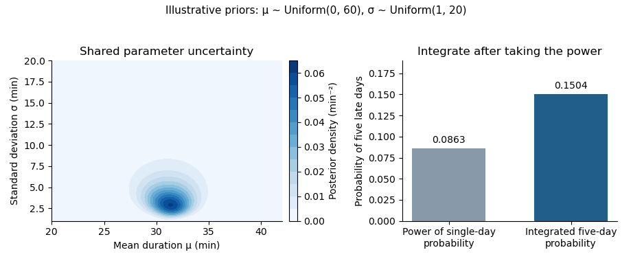

<h1 id="3/d/solution">Solution</h1>

↑ **Parent:** [D](../d.md)

For any chosen proper [prior density](../../../../../prior-density.md) $\rho(\mu,\sigma)$ on $\mathbb R\times(0,\infty)$ with positive evidence, [Bayes' theorem](../../../../../bayes-theorem.md) gives

$$
\boxed{\mathbb P(Y=1\mid A)=\frac{\displaystyle\int_0^\infty\int_{-\infty}^{\infty}\rho(\mu,\sigma)L(\mu,\sigma)\Phi\left(\frac{\mu-30}{\sigma}\right)^5\,d\mu\,d\sigma}{\displaystyle\int_0^\infty\int_{-\infty}^{\infty}\rho(\mu,\sigma)L(\mu,\sigma)\,d\mu\,d\sigma}.}
$$

The [prior density](../../../../../prior-density.md) comes from the first two random draws. The [likelihood](../../../../../likelihood-function.md) $L$ is the [probability](../../../../../probability.md) of satisfying all observed-label constraints after integrating the past duration noises. The factor $\Phi((\mu-30)/\sigma)^5$ is the [probability](../../../../../probability.md) of the five-day outcome conditional on the shared parameters. The denominator is the [probability](../../../../../probability.md) of acceptance, which converts the numerator's joint [probability](../../../../../probability.md) into the required [conditional probability](../../../../../conditional-probability.md).

For the independent uniform priors in part (a), the constant $\rho=1/(60\cdot19)$ cancels and both integrals reduce to $0<\mu<60$, $1<\sigma<20$. A prior on the [variance](../../../../../variance-split.md) $v=\sigma^2$ would require transforming the density: this chosen prior has density $1/(38\sqrt v)$ for $1<v<400$ conditional on $\mu$. One must not silently replace it by a uniform prior on $v$.

There is no unique numerical [probability](../../../../../probability.md) until the [prior distribution](../../../../../prior-probability.md) is chosen. As a check for the stated uniform priors, independent [Gaussian quadrature](../../../../../gaussian-quadrature.md) calculations with 256 and 512 nodes per coordinate agree at the shown precision:

$$
\mathbb P(Y=1\mid A)\approx0.15038909,\qquad \mathbb E[\pi\mid A]\approx0.61265126.
$$

The prior-predictive [probability](../../../../../probability.md) of all observed labels is approximately $0.00030422536$, explaining the rejection cost. These numbers are illustrations of the explicit model, not additional observed data.

A subtle point is that the five future days are independent only conditional on $(\mu,\sigma)$. Integrating shared parameter uncertainty gives $\mathbb E[\pi^5\mid A]$, **not** $(\mathbb E[\pi\mid A])^5$. The latter is about $0.08631110$ for these priors and understates the five-day [probability](../../../../../probability.md). [Jensen's inequality](../../../../../jensen-s-inequality.md) gives $(\mathbb E[\pi\mid A])^5\leq\mathbb E[\pi^5\mid A]$, while $0\leq\pi\leq1$ gives $\mathbb E[\pi^5\mid A]\leq\mathbb E[\pi\mid A]$. For two future late-arrival [indicator functions](../../../../../indicator-function.md), their posterior [covariance](../../../../../covariance.md) is $\operatorname{Var}(\pi\mid A)\geq0$. This is the [posterior predictive repeated-success identity](../../../../../posterior-predictive-repeated-success-identity.md).

**[Figure 1](#3/d/image-posterior-uncertainty-and-the-five-day-predictive-probability-for-the-explicitly-chosen-uniform-priors-the-contour-is-cropped-to-the-parameter-region-carrying-the-visible-mass-integration-uses-the-full-prior-rectangle). Posterior uncertainty and the five-day predictive probability for the explicitly chosen uniform priors. The contour is cropped to the parameter region carrying the visible mass; integration uses the full prior rectangle.**

## ↑ Ancestors (11)

1. [D](../d.md)
2. [3](../../3.md)
3. [Bayesian statistical probabilistic programming](../../../bayesian-statistical-probabilistic-programming-split.md)
4. [2021](../../../split.md)
5. [Past exam of the MSc in advanced computer science course of the University of Oxford](../../../../split.md)
6. [MSc in advanced computer science course of the University of Oxford](../../../../../msc-in-advanced-computer-science-course-of-the-university-of-oxford.md)
7. [Master's course of the University of Oxford](../../../../../master-s-course-of-the-university-of-oxford.md)
8. [Course of the University of Oxford](../../../../../course-of-the-university-of-oxford.md)
9. [University of Oxford](../../../../../university-of-oxford-split.md)
10. [List of universities](../../../../../list-of-universities.md)
11. [Codex Wiki](../../../../../split.md)
