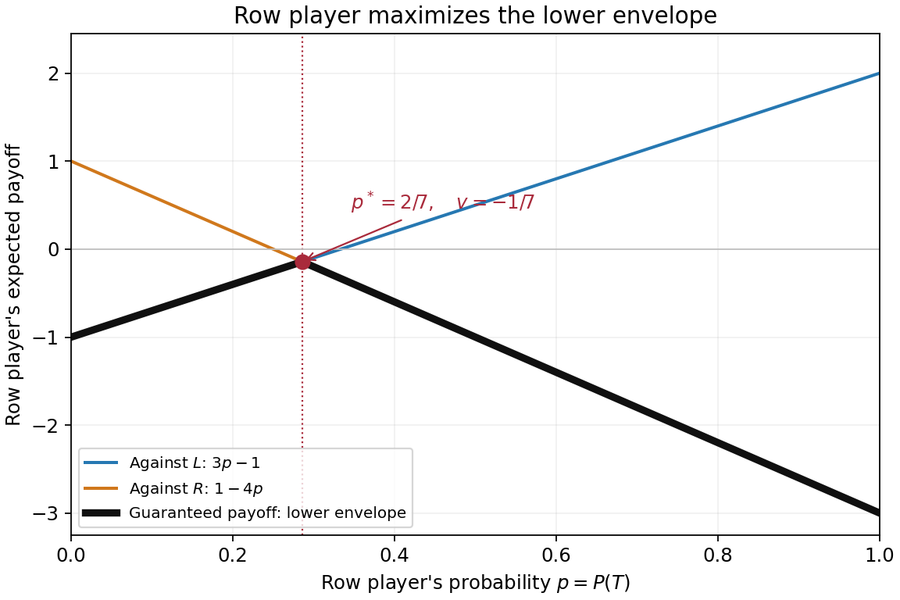
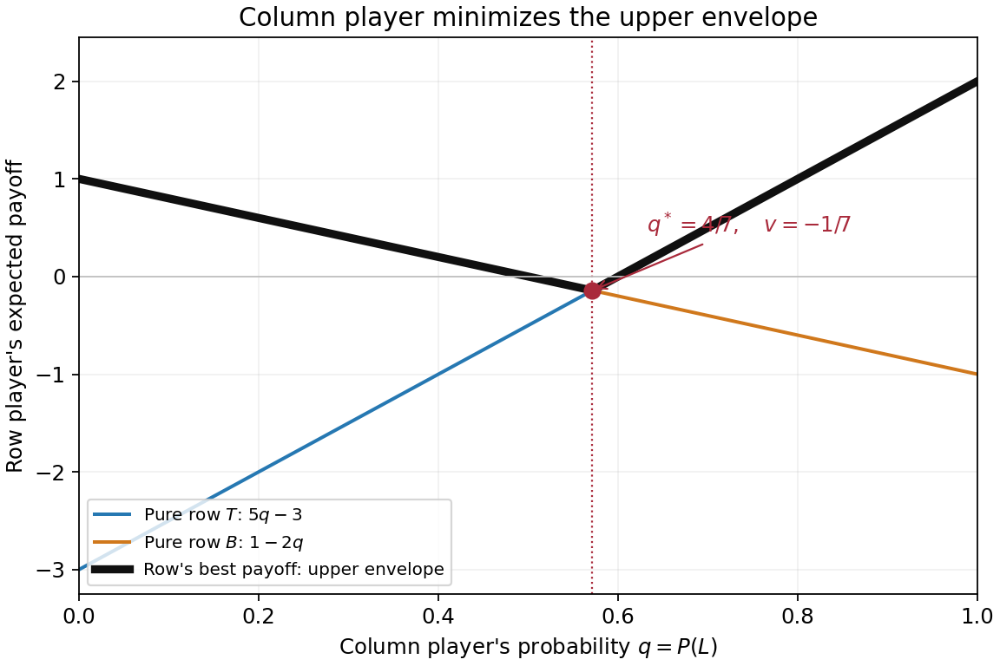
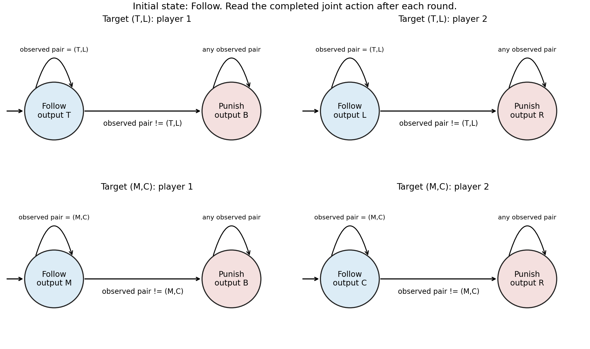
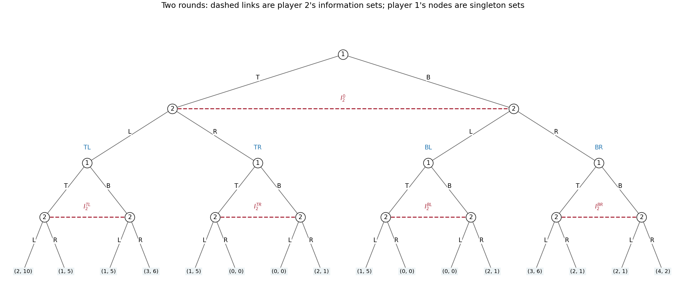

# Computational game theory

↑ **Parent:** [2021](../2021.md)

Source paper: [released examination archive](https://www.whatdotheyknow.com/request/ba_computer_science_past_papers/response/2577745/attach/2/202402%20183%20CS%20Papers.zip?cookie_passthrough=1).

**Table of contents**

- [1](#1)
  - [a](#1/a)
    - [Solution](#1/a/solution)
  - [b](#1/b)
    - [Solution](#1/b/solution)
- [2](#2)
  - [a](#2/a)
    - [Solution](#2/a/solution)
  - [b](#2/b)
    - [Solution](#2/b/solution)
  - [c](#2/c)
    - [Solution](#2/c/solution)
  - [d](#2/d)
    - [Solution](#2/d/solution)
- [3](#3)
  - [a](#3/a)
    - [Solution](#3/a/solution)
  - [b](#3/b)
    - [Solution](#3/b/solution)
- [4](#4)
  - [a](#4/a)
    - [Solution](#4/a/solution)
  - [b](#4/b)
    - [Solution](#4/b/solution)
  - [c](#4/c)
    - [i](#4/c/i)
      - [Solution](#4/c/i/solution)
    - [ii](#4/c/ii)
      - [Solution](#4/c/ii/solution)

## 1

↑ **Parent:** [Computational game theory](computational-game-theory.md)

<h3 id="1/a">a</h3>

↑ **Parent:** [1](#1)

<h4 id="1/a/solution">Solution</h4>

↑ **Parent:** [A](#1/a)

**$\ell_2\succ\ell_1$.** The distinction is small but strict: their normalized [expected utilities](../../utility-function.md#expected-utility) are $18/25$ and $7/10$, respectively.

By the [Von Neumann-Morgenstern utility theorem](../../utility-function.md#von-neumann-morgenstern-utility-theorem), use a representing [utility function](../../utility-function.md) and apply a positive [affine function](../../vector-space.md#affine-function) to set $u(\omega_1)=1$ and $u(\omega_4)=0$. This is possible because the given [strict preference](../../set-theory.md#strict-preference) implies $u(\omega_1)>u(\omega_4)$. The two specified [indifference relations](../../set-theory.md#indifference-relation) then give

$$
u(\omega_3)=\frac35,\qquad u(\omega_2)=\frac34+\frac14\frac35=\frac9{10}.
$$

Taking the [expected utility](../../utility-function.md#expected-utility) of each [lottery](../../utility-function.md#lottery) yields

$$
U(\ell_1)=\frac25+\frac15\frac9{10}+\frac15\frac35=\frac7{10},\qquad
U(\ell_2)=\frac25\frac9{10}+\frac35\frac35=\frac{18}{25}.
$$

Their difference is $1/50>0$, establishing the stated [strict preference](../../set-theory.md#strict-preference). These numbers measure [utility](../../mathematics.md#utility), not monetary reward or an assumed ordering of the subscripts.

Here is the underlying argument directly in terms of the axioms. The [independence axiom for lottery preferences](../../utility-function.md#independence-axiom-for-lottery-preferences) permits [substitution of indifferent lotteries](../../utility-function.md#substitution-of-indifferent-lotteries) inside a common mixture. Replacing $\omega_3$ by its given mixture of $\omega_1,\omega_4$, and then replacing $\omega_2$, followed by [reduction of compound lotteries](../../utility-function.md#reduction-of-compound-lotteries), gives

$$
\omega_2\sim\frac9{10}\omega_1+\frac1{10}\omega_4,
$$

and consequently

$$
\ell_1\sim\frac7{10}\omega_1+\frac3{10}\omega_4,
\qquad
\ell_2\sim\frac{18}{25}\omega_1+\frac7{25}\omega_4.
$$

The [transitive relation](../../set-theory.md#transitive-relation) axiom combines the successive substitutions. Finally, [mixture monotonicity](../../utility-function.md#mixture-monotonicity) says that among mixtures of a strictly better and a strictly worse outcome, the greater [probability](../../probability-theory.md#probability) of the better outcome is strictly preferred; this follows from the [independence axiom for lottery preferences](../../utility-function.md#independence-axiom-for-lottery-preferences) and [transitivity](../../set-theory.md#transitive-relation). Since $18/25>7/10$ and $\omega_1\succ\omega_4$, the comparison follows. [Complete lottery preferences](../../set-theory.md#complete-lottery-preferences) and [continuity of lottery preferences](../../utility-function.md#continuity-of-lottery-preferences) are part of the representation theorem's hypotheses; the direct substitution calculation uses the already supplied indifferences and does not need to invoke [continuity of lottery preferences](../../utility-function.md#continuity-of-lottery-preferences) again.[“The Expected Utility Property” and the preceding preference axioms](../../mathematics-bibliography.md#expected-utility-theory-by-econport)

<h3 id="1/b">b</h3>

↑ **Parent:** [1](#1)

<h4 id="1/b/solution">Solution</h4>

↑ **Parent:** [B](#1/b)

**No: these two strict comparisons violate the [independence axiom for lottery preferences](../../utility-function.md#independence-axiom-for-lottery-preferences).** Let $z$ denote the certain zero-money [lottery](../../utility-function.md#lottery). [Reduction of compound lotteries](../../utility-function.md#reduction-of-compound-lotteries) gives

$$
\ell_1=\frac14\ell_3+\frac34z,\qquad
\ell_2=\frac14\ell_4+\frac34z.
$$

For example, the second expression assigns [probability](../../probability-theory.md#probability) $(1/4)(4/5)=1/5$ to the nonzero reward and $4/5$ to zero. The claimed $\ell_3\succ\ell_4$ must therefore imply

$$
\frac14\ell_3+\frac34z\succ\frac14\ell_4+\frac34z,
$$

which is $\ell_1\succ\ell_2$, contradicting the other claimed [strict preference](../../set-theory.md#strict-preference).

The same obstruction is visible in any proposed [expected utility](../../utility-function.md#expected-utility) representation. Subtract $u(0)$ from the [utility function](../../utility-function.md), and write $a=u(3000)-u(0)$ and $b=u(4000)-u(0)$. The first comparison requires $(1/5)b>(1/4)a$, hence $(4/5)b>a$, whereas the second requires $a>(4/5)b$. No real $a,b$ satisfy both. This argument requires neither [risk neutrality](../../utility-function.md#risk-neutrality) nor an assumption that the [utility function](../../utility-function.md) is increasing in money.

## 2

↑ **Parent:** [Computational game theory](computational-game-theory.md)

<h3 id="2/a">a</h3>

↑ **Parent:** [2](#2)

<h4 id="2/a/solution">Solution</h4>

↑ **Parent:** [A](#2/a)

Put $p=\Pr(T)$ and $q=\Pr(L)$, so the complementary [probabilities](../../probability-theory.md#probability) are $1-p$ and $1-q$. All four expressions are the row player's [expected payoff](../../game-theory.md#expected-payoff), including those indexed by a column action. Direct [expected value](../../expected-value.md) calculations give

$$
\boxed{\begin{aligned}
\pi_1(p,L)&=2p-(1-p)=3p-1,\\
\pi_1(p,R)&=-3p+(1-p)=1-4p,\\
\pi_1(T,q)&=2q-3(1-q)=5q-3,\\
\pi_1(B,q)&=-q+(1-q)=1-2q.
\end{aligned}}
$$

The column player's [expected payoff](../../game-theory.md#expected-payoff) is the negative of the row player's because this is a [zero-sum game](../../game-theory.md#zero-sum-game).

<h3 id="2/b">b</h3>

↑ **Parent:** [2](#2)

<h4 id="2/b/solution">Solution</h4>

↑ **Parent:** [B](#2/b)

The bold black curve is the [pointwise minimum](../../function.md#pointwise-minimum) of the two opposing-column [expected payoff](../../game-theory.md#expected-payoff) functions. It is the row player's [security level payoff](../../game-theory.md#security-level-payoff) at the specified [mixed strategy](../../game-theory.md#mixed-strategy):

$$
g(p)=\min(3p-1,1-4p)=
\begin{cases}3p-1,&0\le p\le2/7,\\1-4p,&2/7\le p\le1.\end{cases}
$$

The lines meet where $3p-1=1-4p$, hence at $p=2/7$. The first branch increases with slope $3$ and the second decreases with slope $-4$, so their intersection is the unique global [maximum](../../set.md#maximum-of-a-subset-of-a-total-order) of the lower envelope:

$$
\boxed{\operatorname*{arg\,max}_{0\le p\le1}g(p)=\frac27,\qquad \max g=-\frac17.}
$$

The endpoint values are $g(0)=-1$ and $g(1)=-3$, both smaller. Since an opposing [mixed strategy](../../game-theory.md#mixed-strategy) forms a [convex combination](../../convex-set.md#convex-combination) of the two pure-column [expected payoffs](../../game-theory.md#expected-payoff), it cannot make the row player's [expected payoff](../../game-theory.md#expected-payoff) lower than this envelope.

**[Figure 1](#2/b/image-the-row-player-s-lower-payoff-envelope-and-its-maximum-at-p-2-7). The row player's lower payoff envelope and its maximum at p = 2/7**.

<h3 id="2/c">c</h3>

↑ **Parent:** [2](#2)

<h4 id="2/c/solution">Solution</h4>

↑ **Parent:** [C](#2/c)

The bold black curve is now the [pointwise maximum](../../function.md#pointwise-maximum) of the two pure-row [expected payoff](../../game-theory.md#expected-payoff) functions:

$$
h(q)=\max(5q-3,1-2q)=
\begin{cases}1-2q,&0\le q\le4/7,\\5q-3,&4/7\le q\le1.\end{cases}
$$

It measures the largest [expected payoff](../../game-theory.md#expected-payoff) that the row player can achieve against column [mixed strategy](../../game-theory.md#mixed-strategy) $q$. The column player minimizes this quantity because its own [payoff](../../game-theory.md#payoff) has the opposite sign. Equality of the two lines gives $5q-3=1-2q$, or $q=4/7$. The envelope decreases before that point and increases afterwards, giving

$$
\boxed{\operatorname*{arg\,min}_{0\le q\le1}h(q)=\frac47,\qquad \min h=-\frac17.}
$$

The endpoint values $h(0)=1$ and $h(1)=2$ are both larger. A row [mixed strategy](../../game-theory.md#mixed-strategy) cannot exceed the greatest pure-row [expected payoff](../../game-theory.md#expected-payoff), because its [expected payoff](../../game-theory.md#expected-payoff) is a [convex combination](../../convex-set.md#convex-combination) of those two values.

**[Figure 2](#2/c/image-the-column-player-s-upper-payoff-envelope-and-its-minimum-at-q-4-7). The column player's upper payoff envelope and its minimum at q = 4/7**.

<h3 id="2/d">d</h3>

↑ **Parent:** [2](#2)

<h4 id="2/d/solution">Solution</h4>

↑ **Parent:** [D](#2/d)

**The unique [Nash equilibrium](../../game-theory.md#nash-equilibrium) uses row [probabilities](../../probability-theory.md#probability) $(2/7,5/7)$ on $(T,B)$ and column [probabilities](../../probability-theory.md#probability) $(4/7,3/7)$ on $(L,R)$. The [value of a zero-sum game](../../game-theory.md#value-of-a-zero-sum-game) to the row player is $-1/7$; the column player receives $1/7$.**

The first graph solves the row player's max–min [optimization](../../mathematical-optimization.md): choose a [mixed strategy](../../game-theory.md#mixed-strategy) guaranteeing the greatest possible worst-case [expected payoff](../../game-theory.md#expected-payoff). The second solves the column player's min–max [optimization](../../mathematical-optimization.md): choose a [mixed strategy](../../game-theory.md#mixed-strategy) placing the smallest upper bound on the row player's [expected payoff](../../game-theory.md#expected-payoff). Their optimal heights agree, illustrating the [minimax theorem](../../game-theory.md#minimax-theorem).

There is also a direct [Nash equilibrium](../../game-theory.md#nash-equilibrium) certificate, so the conclusion does not depend on reading coordinates from a plot. At $p^*=2/7$, both opposing pure columns give row [expected payoff](../../game-theory.md#expected-payoff) $-1/7$; at $q^*=4/7$, both pure rows give row [expected payoff](../../game-theory.md#expected-payoff) $-1/7$. By linearity, every [unilateral deviation](../../game-theory.md#unilateral-deviation), including an arbitrary [mixed strategy](../../game-theory.md#mixed-strategy), leaves the deviator's [expected payoff](../../game-theory.md#expected-payoff) unchanged against the fixed opposing equilibrium mixture. Neither player can improve it. This is a [mixed-strategy optimality certificate for a matrix game](../../game-theory.md#mixed-strategy-optimality-certificate-for-a-matrix-game).

The equilibrium outcome is a [probability distribution](../../probability-distribution.md) over cells, rather than one deterministic cell. [Independent](../../random-variable.md#independent-random-variables) randomization gives

$$
\boxed{\Pr(TL)=\frac8{49},\quad \Pr(TR)=\frac6{49},\quad
\Pr(BL)=\frac{20}{49},\quad \Pr(BR)=\frac{15}{49}.}
$$

The resulting row [expected payoff](../../game-theory.md#expected-payoff) is $(16-18-20+15)/49=-1/7$. Finally, each envelope has a unique optimum, so any [Nash equilibrium](../../game-theory.md#nash-equilibrium) must use the displayed [optimal mixed strategies](../../game-theory.md#optimal-mixed-strategy). In particular there is no [pure strategy](../../game-theory.md#pure-strategy) [Nash equilibrium](../../game-theory.md#nash-equilibrium).

## 3

↑ **Parent:** [Computational game theory](computational-game-theory.md)

<h3 id="3/a">a</h3>

↑ **Parent:** [3](#3)

<h4 id="3/a/solution">Solution</h4>

↑ **Parent:** [A](#3/a)

**Exactly $(T,L)$, $(M,C)$ and $(B,R)$ can be sustained as constant [stage game](../../game-theory.md#stage-game) outcomes. Their [long-run average payoffs](../../game-theory.md#long-run-average-payoff) are $(6,6)$, $(4,4)$ and $(0,0)$, respectively.** We assume the usual [repeated game](../../game-theory.md#repeated-game) monitoring convention: both players observe each completed joint action before the next round. The source's colour convention puts the blue lower-left row [payoff](../../game-theory.md#payoff) first and the red upper-right column [payoff](../../game-theory.md#payoff) second.

For necessity, row action $B$ earns $(8,5,0)$ against $(L,C,R)$, so playing it forever guarantees a nonnegative [long-run average payoff](../../game-theory.md#long-run-average-payoff) against every opposing [pure strategy](../../game-theory.md#pure-strategy). Similarly, column action $R$ earns $(8,5,0)$ against $(T,M,B)$ and guarantees zero or more. Conversely, column action $R$ holds the row player's best possible stage [payoff](../../game-theory.md#payoff) to $0$, and row action $B$ holds the column player's to $0$. Thus each player's [minmax payoff](../../game-theory.md#minmax-payoff) is exactly $0$.

Any [Nash equilibrium](../../game-theory.md#nash-equilibrium) must give both players at least zero, an [individually rational payoff in a repeated game](../../game-theory.md#individually-rational-payoff-in-a-repeated-game). Every off-diagonal cell has a negative [payoff](../../game-theory.md#payoff) for one player: $(T,C)$ and $(T,R)$ hurt row, $(M,L)$ and $(B,L)$ hurt column, $(M,R)$ hurts row and $(B,C)$ hurts column. Repeating any such cell forever therefore permits a profitable [unilateral deviation](../../game-theory.md#unilateral-deviation) to the zero-guaranteeing action. The three diagonal cells pass this necessary test.

For sufficiency, fix target $a^*=(T,L)$ or $(M,C)$. Each player's [finite-state strategy](../../game-theory.md#finite-state-strategy) has initial state $F$ and an absorbing state $P$. In $F$, output the player's component of $a^*$; remain in $F$ if the completed joint action equals $a^*$, and otherwise move to $P$. In $P$, row always outputs $B$ and column always outputs $R$, regardless of further observations. These are two-state [grim trigger strategies](../../game-theory.md#grim-trigger); the separate machines are drawn below. The input is the observed joint action, so after any off-path history the prescribed continuation states agree.

**[Figure 3](#3/a/image-separate-finite-state-punishment-strategies-sustaining-the-two-positive-payoff-diagonal-outcomes). Separate finite-state punishment strategies sustaining the two positive-payoff diagonal outcomes**.

If neither player deviates, the target is repeated forever. If a player first deviates at a finite round $\tau$, the opponent enters $P$ for all later rounds. Against column action $R$, every row action earns at most zero; against row action $B$, every column action earns at most zero. All [payoffs](../../game-theory.md#payoff) are bounded, so the total reward before and at $\tau$, divided by the horizon, tends to zero. The deviator's upper limiting average is therefore at most $0$, below either target [payoff](../../game-theory.md#payoff) $6$ or $4$. This proof tests arbitrary future deviations, not merely a single changed action. It also rules out improvement by deviations whose averages fail to converge, if the criterion is extended by an upper or lower limit.

For target $(B,R)$, one-state machines outputting $B$ and $R$ forever suffice: each is a [best response](../../game-theory.md#best-response) to the other in every round. Their [long-run average payoffs](../../game-theory.md#long-run-average-payoff) are zero and no [unilateral deviation](../../game-theory.md#unilateral-deviation) can improve them. In fact, the punishment is credible because $(B,R)$ is a stage [Nash equilibrium](../../game-theory.md#nash-equilibrium), so the two positive-target constructions are also [subgame perfect equilibria](../../game-theory.md#subgame-perfect-equilibrium) under the stated monitoring assumption. The general punishment mechanism is described in [slides 12–15; those slides use discounting, while the finite-prefix argument here uses long-run averages](../../computer-science-bibliography.md#lecture-15-repeated-games-by-asu-ozdaglar).

“Outcomes of the stage game” here means a fixed action pair repeated forever. Allowing time sharing also sustains some average [payoff](../../game-theory.md#payoff) vectors that are not stage cells: for example, a deterministic alternating cycle $(T,L),(M,C)$ gives $(5,5)$, with a two-phase [finite-state strategy](../../game-theory.md#finite-state-strategy) and the same permanent punishment. An off-diagonal cell may occur in a sustainable cycle; the impossibility above concerns its constant repetition, not every appearance on an equilibrium path. With finite-state [pure strategies](../../game-theory.md#pure-strategy), an undisturbed path is eventually periodic, so its limiting cell frequencies are [rational numbers](../../number-theory.md#rational-number).

<h3 id="3/b">b</h3>

↑ **Parent:** [3](#3)

<h4 id="3/b/solution">Solution</h4>

↑ **Parent:** [B](#3/b)

Use the standard [repeated game](../../game-theory.md#repeated-game) convention that the first round's joint action is observed before round two. The following original [game tree](../../game-theory.md#game-tree) represents simultaneous moves by making row move first in each round while hiding that current move from column. Terminal labels are **total [payoffs](../../game-theory.md#payoff) over both rounds**, ordered row then column.

**[Figure 4](#3/b/image-the-full-two-round-extensive-form-game-with-all-sixteen-terminal-payoff-pairs-and-five-column-information-sets). The full two-round extensive-form game, with all sixteen terminal payoff pairs and five column information sets**.

Formally, round one starts at a row decision with actions $T,B$. The two ensuing column nodes form one [information set](../../game-theory.md#information-set) $I_2^0$, with available actions $L,R$; column cannot tell which current row action occurred. The four completed first-round histories are $H=\{TL,TR,BL,BR\}$. At each $h\in H$, round two begins at a separate row node. Its two successors, after row's current $T$ or $B$, form a column [information set](../../game-theory.md#information-set) $I_2^h$. Distinct $h$ have distinct [information sets](../../game-theory.md#information-set): both players know the whole first-round outcome. There are sixteen terminal histories $(h,k)\in H^2$, whose total [payoff](../../game-theory.md#payoff) is $u(h)+u(k)$, as displayed in the tree.

The row player's five [information sets](../../game-theory.md#information-set) are the initial singleton and the four singleton round-two nodes, one per $h$. The column player's five [information sets](../../game-theory.md#information-set) are $I_2^0$ and the four two-node sets $I_2^h$. Thus each player must specify one binary choice at each of five [information sets](../../game-theory.md#information-set), including histories that its own first choice might prevent:

$$
\boxed{|S_1|=|S_2|=2^5=32.}
$$

Counting only the four possible two-round action sequences would miss the distinct contingent responses to the opponent's first action.

For a concrete pair of complete [pure strategies](../../game-theory.md#pure-strategy), order the second-round histories as $(TL,TR,BL,BR)$ and use

$$
s_1=(T;B,T,T,T),\qquad s_2=(L;R,L,L,L).
$$

The first entry is the initial action, and the four remaining entries prescribe the action after each first-round history. This induces the unique path $TL$ in round one followed by $BR$ in round two. Hence the total [payoff](../../game-theory.md#payoff) is

$$
\boxed{(1,5)+(2,1)=(3,6).}
$$

The off-path entries are part of each [pure strategy](../../game-theory.md#pure-strategy), even though this pair does not reach them.

For randomization, a [mixed strategy](../../game-theory.md#mixed-strategy) is a [probability distribution](../../probability-distribution.md) over the $32$ complete plans, with $31$ free [probabilities](../../probability-theory.md#probability) in a general distribution. A [behavioural strategy](../../game-theory.md#behavioural-strategy) instead gives one binary-action [probability](../../probability-theory.md#probability) at each of five [information sets](../../game-theory.md#information-set), requiring five parameters. This game has [perfect recall](../../game-theory.md#perfect-recall): a player never forgets a previous own action or a first-round observation, and the only concealed action is the opponent's current simultaneous choice. Consequently **neither kind of randomization has a greater attainable-payoff advantage**: [Kuhn's theorem](../../game-theory.md#kuhn-s-theorem) gives [realization-equivalent strategies](../../game-theory.md#realization-equivalent-strategies) against every fixed opposing strategy.[original article, pp. 193–216, equivalence under perfect recall](../../mathematics-bibliography.md#extensive-games-and-the-problem-of-information-by-harold-w-kuhn)

The equivalence can be verified directly here. Given a [behavioural strategy](../../game-theory.md#behavioural-strategy), sample all five contingent actions independently before play; the resulting product [probability distribution](../../probability-distribution.md) over complete plans is an equivalent [mixed strategy](../../game-theory.md#mixed-strategy). Conversely, let $\mu$ be a [mixed strategy](../../game-theory.md#mixed-strategy) for player $i$. Use its marginal [probability](../../probability-theory.md#probability) for the initial action. At history $h$ containing own first action $a_i$, choose second action $b_i$ with [conditional probability](../../probability-theory.md#conditional-probability)

$$
\beta_i(b_i\mid h)=
\frac{\mu\{s:s^0=a_i,\ s^h=b_i\}}
{\mu\{s:s^0=a_i\}},
$$

whenever the denominator is positive; if it is zero, choose arbitrarily at that unreachable history. The opponent's first-round action is simultaneous and cannot depend on the sampled hidden plan beyond the chosen first action. Thus conditioning on $h$ preserves exactly these [conditional probabilities](../../probability-theory.md#conditional-probability) of actions, and multiplying the first- and second-round factors reproduces each terminal [probability](../../probability-theory.md#probability). Correlations between prescriptions at mutually exclusive second-round histories have no further observable effect. [Behavioural strategies](../../game-theory.md#behavioural-strategy) offer the more compact representation, while [mixed strategies](../../game-theory.md#mixed-strategy) describe a single random choice of a full plan. Imperfect information here does not mean imperfect recall.

## 4

↑ **Parent:** [Computational game theory](computational-game-theory.md)

<h3 id="4/a">a</h3>

↑ **Parent:** [4](#4)

<h4 id="4/a/solution">Solution</h4>

↑ **Parent:** [A](#4/a)

**If the [core](../../game-theory.md#core-game-theory) is nonempty, it is exactly the singleton allocation $p_j=v(\{j\})$ for every $j$.** Take any $p$ in the [core of a cooperative game](../../game-theory.md#core-game-theory) and write $p(C)=\sum_{j\in C}p_j$. Core membership gives efficiency of the [imputation](../../game-theory.md#imputation-in-a-coalitional-game), $p(N)=v(N)$, and the [coalition](../../game-theory.md#coalition-game-theory) inequalities

$$
p(C)\ge v(C),\qquad p(N\setminus C)\ge v(N\setminus C).
$$

Using the given complementary-coalition equality in this [constant-sum cooperative game](../../game-theory.md#constant-sum-cooperative-game), the second inequality yields

$$
p(C)=v(N)-p(N\setminus C)
\le v(N)-v(N\setminus C)=v(C).
$$

Combining upper and lower bounds gives $p(C)=v(C)$ for every [coalition](../../game-theory.md#coalition-game-theory) $C$. In particular,

$$
\boxed{p_j=p(\{j\})=v(\{j\})\quad\text{for every }j\in N.}
$$

Since this holds for any [core](../../game-theory.md#core-game-theory) member and at least one exists by hypothesis, the displayed allocation is in the [core](../../game-theory.md#core-game-theory) and is its only member. The argument also shows why nonemptiness is restrictive: it forces $v(C)=\sum_{j\in C}v(\{j\})$ for every [coalition](../../game-theory.md#coalition-game-theory), so the [characteristic function of a coalitional game](../../game-theory.md#characteristic-function-of-a-coalitional-game) must be additive. No [superadditive coalitional game](../../game-theory.md#superadditive-coalitional-game) or monotonicity assumption is needed.

<h3 id="4/b">b</h3>

↑ **Parent:** [4](#4)

<h4 id="4/b/solution">Solution</h4>

↑ **Parent:** [B](#4/b)

**$G_1$ cannot have an [induced subgraph game](../../game-theory.md#induced-subgraph-game) representation. $G_2$ is represented by a weighted triangle with edge weights $w_{12}=2$, $w_{13}=3$, $w_{23}=3$, and has [Shapley value](../../game-theory.md#shapley-value) vector $(5/2,5/2,3)$.**

In an [induced subgraph game](../../game-theory.md#induced-subgraph-game), players are [graph vertices](../../graph.md#vertex-graph-theory) and a [coalition](../../game-theory.md#coalition-game-theory) receives the sum of the weights of [graph edges](../../graph-theory.md#edge-of-a-graph) whose two endpoints lie in it. Therefore each two-player [coalition](../../game-theory.md#coalition-game-theory) determines the corresponding edge weight. For $G_1$ these weights would have to be $2,6,3$, making the grand [coalition](../../game-theory.md#coalition-game-theory) worth $2+6+3=11$, whereas its actual value is $15$. No other edge weights can repair that discrepancy without changing a two-player [coalition](../../game-theory.md#coalition-game-theory)'s value. Even a convention allowing vertex weights would not help: its singleton values force all such weights to zero.

For $G_2$, the stated weighted [graph triangle](../../graph.md#triangle-in-a-graph) has grand [coalition](../../game-theory.md#coalition-game-theory) value $2+3+3=8$ and reproduces all three pair values. Empty and singleton [coalitions](../../game-theory.md#coalition-game-theory) contain no [graph edges](../../graph-theory.md#edge-of-a-graph), so their values are zero. This verifies all eight [coalitions](../../game-theory.md#coalition-game-theory) and supplies the complete representation.

To compute the [Shapley value](../../game-theory.md#shapley-value), reveal players in a uniformly random [permutation](../../combinatorics.md#permutation). An edge's weight contributes to an endpoint's [marginal contribution](../../game-theory.md#marginal-contribution) precisely when the other endpoint appeared earlier. Each endpoint is later with [probability](../../probability-theory.md#probability) $1/2$, independently of where the third player appears. Linearity of the [expected value](../../expected-value.md) therefore splits each edge weight equally between its two endpoints:

$$
\boxed{\phi_1=\frac{2+3}{2}=\frac52,\quad
\phi_2=\frac{2+3}{2}=\frac52,\quad
\phi_3=\frac{3+3}{2}=3.}
$$

The values sum to $8=v_2(N)$, as required by the [Shapley value](../../game-theory.md#shapley-value)'s efficiency property. This is the general [Shapley value of an induced subgraph game](../../game-theory.md#shapley-value-of-an-induced-subgraph-game) formula, not an assumption that all three players are symmetric: player $3$ has a different incident-weight total.

<h3 id="4/c">c</h3>

↑ **Parent:** [4](#4)

<h4 id="4/c/i">i</h4>

↑ **Parent:** [C](#4/c)

<h5 id="4/c/i/solution">Solution</h5>

↑ **Parent:** [I](#4/c/i)

**The [core](../../game-theory.md#core-game-theory) is the singleton $\{(1/2,1/2,1/2,1/2)\}$.** Here the [characteristic function of a coalitional game](../../game-theory.md#characteristic-function-of-a-coalitional-game) is $v(C)=\lfloor |C|/2\rfloor$, the two-person instance of the [core of the miners game](../../game-theory.md#core-of-the-miners-game) calculation.

Let $x$ be in the [core](../../game-theory.md#core-game-theory). Efficiency requires $x_1+x_2+x_3+x_4=2$, and every pair [coalition](../../game-theory.md#coalition-game-theory) requires $x_i+x_j\ge1$. Summing the six pair inequalities counts each coordinate three times, giving $3\sum_i x_i\ge6$. Efficiency makes this an equality; since every individual slack is nonnegative, all six pair inequalities must be equalities. In particular $x_1+x_2=x_1+x_3=x_1+x_4=1$ forces $x_2=x_3=x_4$, and comparison with $x_2+x_3=1$ gives every $x_i=1/2$.

Conversely, for the uniform allocation every [coalition](../../game-theory.md#coalition-game-theory) satisfies

$$
\sum_{i\in C}x_i=\frac{|C|}{2}\ge\left\lfloor\frac{|C|}{2}\right\rfloor=v(C),
$$

and its total is $2=v(N)$. It is therefore a [core](../../game-theory.md#core-game-theory) member, completing both existence and uniqueness. In particular, a three-player [coalition](../../game-theory.md#coalition-game-theory) receives $3/2\ge1$; the pair constraints are the tight ones.

<h4 id="4/c/ii">ii</h4>

↑ **Parent:** [C](#4/c)

<h5 id="4/c/ii/solution">Solution</h5>

↑ **Parent:** [Ii](#4/c/ii)

**The [core](../../game-theory.md#core-game-theory) is empty.** Efficiency would require $x_1+x_2+x_3=v(N)=1$. Each two-player [coalition](../../game-theory.md#coalition-game-theory) has value $1$, so [core](../../game-theory.md#core-game-theory) membership would also require

$$
x_1+x_2\ge1,\qquad x_1+x_3\ge1,\qquad x_2+x_3\ge1.
$$

Adding gives $2(x_1+x_2+x_3)\ge3$, contradicting efficiency, which makes the left side $2$. Thus no allocation can meet all [coalition](../../game-theory.md#coalition-game-theory) demands. The obstruction uses only pair [coalitions](../../game-theory.md#coalition-game-theory) and the grand [coalition](../../game-theory.md#coalition-game-theory); imposing individual rationality cannot remove it. The equal allocation $(1/3,1/3,1/3)$ is efficient but gives each pair only $2/3<1$, so symmetry does not supply a [core](../../game-theory.md#core-game-theory) allocation.

## ↑ Ancestors (8)

1. [2021](../2021.md)
2. [Past exam of the MSc in advanced computer science course of the University of Oxford](../../past-exam-of-the-msc-in-advanced-computer-science-course-of-the-university-of-oxford.md)
3. [MSc in advanced computer science course of the University of Oxford](../../university-of-oxford.md#msc-in-advanced-computer-science-course-of-the-university-of-oxford)
4. [Master's course of the University of Oxford](../../university-of-oxford.md#master-s-course-of-the-university-of-oxford)
5. [Course of the University of Oxford](../../university-of-oxford.md#course-of-the-university-of-oxford)
6. [University of Oxford](../../university-of-oxford.md)
7. [List of universities](../../README.md#list-of-universities)
8. [Codex Wiki](../../README.md)
