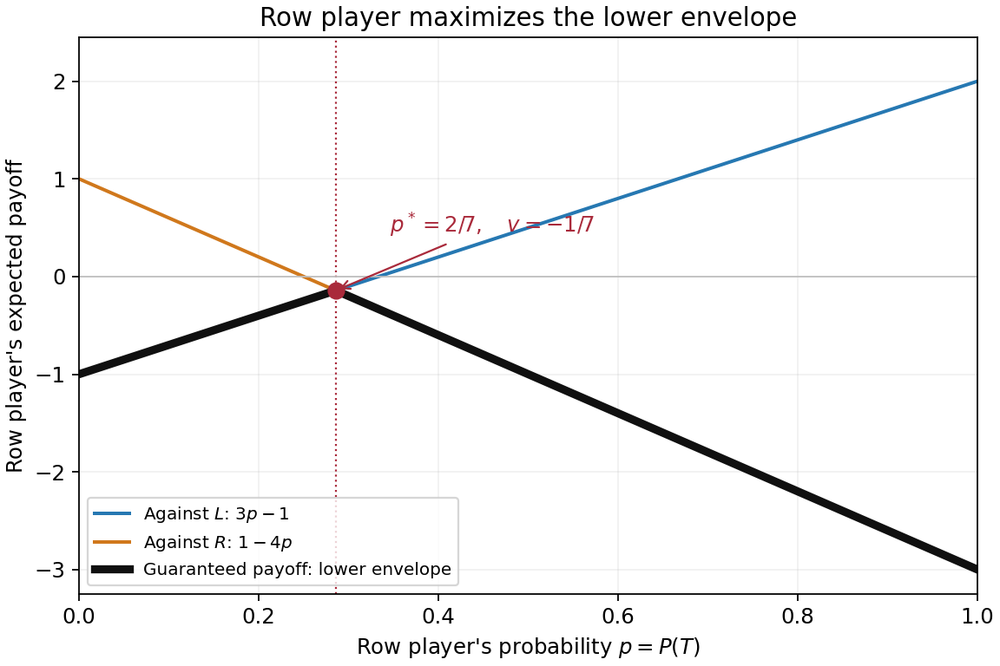

<h1 id="2/b/solution">Solution</h1>

↑ **Parent:** [B](../b.md)

The bold black curve is the [pointwise minimum](../../../../../pointwise-minimum.md) of the two opposing-column [expected payoff](../../../../../expected-payoff.md) functions. It is the row player's [security level payoff](../../../../../security-level-payoff.md) at the specified [mixed strategy](../../../../../mixed-strategy.md):

$$
g(p)=\min(3p-1,1-4p)=
\begin{cases}3p-1,&0\le p\le2/7,\\1-4p,&2/7\le p\le1.\end{cases}
$$

The lines meet where $3p-1=1-4p$, hence at $p=2/7$. The first branch increases with slope $3$ and the second decreases with slope $-4$, so their intersection is the unique global [maximum](../../../../../maximum-of-a-subset-of-a-total-order.md) of the lower envelope:

$$
\boxed{\operatorname*{arg\,max}_{0\le p\le1}g(p)=\frac27,\qquad \max g=-\frac17.}
$$

The endpoint values are $g(0)=-1$ and $g(1)=-3$, both smaller. Since an opposing [mixed strategy](../../../../../mixed-strategy.md) forms a [convex combination](../../../../../convex-combination.md) of the two pure-column [expected payoffs](../../../../../expected-payoff.md), it cannot make the row player's [expected payoff](../../../../../expected-payoff.md) lower than this envelope.

**[Figure 1](#2/b/image-the-row-player-s-lower-payoff-envelope-and-its-maximum-at-p-2-7). The row player's lower payoff envelope and its maximum at p = 2/7**.

## ↑ Ancestors (11)

1. [B](../b.md)
2. [2](../../2.md)
3. [Computational game theory](../../../computational-game-theory-split.md)
4. [2021](../../../split.md)
5. [Past exam of the MSc in advanced computer science course of the University of Oxford](../../../../split.md)
6. [MSc in advanced computer science course of the University of Oxford](../../../../../msc-in-advanced-computer-science-course-of-the-university-of-oxford.md)
7. [Master's course of the University of Oxford](../../../../../master-s-course-of-the-university-of-oxford.md)
8. [Course of the University of Oxford](../../../../../course-of-the-university-of-oxford.md)
9. [University of Oxford](../../../../../university-of-oxford-split.md)
10. [List of universities](../../../../../list-of-universities.md)
11. [Codex Wiki](../../../../../split.md)
