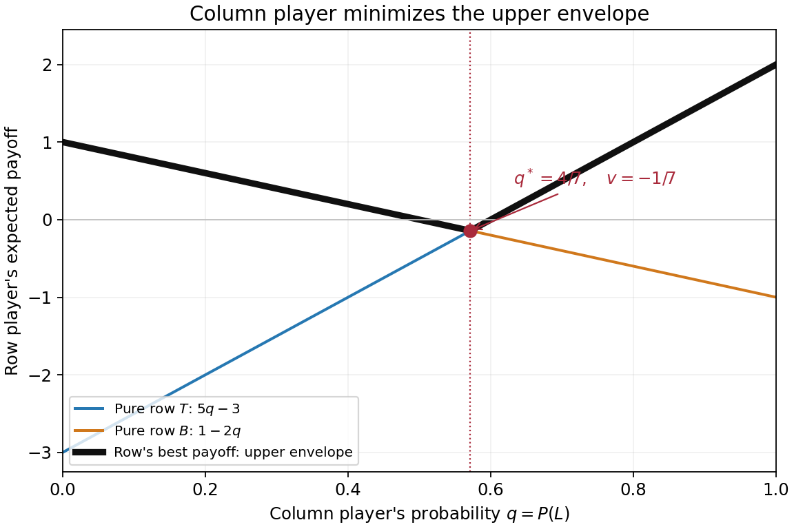

<h1 id="2/c/solution">Solution</h1>

↑ **Parent:** [C](../c.md)

The bold black curve is now the [pointwise maximum](../../../../../pointwise-maximum.md) of the two pure-row [expected payoff](../../../../../expected-payoff.md) functions:

$$
h(q)=\max(5q-3,1-2q)=
\begin{cases}1-2q,&0\le q\le4/7,\\5q-3,&4/7\le q\le1.\end{cases}
$$

It measures the largest [expected payoff](../../../../../expected-payoff.md) that the row player can achieve against column [mixed strategy](../../../../../mixed-strategy.md) $q$. The column player minimizes this quantity because its own [payoff](../../../../../payoff.md) has the opposite sign. Equality of the two lines gives $5q-3=1-2q$, or $q=4/7$. The envelope decreases before that point and increases afterwards, giving

$$
\boxed{\operatorname*{arg\,min}_{0\le q\le1}h(q)=\frac47,\qquad \min h=-\frac17.}
$$

The endpoint values $h(0)=1$ and $h(1)=2$ are both larger. A row [mixed strategy](../../../../../mixed-strategy.md) cannot exceed the greatest pure-row [expected payoff](../../../../../expected-payoff.md), because its [expected payoff](../../../../../expected-payoff.md) is a [convex combination](../../../../../convex-combination.md) of those two values.

**[Figure 2](#2/c/image-the-column-player-s-upper-payoff-envelope-and-its-minimum-at-q-4-7). The column player's upper payoff envelope and its minimum at q = 4/7**.

## ↑ Ancestors (11)

1. [C](../c.md)
2. [2](../../2.md)
3. [Computational game theory](../../../computational-game-theory-split.md)
4. [2021](../../../split.md)
5. [Past exam of the MSc in advanced computer science course of the University of Oxford](../../../../split.md)
6. [MSc in advanced computer science course of the University of Oxford](../../../../../msc-in-advanced-computer-science-course-of-the-university-of-oxford.md)
7. [Master's course of the University of Oxford](../../../../../master-s-course-of-the-university-of-oxford.md)
8. [Course of the University of Oxford](../../../../../course-of-the-university-of-oxford.md)
9. [University of Oxford](../../../../../university-of-oxford-split.md)
10. [List of universities](../../../../../list-of-universities.md)
11. [Codex Wiki](../../../../../split.md)
