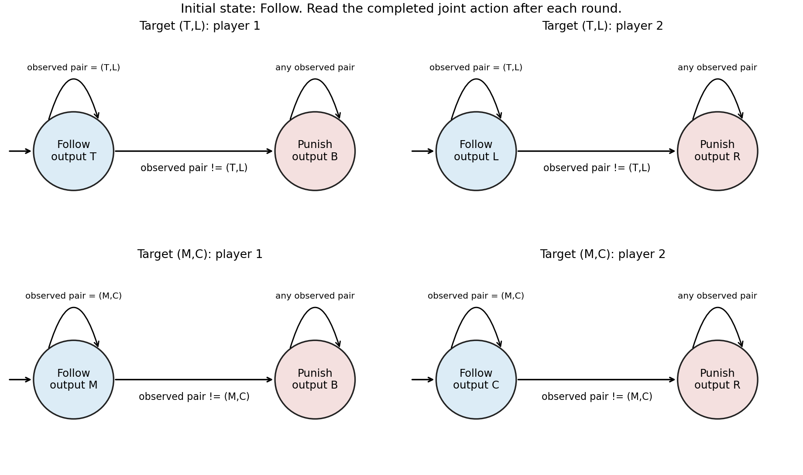

<h1 id="3/a/solution">Solution</h1>

↑ **Parent:** [A](../a.md)

**Exactly $(T,L)$, $(M,C)$ and $(B,R)$ can be sustained as constant [stage game](../../../../../stage-game.md) outcomes. Their [long-run average payoffs](../../../../../long-run-average-payoff.md) are $(6,6)$, $(4,4)$ and $(0,0)$, respectively.** We assume the usual [repeated game](../../../../../repeated-game.md) monitoring convention: both players observe each completed joint action before the next round. The source's colour convention puts the blue lower-left row [payoff](../../../../../payoff.md) first and the red upper-right column [payoff](../../../../../payoff.md) second.

For necessity, row action $B$ earns $(8,5,0)$ against $(L,C,R)$, so playing it forever guarantees a nonnegative [long-run average payoff](../../../../../long-run-average-payoff.md) against every opposing [pure strategy](../../../../../pure-strategy.md). Similarly, column action $R$ earns $(8,5,0)$ against $(T,M,B)$ and guarantees zero or more. Conversely, column action $R$ holds the row player's best possible stage [payoff](../../../../../payoff.md) to $0$, and row action $B$ holds the column player's to $0$. Thus each player's [minmax payoff](../../../../../minmax-payoff.md) is exactly $0$.

Any [Nash equilibrium](../../../../../nash-equilibrium.md) must give both players at least zero, an [individually rational payoff in a repeated game](../../../../../individually-rational-payoff-in-a-repeated-game.md). Every off-diagonal cell has a negative [payoff](../../../../../payoff.md) for one player: $(T,C)$ and $(T,R)$ hurt row, $(M,L)$ and $(B,L)$ hurt column, $(M,R)$ hurts row and $(B,C)$ hurts column. Repeating any such cell forever therefore permits a profitable [unilateral deviation](../../../../../unilateral-deviation.md) to the zero-guaranteeing action. The three diagonal cells pass this necessary test.

For sufficiency, fix target $a^*=(T,L)$ or $(M,C)$. Each player's [finite-state strategy](../../../../../finite-state-strategy.md) has initial state $F$ and an absorbing state $P$. In $F$, output the player's component of $a^*$; remain in $F$ if the completed joint action equals $a^*$, and otherwise move to $P$. In $P$, row always outputs $B$ and column always outputs $R$, regardless of further observations. These are two-state [grim trigger strategies](../../../../../grim-trigger.md); the separate machines are drawn below. The input is the observed joint action, so after any off-path history the prescribed continuation states agree.

**[Figure 3](#3/a/image-separate-finite-state-punishment-strategies-sustaining-the-two-positive-payoff-diagonal-outcomes). Separate finite-state punishment strategies sustaining the two positive-payoff diagonal outcomes**.

If neither player deviates, the target is repeated forever. If a player first deviates at a finite round $\tau$, the opponent enters $P$ for all later rounds. Against column action $R$, every row action earns at most zero; against row action $B$, every column action earns at most zero. All [payoffs](../../../../../payoff.md) are bounded, so the total reward before and at $\tau$, divided by the horizon, tends to zero. The deviator's upper limiting average is therefore at most $0$, below either target [payoff](../../../../../payoff.md) $6$ or $4$. This proof tests arbitrary future deviations, not merely a single changed action. It also rules out improvement by deviations whose averages fail to converge, if the criterion is extended by an upper or lower limit.

For target $(B,R)$, one-state machines outputting $B$ and $R$ forever suffice: each is a [best response](../../../../../best-response.md) to the other in every round. Their [long-run average payoffs](../../../../../long-run-average-payoff.md) are zero and no [unilateral deviation](../../../../../unilateral-deviation.md) can improve them. In fact, the punishment is credible because $(B,R)$ is a stage [Nash equilibrium](../../../../../nash-equilibrium.md), so the two positive-target constructions are also [subgame perfect equilibria](../../../../../subgame-perfect-equilibrium.md) under the stated monitoring assumption. The general punishment mechanism is described in [slides 12–15; those slides use discounting, while the finite-prefix argument here uses long-run averages](../../../../../lecture-15-repeated-games-by-asu-ozdaglar.md).

“Outcomes of the stage game” here means a fixed action pair repeated forever. Allowing time sharing also sustains some average [payoff](../../../../../payoff.md) vectors that are not stage cells: for example, a deterministic alternating cycle $(T,L),(M,C)$ gives $(5,5)$, with a two-phase [finite-state strategy](../../../../../finite-state-strategy.md) and the same permanent punishment. An off-diagonal cell may occur in a sustainable cycle; the impossibility above concerns its constant repetition, not every appearance on an equilibrium path. With finite-state [pure strategies](../../../../../pure-strategy.md), an undisturbed path is eventually periodic, so its limiting cell frequencies are [rational numbers](../../../../../rational-number.md).

## ↑ Ancestors (11)

1. [A](../a.md)
2. [3](../../3.md)
3. [Computational game theory](../../../computational-game-theory-split.md)
4. [2021](../../../split.md)
5. [Past exam of the MSc in advanced computer science course of the University of Oxford](../../../../split.md)
6. [MSc in advanced computer science course of the University of Oxford](../../../../../msc-in-advanced-computer-science-course-of-the-university-of-oxford.md)
7. [Master's course of the University of Oxford](../../../../../master-s-course-of-the-university-of-oxford.md)
8. [Course of the University of Oxford](../../../../../course-of-the-university-of-oxford.md)
9. [University of Oxford](../../../../../university-of-oxford-split.md)
10. [List of universities](../../../../../list-of-universities.md)
11. [Codex Wiki](../../../../../split.md)
