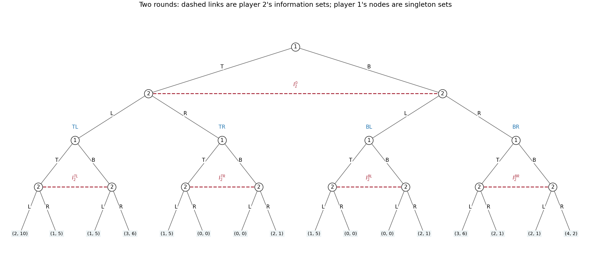

<h1 id="3/b/solution">Solution</h1>

↑ **Parent:** [B](../b.md)

Use the standard [repeated game](../../../../../repeated-game.md) convention that the first round's joint action is observed before round two. The following original [game tree](../../../../../game-tree.md) represents simultaneous moves by making row move first in each round while hiding that current move from column. Terminal labels are **total [payoffs](../../../../../payoff.md) over both rounds**, ordered row then column.

**[Figure 4](#3/b/image-the-full-two-round-extensive-form-game-with-all-sixteen-terminal-payoff-pairs-and-five-column-information-sets). The full two-round extensive-form game, with all sixteen terminal payoff pairs and five column information sets**.

Formally, round one starts at a row decision with actions $T,B$. The two ensuing column nodes form one [information set](../../../../../information-set.md) $I_2^0$, with available actions $L,R$; column cannot tell which current row action occurred. The four completed first-round histories are $H=\{TL,TR,BL,BR\}$. At each $h\in H$, round two begins at a separate row node. Its two successors, after row's current $T$ or $B$, form a column [information set](../../../../../information-set.md) $I_2^h$. Distinct $h$ have distinct [information sets](../../../../../information-set.md): both players know the whole first-round outcome. There are sixteen terminal histories $(h,k)\in H^2$, whose total [payoff](../../../../../payoff.md) is $u(h)+u(k)$, as displayed in the tree.

The row player's five [information sets](../../../../../information-set.md) are the initial singleton and the four singleton round-two nodes, one per $h$. The column player's five [information sets](../../../../../information-set.md) are $I_2^0$ and the four two-node sets $I_2^h$. Thus each player must specify one binary choice at each of five [information sets](../../../../../information-set.md), including histories that its own first choice might prevent:

$$
\boxed{|S_1|=|S_2|=2^5=32.}
$$

Counting only the four possible two-round action sequences would miss the distinct contingent responses to the opponent's first action.

For a concrete pair of complete [pure strategies](../../../../../pure-strategy.md), order the second-round histories as $(TL,TR,BL,BR)$ and use

$$
s_1=(T;B,T,T,T),\qquad s_2=(L;R,L,L,L).
$$

The first entry is the initial action, and the four remaining entries prescribe the action after each first-round history. This induces the unique path $TL$ in round one followed by $BR$ in round two. Hence the total [payoff](../../../../../payoff.md) is

$$
\boxed{(1,5)+(2,1)=(3,6).}
$$

The off-path entries are part of each [pure strategy](../../../../../pure-strategy.md), even though this pair does not reach them.

For randomization, a [mixed strategy](../../../../../mixed-strategy.md) is a [probability distribution](../../../../../probability-distribution-split.md) over the $32$ complete plans, with $31$ free [probabilities](../../../../../probability.md) in a general distribution. A [behavioural strategy](../../../../../behavioural-strategy.md) instead gives one binary-action [probability](../../../../../probability.md) at each of five [information sets](../../../../../information-set.md), requiring five parameters. This game has [perfect recall](../../../../../perfect-recall.md): a player never forgets a previous own action or a first-round observation, and the only concealed action is the opponent's current simultaneous choice. Consequently **neither kind of randomization has a greater attainable-payoff advantage**: [Kuhn's theorem](../../../../../kuhn-s-theorem.md) gives [realization-equivalent strategies](../../../../../realization-equivalent-strategies.md) against every fixed opposing strategy.[original article, pp. 193–216, equivalence under perfect recall](../../../../../extensive-games-and-the-problem-of-information-by-harold-w-kuhn.md)

The equivalence can be verified directly here. Given a [behavioural strategy](../../../../../behavioural-strategy.md), sample all five contingent actions independently before play; the resulting product [probability distribution](../../../../../probability-distribution-split.md) over complete plans is an equivalent [mixed strategy](../../../../../mixed-strategy.md). Conversely, let $\mu$ be a [mixed strategy](../../../../../mixed-strategy.md) for player $i$. Use its marginal [probability](../../../../../probability.md) for the initial action. At history $h$ containing own first action $a_i$, choose second action $b_i$ with [conditional probability](../../../../../conditional-probability.md)

$$
\beta_i(b_i\mid h)=
\frac{\mu\{s:s^0=a_i,\ s^h=b_i\}}
{\mu\{s:s^0=a_i\}},
$$

whenever the denominator is positive; if it is zero, choose arbitrarily at that unreachable history. The opponent's first-round action is simultaneous and cannot depend on the sampled hidden plan beyond the chosen first action. Thus conditioning on $h$ preserves exactly these [conditional probabilities](../../../../../conditional-probability.md) of actions, and multiplying the first- and second-round factors reproduces each terminal [probability](../../../../../probability.md). Correlations between prescriptions at mutually exclusive second-round histories have no further observable effect. [Behavioural strategies](../../../../../behavioural-strategy.md) offer the more compact representation, while [mixed strategies](../../../../../mixed-strategy.md) describe a single random choice of a full plan. Imperfect information here does not mean imperfect recall.

## ↑ Ancestors (11)

1. [B](../b.md)
2. [3](../../3.md)
3. [Computational game theory](../../../computational-game-theory-split.md)
4. [2021](../../../split.md)
5. [Past exam of the MSc in advanced computer science course of the University of Oxford](../../../../split.md)
6. [MSc in advanced computer science course of the University of Oxford](../../../../../msc-in-advanced-computer-science-course-of-the-university-of-oxford.md)
7. [Master's course of the University of Oxford](../../../../../master-s-course-of-the-university-of-oxford.md)
8. [Course of the University of Oxford](../../../../../course-of-the-university-of-oxford.md)
9. [University of Oxford](../../../../../university-of-oxford-split.md)
10. [List of universities](../../../../../list-of-universities.md)
11. [Codex Wiki](../../../../../split.md)
