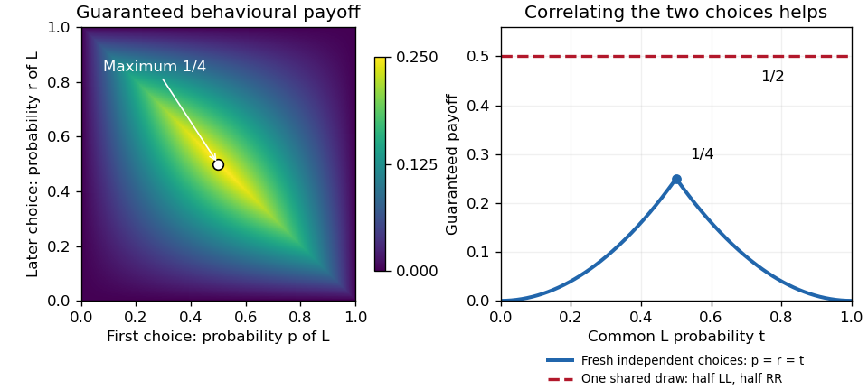

# Computational game theory

↑ **Parent:** [2022](../2022.md)

Solutions to all four questions of the 3 June 2022 paper, including every marked part. Both examination codes identify this same shared undergraduate and MSc paper. Source release: [released examination archive](https://www.whatdotheyknow.com/request/ba_computer_science_past_papers/response/2577745/attach/2/202402%20183%20CS%20Papers.zip?cookie_passthrough=1). The cover date controls despite the archive member's misleading 2021 directory.

**Table of contents**

- [1](#1)
  - [a](#1/a)
    - [Solution](#1/a/solution)
  - [b](#1/b)
    - [Solution](#1/b/solution)
  - [c](#1/c)
    - [Solution](#1/c/solution)
- [2](#2)
  - [a](#2/a)
    - [Solution](#2/a/solution)
  - [b](#2/b)
    - [Solution](#2/b/solution)
  - [c](#2/c)
    - [Solution](#2/c/solution)
- [3](#3)
  - [a](#3/a)
    - [Solution](#3/a/solution)
  - [b](#3/b)
    - [Solution](#3/b/solution)
- [4](#4)
  - [a](#4/a)
    - [Solution](#4/a/solution)
  - [b](#4/b)
    - [Solution](#4/b/solution)
  - [c](#4/c)
    - [i](#4/c/i)
      - [Solution](#4/c/i/solution)
    - [ii](#4/c/ii)
      - [Solution](#4/c/ii/solution)
    - [iii](#4/c/iii)
      - [Solution](#4/c/iii/solution)
    - [iv](#4/c/iv)
      - [Solution](#4/c/iv/solution)

## 1

↑ **Parent:** [Computational game theory](computational-game-theory.md)

<h3 id="1/a">a</h3>

↑ **Parent:** [1](#1)

<h4 id="1/a/solution">Solution</h4>

↑ **Parent:** [A](#1/a)

Let $X$ denote the monetary reward. Its [expected value](../../expected-value.md) and [expected utility](../../utility-function.md#expected-utility) are different quantities:

$$
\mathbb E X=\frac{89}{100}+\frac{10}{10}=\boxed{1.89},\qquad
\mathbb E[u(X)]=\frac{89}{100}+\frac{100}{10}=\frac{1089}{100}=10.89.
$$

Thus indifference to a sure nonnegative reward requires $k^2=10.89$, giving **$k=3.30$ dollars**. This is the [certainty equivalent](../../utility-function.md#certainty-equivalent), hence the [lottery](../../utility-function.md#lottery)'s monetary value in the question's comparison with a sure reward. The [utility function](../../utility-function.md) $u(x)=x^2$ is increasing and [strictly convex](../../real-analysis.md#strictly-convex-function) on nonnegative monetary amounts. Its [certainty equivalent](../../utility-function.md#certainty-equivalent) exceeds its [expected value](../../expected-value.md), $3.30>1.89$, demonstrating **[risk seeking](../../utility-function.md#risk-seeking)**; the same conclusion follows from the [Jensen inequality](../../real-analysis.md#jensen-s-inequality).

The wording about paying an entry fee needs a qualification. A [certainty equivalent](../../utility-function.md#certainty-equivalent) compares a gross [lottery](../../utility-function.md#lottery) with a sure gross reward; a literal [utility indifference price](../../utility-function.md#indifference-price) also accounts for the fee's effect on wealth. If $u$ instead describes final wealth, with initial wealth $w$ and fee $c$, the comparison is $\mathbb E[(w-c+X)^2]=w^2$, on a domain where the [utility function](../../utility-function.md) is increasing. Here $\operatorname{Var}(X)=7.3179$, so the nonnegative-wealth branch gives $c=w+1.89-\sqrt{w^2-7.3179}$ whenever that branch is admissible. An initial wealth and an admissible payment domain are not specified. Therefore **$3.30$ is the determined [certainty equivalent](../../utility-function.md#certainty-equivalent)**, while a literal wealth-dependent maximum fee is not uniquely determined. This is the distinction in [certainty equivalent and willingness to pay](../../utility-function.md#certainty-equivalent-and-willingness-to-pay). If negative rewards were allowed without requiring an increasing [utility function](../../utility-function.md), the equation for $k$ also has the algebraic root $-3.30$; the usual nonnegative-reward interpretation selects the positive root.

<h3 id="1/b">b</h3>

↑ **Parent:** [1](#1)

<h4 id="1/b/solution">Solution</h4>

↑ **Parent:** [B](#1/b)

Write $A$ and $B$ for the two deterministic outcomes. Under the [expected utility hypothesis](../../utility-function.md#expected-utility-hypothesis), indifference between them implies $u(A)=u(B)=c$. The [expected utility](../../utility-function.md#expected-utility) of the fair [lottery](../../utility-function.md#lottery) is consequently

$$
U\left(\tfrac12 A+\tfrac12 B\right)=\tfrac12u(A)+\tfrac12u(B)=c.
$$

It must therefore be indifferent to each deterministic outcome, contradicting the asserted strict preference. **These [preferences](../../set-theory.md#preference-relation) do not admit an [expected utility](../../utility-function.md#expected-utility) representation over the stated outcomes.** Equivalently, [affine utility on probability measures](../../utility-function.md#affine-utility-on-probability-measures) preserves this indifference under mixing, as required by the [independence axiom for lottery preferences](../../utility-function.md#independence-axiom-for-lottery-preferences).

A concern for the fairness of the procedure can be perfectly intelligible. It would require enlarging the outcome description to include the procedure; it cannot be represented by an [expected utility](../../utility-function.md#expected-utility) over only the two final gift recipients while retaining the stated strict preference.

<h3 id="1/c">c</h3>

↑ **Parent:** [1](#1)

<h4 id="1/c/solution">Solution</h4>

↑ **Parent:** [C](#1/c)

First evaluate the inner [lottery](../../utility-function.md#lottery): $U(\ell_1)=12p+3(1-p)=3+9p$. By [reduction of compound lotteries](../../utility-function.md#reduction-of-compound-lotteries), the outer [expected utility](../../utility-function.md#expected-utility) is

$$
U(\ell_2)=2p+(1-p)(3+9p)=3+8p-9p^2
=\frac{43}{9}-9\left(p-\frac49\right)^2.
$$

Since $4/9$ lies in the permitted [real interval](../../real-analysis.md#interval-mathematics), the square is minimized there. The unique maximizer and maximum [expected utility](../../utility-function.md#expected-utility) are **$p=4/9$ and $U(\ell_2)=43/9$**. Directly flattening the [lottery](../../utility-function.md#lottery) gives [probabilities](../../probability-theory.md#probability) $p(1-p)$, $(1-p)^2$ and $p$ for the three outcomes; these sum to one and give the same expression.

## 2

↑ **Parent:** [Computational game theory](computational-game-theory.md)

<h3 id="2/a">a</h3>

↑ **Parent:** [2](#2)

<h4 id="2/a/solution">Solution</h4>

↑ **Parent:** [A](#2/a)

Reading the lower-left number in each source cell as player 1's [payoff](../../game-theory.md#payoff), against an opponent playing $A$ the player's own [payoffs](../../game-theory.md#payoff) from $A,B$ are $y,0$; against $B$ they are $x,x/2$. For $x>0$, identify $A$ with aggressive defection and $B$ with yielding cooperation. The standard [payoffs](../../game-theory.md#payoff) then have values

$$
T=x,\qquad R=x/2,\qquad S=0,\qquad P=y.
$$

The [prisoner's dilemma](../../game-theory.md#prisoner-s-dilemma) ordering $T>R>P>S$ holds precisely for **$x>0$ and $0<y<x/2$** with this labeling. For example, $x=4,y=1$ gives $T=4,R=2,P=1,S=0$. Each player then has the [strictly dominant strategy](../../game-theory.md#strictly-dominant-strategy) $A$, although $(B,B)$ gives both a larger [payoff](../../game-theory.md#payoff) than $(A,A)$. Here $2R=T+S$ as well, so the optional weak aggregate-payoff condition is met with equality.

For the [Chicken payoff ordering](../../game-theory.md#chicken-payoff-ordering), the collision outcome must be worse than yielding to an aggressive opponent: $T>R>S>P$. This holds for **$x>0$ and $y<0$**, for example $x=4,y=-1$. Against $B$, the [best response](../../game-theory.md#best-response) is $A$ because $x>x/2$; against $A$, it is $B$ because $0>y$. Consequently $(A,B)$ and $(B,A)$ are the two [pure strategy](../../game-theory.md#pure-strategy) [Nash equilibria](../../game-theory.md#nash-equilibrium), and mutual aggression is the worst outcome for both.

If action names may be exchanged, there is another [prisoner's dilemma](../../game-theory.md#prisoner-s-dilemma) region: take $A$ as cooperation and $B$ as defection. Then $(T,R,P,S)=(0,y,x/2,x)$, so **$x<0$ and $x/2<y<0$** also work, for example $x=-4,y=-1$. This relabeling explains why the first displayed region is not a necessary condition without an action convention. Equality at any of these boundaries destroys the strict ordering.

<h3 id="2/b">b</h3>

↑ **Parent:** [2](#2)

<h4 id="2/b/solution">Solution</h4>

↑ **Parent:** [B](#2/b)

Represent satisfied and unsatisfied goals by [payoffs](../../game-theory.md#payoff) one and zero. The second player's goal is an [exclusive or](../../theoretical-computer-science.md#exclusive-or): it is true precisely when $q\ne r$, independently of $p$. The first goal is false only when all three [Boolean variables](../../theoretical-computer-science.md#boolean-variable) are false. The resulting [payoff matrix](../../game-theory.md#payoff-matrix) is below; each boxed entry marks that player's [best response](../../game-theory.md#best-response) to the opposing [pure strategy](../../game-theory.md#pure-strategy), including ties:

$$
\begin{array}{c|cccc}
 &pq&p\bar q&\bar p q&\bar p\bar q\\\hline
r&(\boxed{1},0)&(\boxed{1},\boxed{1})&(\boxed{1},0)&(\boxed{1},\boxed{1})\\
\bar r&(\boxed{1},\boxed{1})&(\boxed{1},0)&(\boxed{1},\boxed{1})&(0,0)
\end{array}
$$

For player 1, choosing $r$ satisfies the goal against every opposing [pure strategy](../../game-theory.md#pure-strategy). Choosing $\bar r$ does equally well except against $\bar p\bar q$, where it does worse. Thus **$r$ is player 1's unique [dominant strategy](../../game-theory.md#dominant-strategy) in the weak sense**, and there is no [strictly dominant strategy](../../game-theory.md#strictly-dominant-strategy). The ties are why most first-player entries in both rows are boxed.

For player 2, either [pure strategy](../../game-theory.md#pure-strategy) with $q=0$ is a [best response](../../game-theory.md#best-response) against $r$, while either with $q=1$ is a [best response](../../game-theory.md#best-response) against $\bar r$. No one choice of $q$ works against both rows, so **player 2 has no [dominant strategy](../../game-theory.md#dominant-strategy)**, and **there is no [dominant-strategy equilibrium](../../game-theory.md#dominant-strategy-equilibrium)**. The value of $p$ does not affect player 2's own [payoff](../../game-theory.md#payoff).

The cells with both entries boxed give exactly four [pure strategy](../../game-theory.md#pure-strategy) [Nash equilibria](../../game-theory.md#nash-equilibrium):

$$
\boxed{(r,p\bar q),\quad(r,\bar p\bar q),\quad(\bar r,pq),\quad(\bar r,\bar p q).}
$$

All four give [payoffs](../../game-theory.md#payoff) $(1,1)$. In particular, the [weakly dominated](../../game-theory.md#weakly-dominated-strategy) choice $\bar r$ can occur in a [Nash equilibrium](../../game-theory.md#nash-equilibrium) because player 1 is already satisfied there and cannot strictly improve.

<h3 id="2/c">c</h3>

↑ **Parent:** [2](#2)

<h4 id="2/c/solution">Solution</h4>

↑ **Parent:** [C](#2/c)

The succinct input is the players' variable-control sets, their goal [propositional formulas](../../mathematical-logic.md#propositional-formula), and a complete candidate [Boolean valuation](../../mathematical-logic.md#boolean-valuation); an exponentially expanded [payoff matrix](../../game-theory.md#payoff-matrix) is not part of the input. This representation is essential to [candidate equilibrium checking in a Boolean game](../../game-theory.md#candidate-equilibrium-checking-in-a-boolean-game).

For membership in [co-NP](../../theoretical-computer-science.md#co-np), consider the complement: the candidate is not a [Nash equilibrium](../../game-theory.md#nash-equilibrium). A [complexity certificate](../../theoretical-computer-science.md#certificate-complexity) consists of a player $i$ and an alternative [Boolean valuation](../../mathematical-logic.md#boolean-valuation) of that player's controlled [Boolean variables](../../theoretical-computer-science.md#boolean-variable). Evaluate the current goal and the goal after this [unilateral deviation](../../game-theory.md#unilateral-deviation), keeping every other player's variables fixed. A profitable [unilateral deviation](../../game-theory.md#unilateral-deviation) exists precisely when the current goal is false and the new goal is true. The certificate has at most the number of input variables plus the player index, and both [propositional formula](../../mathematical-logic.md#propositional-formula) evaluations take [polynomial time](../../theoretical-computer-science.md#polynomial-time). Thus the complement belongs to [NP](../../theoretical-computer-science.md#np-complexity), and the original [decision problem](../../theoretical-computer-science.md#decision-problem) belongs to [co-NP](../../theoretical-computer-science.md#co-np).

For hardness, start with a [propositional formula](../../mathematical-logic.md#propositional-formula) $F(X)$ and introduce a fresh [Boolean variable](../../theoretical-computer-science.md#boolean-variable) $z$. Construct a one-player [Boolean game](../../game-theory.md#boolean-game) in which that player controls $X\cup\{z\}$ and has goal

$$
\gamma=z\land F(X).
$$

Choose the candidate [pure strategy](../../game-theory.md#pure-strategy) assigning every variable false. Its [payoff](../../game-theory.md#payoff) is zero because $z$ is false, regardless of $F$. If $F$ has a [satisfying assignment](../../theoretical-computer-science.md#satisfying-assignment), changing $X$ to that assignment and $z$ to true is a profitable [unilateral deviation](../../game-theory.md#unilateral-deviation). If $F$ is an [unsatisfiable Boolean formula](../../theoretical-computer-science.md#unsatisfiable-boolean-formula), no [unilateral deviation](../../game-theory.md#unilateral-deviation) can satisfy the goal. Therefore

$$
F\text{ is unsatisfiable}\quad\Longleftrightarrow\quad
\text{the constructed candidate is a Nash equilibrium}.
$$

The construction increases the formula length by only a constant and writes a candidate of linear length, so it is a [polynomial-time many-one reduction](../../theoretical-computer-science.md#polynomial-time-many-one-reduction). Unsatisfiability is [co-NP](../../theoretical-computer-science.md#co-np)-complete; combining hardness and membership proves that **candidate [Nash equilibrium](../../game-theory.md#nash-equilibrium) checking for [Boolean games](../../game-theory.md#boolean-game) is [co-NP](../../theoretical-computer-science.md#co-np)-complete**. If a convention requires at least two players, add a player controlling a fresh unused variable and having the always-true goal; this changes neither direction of the proof.

## 3

↑ **Parent:** [Computational game theory](computational-game-theory.md)

<h3 id="3/a">a</h3>

↑ **Parent:** [3](#3)

<h4 id="3/a/solution">Solution</h4>

↑ **Parent:** [A](#3/a)

There is **no [perfect recall](../../game-theory.md#perfect-recall)**. Player 1's later [information set](../../game-theory.md#information-set) joins histories following both of her initial actions, so she has forgotten whether she chose $L$ or $R$. It also hides player 2's intervening action, but failure to observe another player's action is [imperfect information](../../game-theory.md#imperfect-information), whereas forgetting one's own earlier action is the particular violation of [perfect recall](../../game-theory.md#perfect-recall). Player 2's two nodes form a single [information set](../../game-theory.md#information-set) because player 2 does not observe the initial choice.

For a [behavioural strategy](../../game-theory.md#behavioural-strategy), let $p$ be player 1's initial [probability](../../probability-theory.md#probability) of $L$ and $r$ her later [probability](../../probability-theory.md#probability) of $L$. These are separate [information sets](../../game-theory.md#information-set), so $p$ and $r$ need not be equal; their random draws are [independent](../../random-variable.md#independent-random-variables). Name player 2's unlabeled branches left and right, and let $q$ be the [probability](../../probability-theory.md#probability) of taking the left branch. The only unit-[payoff](../../game-theory.md#payoff) paths are left–left–left and right–right–right. Consequently

$$
\Pr(u_1=1)=qpr+(1-q)(1-p)(1-r).
$$

Because this is a [zero-sum game](../../game-theory.md#zero-sum-game), the natural meaning of the claimed best [behavioural strategy](../../game-theory.md#behavioural-strategy) is its maximum guaranteed [expected payoff](../../game-theory.md#expected-payoff). Player 2 can choose either branch, so the guarantee at $(p,r)$ is

$$
g(p,r)=\min\{pr,(1-p)(1-r)\}.
$$

For nonnegative numbers, their minimum is at most their [geometric mean](../../arithmetic.md#geometric-mean). Also $p(1-p)\le1/4$ and $r(1-r)\le1/4$, hence

$$
g(p,r)\le\sqrt{p(1-p)r(1-r)}\le\frac14.
$$

Taking $p=r=1/2$ makes both possible branch-conditioned success [probabilities](../../probability-theory.md#probability) $1/4$, so this upper bound is attained against every $q$. Thus **the optimal guaranteed [behavioural strategy](../../game-theory.md#behavioural-strategy) success [probability](../../probability-theory.md#probability) is $1/4$**.

A [mixed strategy](../../game-theory.md#mixed-strategy) can instead select the complete plan $LL$ with [probability](../../probability-theory.md#probability) $1/2$ and the complete plan $RR$ with [probability](../../probability-theory.md#probability) $1/2$. The two choices within a sampled plan are correlated. If player 2 chooses left, exactly the sampled plan $LL$ succeeds; if player 2 chooses right, exactly $RR$ succeeds. Therefore the success [probability](../../probability-theory.md#probability) is

$$
\tfrac12q+\tfrac12(1-q)=\boxed{\tfrac12}
$$

against every opposing [mixed strategy](../../game-theory.md#mixed-strategy). It is optimal among [mixed strategies](../../game-theory.md#mixed-strategy) too: player 2's uniform mixture gives success [probability](../../probability-theory.md#probability) $1/2$ to each of $LL,RR$ and zero to $LR,RL$, so no mixture of the four plans can exceed $1/2$ against that opponent. This establishes [mixed and behavioural security levels without perfect recall](../../game-theory.md#mixed-and-behavioural-security-levels-without-perfect-recall) directly.

**[Figure 1](#3/a/image-independent-behavioural-choices-guarantee-at-most-1-4-whereas-a-mixed-plan-correlates-the-choices-and-guarantees-1-2). Independent behavioural choices guarantee at most $1/4$, whereas a mixed plan correlates the choices and guarantees $1/2$**.

The guarantee qualification matters: if player 2's branch were known to be left, the deterministic plan $LL$ would succeed with [probability](../../probability-theory.md#probability) one. The number $1/4$ is not an upper bound against every fixed opposing choice separately.

<h3 id="3/b">b</h3>

↑ **Parent:** [3](#3)

<h4 id="3/b/solution">Solution</h4>

↑ **Parent:** [B](#3/b)

Against [Tit for tat](../../game-theory.md#tit-for-tat), let $a_t$ be an arbitrary deviator's action at round $t$, and set $a_{-1}=C$ to encode the opponent's initial cooperation. The opponent then plays $a_{t-1}$. Define $h(C)=0$ and $h(D)=3$. The four possible transitions give

$$
\begin{array}{c|c|c|c}
a_{t-1}&a_t&u(a_t,a_{t-1})&3+h(a_t)-h(a_{t-1})\\\hline
C&C&3&3\\
C&D&6&6\\
D&C&0&0\\
D&D&1&3
\end{array}
$$

Thus every stage [payoff](../../game-theory.md#payoff) is at most $3+h(a_t)-h(a_{t-1})$. The [telescoping sum](../../arithmetic.md#telescoping-sum) yields the [uniform payoff bound against Tit for tat](../../game-theory.md#uniform-payoff-bound-against-tit-for-tat):

$$
\sum_{t=0}^{T-1}u(a_t,a_{t-1})\le3T+h(a_{T-1})-h(C)\le3T+3.
$$

After division by $T$, no [long-run average payoff](../../game-theory.md#long-run-average-payoff) can exceed three. The bound applies to every action [sequence](../../sequence-and-series.md#sequence), so in particular it covers every [finite-state machine](../../foundations-of-mathematics.md#finite-state-machine) representing a [unilateral deviation](../../game-theory.md#unilateral-deviation). Mutual [Tit for tat](../../game-theory.md#tit-for-tat) produces $C,C$ in every round and gives each player three. Neither player can improve, proving **$(\mathrm{TFT},\mathrm{TFT})$ is a [Nash equilibrium](../../game-theory.md#nash-equilibrium)**.

Another pair is **$(\mathrm{TFT},\text{grim trigger})$**. Here [grim trigger](../../game-theory.md#grim-trigger) initially cooperates and continues cooperating until the opponent first defects, after which it defects forever. Both strategies are two-state [finite-state machines](../../foundations-of-mathematics.md#finite-state-machine): [Tit for tat](../../game-theory.md#tit-for-tat) records the opponent's previous action, while [grim trigger](../../game-theory.md#grim-trigger) records whether defection has ever occurred. Their prescribed play again consists entirely of cooperation and gives $(3,3)$.

The player using [grim trigger](../../game-theory.md#grim-trigger) faces [Tit for tat](../../game-theory.md#tit-for-tat), so every [unilateral deviation](../../game-theory.md#unilateral-deviation) is bounded by the same [telescoping sum](../../arithmetic.md#telescoping-sum) and cannot improve on three. The player using [Tit for tat](../../game-theory.md#tit-for-tat) faces [grim trigger](../../game-theory.md#grim-trigger). If that player never defects, the [payoff](../../game-theory.md#payoff) remains three. If the first defection occurs at a finite round $\tau$, it gives a one-time [payoff](../../game-theory.md#payoff) six; thereafter the opponent always defects, against which each subsequent [payoff](../../game-theory.md#payoff) is at most one. Any finite initial prefix has zero contribution to the [long-run average payoff](../../game-theory.md#long-run-average-payoff), so such a [unilateral deviation](../../game-theory.md#unilateral-deviation) has limiting upper average at most one. It cannot improve on three either. Both players are therefore [best responses](../../game-theory.md#best-response), proving the second claimed [Nash equilibrium](../../game-theory.md#nash-equilibrium).

For deterministic [finite-state machines](../../foundations-of-mathematics.md#finite-state-machine), the joint state path is eventually periodic, so the displayed averages have a [limit](../../calculus.md#limit-of-a-function). The first bound also controls the limiting upper average for arbitrary action [sequences](../../sequence-and-series.md#sequence), making the no-improvement argument stronger than an enumeration of finite-state deviations. Notice that equality in the bound permits alternating exploitation to average three: equilibrium requires absence of a strict improvement, not uniqueness of a [best response](../../game-theory.md#best-response).

## 4

↑ **Parent:** [Computational game theory](computational-game-theory.md)

<h3 id="4/a">a</h3>

↑ **Parent:** [4](#4)

<h4 id="4/a/solution">Solution</h4>

↑ **Parent:** [A](#4/a)

Write $x(S)=\sum_{i\in S}x_i$. The [core of a cooperative game](../../game-theory.md#core-game-theory) is

$$
C(v)=\{x\in\mathbb R^n:x(N)=v(N),\quad x(S)\ge v(S)\text{ for every }S\subseteq N\}.
$$

Take any $x,y\in C(v)$ and $\alpha\in[0,1]$, and form the [convex combination](../../convex-set.md#convex-combination) $z=\alpha x+(1-\alpha)y$. Its total [payoff](../../game-theory.md#payoff) is $z(N)=\alpha v(N)+(1-\alpha)v(N)=v(N)$. For every [coalition](../../game-theory.md#coalition-game-theory) $S$,

$$
z(S)=\alpha x(S)+(1-\alpha)y(S)\ge\alpha v(S)+(1-\alpha)v(S)=v(S).
$$

Hence $z$ remains in the [core](../../game-theory.md#core-game-theory). **The [core](../../game-theory.md#core-game-theory) is a [convex set](../../convex-set.md)**, even when the [transferable utility game](../../game-theory.md#transferable-utility-game) is not a [convex cooperative game](../../game-theory.md#convex-cooperative-game). An empty [core](../../game-theory.md#core-game-theory) is a [convex set](../../convex-set.md) vacuously; the argument does not claim nonemptiness. Geometrically, the same conclusion follows because the constraints intersect an [affine hyperplane](../../vector-space.md#affine-hyperplane) with [closed half-spaces](../../convex-set.md#closed-half-space).

<h3 id="4/b">b</h3>

↑ **Parent:** [4](#4)

<h4 id="4/b/solution">Solution</h4>

↑ **Parent:** [B](#4/b)

Assume the standard [empty-coalition normalization](../../game-theory.md#empty-coalition-normalization) $v(\varnothing)=0$. A [convex cooperative game](../../game-theory.md#convex-cooperative-game) has increasing [marginal contributions](../../game-theory.md#marginal-contribution): whenever $A\subseteq B$ and $i\notin B$,

$$
v(A\cup\{i\})-v(A)\le v(B\cup\{i\})-v(B).
$$

This follows from the [supermodular](../../function.md#supermodular-set-function) inequality applied to $A\cup\{i\}$ and $B$. Fix a [permutation](../../combinatorics.md#permutation) $\pi$ of all players, let $P_i$ be the players preceding $i$, and form its [marginal contribution vector](../../game-theory.md#marginal-contribution-vector)

$$
m_i^\pi=v(P_i\cup\{i\})-v(P_i).
$$

Summing along the full [permutation](../../combinatorics.md#permutation) is a [telescoping sum](../../arithmetic.md#telescoping-sum), so $\sum_{i\in N}m_i^\pi=v(N)$. For an arbitrary [coalition](../../game-theory.md#coalition-game-theory) $S$, list its members in their induced order $i_1,\ldots,i_k$, and put $S_j=\{i_1,\ldots,i_j\}$. Since $S_{j-1}\subseteq P_{i_j}$, increasing [marginal contributions](../../game-theory.md#marginal-contribution) give

$$
\sum_{i\in S}m_i^\pi\ge\sum_{j=1}^k\bigl(v(S_j)-v(S_{j-1})\bigr)=v(S).
$$

Thus every [marginal contribution vector](../../game-theory.md#marginal-contribution-vector) belongs to the [core](../../game-theory.md#core-game-theory). The vector of [Shapley values](../../game-theory.md#shapley-value) is exactly their uniform average over the $n!$ [permutations](../../combinatorics.md#permutation), hence a [convex combination](../../convex-set.md#convex-combination). By the preceding part, that average is in the [core](../../game-theory.md#core-game-theory). This proves that **the [Shapley value](../../game-theory.md#shapley-value) allocation belongs to the [core](../../game-theory.md#core-game-theory) of a [convex cooperative game](../../game-theory.md#convex-cooperative-game)**, including every [coalition](../../game-theory.md#coalition-game-theory) constraint. It is the result [Shapley value belongs to the core of a convex game](../../game-theory.md#shapley-value-belongs-to-the-core-of-a-convex-game).

<h3 id="4/c">c</h3>

↑ **Parent:** [4](#4)

<h4 id="4/c/i">i</h4>

↑ **Parent:** [C](#4/c)

<h5 id="4/c/i/solution">Solution</h5>

↑ **Parent:** [I](#4/c/i)

**Yes.** Use the [simple cooperative game](../../game-theory.md#simple-cooperative-game) in which a [coalition](../../game-theory.md#coalition-game-theory) wins exactly when it contains at least two players. In every [permutation](../../combinatorics.md#permutation), precisely the second arrival changes a losing [coalition](../../game-theory.md#coalition-game-theory) into a winning one. Each player is second in two of the six [permutations](../../combinatorics.md#permutation), so each [Shapley value](../../game-theory.md#shapley-value) is $2/6=1/3$. This constructs the required vector while verifying that singleton [coalitions](../../game-theory.md#coalition-game-theory) lose and the grand [coalition](../../game-theory.md#coalition-game-theory) wins.

<h4 id="4/c/ii">ii</h4>

↑ **Parent:** [C](#4/c)

<h5 id="4/c/ii/solution">Solution</h5>

↑ **Parent:** [Ii](#4/c/ii)

**No.** In a [simple cooperative game](../../game-theory.md#simple-cooperative-game), a player's [marginal contribution](../../game-theory.md#marginal-contribution) along any [permutation](../../combinatorics.md#permutation) is zero or one. With three players there are six equally likely [permutations](../../combinatorics.md#permutation), so every [Shapley value](../../game-theory.md#shapley-value) is an integer multiple of $1/6$, by the [Shapley value denominator in a simple game](../../game-theory.md#shapley-value-denominator-in-a-simple-game). But $6(5/12)=5/2$ and $6(3/12)=3/2$ are not integers. The vector sums to one, but fails this necessary denominator condition.

<h4 id="4/c/iii">iii</h4>

↑ **Parent:** [C](#4/c)

<h5 id="4/c/iii/solution">Solution</h5>

↑ **Parent:** [Iii](#4/c/iii)

**Yes.** Give players $1,2,3$ weights $1,1,2$, respectively, and let the quota be three. This [weighted voting game](../../game-theory.md#weighted-voting-game) is a [simple cooperative game](../../game-theory.md#simple-cooperative-game) whose minimal winning [coalitions](../../game-theory.md#coalition-game-theory) are $\{1,3\}$ and $\{2,3\}$. In orders $123,132,213,231$, player 3 supplies the winning [marginal contribution](../../game-theory.md#marginal-contribution). In order $312$ player 1 does, and in order $321$ player 2 does. Averaging the six [marginal contribution vectors](../../game-theory.md#marginal-contribution-vector) gives exactly **$(1/6,1/6,4/6)$** as the vector of [Shapley values](../../game-theory.md#shapley-value).

<h4 id="4/c/iv">iv</h4>

↑ **Parent:** [C](#4/c)

<h5 id="4/c/iv/solution">Solution</h5>

↑ **Parent:** [Iv](#4/c/iv)

**No.** The denominator test from part ii is satisfied here, so a stronger obstruction is needed. Put $a_i=v(\{i\})$ and $b_{ij}=v(\{i,j\})$. In a three-player [simple cooperative game](../../game-theory.md#simple-cooperative-game), the [Shapley value](../../game-theory.md#shapley-value) formula gives, for distinct $i,j,k$,

$$
\phi_i=\frac13a_i+\frac16(b_{ij}-a_j)+\frac16(b_{ik}-a_k)+\frac13(1-b_{jk}).
$$

Subtract the corresponding expression for $\phi_j$:

$$
\phi_i-\phi_j=\frac12\bigl(a_i-a_j+b_{ik}-b_{jk}\bigr).
$$

Each [coalition](../../game-theory.md#coalition-game-theory) value is zero or one, so this difference must be an integer multiple of $1/2$. This is the obstruction from [pairwise Shapley differences in a three-player simple game](../../game-theory.md#pairwise-shapley-differences-in-a-three-player-simple-game). The proposed first two coordinates differ by $1/6$, which is not an integer multiple of $1/2$. Therefore the vector cannot occur, even though each coordinate separately passes the $1/6$ denominator test.

## ↑ Ancestors (8)

1. [2022](../2022.md)
2. [Past exam of the MSc in advanced computer science course of the University of Oxford](../../past-exam-of-the-msc-in-advanced-computer-science-course-of-the-university-of-oxford.md)
3. [MSc in advanced computer science course of the University of Oxford](../../university-of-oxford.md#msc-in-advanced-computer-science-course-of-the-university-of-oxford)
4. [Master's course of the University of Oxford](../../university-of-oxford.md#master-s-course-of-the-university-of-oxford)
5. [Course of the University of Oxford](../../university-of-oxford.md#course-of-the-university-of-oxford)
6. [University of Oxford](../../university-of-oxford.md)
7. [List of universities](../../README.md#list-of-universities)
8. [Codex Wiki](../../README.md)
