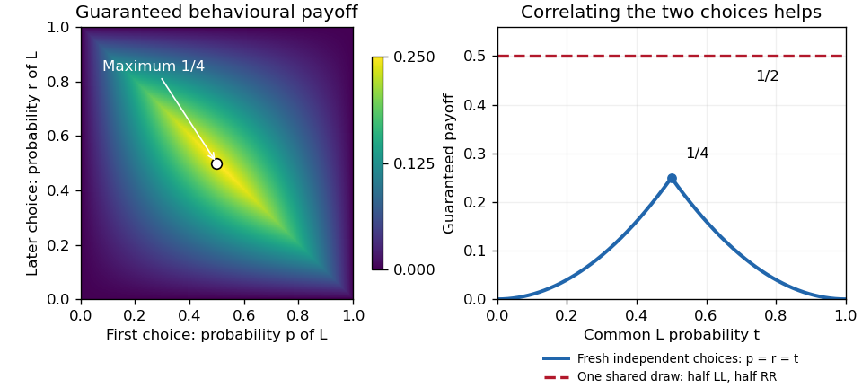

<h1 id="3/a/solution">Solution</h1>

↑ **Parent:** [A](../a.md)

There is **no [perfect recall](../../../../../perfect-recall.md)**. Player 1's later [information set](../../../../../information-set.md) joins histories following both of her initial actions, so she has forgotten whether she chose $L$ or $R$. It also hides player 2's intervening action, but failure to observe another player's action is [imperfect information](../../../../../imperfect-information.md), whereas forgetting one's own earlier action is the particular violation of [perfect recall](../../../../../perfect-recall.md). Player 2's two nodes form a single [information set](../../../../../information-set.md) because player 2 does not observe the initial choice.

For a [behavioural strategy](../../../../../behavioural-strategy.md), let $p$ be player 1's initial [probability](../../../../../probability.md) of $L$ and $r$ her later [probability](../../../../../probability.md) of $L$. These are separate [information sets](../../../../../information-set.md), so $p$ and $r$ need not be equal; their random draws are [independent](../../../../../independent-random-variables.md). Name player 2's unlabeled branches left and right, and let $q$ be the [probability](../../../../../probability.md) of taking the left branch. The only unit-[payoff](../../../../../payoff.md) paths are left–left–left and right–right–right. Consequently

$$
\Pr(u_1=1)=qpr+(1-q)(1-p)(1-r).
$$

Because this is a [zero-sum game](../../../../../zero-sum-game.md), the natural meaning of the claimed best [behavioural strategy](../../../../../behavioural-strategy.md) is its maximum guaranteed [expected payoff](../../../../../expected-payoff.md). Player 2 can choose either branch, so the guarantee at $(p,r)$ is

$$
g(p,r)=\min\{pr,(1-p)(1-r)\}.
$$

For nonnegative numbers, their minimum is at most their [geometric mean](../../../../../geometric-mean.md). Also $p(1-p)\le1/4$ and $r(1-r)\le1/4$, hence

$$
g(p,r)\le\sqrt{p(1-p)r(1-r)}\le\frac14.
$$

Taking $p=r=1/2$ makes both possible branch-conditioned success [probabilities](../../../../../probability.md) $1/4$, so this upper bound is attained against every $q$. Thus **the optimal guaranteed [behavioural strategy](../../../../../behavioural-strategy.md) success [probability](../../../../../probability.md) is $1/4$**.

A [mixed strategy](../../../../../mixed-strategy.md) can instead select the complete plan $LL$ with [probability](../../../../../probability.md) $1/2$ and the complete plan $RR$ with [probability](../../../../../probability.md) $1/2$. The two choices within a sampled plan are correlated. If player 2 chooses left, exactly the sampled plan $LL$ succeeds; if player 2 chooses right, exactly $RR$ succeeds. Therefore the success [probability](../../../../../probability.md) is

$$
\tfrac12q+\tfrac12(1-q)=\boxed{\tfrac12}
$$

against every opposing [mixed strategy](../../../../../mixed-strategy.md). It is optimal among [mixed strategies](../../../../../mixed-strategy.md) too: player 2's uniform mixture gives success [probability](../../../../../probability.md) $1/2$ to each of $LL,RR$ and zero to $LR,RL$, so no mixture of the four plans can exceed $1/2$ against that opponent. This establishes [mixed and behavioural security levels without perfect recall](../../../../../mixed-and-behavioural-security-levels-without-perfect-recall.md) directly.

**[Figure 1](#3/a/image-independent-behavioural-choices-guarantee-at-most-1-4-whereas-a-mixed-plan-correlates-the-choices-and-guarantees-1-2). Independent behavioural choices guarantee at most $1/4$, whereas a mixed plan correlates the choices and guarantees $1/2$**.

The guarantee qualification matters: if player 2's branch were known to be left, the deterministic plan $LL$ would succeed with [probability](../../../../../probability.md) one. The number $1/4$ is not an upper bound against every fixed opposing choice separately.

## ↑ Ancestors (11)

1. [A](../a.md)
2. [3](../../3.md)
3. [Computational game theory](../../../computational-game-theory-split.md)
4. [2022](../../../split.md)
5. [Past exam of the MSc in advanced computer science course of the University of Oxford](../../../../split.md)
6. [MSc in advanced computer science course of the University of Oxford](../../../../../msc-in-advanced-computer-science-course-of-the-university-of-oxford.md)
7. [Master's course of the University of Oxford](../../../../../master-s-course-of-the-university-of-oxford.md)
8. [Course of the University of Oxford](../../../../../course-of-the-university-of-oxford.md)
9. [University of Oxford](../../../../../university-of-oxford-split.md)
10. [List of universities](../../../../../list-of-universities.md)
11. [Codex Wiki](../../../../../split.md)
