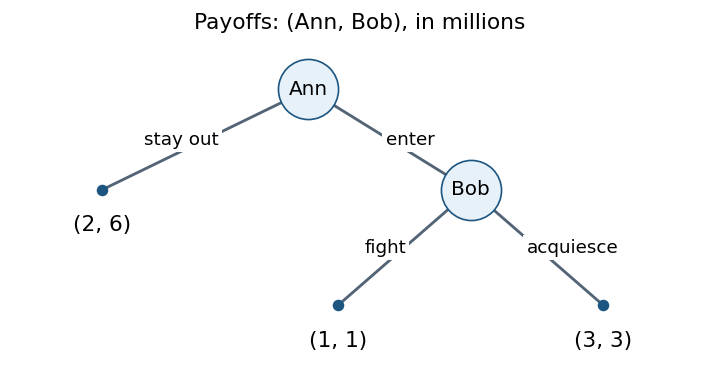
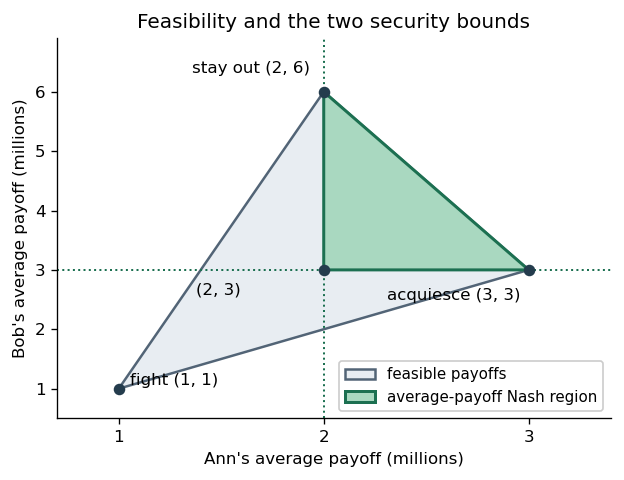
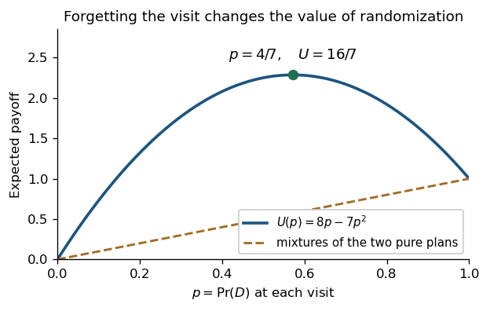

# Computational game theory

↑ **Parent:** [2023](../2023.md)

Solutions to all four questions and all ten marked lettered parts of the University of Oxford examination held on 1 June 2023. Every unlabelled bullet task within those parts is covered. Source release: [released examination archive](https://www.whatdotheyknow.com/request/ba_computer_science_past_papers/response/2577745/attach/2/202402%20183%20CS%20Papers.zip?cookie_passthrough=1), member 2022/T/a15684w1.pdf; the cover identifies the paper as Trinity Term 2023. Question statements and original diagrams are omitted. Necessary conventions about finite representations, repeated-game payoffs and empty-coalition normalization are stated at the affected parts.

**Table of contents**

- [1](#1)
  - [a](#1/a)
    - [Solution](#1/a/solution)
  - [b](#1/b)
    - [Solution](#1/b/solution)
  - [c](#1/c)
    - [Solution](#1/c/solution)
- [2](#2)
  - [a](#2/a)
    - [Solution](#2/a/solution)
  - [b](#2/b)
    - [Solution](#2/b/solution)
- [3](#3)
  - [a](#3/a)
    - [Solution](#3/a/solution)
  - [b](#3/b)
    - [Solution](#3/b/solution)
- [4](#4)
  - [a](#4/a)
    - [Solution](#4/a/solution)
  - [b](#4/b)
    - [Solution](#4/b/solution)
  - [c](#4/c)
    - [Solution](#4/c/solution)

## 1

↑ **Parent:** [Computational game theory](computational-game-theory.md)

<h3 id="1/a">a</h3>

↑ **Parent:** [1](#1)

<h4 id="1/a/solution">Solution</h4>

↑ **Parent:** [A](#1/a)

Under the [expected utility hypothesis](../../utility-function.md#expected-utility-hypothesis), use [positive affine uniqueness of affine preference representations](../../utility-function.md#positive-affine-uniqueness-of-affine-preference-representations) to normalize the extreme outcomes to $u(\omega_1)=1$ and $u(\omega_4)=0$. The stated [indifference relations](../../set-theory.md#indifference-relation) then give

$$
u(\omega_2)=\frac35,\qquad u(\omega_3)=\frac15.
$$

The two [lotteries](../../utility-function.md#lottery) have [expected utilities](../../utility-function.md#expected-utility)

$$
\begin{aligned}
U(\ell_1)&=\frac14\left(1+\frac35+\frac15+0\right)=\frac9{20}=0.45,\\
U(\ell_2)&=\frac3{20}+\frac12\frac35+\frac3{20}\frac15=\frac{12}{25}=0.48.
\end{aligned}
$$

Hence **$\ell_2\succ\ell_1$**, with normalized [expected utility](../../utility-function.md#expected-utility) difference $3/100$. Equivalently, substitution reduces them to [lotteries](../../utility-function.md#lottery) with probabilities $0.45$ and $0.48$ of the better extreme outcome. The inference uses the [independence axiom for lottery preferences](../../utility-function.md#independence-axiom-for-lottery-preferences); the three displayed outcome comparisons alone would not determine preferences over all compound [lotteries](../../utility-function.md#lottery) without the [expected utility hypothesis](../../utility-function.md#expected-utility-hypothesis).

<h3 id="1/b">b</h3>

↑ **Parent:** [1](#1)

<h4 id="1/b/solution">Solution</h4>

↑ **Parent:** [B](#1/b)

**Yes: the stated order has an [expected utility](../../utility-function.md#expected-utility) representation.** For outcomes whose monetary amounts are $1,2,4$, respectively, choose

$$
u(1)=2,\qquad u(2)=0,\qquad u(4)=3.
$$

Then

$$
\begin{aligned}
U(\ell_1)&=\tfrac12\,0+\tfrac12\,3=\tfrac32,\\
U(\ell_2)&=\tfrac35\,2+\tfrac25\,3=\tfrac{12}{5},\\
U(\ell_3)&=\tfrac9{10}\,2+\tfrac1{10}\,0=\tfrac95,\\
U(\ell_4)&=\tfrac35\,0+\tfrac25\,2=\tfrac45.
\end{aligned}
$$

Since $12/5>9/5>3/2>4/5$, this [utility function](../../utility-function.md) gives exactly the required [strict preferences](../../set-theory.md#strict-preference).

The distinction is that the [expected utility hypothesis](../../utility-function.md#expected-utility-hypothesis) does not by itself require the [utility function](../../utility-function.md) to increase with monetary amount. This [nonmonotone monetary utility](../../utility-function.md#nonmonotone-monetary-utility) ranks the outcome paying 2 below the outcome paying 1. If increasing monetary [utility](../../mathematics.md#utility) were imposed as an additional assumption, the stated order would fail: $\ell_3\succ\ell_4$ requires $u(1)>u(2)$ because

$$
U(\ell_3)-U(\ell_4)=\tfrac12\bigl(u(1)-u(2)\bigr).
$$

That additional monotonicity assumption is not printed in this part.

<h3 id="1/c">c</h3>

↑ **Parent:** [1](#1)

<h4 id="1/c/solution">Solution</h4>

↑ **Parent:** [C](#1/c)

For the intended finite representation, put $m=|S|<\infty$. For each $T\subseteq S$, form the [minterm](../../mathematical-logic.md#minterm)

$$
\chi_T=
\left(\bigwedge_{s_i\in T}x_i\right)\land
\left(\bigwedge_{s_i\notin T}\neg x_i\right).
$$

A [Boolean valuation](../../mathematical-logic.md#boolean-valuation) satisfies $\chi_T$ exactly when its selected subset is $T$. Therefore the [weighted formula utility representation](../../utility-function.md#weighted-formula-utility-representation)

$$
\mathcal R_u=\{(\chi_T,u(T)):T\subseteq S\}
$$

represents $u$ exactly: at the [Boolean valuation](../../mathematical-logic.md#boolean-valuation) for $T$, only that [minterm](../../mathematical-logic.md#minterm) contributes, with weight $u(T)$. This proves **completeness and the bound of $2^{|S|}$ rules** simultaneously. Zero-weight rules may be omitted. The bound counts rules; writing each [minterm](../../mathematical-logic.md#minterm) also requires $O(m)$ symbols in [Big O notation](../../real-analysis.md#big-o-notation).

For the computational question, assume rule weights are [rational numbers](../../number-theory.md#rational-number) encoded in binary. This makes exact equality of sums a finite computational task. With this conventional encoding, **equivalence of [weighted formula utility representations](../../utility-function.md#weighted-formula-utility-representation) is [co-NP](../../theoretical-computer-science.md#co-np)-complete**.

For membership, the complement has a short witness: a [Boolean valuation](../../mathematical-logic.md#boolean-valuation) on the variables occurring in either rule base. Evaluate each [propositional formula](../../mathematical-logic.md#propositional-formula), sum the weights of satisfied rules, and accept the witness if the sums differ. [Propositional formula](../../mathematical-logic.md#propositional-formula) evaluation takes [polynomial time](../../theoretical-computer-science.md#polynomial-time). Exact sums of binary [rational numbers](../../number-theory.md#rational-number) also have polynomially bounded bit lengths: the product of their denominators has bit length at most the sum of the input denominator lengths. Thus non-equivalence lies in [NP](../../theoretical-computer-science.md#np-complexity), and equivalence lies in [co-NP](../../theoretical-computer-science.md#co-np).

For hardness, take a [Boolean satisfiability problem](../../theoretical-computer-science.md#boolean-satisfiability-problem) instance $\theta$ and construct

$$
\mathcal R_1=\{(\theta,1)\},\qquad \mathcal R_2=\varnothing.
$$

The first [utility function](../../utility-function.md) is one at satisfying [Boolean valuations](../../mathematical-logic.md#boolean-valuation) and zero elsewhere, while the second is always zero. Consequently

$$
\mathcal R_1\equiv\mathcal R_2
\iff \theta\text{ is an unsatisfiable Boolean formula}.
$$

The [unsatisfiable Boolean formula](../../theoretical-computer-science.md#unsatisfiable-boolean-formula) problem is [co-NP](../../theoretical-computer-science.md#co-np)-complete, as the complement of the [NP](../../theoretical-computer-science.md#np-complexity)-complete [Boolean satisfiability problem](../../theoretical-computer-science.md#boolean-satisfiability-problem). The construction is a [polynomial-time reduction](../../theoretical-computer-science.md#polynomial-time-reduction), proving hardness even with the single weight $1$.

Two qualifications matter in the literal wording. First, unrestricted real weights have no specified finite encoding, so a standard bit-complexity classification needs the encoding assumption above. Second, the problem says only that $S$ is nonempty. If infinite $S$ is allowed while rule bases remain finite, its completeness claim is false. For $S=\mathbb N$, take $u(T)=1$ when $T$ is infinite and $u(T)=0$ when $T$ is finite. A finite rule base mentions only a finite subset $F$ of the variables. The [Boolean valuations](../../mathematical-logic.md#boolean-valuation) for $\varnothing$ and $\mathbb N\setminus F$ agree on all those variables but have different required values. No such rule base represents this $u$. Thus the construction answers the intended finite-set question and identifies the missing hypothesis in the unrestricted statement.

## 2

↑ **Parent:** [Computational game theory](computational-game-theory.md)

<h3 id="2/a">a</h3>

↑ **Parent:** [2](#2)

<h4 id="2/a/solution">Solution</h4>

↑ **Parent:** [A](#2/a)

Read the lower-left entry of each cell as player 1's [payoff](../../game-theory.md#payoff) and the upper-right entry as player 2's [payoff](../../game-theory.md#payoff), as indicated by the source diagram. Against $L$, player 1 strictly prefers $B$ because $2\pi>1$; against $R$, player 1 strictly prefers $T$ because $3>2$. Against $T$, player 2 strictly prefers $R$ because $6>0$; against $B$, player 2 strictly prefers $L$ because $2\sqrt2>2$. Thus the [pure strategy](../../game-theory.md#pure-strategy) [Nash equilibria](../../game-theory.md#nash-equilibrium) are

$$
\boxed{(T,R)\quad\text{and}\quad(B,L).}
$$

For a fully [mixed strategy](../../game-theory.md#mixed-strategy) [Nash equilibrium](../../game-theory.md#nash-equilibrium), write $p=\Pr(T)$ and $q=\Pr(L)$. Player 1's [expected payoffs](../../game-theory.md#expected-payoff) from the two [pure strategies](../../game-theory.md#pure-strategy) are

$$
U_1(T,q)=3-2q,\qquad
U_1(B,q)=2+(2\pi-2)q.
$$

Equality, required when both [pure strategies](../../game-theory.md#pure-strategy) have positive [probability](../../probability-theory.md#probability), gives

$$
q^*=\frac1{2\pi}.
$$

Player 2's corresponding [expected payoffs](../../game-theory.md#expected-payoff) are

$$
U_2(p,L)=2\sqrt2(1-p),\qquad
U_2(p,R)=2+4p,
$$

so equality gives

$$
p^*=\frac{\sqrt2-1}{\sqrt2+2}=\frac{3\sqrt2-4}{2}.
$$

Both probabilities lie strictly between zero and one. Hence the unique fully [mixed strategy](../../game-theory.md#mixed-strategy) [Nash equilibrium](../../game-theory.md#nash-equilibrium) is

$$
\boxed{
\sigma_1(T)=\frac{\sqrt2-1}{\sqrt2+2},\qquad
\sigma_2(L)=\frac1{2\pi},
}
$$

with complementary probabilities on $B$ and $R$. Its [expected payoffs](../../game-theory.md#expected-payoff) are

$$
U_1=3-\frac1\pi,\qquad U_2=6\sqrt2-6.
$$

These are **all three [Nash equilibria](../../game-theory.md#nash-equilibrium)**. There are no equilibria with just one player genuinely mixing: against each opposing [pure strategy](../../game-theory.md#pure-strategy), the other player's [best response](../../game-theory.md#best-response) is unique, so that player cannot mix. When both players mix, the two linear indifference equations have the unique solution just obtained. This is [support enumeration for a bimatrix game](../../game-theory.md#support-enumeration-for-a-bimatrix-game) with all possible supports checked.

<h3 id="2/b">b</h3>

↑ **Parent:** [2](#2)

<h4 id="2/b/solution">Solution</h4>

↑ **Parent:** [B](#2/b)

The definition in this part uses a single [Boolean valuation](../../mathematical-logic.md#boolean-valuation), so the relevant [Nash equilibria](../../game-theory.md#nash-equilibrium) are [pure strategy](../../game-theory.md#pure-strategy) equilibria of a [Boolean game](../../game-theory.md#boolean-game). Use its standard convention that the players' control sets form a [set partition](../../combinatorics.md#set-partition) of the variables.

Membership follows from an existential choice of a [strategy profile](../../game-theory.md#strategy-profile) and a universal check of all [unilateral deviations](../../game-theory.md#unilateral-deviation). Assign [payoff](../../game-theory.md#payoff) one to satisfying a player's goal and zero otherwise. A [strategy profile](../../game-theory.md#strategy-profile) $\sigma$ is a [Nash equilibrium](../../game-theory.md#nash-equilibrium) precisely when, for every player $i$ and every alternative [Boolean valuation](../../mathematical-logic.md#boolean-valuation) $\tau_i$ of that player's variables,

$$
\gamma_i(\sigma)\ \lor\ \neg\gamma_i(\tau_i,\sigma_{-i})
$$

is true: either the goal is already satisfied or no deviation can satisfy it. Thus the requested property is

$$
\exists\sigma\ \forall(i,\tau_i)\quad
\left[
\phi(\sigma)\land
\bigl(\gamma_i(\sigma)\lor
\neg\gamma_i(\tau_i,\sigma_{-i})\bigr)
\right].
$$

The strings encoding $\sigma$, $i$ and $\tau_i$ have polynomial length, and evaluating the bracketed [propositional formulas](../../mathematical-logic.md#propositional-formula) takes [polynomial time](../../theoretical-computer-science.md#polynomial-time). Invalid encodings of a player index can simply be ignored by the test. This is the existential [second level of the polynomial hierarchy](../../theoretical-computer-science.md#second-level-of-the-polynomial-hierarchy), $\Sigma_2^{\mathrm P}$.

For hardness, reduce the canonical complete problem of deciding a [two-block quantified Boolean formula](../../theoretical-computer-science.md#two-block-quantified-boolean-formula)

$$
\exists X\ \forall Y\ \psi(X,Y).
$$

Make a two-player [Boolean game](../../game-theory.md#boolean-game): player 1 controls $X$ and has goal $\gamma_1=\top$; player 2 controls $Y$ and has goal $\gamma_2=\neg\psi$. Set the query formula to $\phi=\psi$. The construction has size linear in the input formula.

If an assignment $x$ satisfies $\forall Y\,\psi(x,Y)$, combine it with any assignment $y$. Player 1 already satisfies its goal, and player 2 cannot satisfy $\neg\psi$ by any [unilateral deviation](../../game-theory.md#unilateral-deviation). Thus $(x,y)$ is a [Nash equilibrium](../../game-theory.md#nash-equilibrium) satisfying the query.

Conversely, let $(x,y)$ be a [Nash equilibrium](../../game-theory.md#nash-equilibrium) satisfying $\psi$. Player 2 currently has [payoff](../../game-theory.md#payoff) zero. If some alternative $y'$ made $\psi(x,y')$ false, that deviation would satisfy player 2's goal and increase its [payoff](../../game-theory.md#payoff) to one. The [Nash equilibrium](../../game-theory.md#nash-equilibrium) condition therefore implies $\forall Y\,\psi(x,Y)$. This proves the required equivalence and the [polynomial-time reduction](../../theoretical-computer-science.md#polynomial-time-reduction).

Together, membership and hardness prove **$\Sigma_2^{\mathrm P}$-completeness** of [existential equilibrium checking in a Boolean game](../../game-theory.md#existential-equilibrium-checking-in-a-boolean-game). The reduction works with only two players and one constant goal.

## 3

↑ **Parent:** [Computational game theory](computational-game-theory.md)

<h3 id="3/a">a</h3>

↑ **Parent:** [3](#3)

<h4 id="3/a/solution">Solution</h4>

↑ **Parent:** [A](#3/a)

Measure all [payoffs](../../game-theory.md#payoff) in millions of dollars, in the order (Ann, Bob). Since both players maximize expected money, those numbers are already their [expected utility](../../utility-function.md#expected-utility) scale.

In the [extensive-form game](../../game-theory.md#extensive-form-game), Ann moves first. Staying out terminates at $(2,6)$. Entering leads to Bob's observed decision between fighting, with terminal [payoffs](../../game-theory.md#payoff) $(1,1)$, and acquiescing, with terminal [payoffs](../../game-theory.md#payoff) $(3,3)$. Each decision node is its own [information set](../../game-theory.md#information-set), so this is a [perfect-information game](../../game-theory.md#perfect-information-game).

**[Figure 1](#3/a/image-the-entry-decision-as-a-perfect-information-game). The entry decision as a perfect-information game**.

The corresponding [normal-form game](../../game-theory.md#normal-form-game) gives Ann the [pure strategies](../../game-theory.md#pure-strategy) $O$ (stay out) and $E$ (enter), and Bob the complete contingent [pure strategies](../../game-theory.md#pure-strategy) $F$ (fight if entry occurs) and $A$ (acquiesce if entry occurs). The [payoff matrix](../../game-theory.md#payoff-matrix) is

$$
\begin{array}{c|cc}
&F&A\\ \hline
O&(2,6)&(2,6)\\
E&(1,1)&(3,3)
\end{array}.
$$

The [pure strategy](../../game-theory.md#pure-strategy) [Nash equilibria](../../game-theory.md#nash-equilibrium) are **$(O,F)$ and $(E,A)$**. Against $F$, Ann prefers $O$; against $A$, Ann prefers $E$. When Ann stays out, Bob's contingent response does not affect his [payoff](../../game-theory.md#payoff), so $F$ is a [best response](../../game-theory.md#best-response) there.

There is exactly one [subgame perfect equilibrium](../../game-theory.md#subgame-perfect-equilibrium), **$(E,A)$**. In the subgame following entry, Bob strictly prefers $3$ to $1$, so [backward induction](../../foundations-of-mathematics.md#backward-induction) selects acquiescence; Ann then strictly prefers entering for $3$ to staying out for $2$. The threat supporting $(O,F)$ is not optimal in that one-shot subgame.

For infinite repetition, the paper specifies no discount factor. First take the [long-run average payoff](../../game-theory.md#long-run-average-payoff) convention, with all past actions observed. The [feasible payoff set](../../game-theory.md#feasible-payoff-set) is the [convex hull](../../convex-set.md#convex-hull)

$$
\mathcal F=\operatorname{conv}\{(2,6),(1,1),(3,3)\}.
$$

Ann can guarantee $2$ in every stage by staying out; Bob can guarantee at least $3$ in every stage by acquiescing whenever entry occurs. These guarantees are also their [minmax payoffs](../../game-theory.md#minmax-payoff): fighting holds Ann's best possible stage [payoff](../../game-theory.md#payoff) to $2$, and entering holds Bob's best possible stage [payoff](../../game-theory.md#payoff) to $3$.

Therefore the sustainable [Nash equilibrium](../../game-theory.md#nash-equilibrium) average [payoffs](../../game-theory.md#payoff) are exactly the feasible, weakly [individually rational payoffs in a repeated game](../../game-theory.md#individually-rational-payoff-in-a-repeated-game):

$$
\boxed{\mathcal F\cap\{(a,b):a\ge2,\ b\ge3\}
=\{(a,b):2\le a\le3,\ 3\le b\le12-3a\}.}
$$

This is the closed triangle with vertices $(2,3),(2,6),(3,3)$.

Here is a direct sufficiency argument for this particular game. Choose a publicly known sequence of stage outcomes whose frequencies give the target point. Before any observed deviation, follow that sequence. After an Ann deviation, Bob fights forever, so Ann can thereafter obtain at most $2$ per stage. After a Bob deviation, Ann enters forever, so Bob can thereafter obtain at most $3$ per stage. A finite prefix has no effect on [long-run average payoff](../../game-theory.md#long-run-average-payoff), so no [unilateral deviation](../../game-theory.md#unilateral-deviation) improves a target with $a\ge2,b\ge3$. Rational frequencies can be implemented periodically; arbitrary real frequencies can be implemented by a deterministic sequence with convergent frequencies. Thus even the weak boundary is covered here. In particular, **staying out forever and entry followed by acquiescence forever are sustainable; fighting forever is not**.

**[Figure 2](#3/a/image-the-feasible-payoff-set-and-sustainable-long-run-average-payoffs). The feasible payoff set and sustainable long-run average payoffs**.

For discounted [payoffs](../../game-theory.md#payoff) $(1-\delta)\sum_{t\ge0}\delta^t u_i^t$, the [folk theorem for repeated games](../../game-theory.md#folk-theorem-for-repeated-games) instead gives the usual patience qualification: every feasible point with $a>2,b>3$ can be sustained for all sufficiently large $\delta<1$. It does not classify the whole region for an unspecified fixed $\delta$. The two one-shot [Nash equilibrium](../../game-theory.md#nash-equilibrium) outcomes remain sustainable for every $\delta$.[Slides 19–20 and 24–27: feasibility, minmax bounds, discounted Nash folk theorem and punishment construction](../../computer-science-bibliography.md#lecture-15-repeated-games-by-asu-ozdaglar)

Finally consider the particular history-dependent pair in the paper. Initially Bob has never acquiesced, so Ann stays out. That preserves the same condition forever, giving [payoffs](../../game-theory.md#payoff) $(2,6)$. **The pair is a [Nash equilibrium](../../game-theory.md#nash-equilibrium).** Holding Bob's strategy fixed, Ann cannot induce an acquiescence: he fights whenever she enters, and his rule never changes unless he has previously acquiesced. Every entry would give her $1$ instead of $2$, so no [unilateral deviation](../../game-theory.md#unilateral-deviation) helps. Holding Ann's strategy fixed, Bob never reaches a decision node because she stays out; changing his strategy alone cannot create a history in which he actually acquiesces. Hence he also cannot improve.

This direct argument works for both discounted and [long-run average payoffs](../../game-theory.md#long-run-average-payoff). The outcome gives Ann exactly her [minmax payoff](../../game-theory.md#minmax-payoff) and Bob more than his, so it is compatible with the [folk theorem for repeated games](../../game-theory.md#folk-theorem-for-repeated-games). A version requiring _strict_ gains above both [minmax payoffs](../../game-theory.md#minmax-payoff) is a sufficient condition, and cannot be used to rule out this boundary example.

<h3 id="3/b">b</h3>

↑ **Parent:** [3](#3)

<h4 id="3/b/solution">Solution</h4>

↑ **Parent:** [B](#3/b)

This is an [absent-minded decision problem](../../game-theory.md#absent-minded-decision-problem): the two decision nodes belong to the same [information set](../../game-theory.md#information-set). A [behavioural strategy](../../game-theory.md#behavioural-strategy) must therefore use the same [probability](../../probability-theory.md#probability) at both visits. Put $p=\Pr(D)$ and $1-p=\Pr(R)$; fresh randomization occurs independently at each visit.

The terminal probabilities are $1-p$ for stopping immediately, $p(1-p)$ for going down once and then right, and $p^2$ for going down twice. Thus the [expected payoff](../../game-theory.md#expected-payoff) is

$$
U(p)=0(1-p)+8p(1-p)+p^2
=8p-7p^2
=\frac{16}{7}-7\left(p-\frac47\right)^2.
$$

This expression gives the unique global maximum on $[0,1]$:

$$
\boxed{\Pr(D)=\frac47,\qquad \Pr(R)=\frac37,\qquad
U_{\max}=\frac{16}{7}.}
$$

**[Figure 3](#3/b/image-the-optimal-behavioural-strategy-improves-on-either-fixed-plan). The optimal behavioural strategy improves on either fixed plan**.

The independence of repeated randomizations is essential. A [mixed strategy](../../game-theory.md#mixed-strategy) choosing once between the two deterministic plans “always $R$” and “always $D$” gives at most $1$, since their [payoffs](../../game-theory.md#payoff) are $0$ and $1$. It cannot arrange “$D$ first, then $R$” as a deterministic plan respecting this [information set](../../game-theory.md#information-set). The failure of [perfect recall](../../game-theory.md#perfect-recall) is exactly why [mixed strategies](../../game-theory.md#mixed-strategy) and [behavioural strategies](../../game-theory.md#behavioural-strategy) need not have the same attainable outcome distributions here.

## 4

↑ **Parent:** [Computational game theory](computational-game-theory.md)

<h3 id="4/a">a</h3>

↑ **Parent:** [4](#4)

<h4 id="4/a/solution">Solution</h4>

↑ **Parent:** [A](#4/a)

It suffices to take four players. Both two-player [coalitions](../../game-theory.md#coalition-game-theory) $\{1,2\}$ and $\{3,4\}$ win, because two is a [prime number](../../prime-number.md), while the empty [coalition](../../game-theory.md#coalition-game-theory) and the four-player [coalition](../../game-theory.md#coalition-game-theory) lose.

Suppose real weights and quota $q$ represented this game. The empty [coalition](../../game-theory.md#coalition-game-theory) loses, so $0<q$. The two winning [coalitions](../../game-theory.md#coalition-game-theory) require

$$
w_1+w_2\ge q,\qquad w_3+w_4\ge q.
$$

Adding gives

$$
w_1+w_2+w_3+w_4\ge2q>q,
$$

so the four-player [coalition](../../game-theory.md#coalition-game-theory) must win, a contradiction. Hence **prime-cardinality games cannot in general be represented as [weighted voting games](../../game-theory.md#weighted-voting-game)**. The same four-player obstruction appears inside every such game with at least four players.

This proof permits negative individual weights, as the printed definition does. An argument based solely on monotonicity would require a nonnegative-weight assumption and would not suffice for that definition.

<h3 id="4/b">b</h3>

↑ **Parent:** [4](#4)

<h4 id="4/b/solution">Solution</h4>

↑ **Parent:** [B](#4/b)

Let $W(C)=\sum_{i\in C}w_i$. If the two disjoint winning [coalitions](../../game-theory.md#coalition-game-theory) exchange players, the aggregate weight is conserved:

$$
W(C_1')+W(C_2')=W(C_1)+W(C_2)\ge2q.
$$

If both resulting [coalitions](../../game-theory.md#coalition-game-theory) lost, each weight would be strictly below $q$, making their sum strictly below $2q$. This is impossible. Thus **every [weighted voting game](../../game-theory.md#weighted-voting-game) has [swap robustness for disjoint winning coalitions](../../game-theory.md#swap-robustness-for-disjoint-winning-coalitions)**, even when the weights or quota are negative.

**The converse is false.** The four-player prime-cardinality game from part (a) has [swap robustness for disjoint winning coalitions](../../game-theory.md#swap-robustness-for-disjoint-winning-coalitions): swapping one player each way preserves each [coalition](../../game-theory.md#coalition-game-theory)'s [cardinality](../../cardinal-number.md#cardinality), so in fact both winning [coalitions](../../game-theory.md#coalition-game-theory) remain winning. Part (a) proves it is not a [weighted voting game](../../game-theory.md#weighted-voting-game).

Even imposing monotonicity would not repair the converse under the printed disjointness restriction. As a stronger counterexample, use five players and declare a [coalition](../../game-theory.md#coalition-game-theory) winning exactly when it contains player $1$ and contains either both $2,3$ or both $4,5$. This is a [simple cooperative game](../../game-theory.md#simple-cooperative-game), and all its winning [coalitions](../../game-theory.md#coalition-game-theory) contain player $1$, so no two are disjoint; the stated swap condition holds vacuously.

Nevertheless $\{1,2,3\}$ and $\{1,4,5\}$ win, while $\{1,2,4\}$ and $\{1,3,5\}$ lose. Both pairs contain every player the same total number of times. A weighted representation would therefore give

$$
\begin{aligned}
2w_1+w_2+w_3+w_4+w_5&\ge2q
&&\text{from the winning pair},\\
2w_1+w_2+w_3+w_4+w_5&<2q
&&\text{from the losing pair},
\end{aligned}
$$

a contradiction. This is a [trade obstruction to weighted voting](../../game-theory.md#trade-obstruction-to-weighted-voting) and pinpoints how weak the disjoint-only swap requirement is.

<h3 id="4/c">c</h3>

↑ **Parent:** [4](#4)

<h4 id="4/c/solution">Solution</h4>

↑ **Parent:** [C](#4/c)

Use the usual [empty-coalition normalization](../../game-theory.md#empty-coalition-normalization) $v(\varnothing)=0$ for a [transferable utility game](../../game-theory.md#transferable-utility-game). Write $P_i=\{1,\ldots,i-1\}$, so the proposed [payoff](../../game-theory.md#payoff) is the [marginal contribution](../../game-theory.md#marginal-contribution)

$$
x_i=v(P_i\cup\{i\})-v(P_i).
$$

The vector is the [marginal contribution vector](../../game-theory.md#marginal-contribution-vector) for the natural player order.

First, [convex cooperative games](../../game-theory.md#convex-cooperative-game) have increasing [marginal contributions](../../game-theory.md#marginal-contribution). If $A\subseteq B$ and $i\notin B$, apply the defining [supermodular set function](../../function.md#supermodular-set-function) inequality to $A\cup\{i\}$ and $B$:

$$
v(A\cup\{i\})+v(B)
\le v(B\cup\{i\})+v(A).
$$

Rearranging gives

$$
v(A\cup\{i\})-v(A)
\le v(B\cup\{i\})-v(B).
$$

The vector is efficient by a [telescoping sum](../../arithmetic.md#telescoping-sum):

$$
\sum_{i=1}^{n}x_i
=\sum_{i=1}^{n}
\bigl(v(\{1,\ldots,i\})-v(\{1,\ldots,i-1\})\bigr)
=v(N)-v(\varnothing)=v(N).
$$

Now fix any [coalition](../../game-theory.md#coalition-game-theory) $T$. For each $i\in T$, its earlier members are $T\cap P_i\subseteq P_i$. Increasing [marginal contributions](../../game-theory.md#marginal-contribution) therefore give

$$
x_i\ge v((T\cap P_i)\cup\{i\})-v(T\cap P_i).
$$

Sum over the members of $T$ in increasing order. The right-hand side is another [telescoping sum](../../arithmetic.md#telescoping-sum), now along the growing [coalition](../../game-theory.md#coalition-game-theory) $T$:

$$
\sum_{i\in T}x_i\ge v(T)-v(\varnothing)=v(T).
$$

Efficiency and these inequalities for every [coalition](../../game-theory.md#coalition-game-theory) are exactly the defining requirements of the [core of a cooperative game](../../game-theory.md#core-game-theory). Thus **$x$ belongs to the [core](../../game-theory.md#core-game-theory)**. The same proof works for any player ordering, not only the natural order.

The normalization is essential to the literal statement: the printed part does not explicitly state it. Without $v(\varnothing)=0$, take the constant [characteristic function of a coalitional game](../../game-theory.md#characteristic-function-of-a-coalitional-game) $v(T)=1$. It satisfies the displayed [convex cooperative game](../../game-theory.md#convex-cooperative-game) inequality with equality, but every proposed $x_i$ is zero, so efficiency fails when $N$ is nonempty. Under the standard normalized definition, the proof above establishes the intended result.

## ↑ Ancestors (8)

1. [2023](../2023.md)
2. [Past exam of the MSc in advanced computer science course of the University of Oxford](../../past-exam-of-the-msc-in-advanced-computer-science-course-of-the-university-of-oxford.md)
3. [MSc in advanced computer science course of the University of Oxford](../../university-of-oxford.md#msc-in-advanced-computer-science-course-of-the-university-of-oxford)
4. [Master's course of the University of Oxford](../../university-of-oxford.md#master-s-course-of-the-university-of-oxford)
5. [Course of the University of Oxford](../../university-of-oxford.md#course-of-the-university-of-oxford)
6. [University of Oxford](../../university-of-oxford.md)
7. [List of universities](../../README.md#list-of-universities)
8. [Codex Wiki](../../README.md)
