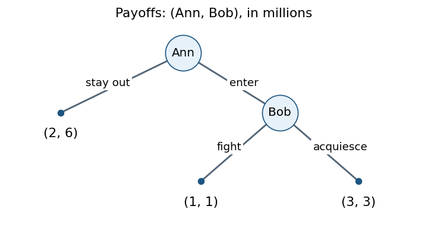
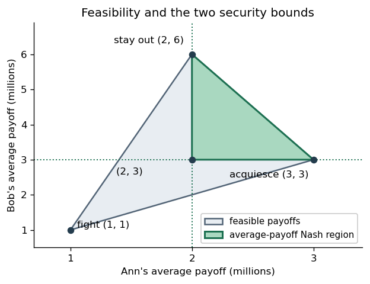

<h1 id="3/a/solution">Solution</h1>

↑ **Parent:** [A](../a.md)

Measure all [payoffs](../../../../../payoff.md) in millions of dollars, in the order (Ann, Bob). Since both players maximize expected money, those numbers are already their [expected utility](../../../../../expected-utility.md) scale.

In the [extensive-form game](../../../../../extensive-form-game.md), Ann moves first. Staying out terminates at $(2,6)$. Entering leads to Bob's observed decision between fighting, with terminal [payoffs](../../../../../payoff.md) $(1,1)$, and acquiescing, with terminal [payoffs](../../../../../payoff.md) $(3,3)$. Each decision node is its own [information set](../../../../../information-set.md), so this is a [perfect-information game](../../../../../perfect-information-game.md).

**[Figure 1](#3/a/image-the-entry-decision-as-a-perfect-information-game). The entry decision as a perfect-information game**.

The corresponding [normal-form game](../../../../../normal-form-game.md) gives Ann the [pure strategies](../../../../../pure-strategy.md) $O$ (stay out) and $E$ (enter), and Bob the complete contingent [pure strategies](../../../../../pure-strategy.md) $F$ (fight if entry occurs) and $A$ (acquiesce if entry occurs). The [payoff matrix](../../../../../payoff-matrix.md) is

$$
\begin{array}{c|cc}
&F&A\\ \hline
O&(2,6)&(2,6)\\
E&(1,1)&(3,3)
\end{array}.
$$

The [pure strategy](../../../../../pure-strategy.md) [Nash equilibria](../../../../../nash-equilibrium.md) are **$(O,F)$ and $(E,A)$**. Against $F$, Ann prefers $O$; against $A$, Ann prefers $E$. When Ann stays out, Bob's contingent response does not affect his [payoff](../../../../../payoff.md), so $F$ is a [best response](../../../../../best-response.md) there.

There is exactly one [subgame perfect equilibrium](../../../../../subgame-perfect-equilibrium.md), **$(E,A)$**. In the subgame following entry, Bob strictly prefers $3$ to $1$, so [backward induction](../../../../../backward-induction.md) selects acquiescence; Ann then strictly prefers entering for $3$ to staying out for $2$. The threat supporting $(O,F)$ is not optimal in that one-shot subgame.

For infinite repetition, the paper specifies no discount factor. First take the [long-run average payoff](../../../../../long-run-average-payoff.md) convention, with all past actions observed. The [feasible payoff set](../../../../../feasible-payoff-set.md) is the [convex hull](../../../../../convex-hull.md)

$$
\mathcal F=\operatorname{conv}\{(2,6),(1,1),(3,3)\}.
$$

Ann can guarantee $2$ in every stage by staying out; Bob can guarantee at least $3$ in every stage by acquiescing whenever entry occurs. These guarantees are also their [minmax payoffs](../../../../../minmax-payoff.md): fighting holds Ann's best possible stage [payoff](../../../../../payoff.md) to $2$, and entering holds Bob's best possible stage [payoff](../../../../../payoff.md) to $3$.

Therefore the sustainable [Nash equilibrium](../../../../../nash-equilibrium.md) average [payoffs](../../../../../payoff.md) are exactly the feasible, weakly [individually rational payoffs in a repeated game](../../../../../individually-rational-payoff-in-a-repeated-game.md):

$$
\boxed{\mathcal F\cap\{(a,b):a\ge2,\ b\ge3\}
=\{(a,b):2\le a\le3,\ 3\le b\le12-3a\}.}
$$

This is the closed triangle with vertices $(2,3),(2,6),(3,3)$.

Here is a direct sufficiency argument for this particular game. Choose a publicly known sequence of stage outcomes whose frequencies give the target point. Before any observed deviation, follow that sequence. After an Ann deviation, Bob fights forever, so Ann can thereafter obtain at most $2$ per stage. After a Bob deviation, Ann enters forever, so Bob can thereafter obtain at most $3$ per stage. A finite prefix has no effect on [long-run average payoff](../../../../../long-run-average-payoff.md), so no [unilateral deviation](../../../../../unilateral-deviation.md) improves a target with $a\ge2,b\ge3$. Rational frequencies can be implemented periodically; arbitrary real frequencies can be implemented by a deterministic sequence with convergent frequencies. Thus even the weak boundary is covered here. In particular, **staying out forever and entry followed by acquiescence forever are sustainable; fighting forever is not**.

**[Figure 2](#3/a/image-the-feasible-payoff-set-and-sustainable-long-run-average-payoffs). The feasible payoff set and sustainable long-run average payoffs**.

For discounted [payoffs](../../../../../payoff.md) $(1-\delta)\sum_{t\ge0}\delta^t u_i^t$, the [folk theorem for repeated games](../../../../../folk-theorem-for-repeated-games.md) instead gives the usual patience qualification: every feasible point with $a>2,b>3$ can be sustained for all sufficiently large $\delta<1$. It does not classify the whole region for an unspecified fixed $\delta$. The two one-shot [Nash equilibrium](../../../../../nash-equilibrium.md) outcomes remain sustainable for every $\delta$.[Slides 19–20 and 24–27: feasibility, minmax bounds, discounted Nash folk theorem and punishment construction](../../../../../lecture-15-repeated-games-by-asu-ozdaglar.md)

Finally consider the particular history-dependent pair in the paper. Initially Bob has never acquiesced, so Ann stays out. That preserves the same condition forever, giving [payoffs](../../../../../payoff.md) $(2,6)$. **The pair is a [Nash equilibrium](../../../../../nash-equilibrium.md).** Holding Bob's strategy fixed, Ann cannot induce an acquiescence: he fights whenever she enters, and his rule never changes unless he has previously acquiesced. Every entry would give her $1$ instead of $2$, so no [unilateral deviation](../../../../../unilateral-deviation.md) helps. Holding Ann's strategy fixed, Bob never reaches a decision node because she stays out; changing his strategy alone cannot create a history in which he actually acquiesces. Hence he also cannot improve.

This direct argument works for both discounted and [long-run average payoffs](../../../../../long-run-average-payoff.md). The outcome gives Ann exactly her [minmax payoff](../../../../../minmax-payoff.md) and Bob more than his, so it is compatible with the [folk theorem for repeated games](../../../../../folk-theorem-for-repeated-games.md). A version requiring _strict_ gains above both [minmax payoffs](../../../../../minmax-payoff.md) is a sufficient condition, and cannot be used to rule out this boundary example.

## ↑ Ancestors (11)

1. [A](../a.md)
2. [3](../../3.md)
3. [Computational game theory](../../../computational-game-theory-split.md)
4. [2023](../../../split.md)
5. [Past exam of the MSc in advanced computer science course of the University of Oxford](../../../../split.md)
6. [MSc in advanced computer science course of the University of Oxford](../../../../../msc-in-advanced-computer-science-course-of-the-university-of-oxford.md)
7. [Master's course of the University of Oxford](../../../../../master-s-course-of-the-university-of-oxford.md)
8. [Course of the University of Oxford](../../../../../course-of-the-university-of-oxford.md)
9. [University of Oxford](../../../../../university-of-oxford-split.md)
10. [List of universities](../../../../../list-of-universities.md)
11. [Codex Wiki](../../../../../split.md)
