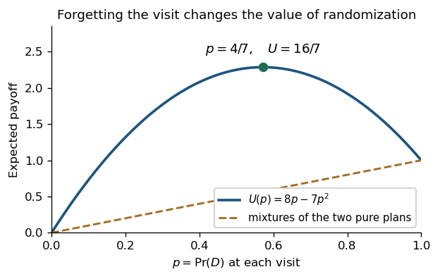

<h1 id="3/b/solution">Solution</h1>

↑ **Parent:** [B](../b.md)

This is an [absent-minded decision problem](../../../../../absent-minded-decision-problem.md): the two decision nodes belong to the same [information set](../../../../../information-set.md). A [behavioural strategy](../../../../../behavioural-strategy.md) must therefore use the same [probability](../../../../../probability.md) at both visits. Put $p=\Pr(D)$ and $1-p=\Pr(R)$; fresh randomization occurs independently at each visit.

The terminal probabilities are $1-p$ for stopping immediately, $p(1-p)$ for going down once and then right, and $p^2$ for going down twice. Thus the [expected payoff](../../../../../expected-payoff.md) is

$$
U(p)=0(1-p)+8p(1-p)+p^2
=8p-7p^2
=\frac{16}{7}-7\left(p-\frac47\right)^2.
$$

This expression gives the unique global maximum on $[0,1]$:

$$
\boxed{\Pr(D)=\frac47,\qquad \Pr(R)=\frac37,\qquad
U_{\max}=\frac{16}{7}.}
$$

**[Figure 3](#3/b/image-the-optimal-behavioural-strategy-improves-on-either-fixed-plan). The optimal behavioural strategy improves on either fixed plan**.

The independence of repeated randomizations is essential. A [mixed strategy](../../../../../mixed-strategy.md) choosing once between the two deterministic plans “always $R$” and “always $D$” gives at most $1$, since their [payoffs](../../../../../payoff.md) are $0$ and $1$. It cannot arrange “$D$ first, then $R$” as a deterministic plan respecting this [information set](../../../../../information-set.md). The failure of [perfect recall](../../../../../perfect-recall.md) is exactly why [mixed strategies](../../../../../mixed-strategy.md) and [behavioural strategies](../../../../../behavioural-strategy.md) need not have the same attainable outcome distributions here.

## ↑ Ancestors (11)

1. [B](../b.md)
2. [3](../../3.md)
3. [Computational game theory](../../../computational-game-theory-split.md)
4. [2023](../../../split.md)
5. [Past exam of the MSc in advanced computer science course of the University of Oxford](../../../../split.md)
6. [MSc in advanced computer science course of the University of Oxford](../../../../../msc-in-advanced-computer-science-course-of-the-university-of-oxford.md)
7. [Master's course of the University of Oxford](../../../../../master-s-course-of-the-university-of-oxford.md)
8. [Course of the University of Oxford](../../../../../course-of-the-university-of-oxford.md)
9. [University of Oxford](../../../../../university-of-oxford-split.md)
10. [List of universities](../../../../../list-of-universities.md)
11. [Codex Wiki](../../../../../split.md)
