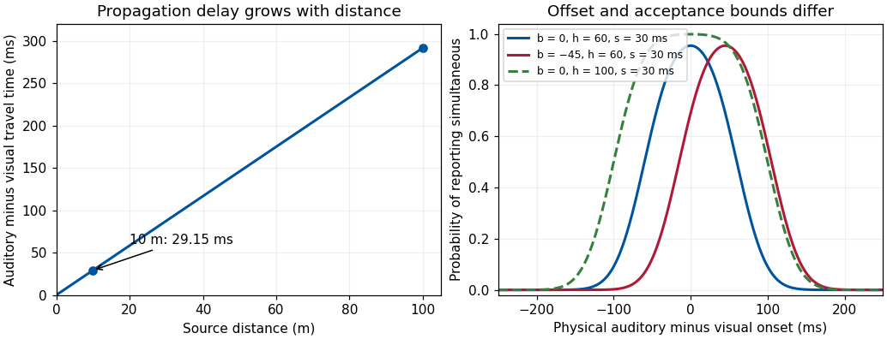

<h1 id="3/solution">Solution</h1>

↑ **Parent:** [3](../3.md)

**Multisensory signals lose synchrony through propagation, receptor and neural delays, and the temporal structure of the event itself. Perceived simultaneity is maintained by tolerance, calibration and inference about common causes, rather than by an infallible clock that makes every channel arrive together.** Physical simultaneity, simultaneous receptor stimulation and subjective simultaneity are different quantities.

For an audiovisual event at distance $d$, let auditory and visual propagation speeds be $c_s,c_\ell$, and processing delays to a specified comparison stage be $L_A,L_V$. A simple internal arrival-time difference, auditory minus visual, is

$$
\Delta=d\left(\frac1{c_s}-\frac1{c_\ell}\right)+(L_A-L_V).
$$

This follows by subtracting the two sums of travel time and processing delay. At 10 m, using $c_s=343$ m/s and $c_\ell=299{,}792{,}458$ m/s, the propagation term is about 29.15 ms; at 100 m it is about 291.54 ms. These are calculations under fixed conditions, not perceptual thresholds. Sound speed varies with the medium and temperature. A fixed neural correction could compensate one distance but cannot eliminate propagation differences at every distance.

The neural terms are not fixed constants either. Phototransduction, cochlear transduction, peripheral conduction, stimulus [intensity](../../../intensity-physics.md), contrast and the pathway used to define a response can affect latency. A weak or ambiguous stimulus can require more evidence before a decision. [Attention](../../../attention.md), expectations and the selected feature may affect reported timing, without requiring a change in the physical stimulus. A neural onset response, identification response and button press do not mark the same stage. Therefore a reported audiovisual delay should not be casually equated with a single axonal conduction time.

Some apparent desynchronization originates in the source. Lip and jaw movements can precede the acoustic release of speech. A seen hand movement can precede contact and its sound; food handling, oral [touch](../../../touch.md), dissolved tastants and retronasal odor release have different physical time courses. Reverberation can add later auditory energy. Electronic capture, buffering and displays can introduce additional modality-specific delays. The useful goal is consequently to recover whether signals belong to one event and when that event occurred, not to force equal onsets for all its components.

One solution is a [temporal binding window](../../../temporal-binding-window.md): a range of disparities within which signals can be grouped or judged as simultaneous. The window is measured through a specified task, not a universal duration. In a [simultaneity judgment](../../../simultaneity-judgment.md), report [probability](../../../probability.md) often has a peak around a [point of subjective simultaneity](../../../point-of-subjective-simultaneity.md). In a [temporal order judgment](../../../temporal-order-judgment.md), performance changes from one reported order to the other across offsets. Those measures can differ because their decisions and criteria differ. A broad simultaneity function can reflect uncertain timing or a liberal response criterion; it does not uniquely measure a long neural integration window.

Consider a [Gaussian simultaneity decision model](../../../gaussian-simultaneity-decision-model.md). Let physical auditory-minus-visual onset difference be $\delta$, stable internal offset $b$, and Gaussian timing noise of [standard deviation](../../../standard-deviation.md) $s$. If the observer reports simultaneous when $|\delta+b+\varepsilon|<h$, then

$$
P(\mathrm{simultaneous}\mid\delta)=\Phi\left(\frac{h-\delta-b}{s}\right)-\Phi\left(\frac{-h-\delta-b}{s}\right).
$$

The expression is the [probability](../../../probability.md) that the noisy difference falls between the two decision bounds. Its center is $-b$ for symmetric bounds and noise. Increasing $h$ makes the observer more tolerant; increasing $s$ makes timing less precise. A shift in $b$, a criterion change and extra noise can thus alter different aspects of a measured curve. This is an illustrative model, not a fitted account of the experiment below.

**[Figure 1](#3/image-original-propagation-calculation-and-gaussian-simultaneity-decision-examples-model-parameters-are-illustrative-not-measured-temporal-binding-windows). Original propagation calculation and Gaussian simultaneity-decision examples; model parameters are illustrative, not measured temporal binding windows**.

[Temporal recalibration](../../../temporal-recalibration.md) shows that the offset is adaptable. [Waka Fujisaki](../../../waka-fujisaki.md) and colleagues repeatedly paired tone pips and ring flashes at a fixed lag, then measured judgments across test lags. Initial adaptation lasted three minutes with brief re-adaptation before tests. Subjective simultaneity shifted toward the experienced lag; changes in an auditory-induced visual illusion gave evidence beyond a simple change in verbal simultaneity responses.[Nat Neurosci 7, 773–778; Simultaneity judgments and illusion transfer](../../../recalibration-of-audiovisual-simultaneity-by-waka-fujisaki-and-others.md) The adjustment was partial, not exact cancellation of the exposure lag. Transfer constrains a purely task-specific response explanation, but does not locate one unique neural clock or exclude all decision contributions.

A complementary strategy is [Bayesian causal inference in perception](../../../bayesian-causal-inference-in-perception.md). In a toy Bayesian model, a measured discrepancy $y$ has Gaussian [variance](../../../variance-split.md) $s^2$, while a common-event [prior](../../../prior-probability.md) favors discrepancy zero with [variance](../../../variance-split.md) $\tau^2$. Completing the square in the product of [likelihood](../../../likelihood-function.md) and [prior](../../../prior-probability.md) proves the [Gaussian temporal-discrepancy shrinkage](../../../gaussian-temporal-discrepancy-shrinkage.md) relation

$$
E[\delta\mid y]=\frac{\tau^2}{\tau^2+s^2}y.
$$

Thus noisy discrepancies can be pulled toward coincidence. This is a conditional model of one-event inference. A system must also allow separate causes: otherwise a loud unrelated sound would be bound to any nearby flash. Spatial agreement, identity, semantic fit, repeated correlation and action–outcome contingencies can affect that causal judgment. A large discrepancy can lead to segregation rather than endless recalibration.

Calibration and tolerance have costs. A wide acceptance range can stabilize a natural event while merging unrelated events; strong adaptation can help with a delayed device but temporarily bias judgments after it is removed. A convincing experiment therefore controls device timing, [intensity](../../../intensity-physics.md) and spatial cues, distinguishes order from simultaneity reports, and tests transfer and recovery. **Perceptual unity is a flexible estimate supported by delayed and noisy evidence; it preserves useful event structure without guaranteeing veridical timing in every circumstance.**

## ↑ Ancestors (11)

1. [3](../3.md)
2. [2022](../../2022-split.md)
3. [Past exam of the multisensory perception: attention, integration, and development course of the University of Oxford](../../split.md)
4. [Multisensory perception: attention, integration, and development course of the University of Oxford](../../../multisensory-perception-attention-integration-and-development-course-of-the-university-of-oxford.md)
5. [Year 3 of the psychology (experimental) course of the University of Oxford](../../../year-3-of-the-psychology-experimental-course-of-the-university-of-oxford.md)
6. [Psychology (experimental) course of the University of Oxford](../../../psychology-experimental-course-of-the-university-of-oxford.md)
7. [Undergraduate course of the University of Oxford](../../../undergraduate-course-of-the-university-of-oxford.md)
8. [Course of the University of Oxford](../../../course-of-the-university-of-oxford.md)
9. [University of Oxford](../../../university-of-oxford-split.md)
10. [List of universities](../../../list-of-universities.md)
11. [Codex Wiki](../../../split.md)
