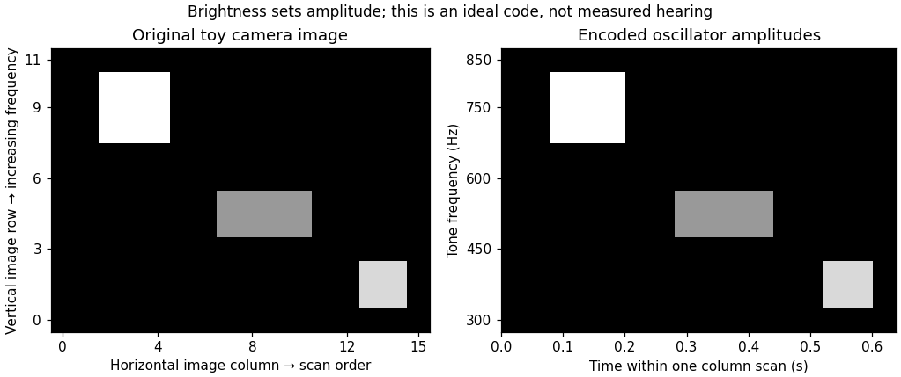

<h1 id="5/solution">Solution</h1>

↑ **Parent:** [5](../5.md)

**[Crossmodal correspondences](../../../crossmodal-correspondence.md) can guide a sensory-substitution code toward distinctions users can learn and retain, but intuitive mappings do not guarantee useful spatial information or effortless [perception](../../../perception.md).** Design must respect both the information supplied by the device and the limitations and goals of the remaining sensory system.

A [sensory substitution system](../../../sensory-substitution-system.md) captures information normally available through one sensory channel and recodes it for another. A camera-to-sound device does not restore [photoreceptors](../../../photoreceptor.md): an auditory listener learns to interpret a controlled relation between image properties and sounds. That differs from [multisensory cue integration](../../../multisensory-cue-integration.md), where two functioning channels provide estimates of the same event. Residual [vision](../../../vision.md), [touch](../../../touch.md) or action can nevertheless interact with the substituted information, so integration and substitution can coexist in actual use.

Historically, [Paul Bach-y-Rita](../../../paul-bach-y-rita.md) and collaborators investigated television-camera information presented through tactile stimulation. Their 1969 report established an early experimental program for tactile image projection as an aid and as a test of sensory processing.[Nature 221, 963–964; apparatus rationale and early substitution report](../../../vision-substitution-by-tactile-image-projection-by-paul-bach-y-rita-and-others.md) This history matters because useful access to object structure need not reproduce the original receptor input. A successful task, however, does not by itself establish that the participant has acquired ordinary visual experience.

A concrete engineering example is [Peter B. L. Meijer](../../../peter-b-l-meijer.md)'s [vOICe](../../../voice.md). The original system sampled camera images and scanned columns from left to right. Horizontal position became time within the scan, vertical position became tone [frequency](../../../frequency.md), and pixel brightness controlled [amplitude](../../../wave-amplitude.md). A computer-based inverse reconstruction tested preservation of image information in the acoustic code; the 1992 paper explicitly distinguished that engineering result from an established resolution of human [perception](../../../perception.md).[IEEE Trans Biomed Eng 39, 112–121; Abstract and Image-to-Sound Mapping](../../../an-experimental-system-for-auditory-image-representations-by-peter-b-l-meijer.md) An invertible signal representation can still be difficult for a listener to decode.

For illustration, let $I_{ij}$ be brightness at row $i$ and column $j$, with row index increasing upward. During column $j$ a simple encoder outputs

$$
s_j(t)=\sum_i A(I_{ij})\sin(2\pi f_i t+\phi_i),\qquad f_{i+1}>f_i.
$$

The scan schedule labels horizontal position; the [frequency](../../../frequency.md) labels vertical position; $A$ labels brightness. Under ideal sampling and orthogonal tones, [amplitude](../../../wave-amplitude.md) extraction recovers the column coefficients. Finite presentation times, masking, [frequency](../../../frequency.md) resolution and noise limit human recoverability. Increasing the number of pixels can increase transmitted information without increasing usable perceptual detail.

**[Figure 2](#5/image-original-toy-image-to-sound-code-column-order-becomes-scan-time-upward-position-becomes-increasing-frequency-and-brightness-sets-amplitude-no-participant-data-or-copied-apparatus-figure). Original toy image-to-sound code: column order becomes scan time, upward position becomes increasing frequency, and brightness sets amplitude; no participant data or copied apparatus figure**.

Correspondence knowledge supplies candidate defaults. Mapping greater elevation to higher [pitch](../../../pitch.md) may align with an existing association; mapping greater brightness to a stronger sound may preserve an ordered [intensity](../../../intensity-physics.md) relation. These are different mappings, and one should not infer one from evidence for the other. The [pitch](../../../pitch.md)–[luminance](../../../luminance.md) association, for example, does not establish that [pitch](../../../pitch.md) is the best code for both elevation and brightness simultaneously. Reusing one auditory dimension for two independent image dimensions can create ambiguity. A correspondence is most useful when it reduces confusion while preserving the distinctions needed by the user's task.

Evidence that compatible pairings can promote binding, such as the temporal and spatial conflict results of [Cesare Valerio Parise](../../../cesare-valerio-parise.md) and [Charles Spence](../../../charles-spence.md), motivates testing whether an analogous compatibility improves [learning](../../../learning.md) of an encoder. It is not a direct comparison of substitution devices. Likewise, relative mappings observed with simple tones and circles need not generalize unchanged to complex soundscapes, congenital [blindness](../../../blindness.md) or navigation. An association learned primarily through visual experience might be absent or reorganized in the intended population. Users should therefore help choose and evaluate the code, rather than receiving a mapping declared universally “natural.”

Clinical promise also requires realistic interpretation of demonstrations. [Ella Striem-Amit](../../../ella-striem-amit.md) and colleagues tested eight congenitally blind and one early-blind participant after substantial vOICe training. Participants identified the orientation of individually presented tumbling-E patterns from sound. Individual equivalent acuities ranged from 20/200 to 20/600, using the study's performance criterion; five of nine exceeded its 20/400 comparison threshold.[PLoS ONE 7:e33136; Participants, Experimental design and Results](../../../visual-acuity-of-the-congenitally-blind-using-visual-to-auditory-sensory-substitution-by-ella-striem-amit-and-others.md) Those are task-specific visual-pattern judgments through audition, not recovered sight, instant expertise or proof of safe real-world mobility. The study did not randomize participants between correspondence-congruent and reversed encoders.

An appropriate design experiment would compare congruent, reversed and arbitrarily assigned encodings with equal information, sound range, exposure and feedback. Counterbalance assignments and measure initial interpretation, [learning](../../../learning.md) curves, retention and transfer to novel objects. Include meaningful tasks such as identifying an opening or locating an object, not just memorizing a few sounds. Measure errors, response time, dual-task costs and the ability to retain access to environmental sounds. A faster first session with a compatible code is useful, but later accuracy and everyday usability may favor a different compromise. No outcomes of this proposed experiment are assumed here.

Finally, action can provide calibration. Moving a camera or hand generates lawful changes in the output; stable [sensorimotor contingencies](../../../sensorimotor-contingency.md) can make an otherwise arbitrary code learnable. Correspondences may reduce the initial [learning](../../../learning.md) burden, while reliable feedback and practice establish detailed interpretation. **Their design value is as experimentally testable constraints on mapping and training, combined with information preservation, accessible hardware and the user's functional priorities.**

## ↑ Ancestors (11)

1. [5](../5.md)
2. [2022](../../2022-split.md)
3. [Past exam of the multisensory perception: attention, integration, and development course of the University of Oxford](../../split.md)
4. [Multisensory perception: attention, integration, and development course of the University of Oxford](../../../multisensory-perception-attention-integration-and-development-course-of-the-university-of-oxford.md)
5. [Year 3 of the psychology (experimental) course of the University of Oxford](../../../year-3-of-the-psychology-experimental-course-of-the-university-of-oxford.md)
6. [Psychology (experimental) course of the University of Oxford](../../../psychology-experimental-course-of-the-university-of-oxford.md)
7. [Undergraduate course of the University of Oxford](../../../undergraduate-course-of-the-university-of-oxford.md)
8. [Course of the University of Oxford](../../../course-of-the-university-of-oxford.md)
9. [University of Oxford](../../../university-of-oxford-split.md)
10. [List of universities](../../../list-of-universities.md)
11. [Codex Wiki](../../../split.md)
