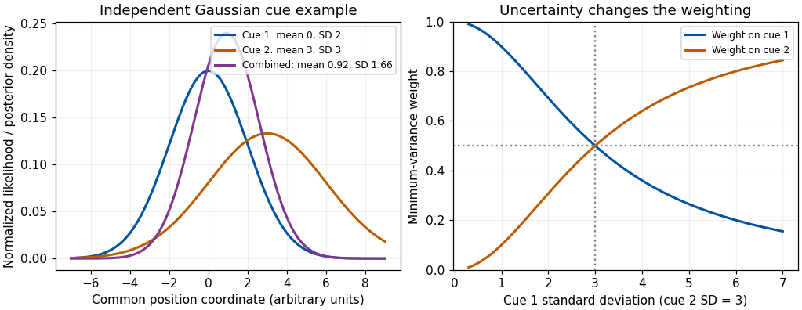

<h1 id="6/solution">Solution</h1>

↑ **Parent:** [6](../6.md)

**Spatial and chemical multisensory processing share problems of binding, uncertainty, [learning](../../../learning.md) and common-cause attribution. They often differ in what their inputs represent: spatial cues can estimate the same location, whereas taste and odor frequently supply complementary attributes of a food.** The comparison concerns particular computations and tasks, not a rigid separation between two kinds of [brain](../../../brain.md).

In spatial localization, [vision](../../../vision.md), audition and [touch](../../../touch.md) can each provide information about position, although they begin in different coordinates. Visual information is initially related to the [retina](../../../retina.md), auditory location depends on binaural and spectral cues, and [touch](../../../touch.md) is related to a body surface. Combining them requires accounting for eye, head and body position. Spatial coincidence supports a common event, but is not sufficient: unrelated events can occur nearby, and one moving object can produce cues at different times.

A simple [reliability-weighted cue integration](../../../reliability-weighted-cue-integration.md) model makes a precise prediction. Suppose $x_1,x_2$ are unbiased, independent estimates of one position, with [variances](../../../variance-split.md) $\sigma_1^2,\sigma_2^2$. An unbiased linear estimate is $\hat x=wx_1+(1-w)x_2$, with

$$
\operatorname{Var}(\hat x)=w^2\sigma_1^2+(1-w)^2\sigma_2^2.
$$

Differentiating and setting the derivative to zero yields

$$
w=\frac{\sigma_2^2}{\sigma_1^2+\sigma_2^2},\qquad
\sigma_{\rm combined}^2=\frac{\sigma_1^2\sigma_2^2}{\sigma_1^2+\sigma_2^2}.
$$

The second derivative is positive. The [minimum-variance two-cue estimate](../../../minimum-variance-two-cue-estimate.md) assigns greater weight to the more precise cue, and independent information reduces [variance](../../../variance-split.md) below either individual [variance](../../../variance-split.md). With independent [Gaussian noise](../../../gaussian-noise.md) and a flat [prior](../../../prior-probability.md), minimizing the negative [log-likelihood](../../../log-likelihood.md) gives the same weighted mean. Correlated errors, bias, a nonflat [prior](../../../prior-probability.md) or separate causes change this benchmark.

[Marc O. Ernst](../../../marc-o-ernst.md) and [Martin S. Banks](../../../martin-s-banks.md) measured visual and haptic estimates of object height and compared combined judgments with predictions based on unisensory variability. Manipulating visual uncertainty and cue conflict supported reliability-dependent weighting and improved combined precision in that task.[Nature 415, 429–433; apparatus, unisensory estimates and combined-cue predictions](../../../humans-integrate-visual-and-haptic-information-in-a-statistically-optimal-fashion-by-marc-o-ernst-and-martin-s-banks.md) The conclusion is conditional optimality for measured inputs and task, not that every multisensory judgment or [neuron](../../../neuron-split.md) always computes an optimum.

**[Figure 3](#6/image-original-independent-gaussian-cue-model-likelihood-multiplication-and-variance-minimizing-weights-curves-are-theoretical-examples-not-experimental-results). Original independent-Gaussian cue model: likelihood multiplication and variance-minimizing weights; curves are theoretical examples, not experimental results**.

Development supplies a useful qualification. [Monica Gori](../../../monica-gori.md) and colleagues measured visual, haptic and combined judgments of block size and orientation in children. Younger children did not always obtain the adult-like precision gain; the dominant modality differed between size and orientation, and adult-like combination emerged around eight to ten years in those tests.[Curr Biol 18, 694–698; size and orientation tasks and age comparisons](../../../young-children-do-not-integrate-visual-and-haptic-form-information-by-monica-gori-and-others.md) The authors proposed a role for cross-sensory calibration. The result does not establish one universal maturation age for all multisensory tasks. It shows why adult cue-combination rules should not simply be assigned to every developing observer.

The chemical senses pose a different representational problem. [Gustation](../../../gustation.md) responds to dissolved chemicals at taste receptors, while [olfaction](../../../olfaction.md) responds to volatile molecules; oral [touch](../../../touch.md), temperature and irritation also contribute to a food percept. Retronasal odor can be attributed to the mouth through [olfactory referral](../../../olfactory-referral.md), even though its receptors remain in the nose. A sweet taste and a fruit odor are not necessarily two noisy measurements of one physical sweetness coordinate. They can jointly identify a food or predict nutritional and hedonic properties. Adding them with inverse-variance weights is therefore not automatically meaningful.

Nevertheless, the same inferential questions arise: do signals belong to the same food, how should [prior](../../../prior-probability.md) experience affect interpretation, and which component is responsible for a judged quality? [Richard J. Stevenson](../../../richard-j-stevenson.md) and colleagues' odor–taste conditioning results show that pairing an odor with sweet or sour tastes can alter later odor judgments.[Learning and Motivation 26, 433–455; Experiment 1](../../../the-acquisition-of-taste-properties-by-odors-by-richard-j-stevenson-and-others.md) Learned co-occurrence can thus influence flavor qualities. Verbal confusion or a rating change alone does not establish full sensory fusion; separate taste, odor and pleasantness scales help test [response dumping](../../../response-dumping.md).

Neural convergence is also shared without implying identical architectures. [Ivan E. T. de Araujo](../../../ivan-e-t-de-araujo.md) and colleagues delivered tastes and retronasal odors separately and together during human [functional magnetic resonance imaging](../../../functional-magnetic-resonance-imaging.md). They identified overlapping responses in several regions and interactions in [orbitofrontal cortex](../../../orbitofrontal-cortex.md); some responses also covaried with consonance or pleasantness ratings.[Eur J Neurosci 18, 2059–2068; event-related taste, retronasal odor and mixture contrasts](../../../taste-olfactory-convergence-and-the-representation-of-the-pleasantness-of-flavour-in-the-human-brain-by-ivan-e-t-de-araujo-and-others.md) A mixture interaction is stronger evidence than overlap alone, but an imaging voxel does not prove that every responding [neuron](../../../neuron-split.md) receives both inputs. A neural correlation with pleasantness also differs from a causal explanation of food preference.

Temporal and spatial structure further distinguish typical tasks. Spatial audiovisual cues can be brief, externally localized events; food [perception](../../../perception.md) unfolds with sniffing, chewing, dissolution and swallowing. Taste and retronasal odor may be bound despite unlike onset profiles because their sequence is expected within eating. Chemical signals can adapt and interact at peripheral as well as central stages, while [vision](../../../vision.md) and audition face their own receptor and pathway nonlinearities. Neither class is exclusively early or late, automatic or attention-dependent. [Attention](../../../attention.md), task instructions, hunger and learned expectations can change what is selected or reported; these influences must be measured rather than inferred from a unitary percept alone.

A decisive comparison therefore uses matched inferential questions: estimate a common property, identify a common object, or judge whether two signals share a cause. Measure unisensory performance, test cue conflict and temporal or semantic congruence, and distinguish changes in quality, uncertainty and response. **Both domains integrate evidence about events; spatial averaging is a useful special case, while complementary chemical information often requires object, quality and value representations beyond a shared coordinate.**

## ↑ Ancestors (11)

1. [6](../6.md)
2. [2022](../../2022-split.md)
3. [Past exam of the multisensory perception: attention, integration, and development course of the University of Oxford](../../split.md)
4. [Multisensory perception: attention, integration, and development course of the University of Oxford](../../../multisensory-perception-attention-integration-and-development-course-of-the-university-of-oxford.md)
5. [Year 3 of the psychology (experimental) course of the University of Oxford](../../../year-3-of-the-psychology-experimental-course-of-the-university-of-oxford.md)
6. [Psychology (experimental) course of the University of Oxford](../../../psychology-experimental-course-of-the-university-of-oxford.md)
7. [Undergraduate course of the University of Oxford](../../../undergraduate-course-of-the-university-of-oxford.md)
8. [Course of the University of Oxford](../../../course-of-the-university-of-oxford.md)
9. [University of Oxford](../../../university-of-oxford-split.md)
10. [List of universities](../../../list-of-universities.md)
11. [Codex Wiki](../../../split.md)
