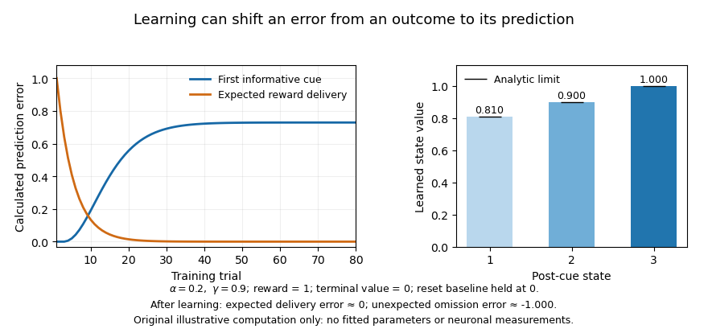
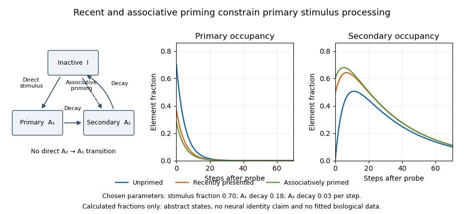

# 2022

↑ **Parent:** [Past exam of the neuropsychopharmacology of higher cognition course of the University of Oxford](../past-exam-of-the-neuropsychopharmacology-of-higher-cognition-course-of-the-university-of-oxford.md)

Study answers to all six options in the [neuropsychopharmacology](../pharmacology.md#neuropsychopharmacology) of higher [cognition](../psychology.md#cognition) examination of 27 May 2022. Source release: [released examination PDF](https://www.whatdotheyknow.com/request/experimental_psychology_past_exa/response/2757831/attach/3/New%20Compressed%20zipped%20Folder.zip?cookie_passthrough=1). The original examination required a choice of three questions; this resource develops every option without reproducing the statements.

Scientific conclusions use work available by the examination date. Experimental models, clinical syndromes and proposed treatments are distinguished; none of the pharmacological discussions is patient-specific advice. Abstract model states and computational illustrations are not presented as biological measurements.

**Table of contents**

- [1](#1)
  - [Solution](#1/solution)
- [2](#2)
  - [Solution](#2/solution)
- [3](#3)
  - [Solution](#3/solution)
- [4](#4)
  - [Solution](#4/solution)
- [5](#5)
  - [Solution](#5/solution)
- [6](#6)
  - [Solution](#6/solution)

## 1

↑ **Parent:** [2022](2022.md)

<h3 id="1/solution">Solution</h3>

↑ **Parent:** [1](#1)

**[Fear](../psychology.md#fear) and [anxiety](../psychology.md#anxiety) share [learning](../animal-behaviour.md#learning) mechanisms, [neuromodulators](../neuron.md#neuromodulator) and defensive circuitry, but differ in how threat is specified and sustained.** A useful operational distinction is an immediate response to an identified danger versus prolonged anticipation of uncertain danger. That distinction should not be mistaken for a universal division into two independent brain centres. [Neuropsychopharmacology](../pharmacology.md#neuropsychopharmacology) is most informative when it compares matched behavioural endpoints and identifies where and when a drug acts.

The first issue is measurement. Freezing, avoidance, autonomic changes, [fear-potentiated startle](../animal-behaviour.md#fear-potentiated-startle) and subjective reports capture different aspects of threat responding. A rat’s reduced open-arm exploration can reflect [anxiety](../psychology.md#anxiety), but also altered movement or novelty preference. A smaller startle response can reflect sedation rather than reduced threat processing. It is therefore necessary to measure baseline responsiveness, locomotion and sensory function, and to distinguish acquisition, consolidation, retrieval and expression. A drug administered only at testing does not establish an effect on the original [learning](../animal-behaviour.md#learning).

An influential rat experiment compared potentiation of acoustic startle by a conditioned threat cue with enhancement during sustained bright illumination. Local [AMPA receptor](../protein.md#ampa-receptor) antagonism in the [central nucleus of the amygdala](../neuroscience.md#central-nucleus-of-the-amygdala) disrupted the conditioned-cue effect, whereas antagonism in the [bed nucleus of the stria terminalis](../neuroscience.md#bed-nucleus-of-the-stria-terminalis) disrupted the light-enhanced effect. The [basolateral amygdala](../neuroscience.md#basolateral-amygdala) contributed to both. This is stronger evidence for differentiation than comparing unrelated assays because the measured reflex was shared. However, conditioning history, stimulus properties and duration differed together, so the result does not isolate duration or uncertainty as the sole cause of the dissociation.[Abstract and Figures 2–5: local glutamate-receptor antagonism and two startle-potentiation paradigms](../psychology-bibliography.md#double-dissociation-between-the-involvement-of-the-bed-nucleus-of-the-stria-terminalis-and-the-central-nucleus-of-the-amygdala-in-startle-increases-produced-by-conditioned-versus-unconditioned-fear-by-david-l-walker-and-others)

The [amygdala](../neuroscience.md#amygdala) and [BNST](../neuroscience.md#bed-nucleus-of-the-stria-terminalis) belong to interacting networks receiving cortical and other inputs and influencing hypothalamic and brainstem outputs. The [hippocampus](../neuroscience.md#hippocampus) supplies contextual information and [prefrontal cortex](../neuroscience.md#prefrontal-cortex) can influence threat regulation and extinction retrieval. Subdivisions and projection-defined populations within the [extended amygdala](../neuroscience.md#extended-amygdala) can differ in function. A general claim that the [amygdala](../neuroscience.md#amygdala) produces all [fear](../psychology.md#fear) and the [BNST](../neuroscience.md#bed-nucleus-of-the-stria-terminalis) produces all [anxiety](../psychology.md#anxiety) consequently ignores shared pathways, task dependence and cellular heterogeneity.

Fast inhibitory signalling supplies an important pharmacological comparison. Many [benzodiazepines](../pharmacology.md#benzodiazepine) positively modulate susceptible [GABA-A receptors](../protein.md#gaba-a-receptor), but anxiolysis must be distinguished from sedation and amnesia. A controlled human crossover study compared predictable-cue, unpredictable-threat and no-threat conditions. Alprazolam reduced sustained contextual startle enhancement at the effective tested treatment condition while leaving phasic cue potentiation relatively unaffected. The design included an active sedating comparison as well as placebo. This supports psychopharmacological differentiation between sustained and phasic measures; it does not prove absolute drug selectivity for a subjective state or show that every clinical [anxiety](../psychology.md#anxiety) presentation has the same mechanism.[Abstract and pp. 760–766: crossover treatments, predictable/unpredictable threat and phasic versus sustained startle](../psychology-bibliography.md#the-benzodiazepine-alprazolam-dissociates-contextual-fear-from-cued-fear-in-humans-as-assessed-by-fear-potentiated-startle-by-christian-grillon-and-others)

[Serotonin](../neuron.md#serotonin) illustrates why transmitter identity alone is insufficient. Reuptake inhibition affects multiple [receptors](../protein.md#receptor-biochemistry) and projection targets, and early effects can differ from adaptations after repeated treatment. In mice, a dorsal-raphe projection to the [BNST](../neuroscience.md#bed-nucleus-of-the-stria-terminalis) recruited a serotonin-sensitive local circuit and promoted selected threat-related behaviours. This provides a pathway-specific explanation for an anxiogenic effect of increasing [serotonin](../neuron.md#serotonin) signalling, compatible with different effects at other targets. It is not evidence that [serotonin](../neuron.md#serotonin) uniformly causes [anxiety](../psychology.md#anxiety) or that rodent threat responses establish the clinical time course of an [SSRI](../pharmacology.md#selective-serotonin-reuptake-inhibitor).[Abstract and Figure 1: dorsal-raphe–BNST projection and threat-related behaviour](../psychology-bibliography.md#serotonin-engages-an-anxiety-and-fear-promoting-circuit-in-the-extended-amygdala-by-catherine-a-marcinkiewcz-and-others)

[Receptor](../protein.md#receptor-biochemistry) subtype and developmental timing also matter. The same [receptor](../protein.md#receptor-biochemistry) class can act as an autoreceptor controlling raphe output or on non-serotonergic target [neurons](../neuron.md). [Norepinephrine](../neuron.md#norepinephrine), [corticotropin-releasing hormone](../neuron.md#corticotropin-releasing-hormone) and other modulators interact with these systems rather than map one-to-one onto [fear](../psychology.md#fear) or [anxiety](../psychology.md#anxiety). Local circuit effects should not be inferred from circulating hormone concentrations. A mechanistic explanation should state the [receptor](../protein.md#receptor-biochemistry), target, timescale and outcome, not merely whether a brain-wide chemical level rose or fell.

[Learning](../animal-behaviour.md#learning) about safety supplies both a shared mechanism and a therapeutic distinction. In [extinction learning](../animal-behaviour.md#extinction-learning), an expected aversive outcome is omitted; reduced responding can reflect new inhibitory or contextual knowledge rather than deletion of the original association. In rats, the [NMDA receptor](../neuron.md#nmda-receptor) partial [agonist](../protein.md#agonist) [D-cycloserine](../pharmacology.md#d-cycloserine) facilitated later reduction of conditioned startle when combined with extinction training. Its effect depended on [learning](../animal-behaviour.md#learning) conditions rather than acting simply as an acute suppressant of every defensive response. This motivates a learning-adjunct strategy, but the animal result alone cannot establish clinical efficacy.[Abstract and Results: extinction-dependent facilitation assessed with conditioned startle](../psychology-bibliography.md#facilitation-of-conditioned-fear-extinction-by-systemic-administration-or-intra-amygdala-infusions-of-d-cycloserine-as-assessed-with-fear-potentiated-startle-in-rats-by-david-l-walker-and-others)

[Anxiety](../psychology.md#anxiety) about uncertain contexts can involve more than a response to one cue: broad threat generalization, avoidance that prevents corrective experience, and context-dependent retrieval may sustain it. Conversely, a sharply defined learned cue can acquire persistent control. [Exposure therapy](../psychology.md#exposure-therapy) therefore cannot be reduced to suppressing an output on one occasion. An [intervention](../causal-inference.md#treatment) that changes expression without improving subsequent safety [learning](../animal-behaviour.md#learning) might have a different long-term effect from one that changes what is retained. [Renewal after extinction](../animal-behaviour.md#renewal-after-extinction) also predicts that improvement in one context need not transfer automatically to another.

The strongest comparison is thus dimensional and mechanistic. [Fear](../psychology.md#fear) and [anxiety](../psychology.md#anxiety) share [synaptic plasticity](../neuron.md#synaptic-plasticity), inhibitory signalling and distributed threat networks, while particular temporal and informational demands recruit distinguishable components. Drug and circuit dissociations are meaningful when matched controls rule out motor or sensory explanations; they should refine this network account rather than replace it with a pair of transmitter labels. These are conclusions about evidence and experimental models, not instructions for selecting medication.

## 2

↑ **Parent:** [2022](2022.md)

<h3 id="2/solution">Solution</h3>

↑ **Parent:** [2](#2)

**[Learning](../animal-behaviour.md#learning) and [memory](../neuroscience.md#memory-in-animals) provide powerful mechanistic accounts of some psychiatric symptoms, but they are not an adequate single-level definition of all psychiatric disorders.** The most useful claim is that abnormal [learning](../animal-behaviour.md#learning), valuation or retrieval can mediate particular symptoms and interact with biological vulnerability and environment. Calling every persistent symptom a “[memory](../neuroscience.md#memory-in-animals)” without specifying a computation, mechanism and discriminating prediction would make the account unfalsifiable.

Several causal positions must be separated. A [learning](../animal-behaviour.md#learning) abnormality could precede illness and increase vulnerability, mediate the expression of an established biological disturbance, or follow from the illness, medication or adverse experiences. A cross-sectional task deficit does not distinguish these possibilities. Nor does a diagnosis identify one latent parameter: poor performance can result from altered [motivation](../psychology.md#motivation), perception, [attention](../psychology.md#attention), beliefs or motor output as well as [learning](../animal-behaviour.md#learning). [Construct validity](../design-of-experiments.md#construct-validity) and [external validity](../causal-inference.md#external-validity) are therefore central, not afterthoughts.

For [schizophrenia](../psychiatry.md#schizophrenia), an influential proposal links [dopamine](../neuron.md#dopamine) dysregulation to [aberrant salience](../psychology.md#aberrant-salience). Events or internal representations acquire inappropriate significance, and attempts to explain those experiences can contribute to [delusions](../psychology.md#delusion). This creates a possible bridge between neurochemistry and acquired belief. It is a theoretical framework rather than evidence that each psychotic belief is an ordinary reinforced association; [psychosis](../psychology.md#psychosis) is also not specific to [schizophrenia](../psychiatry.md#schizophrenia). The account must explain which symptoms it predicts and which remain outside its scope.[Abstract and pp. 13–23: proposed salience framework and its stated explanatory scope](../psychology-bibliography.md#psychosis-as-a-state-of-aberrant-salience-a-framework-linking-biology-phenomenology-and-pharmacology-in-schizophrenia-by-shitij-kapur)

A pharmacological experiment provides a more direct test of one link. Healthy volunteers performed causal associative [learning](../animal-behaviour.md#learning) during randomized [ketamine](../pharmacology.md#ketamine) and placebo sessions with [functional magnetic resonance imaging](../nuclear-magnetic-resonance.md#functional-magnetic-resonance-imaging). The drug perturbed right-frontal responses related to violated expectations, and individual neural responses were related to subsequently assessed perceptual and belief-like drug effects. This supports an association between altered learning-related processing and psychotomimetic experience. It does not show that [ketamine](../pharmacology.md#ketamine) reproduces the developmental course of [schizophrenia](../psychiatry.md#schizophrenia), or that the observed imaging signal is the unique mediator of a [delusion](../psychology.md#delusion). [Pharmacology](../pharmacology.md) causally changes the drug condition; the relationship between an imaging response and a symptom remains a separate inferential step.[Abstract; Results and Comment, pp. 611–621: randomized drug challenge, learning responses and symptom relations](../psychology-bibliography.md#frontal-responses-during-learning-predict-vulnerability-to-the-psychotogenic-effects-of-ketamine-linking-cognition-brain-activity-and-psychosis-by-philip-r-corlett-and-others)

Prospective evidence helps with temporal ordering. Elevated striatal [dopamine](../neuron.md#dopamine) synthesis capacity was observed before transition to psychotic disorder in a high-risk cohort. That finding is important biological evidence, but a PET synthesis-capacity estimate does not directly measure trial-wise [reward prediction errors](../statistical-learning.md#reward-prediction-error), and elevated capacity does not establish a specific [learning](../animal-behaviour.md#learning) algorithm. It also does not imply that every high-risk person or every diagnosed patient has the same abnormality. A [learning](../animal-behaviour.md#learning) account should connect this biological vulnerability to task-defined computations rather than substitute one measure for another.[Abstract and pp. 1311–1317: prospective imaging and transition-group comparison](../psychology-bibliography.md#dopamine-synthesis-capacity-before-onset-of-psychosis-by-oliver-d-howes-and-others)

For [major depressive disorder](../psychiatry.md#major-depressive-disorder), low expectations of control, persistent negative interpretations and reduced engagement with rewarding opportunities are plausible learning-related mechanisms. [Learned helplessness](../animal-behaviour.md#learned-helplessness) provides a specific model of how uncontrollability can change later behaviour; [attributional style](../psychology.md#attributional-style) helps explain generalization and persistence in human accounts. These mechanisms are neither a moral judgment about the individual nor proof that all adverse circumstances are controllable. Sleep, bodily symptoms, neurodevelopmental factors and the diversity of depressive presentations remain part of the explanandum.

Behavioural evidence is more precise than a global claim that depressed people “cannot learn.” In a probabilistic reward task, unmedicated depressed participants showed reduced development of response bias toward a more frequently rewarded stimulus, with analyses implicating integration of reinforcement history rather than total absence of response to an individual reward. This separates one aspect of [reward learning](../animal-behaviour.md#reward-learning) from subjective pleasure and from every component of [anhedonia](../psychiatry.md#anhedonia). The direction of causation remains open in a cross-sectional comparison.[Abstract and trial-history analyses: asymmetric reinforcement and response bias](../psychology-bibliography.md#reduced-hedonic-capacity-in-major-depressive-disorder-evidence-from-a-probabilistic-reward-task-by-diego-a-pizzagalli-and-others)

Treatment findings can also link biological and cognitive levels. An acute norepinephrine-reuptake manipulation changed emotional processing in depressed participants before subjective mood changed. That observation is consistent with pharmacologically altered experience processing contributing to later improvement; it does not prove that the early task change mediates every later clinical response. [Learning](../animal-behaviour.md#learning) and [pharmacology](../pharmacology.md) can interact rather than constitute mutually exclusive treatments. A drug might alter the conditions under which corrective experiences are encoded, while behavioural [intervention](../causal-inference.md#treatment) supplies those experiences.[Abstract; Methods and Results: early emotional-processing effects without immediate mood change](../psychology-bibliography.md#effect-of-acute-antidepressant-administration-on-negative-affective-bias-in-depressed-patients-by-catherine-j-harmer-and-others)

The [learning](../animal-behaviour.md#learning) perspective generates concrete treatment hypotheses. In threat disorders, [extinction learning](../animal-behaviour.md#extinction-learning) suggests improving safety [learning](../animal-behaviour.md#learning) and its retrieval across contexts, rather than merely suppressing an immediate response. A randomized pilot study combined [D-cycloserine](../pharmacology.md#d-cycloserine) or placebo with virtual-reality exposure to heights in people with acrophobia. Greater improvement in the adjunct condition provided an early proof of concept for facilitating a specified [learning](../animal-behaviour.md#learning) experience. The small, specific trial does not establish a general cognitive enhancer for all diagnoses, and an [intervention](../causal-inference.md#treatment) that facilitates [learning](../animal-behaviour.md#learning) need not selectively strengthen desirable information. Treatment timing and the quality of the [learning](../animal-behaviour.md#learning) episode are therefore empirical issues.[Abstract and pp. 1136–1144: blinded randomized pilot, virtual glass-elevator exposure and follow-up](../psychology-bibliography.md#cognitive-enhancers-as-adjuncts-to-psychotherapy-use-of-d-cycloserine-in-phobic-individuals-to-facilitate-extinction-of-fear-by-kerry-j-ressler-and-others)

For psychotic symptoms, a [learning](../animal-behaviour.md#learning) account predicts that reducing inappropriate salience may permit new interpretation without instantly deleting established beliefs. For depression, it motivates tests of changes in reward sensitivity, information integration and expectations, with functional recovery as an outcome. These are treatment-development hypotheses, not conclusions that a single task parameter should dictate care. Symptom improvement, correction of a proposed mechanism and prevention of relapse require separate measurements; changing a laboratory score is not sufficient evidence of benefit.

The broad claim becomes convincing only when models predict specific patterns, survive controls for performance confounds, and show temporally appropriate changes linked to symptoms. Comparisons with unaffected high-risk individuals, longitudinal designs and mechanism-sensitive randomized trials can distinguish vulnerability, mediation and consequence. [Learning](../animal-behaviour.md#learning) and [memory](../neuroscience.md#memory-in-animals) are therefore valuable explanatory levels and possible treatment targets, especially for particular acquired responses and beliefs. They do not replace the biological, developmental and social causes of psychiatric illness, and they should not turn diagnostic heterogeneity into one assumed defect.

## 3

↑ **Parent:** [2022](2022.md)

<h3 id="3/solution">Solution</h3>

↑ **Parent:** [3](#3)

**Non-human experiments have made [serotonin](../neuron.md#serotonin)’s role in [emotion](../psychology.md#emotion) more specific: its effects depend on [receptor](../protein.md#receptor-biochemistry) subtype, developmental history, projection and behavioural demand.** Their strength is controlled [intervention](../causal-inference.md#treatment) at levels inaccessible in ordinary human research. Their weakness is that an experimentally altered behaviour is an operational measure, not a direct reading of human emotional experience or an entire psychiatric disorder.

[Serotonin](../neuron.md#serotonin) arises from heterogeneous neuronal populations and acts through multiple [serotonin receptors](../protein.md#serotonin-receptor). Manipulating synthesis, reuptake, a [receptor](../protein.md#receptor-biochemistry) or one projection is not interchangeable. Systemic drug administration can affect many targets, while a permanent depletion permits adaptation. Conversely, temporally restricted [intervention](../causal-inference.md#treatment) can reveal when a pathway matters but imposes a pattern that may differ from natural activity. These distinctions make converging approaches more informative than assigning a single emotional function to the molecule.

Developmental rescue experiments demonstrate why timing matters. Mice lacking [5-HT1A receptors](../protein.md#5-ht1a-receptor) showed increased anxiety-like behaviour; conditional [receptor](../protein.md#receptor-biochemistry) expression largely in hippocampal and cortical targets rescued the measured phenotype when present during an early postnatal period, whereas adult expression alone did not provide the same rescue. This supports a developmental contribution and warns against equating a lifelong genetic perturbation with acute adult treatment. However, rescue establishes sufficiency of the introduced expression pattern under those conditions, not necessarily the endogenous [receptor](../protein.md#receptor-biochemistry) location’s unique necessity. Ectopic expression, altered circuitry and compensatory development remain relevant limitations.[Abstract and pp. 396–400: conditional spatial and developmental rescue](../psychology-bibliography.md#serotonin1a-receptor-acts-during-development-to-establish-normal-anxiety-like-behaviour-in-the-adult-by-cornelius-gross-and-others)

Local depletion in primates provides a different kind of evidence. Marmosets with prefrontal [serotonin](../neuron.md#serotonin) depletion perseverated on a previously rewarded visual stimulus when its contingency reversed, while retention of a previously learned discrimination and acquisition of a new one were relatively spared. These controls constrain explanations based on general inability to learn or recognize the stimuli. The result links [serotonin](../neuron.md#serotonin) to flexible use of changed outcomes, a process relevant to [emotion](../psychology.md#emotion) regulation. Yet [reversal learning](../animal-behaviour.md#reversal-learning) is not itself a measure of sadness, [fear](../psychology.md#fear) or subjective affect, and depletion is not equivalent to an isolated physiological fluctuation.[Abstract and pp. 878–880: serial reversals, retention and new-discrimination controls](../psychology-bibliography.md#cognitive-inflexibility-after-prefrontal-serotonin-depletion-by-hannah-f-clarke-and-others)

Optogenetic studies add temporal precision. In mice waiting for delayed rewards, timed activation of dorsal-raphe serotonergic [neurons](../neuron.md) reduced premature abandonment of waiting, including on omission trials. Control experiments argued against simple motor inhibition and against the effect being merely reinforcing. This challenges an account of [serotonin](../neuron.md#serotonin) as only a punishment or generalized behavioural-inhibition signal. The appropriate conclusion is that activating the targeted population can promote waiting in that task; patience is still a behavioural construct, and the imposed activity does not by itself identify the natural signal’s full content.[Abstract and Results, pp. 2033–2040: delayed-reward waiting and motor/reinforcement controls](../psychology-bibliography.md#optogenetic-activation-of-dorsal-raphe-serotonin-neurons-enhances-patience-for-future-rewards-by-kayoko-w-miyazaki-and-others)

A pathway-specific experiment gives the complementary result. Activating serotonergic projections from the [dorsal raphe nucleus](../neuroscience.md#dorsal-raphe-nucleus) to the [BNST](../neuroscience.md#bed-nucleus-of-the-stria-terminalis) promoted selected anxiety- and fear-related behaviours. Combined anatomical, electrophysiological and pharmacological evidence implicated a local [5-HT2C receptor](../protein.md#5-ht2c-receptor)-sensitive circuit involving [corticotropin-releasing hormone](../neuron.md#corticotropin-releasing-hormone) [neurons](../neuron.md). Thus raising serotonergic activity in one pathway can have a different behavioural consequence from activating another population during reward waiting. Local inhibition and disinhibition matter: transmitter effects on one cell class need not have the same sign as the pathway’s net behavioural effect.[Abstract; Figures 1–3 and Extended Data Figure 10: projection, receptor-sensitive microcircuit and behaviour](../psychology-bibliography.md#serotonin-engages-an-anxiety-and-fear-promoting-circuit-in-the-extended-amygdala-by-catherine-a-marcinkiewcz-and-others)

These examples also show how apparatus shapes the claim. Open-arm exploration measures approach–avoidance under environmental threat; conditioned freezing measures one defensive output; visual choice tasks measure outcome-guided flexibility; a reward port allows measurement of waiting and leaving. Each permits careful timing and quantitative controls, but none is a complete emotional state. Converging measures of movement, feeding, autonomic state, discrimination and learned response reduce the risk of interpreting every changed score as an emotional effect.

Species comparisons are informative when they isolate conserved functions rather than presume identical experience. Primates allow some translational similarities in prefrontal organization and complex behaviour; rodents allow larger experimental samples and finer cellular access. Strain, sex, age, housing and prior stress can influence measured phenotypes. Highly controlled laboratory conditions improve internal validity while limiting the contexts over which the result is known to generalize. Inbred animals and one aversive task cannot represent the full diversity of human affective illness.

Cell specificity creates further opportunities and limits. Targeting [neurons](../neuron.md) by a serotonergic marker improves on identifying them only from spike shape or location. Nevertheless, cell populations can differ in projections and [co-transmission](../neuron.md#co-transmission); stimulating a cell can affect more than [serotonin](../neuron.md#serotonin) at one target. Terminal stimulation can recruit network or collateral effects, and a [receptor](../protein.md#receptor-biochemistry) [antagonist](../pharmacology.md#antagonist) can have [off-target drug effects](../pharmacology.md#off-target-drug-effect). Claims about a particular released transmitter are stronger when supported by release measurements, receptor-level tests and independent perturbations, not genetic targeting alone.

Temporal comparisons are equally important. Developmental effects concern how a circuit is established; acute effects concern its current operation; repeated pharmacological exposure may change [receptor](../protein.md#receptor-biochemistry) regulation and experience-dependent [learning](../animal-behaviour.md#learning). A behavioural rescue in a genetically altered mouse therefore cannot be read as a prescription for an adult human. Nor does a transient anxiogenic effect contradict every beneficial effect of longer treatment: different times, targets and readouts are being compared.

The best use of animal work is an iterative programme. Specify a computation or response, establish a selective circuit or [receptor](../protein.md#receptor-biochemistry) contribution, test alternative performance explanations, and then examine corresponding predictions with human behavioural and pharmacological measures. Animal experiments have already replaced a simple “more [serotonin](../neuron.md#serotonin) means better mood” story with mechanistic heterogeneity. Their translational value increases when they identify that heterogeneity and its boundary conditions rather than claim that one manipulation models all [emotion](../psychology.md#emotion).

## 4

↑ **Parent:** [2022](2022.md)

<h3 id="4/solution">Solution</h3>

↑ **Parent:** [4](#4)

**[Reward prediction error](../statistical-learning.md#reward-prediction-error) remains a strong account of particular phasic [dopamine](../neuron.md#dopamine) signals and their contribution to [learning](../animal-behaviour.md#learning); it is inadequate as a universal description of every [dopamine](../neuron.md#dopamine) [neuron](../neuron.md), projection and timescale.** The question is best answered by separating the computational hypothesis, measurements of naturally occurring activity, and evidence that manipulating an error-like signal changes later [learning](../animal-behaviour.md#learning).

In [temporal-difference learning](../statistical-learning.md#temporal-difference-learning), a prediction is updated using

$$
\delta_t=r_{t+1}+\gamma V(s_{t+1})-V(s_t),\qquad
V(s_t)\leftarrow V(s_t)+\alpha\delta_t,
$$

where $V(s)$ is the [value function](../mathematical-optimization.md#value-function) for state $s$, $r_{t+1}$ is the next reward, $0\leq\gamma\leq1$ discounts later return, and $0<\alpha\leq1$ is the update step size. The terminal value is zero. A [reward prediction error](../statistical-learning.md#reward-prediction-error) is therefore not simply reward, pleasure or salience. Its sign depends on what was expected and when. An unexpected reward can generate a positive error; an accurately predicted reward can generate little error; omission of an expected reward can generate a negative error. A cue can produce an error when it changes the prediction of future return even though no immediate reward is delivered.

Primate recordings motivated this account because phasic responses changed with [learning](../animal-behaviour.md#learning) and reward expectation rather than responding identically to every reward. Linking these patterns to a quantitative [learning](../animal-behaviour.md#learning) rule provided predictions about cue responses and outcome omissions that a generic “reward [neuron](../neuron.md)” label lacked. However, extracellular identification and population sampling matter, and the computational state representation is an assumption. A model fitted with a poor description of what the animal knows can misclassify a genuine expectation-related response as a theoretical failure.[Abstract and pp. 1593–1599: linkage between dopaminergic activity, changing predictions and computational learning](../neuroscience-bibliography.md#a-neural-substrate-of-prediction-and-reward-by-wolfram-schultz-and-others)

**[Figure 1](#4/image-prediction-errors-in-an-original-toy-temporal-difference-learning-task). Prediction errors in an original toy temporal-difference learning task**. Calculated learning curves and value estimates for a deterministic state chain; these are not neuronal recordings. A reset trial state supplies the first informative cue. After learning, an unexpected reward omission produces a negative error at the expected reward transition.

Association-learning experiments make the interpretation more than a curve-fitting exercise. In blocking, an established cue already predicts the reward, reducing [learning](../animal-behaviour.md#learning) about an added cue. Reward-timed optogenetic activation of [dopamine](../neuron.md#dopamine) [neurons](../neuron.md) could overcome this blocking, supplying an error-like teaching event despite the normally expected reward. The relevant endpoint was subsequent [learning](../animal-behaviour.md#learning) about a cue, not just movement during stimulation. This supports a causal teaching contribution but does not establish that artificially synchronized activation reproduces every feature of an endogenous code.[Abstract and Figures 1–4: reward-timed stimulation, blocking and subsequent learning](../neuroscience-bibliography.md#a-causal-link-between-prediction-errors-dopamine-neurons-and-learning-by-elizabeth-e-steinberg-and-others)

The negative side of the error also has [intervention](../causal-inference.md#treatment) evidence. Brief inhibition of targeted [dopamine](../neuron.md#dopamine) [neurons](../neuron.md) around reward processing produced later [learning](../animal-behaviour.md#learning) changes resembling those expected from a negative error, with behavioural controls addressing distraction or immediate aversion. This strengthens a bidirectional teaching account beyond sufficiency of excitation alone. The imposed pause still tests a particular population and task, and inhibition can affect processes other than the proposed scalar signal. Appropriate timing controls and later unstimulated testing are essential to the interpretation.[Abstract and Results, pp. 111–116: brief inhibition and later associative responding](../psychology-bibliography.md#brief-optogenetic-inhibition-of-dopamine-neurons-mimics-endogenous-negative-reward-prediction-errors-by-chun-yun-chang-and-others)

Population heterogeneity can refine the hypothesis rather than simply refute it. Distributional reinforcement-learning work proposed multiple channels differing in optimism and in their relative sensitivity to positive and negative errors. Mouse single-unit data showed systematic variation in response reversal points consistent with this account. One reward can then be better than expected for one channel and worse for another. The finding challenges a single shared scalar prediction broadcast identically by all cells, while retaining prediction-error-like computations. It does not make heterogeneity alone proof of a particular distributional algorithm.[Abstract and Figures 1–5: differential reversal points and distributional predictions](../psychology-bibliography.md#a-distributional-code-for-value-in-dopamine-based-reinforcement-learning-by-will-dabney-and-others)

Other heterogeneity is not readily summarized as reward error. Cell-resolved imaging during a mouse virtual-navigation task found dopamine-neuron signals related to sensory, motor and cognitive variables, with structured differences across [neurons](../neuron.md). Regression and task design can separate some predictors, but correlated movements and expectations limit unique interpretation. Such findings make a universal scalar account implausible; they do not eliminate the well-controlled reward-error results in other populations. Nor should every movement-related signal be re-labelled as error without an independently specified model that predicts it.[Abstract and encoding analyses, pp. 509–513: cell-resolved task-variable heterogeneity](../psychology-bibliography.md#specialized-coding-of-sensory-motor-and-cognitive-variables-in-vta-dopamine-neurons-by-ben-engelhard-and-others)

The measurement compartment is another limitation. A comparison of identified VTA cell spiking with nucleus-accumbens [dopamine](../neuron.md#dopamine) release in a common decision task found release dynamics related to evolving reward expectations without corresponding changes in recorded cell-body spiking. Local release regulation therefore matters: a terminal sensor and a somatic [spike train](../neuroscience.md#spike-train) need not report the same quantity. This is especially important for interpreting slower ramps or motivational effects as direct readings of a broadcast phasic error.[Abstract and Figures 2–5: comparison of identified spiking and accumbens release dynamics](../psychology-bibliography.md#dissociable-dopamine-dynamics-for-learning-and-motivation-by-ali-mohebi-and-others)

Further qualifications concern [learning](../animal-behaviour.md#learning) itself. An error depends on subjective reward, inferred state, uncertainty and task structure; it is not calculated from the experimenter’s reward schedule alone. Values informed by a model of the environment can also contribute, so identifying an error-like signal does not automatically prove exclusively model-free [learning](../animal-behaviour.md#learning). Conversely, a very flexible state model can accommodate almost any observation unless its representation and parameters are constrained independently. Good tests manipulate expectation while matching outcome and movement, and compare explicit alternatives on held-out behaviour and neural data.

The account is thus still appropriate when stated at the right resolution: some temporally precise [dopamine](../neuron.md#dopamine) activity supplies expectation-dependent teaching signals, supported by both recordings and causal [learning](../animal-behaviour.md#learning) manipulations. A complete account of the [dopamine](../neuron.md#dopamine) system must additionally explain projection-specific coding, local transmitter dynamics, [motivation](../psychology.md#motivation) and movement. The productive revision is a family of constrained computational and circuit hypotheses, rather than either one molecule–one number or abandonment of prediction error altogether.

## 5

↑ **Parent:** [2022](2022.md)

<h3 id="5/solution">Solution</h3>

↑ **Parent:** [5](#5)

**The [SOP model](../animal-behaviour.md#sop-model) family specifies testable principles of stimulus processing and association, but it does not yet have a uniquely established neural implementation.** Its behavioural breadth should be distinguished from evidence identifying the biological counterparts of its states, transition rules and separate response systems. The strongest neurobiology concerns processes that the models require—priming, associative retrieval and differentiated response pathways—rather than a one-to-one mapping of every symbol onto a brain structure.

[Ivan Pavlov](../physiology.md#ivan-pavlov)’s [classical conditioning](../animal-behaviour.md#classical-conditioning) tradition made stimulus history and the measured [conditioned response](../animal-behaviour.md#conditioned-response) objects of controlled experiment. The [SOP model](../animal-behaviour.md#sop-model) introduced by [Allan R. Wagner](../psychologist.md#allan-r-wagner) represents stimuli as elements distributed among inactivity $I$, primary activation $A_1$ and secondary activation $A_2$. External presentation promotes inactive elements into $A_1$; activity then passes through $A_2$ before returning to inactivity. A learned associate can activate an expected event directly into $A_2$. Recently or associatively activated elements are less available for renewed primary processing, distinguishing [self-generated priming](../neuroscience.md#self-generated-priming) from [retrieval-generated priming](../neuroscience.md#retrieval-generated-priming). A contemporary quantitative analysis shows how these dynamics can generate several [habituation](../animal-behaviour.md#habituation) regularities; these are simulations, not measurements of neuronal states.[The SOP Model section: state occupancy, decay and two sources of priming](../psychology-bibliography.md#a-quantitative-account-of-the-behavioral-characteristics-of-habituation-the-sometimes-opponent-processes-model-of-stimulus-processing-by-yerco-e-uribe-bahamonde-and-others)

The association rules make the account more specific than a generic fading trace. In the original formulation, concurrent $A_{1,CS}$ and $A_{1,US}$ activity promotes excitation, whereas $A_{1,CS}$ with $A_{2,US}$ promotes inhibition. The [Modified SOP model](../animal-behaviour.md#modified-sop-model) additionally permits [learning](../animal-behaviour.md#learning) involving a cue activated into $A_2$: matched-state combinations can strengthen excitation and mismatched-state combinations inhibition. This allows an absent cue’s association to change through retrieval, addressing [retrospective revaluation](../animal-behaviour.md#retrospective-revaluation). The model is therefore not simply equivalent to a reward-error equation or to synaptic fatigue.

Human causal-judgment experiments motivated an important constraint. Participants learned relations among compound cues and an outcome, then received information about a companion cue without the target. Retrospective changes in judgments depended on the consistency of earlier within-compound pairings. This supports a role for learned cue–cue relations in revaluation, but the behavioural result does not identify [synapses](../neuron.md#synapse) implementing the modified state-pair rules. Other retrieval or inference models can also use knowledge of those relations.[Abstract and experiments, pp. 60–80: consistent versus varied compounds and backward revaluation](../psychology-bibliography.md#within-compound-associations-mediate-the-retrospective-revaluation-of-causality-judgements-by-anthony-dickinson-and-others)

**[Figure 2](#5/image-primary-and-secondary-activation-in-an-original-illustrative-sop-style-state-model). Primary and secondary activation in an original illustrative SOP-style state model**. Calculated occupancy fractions with chosen parameters, not neuronal activity. A recent presentation or associative priming leaves fewer inactive elements available for a subsequent primary response. The figure illustrates the state logic and conservation of probability, not a full SOP, M-SOP or AESOP learning simulation.

Neural adaptation alone is insufficient to explain retrieval-generated effects. A transient reduction in response to a repeated physical stimulus could result from [receptor](../protein.md#receptor-biochemistry) adaptation, local synaptic dynamics or wider circuit changes, whereas context-specific long-term priming requires an account of the context’s learned relation to the event. A biological test must distinguish an unfamiliar stimulus from an unexpected combination of familiar stimuli and control [attention](../psychology.md#attention), orienting and stimulus exposure. Reduced firing cannot simply be labelled $A_2$: the theory permits secondary activity to be behaviourally silent or have a response-system-dependent effect.

Hippocampal lesion experiments provide evidence at that process level. Rats learned audiovisual sequences in which particular sounds preceded particular lights. Switching the familiar sound–light combinations renewed visual orienting in controls but not in hippocampal-lesioned animals, despite relatively preserved [habituation](../animal-behaviour.md#habituation) to visual stimuli and evidence of sequence associations. This implicates the [hippocampus](../neuroscience.md#hippocampus) in [associative mismatch](../neuroscience.md#associative-mismatch) rather than novelty alone. It is compatible with a contribution to expectation or retrieval, but does not uniquely show that the [hippocampus](../neuroscience.md#hippocampus) is $A_2$, nor that every [SOP model](../animal-behaviour.md#sop-model) process is hippocampal.[Abstract and pp. 2226–2230: audiovisual sequence switching, orienting and lesion controls](../psychology-bibliography.md#hippocampal-lesions-disrupt-an-associative-mismatch-process-by-robert-c-honey-and-others)

[Receptor](../protein.md#receptor-biochemistry) perturbation further separates short- and long-term components. Mice lacking the GluA1 AMPA-receptor subunit showed impaired short-term spatial novelty performance but enhanced long-term performance under the tested interval conditions. Manipulating exposure and test intervals helped distinguish rapid recency-dependent effects from longer-lasting [learning](../animal-behaviour.md#learning). This is consistent with separable processes of the kind emphasized by the [SOP model](../animal-behaviour.md#sop-model), rather than an undifferentiated stronger-versus-weaker [memory](../neuroscience.md#memory-in-animals). Nevertheless, a lifelong mutation can alter development and network function, and task dependence prevents identifying GluA1 with a single abstract transition parameter.[Abstract and Experiments 1–2: exposure/test intervals, spatial novelty and the opposite short-/long-term effects](../psychology-bibliography.md#enhanced-long-term-and-impaired-short-term-spatial-memory-in-glua1-ampa-receptor-subunit-knockout-mice-evidence-for-a-dual-process-memory-model-by-david-j-sanderson-and-others)

Associative access to an absent outcome has additional circuit support. In rat [sensory preconditioning](../animal-behaviour.md#sensory-preconditioning), orbitofrontal inactivation impaired behaviour guided by an indirectly inferred outcome while sparing behaviour supported by the directly reward-paired cue. The manipulation also altered [learning](../animal-behaviour.md#learning) when inferred value normally acted as a blocker. This shows that retrieved associative structure can influence both performance and new [learning](../animal-behaviour.md#learning). It is relevant to the demands of [Modified SOP model](../animal-behaviour.md#modified-sop-model), but does not demonstrate that the neural representation is in exactly $A_2$ or that its plasticity has the model’s stipulated sign.[Abstract and Figures 1–2: inferred versus directly trained values and reversible inactivation](../psychology-bibliography.md#orbitofrontal-cortex-supports-behavior-and-learning-using-inferred-but-not-cached-values-by-joshua-l-jones-and-others)

The [Affective extension of SOP](../animal-behaviour.md#affective-extension-of-sop), developed by [Allan R. Wagner](../psychologist.md#allan-r-wagner) and [Susan E. Brandon](../psychologist.md#susan-e-brandon), distinguishes sensory-specific and emotive components with different processing time courses and response consequences. Behavioural experiments in rabbits showed modulation of a discrete conditioned eyeblink by another putatively emotive [conditioned stimulus](../animal-behaviour.md#conditioned-stimulus). Such dissociations motivate separate response components. They do not locate a complete emotive representation in one nucleus. Basic conditioned-eyelid experiments independently implicated cerebellar nuclear circuitry through lesions, recordings and stimulation, illustrating why a motor [conditioned response](../animal-behaviour.md#conditioned-response) cannot simply be assigned to the same mechanism as every autonomic or emotional effect.[Abstract and pp. 299–311: modulation of the discrete conditioned reflex](../psychology-bibliography.md#modulation-of-a-discrete-pavlovian-conditioned-reflex-by-a-putative-emotive-pavlovian-conditioned-stimulus-by-susan-e-brandon-and-others)[Abstract and pp. 296–299: cerebellar lesions, activity and stimulation](../psychology-bibliography.md#cerebellum-essential-involvement-in-the-classically-conditioned-eyelid-response-by-david-a-mccormick-and-others)

The remaining challenge is discriminative implementation. A candidate neural model should specify what an element is, how direct and retrieved activity differ, how relevant overlap controls plasticity, and how sensory and affective components affect separate outputs. Manipulating [receptor](../protein.md#receptor-biochemistry) function or recording reactivation is not enough unless alternative mechanisms make different predictions. [Neuromodulators](../neuron.md#neuromodulator) could regulate transition rates, representation selection or plasticity, but there is no justified general identity such as “[dopamine](../neuron.md#dopamine) is $A_1$” or “[serotonin](../neuron.md#serotonin) is $A_2$.” Multiple biological mechanisms could realize the same functional state description.

The [SOP model](../animal-behaviour.md#sop-model) family is therefore a valuable framework connecting stimulus history, expectation and response organization. Primary lesion, [receptor](../protein.md#receptor-biochemistry) and inactivation evidence supports several component processes. Its comprehensive behavioural ambitions exceed what is currently established about its precise neurobiology; the next useful experiments distinguish direct activation from retrieved activation and test the associated plasticity rules, rather than merely find a neural correlate of one familiar behavioural effect.

## 6

↑ **Parent:** [2022](2022.md)

<h3 id="6/solution">Solution</h3>

↑ **Parent:** [6](#6)

**Correlative and causal approaches answer different questions, and neither is dispensable for understanding [neuromodulation](../neuron.md#neuromodulation).** An [intervention](../causal-inference.md#treatment) is generally stronger evidence about the consequence of changing a specified target, while observation is essential for discovering the naturally occurring signal, its heterogeneity and the contexts in which it appears. Usefulness depends on the claim, measurement and assumptions, not simply on whether an experiment uses an optogenetic actuator.

A [correlation](../variance.md#pearson-correlation-coefficient) between a neuromodulatory signal and behaviour can arise because the signal influences the behaviour, behaviour changes the signal, or a third variable influences both. Reward expectation, movement and [arousal](../physiology.md#arousal) often covary. Temporal precedence helps reject some accounts but does not eliminate an unmeasured common cause. Detailed task manipulations can nevertheless make correlative evidence much more discriminating: varying expectation while holding delivered outcome constant tests a different hypothesis from merely comparing rewarded and unrewarded trials.

The [dopamine](../neuron.md#dopamine) prediction-error account illustrates this value. Patterns across unexpected rewards, predictive cues and omitted expected rewards constrained an explicit computational hypothesis. A generic rise in activity at a reward would not distinguish reward receipt, expectation and error. Recording before intervening helped identify the timing and task conditions in which a putative teaching signal should be manipulated. Without that information, a stimulation experiment might show that a pathway can change behaviour while leaving the proposed natural computation largely unspecified.

Observations also reveal what population averages hide. Cell-resolved [dopamine](../neuron.md#dopamine) imaging showed structured sensory, motor and cognitive heterogeneity during a navigation task. Comparing identified [dopamine](../neuron.md#dopamine) spiking with accumbens release revealed that evolving release dynamics need not mirror recorded somatic activity. These findings constrain the target and measurement level of subsequent [interventions](../causal-inference.md#treatment). They are not failures of observation: a perturbation of an entire heterogeneous population could obscure precisely the functional distinctions that recording discovers.[Abstract and cell-resolved encoding analyses: heterogeneous task-variable relationships](../psychology-bibliography.md#specialized-coding-of-sensory-motor-and-cognitive-variables-in-vta-dopamine-neurons-by-ben-engelhard-and-others)[Abstract and Figures 2–5: cell-body spiking versus local release](../psychology-bibliography.md#dissociable-dopamine-dynamics-for-learning-and-motivation-by-ali-mohebi-and-others)

[Interventions](../causal-inference.md#treatment) can then test a well-specified causal prediction. Reward-timed activation of [dopamine](../neuron.md#dopamine) [neurons](../neuron.md) overcame associative blocking, changing subsequent cue [learning](../animal-behaviour.md#learning); brief inhibition supported a negative-error-like [learning](../animal-behaviour.md#learning) effect. These manipulations are stronger evidence for a teaching contribution than a [correlation](../variance.md#pearson-correlation-coefficient) alone. Yet the manipulated population and timing must match the proposed endogenous signal, and later unstimulated testing is needed to separate acquired [learning](../animal-behaviour.md#learning) from immediate performance effects. Sufficiency to impose an effect is not proof that the artificial activity pattern occurs naturally or is the only possible teaching route.[Abstract and Figures 1–4: temporally targeted manipulation and subsequent associative learning](../neuroscience-bibliography.md#a-causal-link-between-prediction-errors-dopamine-neurons-and-learning-by-elizabeth-e-steinberg-and-others)[Abstract and Results: brief inhibition and later learning effects](../psychology-bibliography.md#brief-optogenetic-inhibition-of-dopamine-neurons-mimics-endogenous-negative-reward-prediction-errors-by-chun-yun-chang-and-others)

Claims of [functional necessity and sufficiency](../causal-inference.md#functional-necessity-and-sufficiency) are conditional. Selective inhibition that impairs performance can support necessity under the tested conditions, but may act through sensation, movement or [motivation](../psychology.md#motivation) rather than the hypothesized computation. A null effect can reflect redundant circuits, incomplete [target engagement](../pharmacology.md#target-engagement) or compensation. Conversely, stimulation can recruit an unnatural synchrony, reverse-propagating activity or multiple collateral targets. Changing [neurons](../neuron.md) identified by one transmitter can also change [co-transmission](../neuron.md#co-transmission), so the [intervention](../causal-inference.md#treatment) is not automatically selective for that chemical signal at one [synapse](../neuron.md#synapse).

Pharmacological perturbations make similar assumptions visible. A systemic drug affects [receptors](../protein.md#receptor-biochemistry) according to exposure and selectivity, not according to the experimenter’s functional label. Time of testing, peripheral actions, active metabolites and [off-target drug effects](../pharmacology.md#off-target-drug-effect) matter. The chemogenetic ligand clozapine-N-oxide provides a concrete example: receptor-binding and distribution work showed that conversion to clozapine can account for central [DREADD](../neuroscience.md#dreadd) activation. Thus an apparent designer-receptor [intervention](../causal-inference.md#treatment) cannot be assumed to have the intended pharmacological isolation merely because the [receptor](../protein.md#receptor-biochemistry) was genetically targeted. Ligand-only controls and exposure measurements improve the causal interpretation.[Abstract and Figures 1–4: ligand conversion, brain entry and receptor occupancy](../psychology-bibliography.md#chemogenetics-revealed-dreadd-occupancy-and-activation-via-converted-clozapine-by-juan-l-gomez-and-others)

Measurement is therefore required inside causal experiments as well as before them. Histology can confirm targeting but not the actual moment-to-moment physiological effect; [electrophysiology](../physiology.md#electrophysiology) or transmitter measurements can test [target engagement](../pharmacology.md#target-engagement). Calcium signals, [fibre photometry](../neurology.md#fibre-photometry), voltammetry and spikes have different spatial, temporal and chemical limitations. Converging methods are more persuasive when they agree at their common resolution, while disagreements can identify local regulation or a mistaken measurement model rather than simply experimental failure.

[Causal mediation](../causal-inference.md#causal-mediation) is a further step. Randomizing a drug can establish an effect of the assigned treatment, but correlating a post-treatment neural signal with symptom change does not prove that signal mediated the effect. Both may reflect another drug consequence. Likewise, statistically controlling for movement can remove a confound in one causal model but remove a genuine intermediate mechanism in another. A causal diagram and an explicit target estimand should guide adjustment rather than a rule to regress out every variable associated with behaviour.

Human and animal approaches have complementary scope. Fine cellular [interventions](../causal-inference.md#treatment) can provide internal validity in a restricted animal task, while human longitudinal observations can test whether candidate abnormalities precede illness and whether the same behavioural dimensions matter clinically. Ethical and practical constraints preclude arbitrary human lesions or perfectly selective transmitter manipulation. It would be unhelpful to discard clinically relevant observation for failing to perform an impossible experiment; equally, a prospective association should not be relabelled as a proven biological cause.

The most productive programme iterates among formal models, naturalistic measurements and selective perturbations. Specify the computation, identify its predicted signal, vary task factors that distinguish alternatives, and intervene with appropriate timing, targeting and performance controls. Re-test the resulting behavioural and neural predictions across contexts. Causal experiments generally have an advantage for a precise [intervention](../causal-inference.md#treatment) question, but correlative approaches remain essential for deciding what should be changed and what the causal result actually explains.

## ↑ Ancestors (9)

1. [Past exam of the neuropsychopharmacology of higher cognition course of the University of Oxford](../past-exam-of-the-neuropsychopharmacology-of-higher-cognition-course-of-the-university-of-oxford.md)
2. [Neuropsychopharmacology of higher cognition course of the University of Oxford](../university-of-oxford.md#neuropsychopharmacology-of-higher-cognition-course-of-the-university-of-oxford)
3. [Year 3 of the psychology (experimental) course of the University of Oxford](../university-of-oxford.md#year-3-of-the-psychology-experimental-course-of-the-university-of-oxford)
4. [Psychology (experimental) course of the University of Oxford](../university-of-oxford.md#psychology-experimental-course-of-the-university-of-oxford)
5. [Undergraduate course of the University of Oxford](../university-of-oxford.md#undergraduate-course-of-the-university-of-oxford)
6. [Course of the University of Oxford](../university-of-oxford.md#course-of-the-university-of-oxford)
7. [University of Oxford](../university-of-oxford.md)
8. [List of universities](../README.md#list-of-universities)
9. [Codex Wiki](../README.md)
