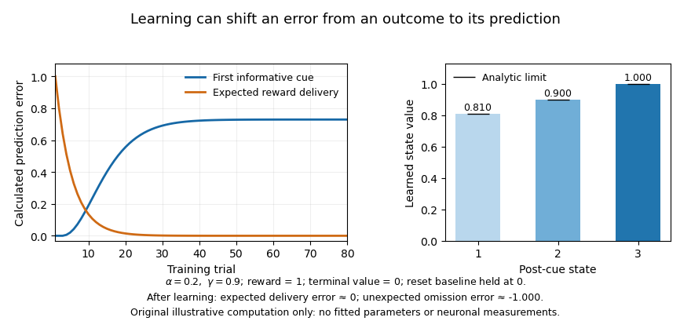

<h1 id="4/solution">Solution</h1>

↑ **Parent:** [4](../4.md)

**[Reward prediction error](../../../reward-prediction-error.md) remains a strong account of particular phasic [dopamine](../../../dopamine.md) signals and their contribution to [learning](../../../learning.md); it is inadequate as a universal description of every [dopamine](../../../dopamine.md) [neuron](../../../neuron-split.md), projection and timescale.** The question is best answered by separating the computational hypothesis, measurements of naturally occurring activity, and evidence that manipulating an error-like signal changes later [learning](../../../learning.md).

In [temporal-difference learning](../../../temporal-difference-learning.md), a prediction is updated using

$$
\delta_t=r_{t+1}+\gamma V(s_{t+1})-V(s_t),\qquad
V(s_t)\leftarrow V(s_t)+\alpha\delta_t,
$$

where $V(s)$ is the [value function](../../../value-function.md) for state $s$, $r_{t+1}$ is the next reward, $0\leq\gamma\leq1$ discounts later return, and $0<\alpha\leq1$ is the update step size. The terminal value is zero. A [reward prediction error](../../../reward-prediction-error.md) is therefore not simply reward, pleasure or salience. Its sign depends on what was expected and when. An unexpected reward can generate a positive error; an accurately predicted reward can generate little error; omission of an expected reward can generate a negative error. A cue can produce an error when it changes the prediction of future return even though no immediate reward is delivered.

Primate recordings motivated this account because phasic responses changed with [learning](../../../learning.md) and reward expectation rather than responding identically to every reward. Linking these patterns to a quantitative [learning](../../../learning.md) rule provided predictions about cue responses and outcome omissions that a generic “reward [neuron](../../../neuron-split.md)” label lacked. However, extracellular identification and population sampling matter, and the computational state representation is an assumption. A model fitted with a poor description of what the animal knows can misclassify a genuine expectation-related response as a theoretical failure.[Abstract and pp. 1593–1599: linkage between dopaminergic activity, changing predictions and computational learning](../../../a-neural-substrate-of-prediction-and-reward-by-wolfram-schultz-and-others.md)

**[Figure 1](#4/image-prediction-errors-in-an-original-toy-temporal-difference-learning-task). Prediction errors in an original toy temporal-difference learning task**. Calculated learning curves and value estimates for a deterministic state chain; these are not neuronal recordings. A reset trial state supplies the first informative cue. After learning, an unexpected reward omission produces a negative error at the expected reward transition.

Association-learning experiments make the interpretation more than a curve-fitting exercise. In blocking, an established cue already predicts the reward, reducing [learning](../../../learning.md) about an added cue. Reward-timed optogenetic activation of [dopamine](../../../dopamine.md) [neurons](../../../neuron-split.md) could overcome this blocking, supplying an error-like teaching event despite the normally expected reward. The relevant endpoint was subsequent [learning](../../../learning.md) about a cue, not just movement during stimulation. This supports a causal teaching contribution but does not establish that artificially synchronized activation reproduces every feature of an endogenous code.[Abstract and Figures 1–4: reward-timed stimulation, blocking and subsequent learning](../../../a-causal-link-between-prediction-errors-dopamine-neurons-and-learning-by-elizabeth-e-steinberg-and-others.md)

The negative side of the error also has [intervention](../../../treatment.md) evidence. Brief inhibition of targeted [dopamine](../../../dopamine.md) [neurons](../../../neuron-split.md) around reward processing produced later [learning](../../../learning.md) changes resembling those expected from a negative error, with behavioural controls addressing distraction or immediate aversion. This strengthens a bidirectional teaching account beyond sufficiency of excitation alone. The imposed pause still tests a particular population and task, and inhibition can affect processes other than the proposed scalar signal. Appropriate timing controls and later unstimulated testing are essential to the interpretation.[Abstract and Results, pp. 111–116: brief inhibition and later associative responding](../../../brief-optogenetic-inhibition-of-dopamine-neurons-mimics-endogenous-negative-reward-prediction-errors-by-chun-yun-chang-and-others.md)

Population heterogeneity can refine the hypothesis rather than simply refute it. Distributional reinforcement-learning work proposed multiple channels differing in optimism and in their relative sensitivity to positive and negative errors. Mouse single-unit data showed systematic variation in response reversal points consistent with this account. One reward can then be better than expected for one channel and worse for another. The finding challenges a single shared scalar prediction broadcast identically by all cells, while retaining prediction-error-like computations. It does not make heterogeneity alone proof of a particular distributional algorithm.[Abstract and Figures 1–5: differential reversal points and distributional predictions](../../../a-distributional-code-for-value-in-dopamine-based-reinforcement-learning-by-will-dabney-and-others.md)

Other heterogeneity is not readily summarized as reward error. Cell-resolved imaging during a mouse virtual-navigation task found dopamine-neuron signals related to sensory, motor and cognitive variables, with structured differences across [neurons](../../../neuron-split.md). Regression and task design can separate some predictors, but correlated movements and expectations limit unique interpretation. Such findings make a universal scalar account implausible; they do not eliminate the well-controlled reward-error results in other populations. Nor should every movement-related signal be re-labelled as error without an independently specified model that predicts it.[Abstract and encoding analyses, pp. 509–513: cell-resolved task-variable heterogeneity](../../../specialized-coding-of-sensory-motor-and-cognitive-variables-in-vta-dopamine-neurons-by-ben-engelhard-and-others.md)

The measurement compartment is another limitation. A comparison of identified VTA cell spiking with nucleus-accumbens [dopamine](../../../dopamine.md) release in a common decision task found release dynamics related to evolving reward expectations without corresponding changes in recorded cell-body spiking. Local release regulation therefore matters: a terminal sensor and a somatic [spike train](../../../spike-train.md) need not report the same quantity. This is especially important for interpreting slower ramps or motivational effects as direct readings of a broadcast phasic error.[Abstract and Figures 2–5: comparison of identified spiking and accumbens release dynamics](../../../dissociable-dopamine-dynamics-for-learning-and-motivation-by-ali-mohebi-and-others.md)

Further qualifications concern [learning](../../../learning.md) itself. An error depends on subjective reward, inferred state, uncertainty and task structure; it is not calculated from the experimenter’s reward schedule alone. Values informed by a model of the environment can also contribute, so identifying an error-like signal does not automatically prove exclusively model-free [learning](../../../learning.md). Conversely, a very flexible state model can accommodate almost any observation unless its representation and parameters are constrained independently. Good tests manipulate expectation while matching outcome and movement, and compare explicit alternatives on held-out behaviour and neural data.

The account is thus still appropriate when stated at the right resolution: some temporally precise [dopamine](../../../dopamine.md) activity supplies expectation-dependent teaching signals, supported by both recordings and causal [learning](../../../learning.md) manipulations. A complete account of the [dopamine](../../../dopamine.md) system must additionally explain projection-specific coding, local transmitter dynamics, [motivation](../../../motivation.md) and movement. The productive revision is a family of constrained computational and circuit hypotheses, rather than either one molecule–one number or abandonment of prediction error altogether.

## ↑ Ancestors (11)

1. [4](../4.md)
2. [2022](../../2022-split.md)
3. [Past exam of the neuropsychopharmacology of higher cognition course of the University of Oxford](../../split.md)
4. [Neuropsychopharmacology of higher cognition course of the University of Oxford](../../../neuropsychopharmacology-of-higher-cognition-course-of-the-university-of-oxford.md)
5. [Year 3 of the psychology (experimental) course of the University of Oxford](../../../year-3-of-the-psychology-experimental-course-of-the-university-of-oxford.md)
6. [Psychology (experimental) course of the University of Oxford](../../../psychology-experimental-course-of-the-university-of-oxford.md)
7. [Undergraduate course of the University of Oxford](../../../undergraduate-course-of-the-university-of-oxford.md)
8. [Course of the University of Oxford](../../../course-of-the-university-of-oxford.md)
9. [University of Oxford](../../../university-of-oxford-split.md)
10. [List of universities](../../../list-of-universities.md)
11. [Codex Wiki](../../../split.md)
