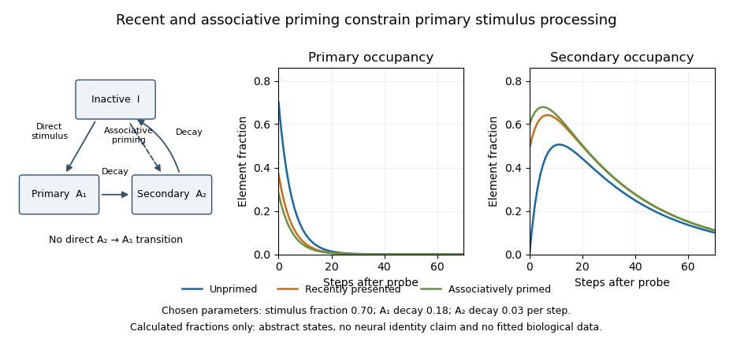

<h1 id="5/solution">Solution</h1>

↑ **Parent:** [5](../5.md)

**The [SOP model](../../../sop-model.md) family specifies testable principles of stimulus processing and association, but it does not yet have a uniquely established neural implementation.** Its behavioural breadth should be distinguished from evidence identifying the biological counterparts of its states, transition rules and separate response systems. The strongest neurobiology concerns processes that the models require—priming, associative retrieval and differentiated response pathways—rather than a one-to-one mapping of every symbol onto a brain structure.

[Ivan Pavlov](../../../ivan-pavlov.md)’s [classical conditioning](../../../classical-conditioning.md) tradition made stimulus history and the measured [conditioned response](../../../conditioned-response.md) objects of controlled experiment. The [SOP model](../../../sop-model.md) introduced by [Allan R. Wagner](../../../allan-r-wagner.md) represents stimuli as elements distributed among inactivity $I$, primary activation $A_1$ and secondary activation $A_2$. External presentation promotes inactive elements into $A_1$; activity then passes through $A_2$ before returning to inactivity. A learned associate can activate an expected event directly into $A_2$. Recently or associatively activated elements are less available for renewed primary processing, distinguishing [self-generated priming](../../../self-generated-priming.md) from [retrieval-generated priming](../../../retrieval-generated-priming.md). A contemporary quantitative analysis shows how these dynamics can generate several [habituation](../../../habituation.md) regularities; these are simulations, not measurements of neuronal states.[The SOP Model section: state occupancy, decay and two sources of priming](../../../a-quantitative-account-of-the-behavioral-characteristics-of-habituation-the-sometimes-opponent-processes-model-of-stimulus-processing-by-yerco-e-uribe-bahamonde-and-others.md)

The association rules make the account more specific than a generic fading trace. In the original formulation, concurrent $A_{1,CS}$ and $A_{1,US}$ activity promotes excitation, whereas $A_{1,CS}$ with $A_{2,US}$ promotes inhibition. The [Modified SOP model](../../../modified-sop-model.md) additionally permits [learning](../../../learning.md) involving a cue activated into $A_2$: matched-state combinations can strengthen excitation and mismatched-state combinations inhibition. This allows an absent cue’s association to change through retrieval, addressing [retrospective revaluation](../../../retrospective-revaluation.md). The model is therefore not simply equivalent to a reward-error equation or to synaptic fatigue.

Human causal-judgment experiments motivated an important constraint. Participants learned relations among compound cues and an outcome, then received information about a companion cue without the target. Retrospective changes in judgments depended on the consistency of earlier within-compound pairings. This supports a role for learned cue–cue relations in revaluation, but the behavioural result does not identify [synapses](../../../synapse.md) implementing the modified state-pair rules. Other retrieval or inference models can also use knowledge of those relations.[Abstract and experiments, pp. 60–80: consistent versus varied compounds and backward revaluation](../../../within-compound-associations-mediate-the-retrospective-revaluation-of-causality-judgements-by-anthony-dickinson-and-others.md)

**[Figure 2](#5/image-primary-and-secondary-activation-in-an-original-illustrative-sop-style-state-model). Primary and secondary activation in an original illustrative SOP-style state model**. Calculated occupancy fractions with chosen parameters, not neuronal activity. A recent presentation or associative priming leaves fewer inactive elements available for a subsequent primary response. The figure illustrates the state logic and conservation of probability, not a full SOP, M-SOP or AESOP learning simulation.

Neural adaptation alone is insufficient to explain retrieval-generated effects. A transient reduction in response to a repeated physical stimulus could result from [receptor](../../../receptor-biochemistry.md) adaptation, local synaptic dynamics or wider circuit changes, whereas context-specific long-term priming requires an account of the context’s learned relation to the event. A biological test must distinguish an unfamiliar stimulus from an unexpected combination of familiar stimuli and control [attention](../../../attention.md), orienting and stimulus exposure. Reduced firing cannot simply be labelled $A_2$: the theory permits secondary activity to be behaviourally silent or have a response-system-dependent effect.

Hippocampal lesion experiments provide evidence at that process level. Rats learned audiovisual sequences in which particular sounds preceded particular lights. Switching the familiar sound–light combinations renewed visual orienting in controls but not in hippocampal-lesioned animals, despite relatively preserved [habituation](../../../habituation.md) to visual stimuli and evidence of sequence associations. This implicates the [hippocampus](../../../hippocampus.md) in [associative mismatch](../../../associative-mismatch.md) rather than novelty alone. It is compatible with a contribution to expectation or retrieval, but does not uniquely show that the [hippocampus](../../../hippocampus.md) is $A_2$, nor that every [SOP model](../../../sop-model.md) process is hippocampal.[Abstract and pp. 2226–2230: audiovisual sequence switching, orienting and lesion controls](../../../hippocampal-lesions-disrupt-an-associative-mismatch-process-by-robert-c-honey-and-others.md)

[Receptor](../../../receptor-biochemistry.md) perturbation further separates short- and long-term components. Mice lacking the GluA1 AMPA-receptor subunit showed impaired short-term spatial novelty performance but enhanced long-term performance under the tested interval conditions. Manipulating exposure and test intervals helped distinguish rapid recency-dependent effects from longer-lasting [learning](../../../learning.md). This is consistent with separable processes of the kind emphasized by the [SOP model](../../../sop-model.md), rather than an undifferentiated stronger-versus-weaker [memory](../../../memory-in-animals.md). Nevertheless, a lifelong mutation can alter development and network function, and task dependence prevents identifying GluA1 with a single abstract transition parameter.[Abstract and Experiments 1–2: exposure/test intervals, spatial novelty and the opposite short-/long-term effects](../../../enhanced-long-term-and-impaired-short-term-spatial-memory-in-glua1-ampa-receptor-subunit-knockout-mice-evidence-for-a-dual-process-memory-model-by-david-j-sanderson-and-others.md)

Associative access to an absent outcome has additional circuit support. In rat [sensory preconditioning](../../../sensory-preconditioning.md), orbitofrontal inactivation impaired behaviour guided by an indirectly inferred outcome while sparing behaviour supported by the directly reward-paired cue. The manipulation also altered [learning](../../../learning.md) when inferred value normally acted as a blocker. This shows that retrieved associative structure can influence both performance and new [learning](../../../learning.md). It is relevant to the demands of [Modified SOP model](../../../modified-sop-model.md), but does not demonstrate that the neural representation is in exactly $A_2$ or that its plasticity has the model’s stipulated sign.[Abstract and Figures 1–2: inferred versus directly trained values and reversible inactivation](../../../orbitofrontal-cortex-supports-behavior-and-learning-using-inferred-but-not-cached-values-by-joshua-l-jones-and-others.md)

The [Affective extension of SOP](../../../affective-extension-of-sop.md), developed by [Allan R. Wagner](../../../allan-r-wagner.md) and [Susan E. Brandon](../../../susan-e-brandon.md), distinguishes sensory-specific and emotive components with different processing time courses and response consequences. Behavioural experiments in rabbits showed modulation of a discrete conditioned eyeblink by another putatively emotive [conditioned stimulus](../../../conditioned-stimulus.md). Such dissociations motivate separate response components. They do not locate a complete emotive representation in one nucleus. Basic conditioned-eyelid experiments independently implicated cerebellar nuclear circuitry through lesions, recordings and stimulation, illustrating why a motor [conditioned response](../../../conditioned-response.md) cannot simply be assigned to the same mechanism as every autonomic or emotional effect.[Abstract and pp. 299–311: modulation of the discrete conditioned reflex](../../../modulation-of-a-discrete-pavlovian-conditioned-reflex-by-a-putative-emotive-pavlovian-conditioned-stimulus-by-susan-e-brandon-and-others.md)[Abstract and pp. 296–299: cerebellar lesions, activity and stimulation](../../../cerebellum-essential-involvement-in-the-classically-conditioned-eyelid-response-by-david-a-mccormick-and-others.md)

The remaining challenge is discriminative implementation. A candidate neural model should specify what an element is, how direct and retrieved activity differ, how relevant overlap controls plasticity, and how sensory and affective components affect separate outputs. Manipulating [receptor](../../../receptor-biochemistry.md) function or recording reactivation is not enough unless alternative mechanisms make different predictions. [Neuromodulators](../../../neuromodulator.md) could regulate transition rates, representation selection or plasticity, but there is no justified general identity such as “[dopamine](../../../dopamine.md) is $A_1$” or “[serotonin](../../../serotonin.md) is $A_2$.” Multiple biological mechanisms could realize the same functional state description.

The [SOP model](../../../sop-model.md) family is therefore a valuable framework connecting stimulus history, expectation and response organization. Primary lesion, [receptor](../../../receptor-biochemistry.md) and inactivation evidence supports several component processes. Its comprehensive behavioural ambitions exceed what is currently established about its precise neurobiology; the next useful experiments distinguish direct activation from retrieved activation and test the associated plasticity rules, rather than merely find a neural correlate of one familiar behavioural effect.

## ↑ Ancestors (11)

1. [5](../5.md)
2. [2022](../../2022-split.md)
3. [Past exam of the neuropsychopharmacology of higher cognition course of the University of Oxford](../../split.md)
4. [Neuropsychopharmacology of higher cognition course of the University of Oxford](../../../neuropsychopharmacology-of-higher-cognition-course-of-the-university-of-oxford.md)
5. [Year 3 of the psychology (experimental) course of the University of Oxford](../../../year-3-of-the-psychology-experimental-course-of-the-university-of-oxford.md)
6. [Psychology (experimental) course of the University of Oxford](../../../psychology-experimental-course-of-the-university-of-oxford.md)
7. [Undergraduate course of the University of Oxford](../../../undergraduate-course-of-the-university-of-oxford.md)
8. [Course of the University of Oxford](../../../course-of-the-university-of-oxford.md)
9. [University of Oxford](../../../university-of-oxford-split.md)
10. [List of universities](../../../list-of-universities.md)
11. [Codex Wiki](../../../split.md)
