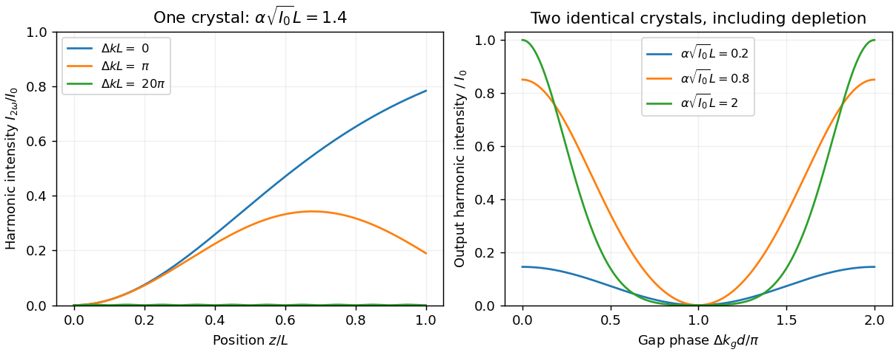

# Paper 1

↑ **Parent:** [2012](../2012.md)

Source: [Cambridge examination PDF, physical pages 479–481; printed paper 235](https://www.whatdotheyknow.com/request/natural_science_tripos_physics_e_2/response/2340776/attach/2/FOI%202023%20399%20Zahid%20materials.pdf?cookie_passthrough=1).

**Table of contents**

- [1](#1)
  - [Solution](#1/solution)
- [2](#2)
  - [Solution](#2/solution)
- [3](#3)
  - [a](#3/a)
    - [Solution](#3/a/solution)
  - [b](#3/b)
    - [Solution](#3/b/solution)
  - [c](#3/c)
    - [Solution](#3/c/solution)

## 1

↑ **Parent:** [Paper 1](paper-1.md)

<h3 id="1/solution">Solution</h3>

↑ **Parent:** [1](#1)

[Second-harmonic generation](../../optics.md#second-harmonic-generation) doubles optical [frequency](../../wave.md#frequency), hence halves the vacuum [wavelength](../../wave-equation.md#wavelength). It requires a nonzero effective second-order [nonlinear optical susceptibility](../../optics.md#nonlinear-optical-susceptibility) for the selected fields, overlap in the nonlinear medium, and enough intensity and interaction length for a useful signal. Bulk electric-dipole second-order response vanishes in an inversion-symmetric medium. Low absorption at both frequencies and [phase matching](../../physical-optics.md#phase-matching) prevent generated amplitudes from being lost or canceling during propagation. Pulses additionally need suitable temporal overlap and bandwidth acceptance.

For the stated lossless amplitude equations, choose real $\alpha$, input $A_0=|A_0|e^{i\phi}$ and **no second-harmonic seed**. Perfect [phase matching](../../physical-optics.md#phase-matching) admits

$$
A_\omega(z)=A_0\operatorname{sech}(\lambda z),\qquad
A_{2\omega}(z)=i|A_0|e^{2i\phi}\tanh(\lambda z),\qquad
\boxed{\lambda=\alpha|A_0|.}
$$

The second equation follows by substituting the first into $A_\omega'=i\alpha A_{2\omega}A_\omega^*$. Its derivative then equals $i\alpha A_0^2\operatorname{sech}^2(\lambda z)$, verifying the other coupled equation. Equivalently, $\lambda^2=\alpha^2|A_0|^2$; changing the sign of $\lambda$ does not change the pump profile. The intensity convention in the question therefore gives

$$
\boxed{I_{2\omega}(z)=I_0\tanh^2(\alpha\sqrt{I_0}\,z),\qquad
I_\omega(z)=I_0\operatorname{sech}^2(\alpha\sqrt{I_0}\,z).}
$$

Their sum is $I_0$, as follows directly from the supplied equal-coupling equations. This uses their normalization; physically normalized photon-flux equations can place [frequency](../../wave.md#frequency) factors in the two coupling coefficients. A nonzero input harmonic would require a different boundary-value solution.

For an undepleted pump at nonzero mismatch, direct integration gives

$$
A_{2\omega}(z)=i\alpha A_0^2z\,e^{i\Delta kz/2}\operatorname{sinc}(\Delta kz/2),\qquad
I_{2\omega}(z)=\alpha^2I_0^2z^2\operatorname{sinc}^2(\Delta kz/2).
$$

Here $\operatorname{sinc}x=\sin x/x$. The perfectly matched small-signal curve grows quadratically and its depleted continuation saturates. For $\Delta kL=\pi$, destructive phase accumulation reduces output; in the undepleted limit its endpoint is $4/\pi^2$ of the matched small-signal output. For $|\Delta k|L\gg\pi$, successive regions alternately generate and cancel harmonic amplitude, giving rapid low-amplitude oscillations with spatial period $2\pi/|\Delta k|$. For substantial depletion, the complete curve also depends on $\alpha\sqrt{I_0}L$; specifying mismatch alone does not determine a unique numerical sketch.

**[Figure 1](#1/image-second-harmonic-depletion-phase-mismatch-and-two-crystal-interference). Second-harmonic depletion, phase mismatch and two-crystal interference**. Original integration of the stated lossless amplitude equations. Left: three mismatches for a declared nonlinear interaction strength. Right: output versus gap phase for identical crystals at several strengths; curves are illustrative model predictions, not measured data.

For the separated crystals, use the undepleted approximation and perfect matching inside each crystal. Up to a common output phase, the harmonic generated in the first crystal contributes $i\alpha A_0^2L e^{ik(2\omega)d}$, while the second crystal contributes $i\alpha A_0^2L e^{2ik(\omega)d}$. The different phases come from propagation of an already generated harmonic versus propagation of two pump factors through the gap. Ideal antireflection coatings remove the multiple-reflection complication. Thus

$$
\boxed{I_{2\omega}^{\rm out}(d)=4\alpha^2I_0^2L^2
\cos^2\left[\frac{\Delta k_gd}{2}\right],\qquad
\Delta k_g=\frac{2\omega}{c}[n(\omega)-n(2\omega)].}
$$

This is [two-crystal second-harmonic interference](../../optics.md#two-crystal-second-harmonic-interference). Maxima require $\Delta k_gd=2\pi m$. With nonzero dispersion, their spacing is $2\pi/|\Delta k_g|=\lambda_0/[2|n(\omega)-n(2\omega)|]$, where $\lambda_0$ is the pump vacuum [wavelength](../../wave-equation.md#wavelength). If the gap has no index difference between these frequencies, every separation is constructive within this ideal propagation model.

Finite depletion makes the amplitude entering the second crystal smaller and permits coherent backconversion, so the simple cosine-squared envelope no longer applies and the total converted intensity cannot exceed $I_0$. The gap phase remains periodic. In the ideal identical lossless case the constructive setting is equivalent to a matched crystal of length $2L$, giving $I_0\tanh^2(2\alpha\sqrt{I_0}L)$. The opposite relative phase can make the second crystal reverse the first conversion, restoring the pump and leaving zero harmonic. Thus depletion does not necessarily fill an ideal destructive minimum; unequal crystals, loss or other phase errors can spoil that cancellation.

## 2

↑ **Parent:** [Paper 1](paper-1.md)

<h3 id="2/solution">Solution</h3>

↑ **Parent:** [2](#2)

A coherent pump has a [Poisson distribution](../../discrete-probability-distribution.md#poisson-distribution) of [photon](../../quantum-mechanics.md#photon) numbers. Second-harmonic conversion couples a pump [number state](../../quantum-harmonic-oscillator.md#number-state) $|n\rangle$ to a state with two fewer pump [photons](../../quantum-mechanics.md#photon) with a matrix element proportional to $\sqrt{n(n-1)}$. Different number components therefore evolve at different rates, and the pump becomes correlated with the harmonic mode. Its reduced state is generally neither pure nor exactly Poisson coherent. An undepleted classical-pump approximation suppresses precisely this backaction; it cannot prove that the exact finite-depletion [quantum state](../../quantum-system.md#quantum-state) stays coherent. Vacuum input or zero interaction are trivial exceptions.

Let $A=a^{\dagger2}$, $B=a^2$ and $N=a^\dagger a$. The oscillator algebra gives $[A,B]=-4N-2$, $[N,A]=2A$ and $[N,B]=-2B$. Substituting into the definitions proves closure:

$$
\boxed{[K_1,K_2]=-4iK_3,\qquad [K_2,K_3]=iK_1,\qquad [K_3,K_1]=iK_2.}
$$

The factors depend on the stated normalization: $K_3$ has an extra factor one-half relative to $N+1/2$. The [Robertson uncertainty relation](../../quantum-theory.md#robertson-uncertainty-principle) consequently gives

$$
(\Delta K_1)^2(\Delta K_2)^2\geq\frac14|\langle[K_1,K_2]\rangle|^2
=4\langle K_3\rangle^2.
$$

For a [coherent state](../../quantum-theory.md#coherent-state) with $n=|\alpha|^2$, [normal ordering](../../perturbative-quantum-field-theory.md#normal-ordering) gives

$$
\langle A B\rangle=n^2,\quad\langle B A\rangle=n^2+4n+2,\quad
\langle A^2\rangle=\alpha^{*4},\quad\langle B^2\rangle=\alpha^4.
$$

Thus $\langle K_1\rangle=\operatorname{Re}\alpha^2$ and $\langle K_2\rangle=-\operatorname{Im}\alpha^2$. In either [variance](../../variance.md), the fourth-power and $n^2$ terms cancel against the square of the mean, leaving

$$
\boxed{(\Delta K_1)^2=(\Delta K_2)^2=n+\tfrac12,\qquad
\langle K_3\rangle=\tfrac12(n+\tfrac12).}
$$

The [variance](../../variance.md) product is exactly $4\langle K_3\rangle^2$, so the [coherent state](../../quantum-theory.md#coherent-state) saturates the stated bound.

[Amplitude-squared squeezing](../../quantum-optics.md#amplitude-squared-squeezing) in either of these axes means

$$
\boxed{(\Delta K_j)^2<2|\langle K_3\rangle|=\langle N\rangle+\tfrac12\quad(j=1\text{ or }2).}
$$

The other [variance](../../variance.md) must then rise sufficiently to respect the product inequality. A rotated [field-squared quadrature](../../quantum-optics.md#field-squared-quadrature) can reveal squeezing in another direction; the criterion concerns the declared quadrature and reference, not merely a reduction in mean optical intensity.

## 3

↑ **Parent:** [Paper 1](paper-1.md)

<h3 id="3/a">a</h3>

↑ **Parent:** [3](#3)

<h4 id="3/a/solution">Solution</h4>

↑ **Parent:** [A](#3/a)

For stationary photodetection, the normalized correlation in [second-order optical coherence](../../quantum-optics.md#second-order-optical-coherence) is $g^{(2)}(\tau)=\langle E^-(t)E^-(t+\tau)E^+(t+\tau)E^+(t)\rangle/\langle E^-E^+\rangle^2$. [Normal ordering](../../perturbative-quantum-field-theory.md#normal-ordering) expresses the absorption of two [photons](../../quantum-mechanics.md#photon). In a single mode,

$$
g^{(2)}(0)=\frac{\langle N(N-1)\rangle}{\langle N\rangle^2}
=1+\frac{\operatorname{Var}N-\langle N\rangle}{\langle N\rangle^2}.
$$

A [coherent state](../../quantum-theory.md#coherent-state) has $g^{(2)}(0)=1$. A single-mode thermal field has $g^{(2)}(0)=2$ and bunches, while a [number state](../../quantum-harmonic-oscillator.md#number-state) with $n>0$ gives $1-1/n$; a single-photon state has zero ideal coincidence [probability](../../probability-theory.md#probability) at zero delay. Antibunching, a zero-delay suppression relative to nearby delays, is distinct from simply reporting an intensity [variance](../../variance.md). Multimode averaging and finite detector response reduce observed contrast.

The [Hanbury Brown and Twiss effect](../../quantum-optics.md#hanbury-brown-and-twiss-effect) is measured by splitting the [light](../../optics.md#light) onto two detectors and histogramming coincidences versus delay. Background counts, detector timing, dead time and afterpulsing need calibration. Two detectors avoid confusing the single detector's inability to register arbitrarily close counts with real antibunching. First-order [interference](../../physical-optics.md#interference-wave-propagation) and second-order correlations contain different information: weak first-order coherence does not imply an absence of intensity bunching.[1956, two-detector optical correlation experiment](../../physics-bibliography.md#correlation-between-photons-in-two-coherent-beams-of-light-by-robert-hanbury-brown-and-richard-quentin-twiss)

<h3 id="3/b">b</h3>

↑ **Parent:** [3](#3)

<h4 id="3/b/solution">Solution</h4>

↑ **Parent:** [B](#3/b)

For a second-order response, $P_i^{(2)}(\omega_3)=\epsilon_0\sum_{jk}\chi_{ijk}^{(2)}(\omega_3;\omega_1,\omega_2)E_j(\omega_1)E_k(\omega_2)$, with the appropriate [frequency](../../wave.md#frequency) conservation and negative-frequency convention for difference-frequency processes. Interchanging the two input field-frequency pairs gives [intrinsic permutation symmetry of nonlinear susceptibility](../../optics.md#intrinsic-permutation-symmetry-of-nonlinear-susceptibility):

$$
\chi_{ijk}^{(2)}(\omega_3;\omega_1,\omega_2)
=\chi_{ikj}^{(2)}(\omega_3;\omega_2,\omega_1).
$$

For [second-harmonic generation](../../optics.md#second-harmonic-generation) the input frequencies agree, so the last two Cartesian indices are symmetric and can be contracted into six input-pair labels. This reduces the unrestricted 27 Cartesian entries to at most 18 before crystal symmetries are imposed.

Crystal point-group transformations must leave the material tensor invariant and can [force](../../force.md) entries to vanish or become related. Under spatial inversion both [electric field](../../electric-field.md) and [polarization](../../wave.md#polarization-waves) reverse, whereas the field product is even. A centrosymmetric bulk therefore has zero electric-dipole $\chi^{(2)}$. Surfaces and interfaces can break [inversion symmetry](../../bloch-s-theorem.md#inversion-symmetry), and higher-multipole processes are outside that simple prohibition.

[Kleinman symmetry](../../optics.md#kleinman-symmetry) is a stronger approximate permutation symmetry used sufficiently far from resonances when dispersion can be neglected over the participating frequencies. It is not justified merely because two input frequencies are equal; resonant or appreciably dispersive media need the full frequency-dependent relations. These distinctions determine which [polarization](../../wave.md#polarization-waves) and propagation geometries have nonzero effective coupling, in addition to whether they satisfy [phase matching](../../physical-optics.md#phase-matching).[1962, symmetry of the nonlinear dielectric response](../../physics-bibliography.md#nonlinear-dielectric-polarization-in-optical-media-by-d-a-kleinman)

<h3 id="3/c">c</h3>

↑ **Parent:** [3](#3)

<h4 id="3/c/solution">Solution</h4>

↑ **Parent:** [C](#3/c)

[Frequency-resolved optical gating](../../optics.md#frequency-resolved-optical-gating) characterizes an ultrashort pulse using a nonlinear gate and a measured two-dimensional [spectrogram](../../fourier-analysis.md#spectrogram). In [second-harmonic frequency-resolved optical gating](../../optics.md#second-harmonic-frequency-resolved-optical-gating), split the pulse into two replicas, vary their relative delay, overlap them noncollinearly in a thin second-harmonic crystal, and spectrally resolve the cross-generated beam. Its propagation direction separates it from the individual beams' self-generated harmonics. For complex pulse envelope $E(t)$, the ideal trace is

$$
\boxed{I_{\rm FROG}(\Omega,\tau)\propto\left|\int E(t)E(t-\tau)e^{-i\Omega t}\,dt\right|^2,}
$$

where $\Omega$ denotes the output [frequency](../../wave.md#frequency) offset in the envelope convention. An iterative [phase retrieval](../../inverse-problem.md#phase-retrieval) algorithm seeks a pulse consistent with both this measured Fourier magnitude and the nonlinear product relation. The delay axis provides timing structure, while the resolved spectrum adds information missing from a plain intensity [autocorrelation](../../time-series.md#autocorrelation).[1993, nonlinear-gating spectrogram and pulse reconstruction](../../physics-bibliography.md#characterization-of-arbitrary-femtosecond-pulses-using-frequency-resolved-optical-gating-by-daniel-j-kane-and-rick-trebino)

The measured trace does not fix absolute optical phase or absolute time origin. SHG FROG also has a conjugate time-reversal ambiguity: $E(t)$ and $E^*(-t)$ produce the same trace. Extra information, such as a known dispersion change and a second measurement, can resolve that direction-of-time ambiguity. Finite phase-matching bandwidth, [group-velocity mismatch](../../dispersion-relation.md#group-velocity-mismatch), spatial chirp, [spectrometer](../../optical-instrument.md#spectrometer) calibration, delay error, noise and instability over the scan must be controlled. A thin gate helps avoid temporal blurring, but trades against signal. FROG therefore reconstructs a pulse under an explicit instrument model rather than reading optical phase directly from a single intensity image.

## ↑ Ancestors (11)

1. [2012](../2012.md)
2. [Past exam of the nonlinear Optics and Quantum States of Light course of the University of Cambridge](../../past-exam-of-the-nonlinear-optics-and-quantum-states-of-light-course-of-the-university-of-cambridge.md)
3. [Nonlinear Optics and Quantum States of Light course of the University of Cambridge](../../university-of-cambridge.md#nonlinear-optics-and-quantum-states-of-light-course-of-the-university-of-cambridge)
4. [Physics course of the year 4 of the natural sciences course of the University of Cambridge](../../university-of-cambridge.md#physics-course-of-the-year-4-of-the-natural-sciences-course-of-the-university-of-cambridge)
5. [Year 4 of the natural sciences course of the University of Cambridge](../../university-of-cambridge.md#year-4-of-the-natural-sciences-course-of-the-university-of-cambridge)
6. [Year of the natural sciences course of the University of Cambridge](../../university-of-cambridge.md#year-of-the-natural-sciences-course-of-the-university-of-cambridge)
7. [Natural sciences course of the University of Cambridge](../../university-of-cambridge.md#natural-sciences-course-of-the-university-of-cambridge)
8. [Course of the University of Cambridge](../../university-of-cambridge.md#course-of-the-university-of-cambridge)
9. [University of Cambridge](../../university-of-cambridge.md)
10. [List of universities](../../README.md#list-of-universities)
11. [Codex Wiki](../../README.md)
