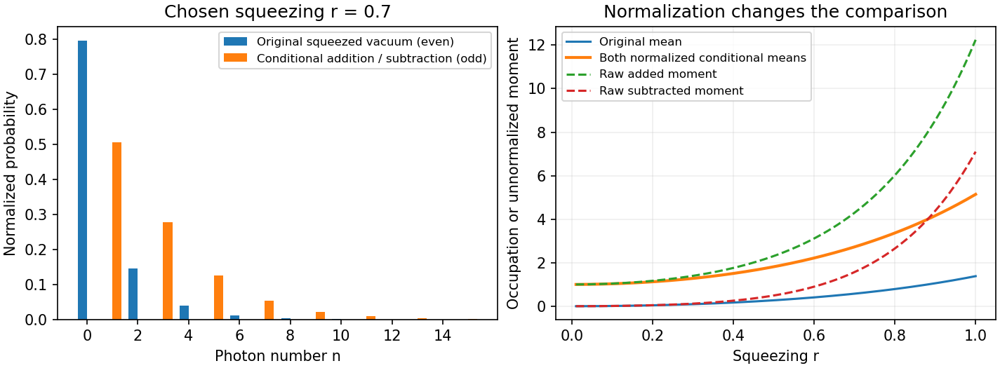

# Paper 1

↑ **Parent:** [2014](../2014.md)

Original paper: [23 April 2014, physical PDF pages 678–680](https://www.whatdotheyknow.com/request/natural_science_tripos_physics_e_2/response/2340776/attach/2/FOI%202023%20399%20Zahid%20materials.pdf?cookie_passthrough=1#page=678).

**Table of contents**

- [1](#1)
  - [Solution](#1/solution)
- [2](#2)
  - [Solution](#2/solution)
- [3](#3)
  - [a](#3/a)
    - [Solution](#3/a/solution)
  - [b](#3/b)
    - [Solution](#3/b/solution)
  - [c](#3/c)
    - [Solution](#3/c/solution)

## 1

↑ **Parent:** [Paper 1](paper-1.md)

<h3 id="1/solution">Solution</h3>

↑ **Parent:** [1](#1)

Put $g=\gamma P_0$. For a temporally uniform envelope, $A_z=igA$ and $A_{TT}=0$, so the propagation equation reduces to $-gA+\gamma P_0A=0$. Thus **the [power](../../energy.md#power) stays $P_0$ and the accumulated nonlinear [wave phase](../../wave.md#phase-waves) is $g z$**. The [optical Kerr effect](../../optics.md#optical-kerr-effect) gives an intensity-dependent [refractive index](../../electromagnetic-wave.md#refractive-index), and hence [self-phase modulation](../../optics.md#self-phase-modulation). For the usual [power](../../energy.md#power) normalization $\gamma\simeq n_2\omega_0/(cA_{\rm eff})$, with effective guided-mode area $A_{\rm eff}$. Losslessness preserves the background [power](../../energy.md#power); it does not remove the [self-phase modulation](../../optics.md#self-phase-modulation). The carrier [wave phase](../../wave.md#phase-waves) has already been factored out.

Write $A=(\sqrt{P_0}+\epsilon)e^{igz}$. To first order,

$$
|\sqrt{P_0}+\epsilon|^2(\sqrt{P_0}+\epsilon)
=P_0^{3/2}+P_0(2\epsilon+\epsilon^*)+O(|\epsilon|^2).
$$

Cancelling the background and its phase derivative leaves

$$
i\epsilon_z-\frac{\beta_2}{2}\epsilon_{TT}+g(\epsilon+\epsilon^*)=0.
$$

The last term couples a [perturbation](../../asymptotic-expansion.md#perturbation) to its [complex conjugate](../../complex-analysis.md#complex-conjugate): the pump can transfer [energy](../../energy.md) into a pair of sidebands. It is not an independent [wave phase](../../wave.md#phase-waves) of each Fourier component. This [sideband coupling](../../dispersion-relation.md#sideband-coupling) is the linear origin of [fibre modulational instability](../../dispersion-relation.md#fibre-modulational-instability).

For real $K,\Omega,c_1,c_2$, put $d=\beta_2\Omega^2/2$. Matching the two exponential coefficients gives

$$
\begin{pmatrix}d+g-K&g\\g&d+g+K\end{pmatrix}
\begin{pmatrix}c_1\\c_2\end{pmatrix}=0.
$$

A nonzero pair requires a zero [determinant](../../multilinear-algebra.md#determinant), hence

$$
\boxed{K^2=d(d+2g)=\frac{\beta_2^2\Omega^2}{4}
\left(\Omega^2+\frac{4g}{\beta_2}\right).}
$$

For unstable complex $K$, the real-coefficient assumption is too restrictive. The consistent pair is $\epsilon=u e^{iKz-i\Omega T}+v^*e^{-iK^*z+i\Omega T}$, with complex $u,v$. Its equations give the same [determinant](../../multilinear-algebra.md#determinant) and allow the growing and decaying branches. Merely inserting imaginary $K$ while treating the two original coefficients as real would not respect [complex conjugation](../../complex-analysis.md#complex-conjugation).

For $P_0>0$ and nonzero $\beta_2,\gamma$, exponential growth requires **$\beta_2\gamma<0$** and

$$
0<\Omega^2<-\frac{4\gamma P_0}{\beta_2}.
$$

For ordinary positive Kerr nonlinearity this means anomalous [group velocity dispersion](../../dispersion-relation.md#group-velocity-dispersion), $\beta_2<0$. Define $\Omega_c=\sqrt{4g/|\beta_2|}$. The growing branch is $K=-iG$, with [amplitude](../../wave.md#wave-amplitude) growth rate

$$
G(\Omega)=\frac{|\beta_2||\Omega|}{2}\sqrt{\Omega_c^2-\Omega^2},\qquad
\boxed{|\Omega|_{\max}=\Omega_c/\sqrt2,\quad G_{\max}=g.}
$$

Sideband [power](../../energy.md#power) grows at rate $2G$, rather than $G$. The cutoff and zero-frequency modes have no exponential growth; in a degenerate zero-frequency sector a secular phase response can remain. Positive dispersion with positive $\gamma$ gives real $K$ and oscillatory [perturbations](../../asymptotic-expansion.md#perturbation).

Initially small ripples grow into pronounced [intensity](../../wave.md#intensity-physics) peaks and deplete the uniform background. Dispersion and [self-phase modulation](../../optics.md#self-phase-modulation) can then support localized bright pulses. A [fundamental temporal bright soliton](../../optics.md#fundamental-temporal-bright-soliton) obeys $\gamma P_sT_0^2=|\beta_2|$, so its width is comparable to $1/\Omega_c$ when its peak [power](../../energy.md#power) is comparable to the original [power](../../energy.md#power). The dominant ripple spacing is $2\pi/|\Omega|_{\max}$, not simply $1/\Omega_c$. Propagation distance $z$ is the evolution variable; $T$ measures time within the envelope. An ideal conservative fibre need not settle permanently into a unique pulse train: nonlinear compression, interactions and recurrence depend on the seed and boundary conditions.

**[Figure 1](#1/image-original-instability-gain-and-calculated-nonlinear-growth-of-a-weak-periodic-modulation-in-a-focusing-fibre-model). Original instability gain and calculated nonlinear growth of a weak periodic modulation in a focusing fibre model**.

## 2

↑ **Parent:** [Paper 1](paper-1.md)

<h3 id="2/solution">Solution</h3>

↑ **Parent:** [2](#2)

A degenerate [optical parametric amplifier](../../optics.md#optical-parametric-amplifier) sends a strong pump at $2\omega$ through a phase-matched second-order nonlinear medium, creating pairs in a selected mode near $\omega$. With the pump treated classically and undepleted, the effective interaction is quadratic in the mode's [creation and annihilation operators](../../quantum-harmonic-oscillator.md#creation-and-annihilation-operators). Vacuum input evolves into an [optical squeezed vacuum](../../quantum-harmonic-oscillator.md#optical-squeezed-vacuum); the pump phase fixes the quiet [optical quadrature](../../quantum-optics.md#optical-quadrature). A cavity enhances the interaction below oscillation threshold. [balanced homodyne detection](../../quantum-optics.md#balanced-homodyne-detection) compares this [optical quadrature](../../quantum-optics.md#optical-quadrature)'s noise with the blocked-signal vacuum reference; phase locking, detector balance, electronic-noise measurement and loss calibration distinguish squeezing from an instrumental noise reduction. A primary cavity experiment observed below-vacuum noise by degenerate down conversion and balanced homodyne readout.[1986, abstract: cavity down conversion and homodyne noise reduction](../../physics-bibliography.md#generation-of-squeezed-states-by-parametric-down-conversion-by-ling-an-wu-and-others)

Use $S(r)=\exp[\tfrac r2(a^2-a^{\dagger2})]$, so $S^\dagger aS=a\cosh r-a^\dagger\sinh r$. Write $s=\sinh^2r$, $c=\cosh r$ and $N=a^\dagger a$. Vacuum expectations then give

$$
\boxed{\langle N\rangle=s},\qquad
\langle a^2\rangle=-\sinh r\cosh r.
$$

Pair creation makes the mean field zero while the mean [photon number](../../quantum-harmonic-oscillator.md#photon-number) is positive. Expanding the transformed ladder operators in the vacuum gives the [squeezed-vacuum photon-number moments](../../quantum-harmonic-oscillator.md#squeezed-vacuum-photon-number-moments): $\langle N(N-1)\rangle=3s^2+s$ and $\langle N^2\rangle=3s^2+2s$; equivalently $\operatorname{Var}N=2s(s+1)$.

The vectors produced by [photon addition](../../quantum-optics.md#photon-addition) and [photon subtraction](../../quantum-optics.md#photon-subtraction) in the paper are not normalized. Their squared norms are $s+1$ and $s$, respectively. A particularly direct evaluation is

$$
a^\dagger S(r)|0\rangle=cS(r)|1\rangle,\qquad
aS(r)|0\rangle=-\sinh r\,S(r)|1\rangle.
$$

Both successful operations therefore prepare the same [squeezed one-photon state](../../quantum-harmonic-oscillator.md#squeezed-one-photon-state), up to an overall phase, whenever subtraction has nonzero [probability](../../probability-theory.md#probability). Since $\langle1|S^\dagger NS|1\rangle=c^2+2s=1+3s$, the unnormalized moments are

$$
M_+=\langle\Psi_+|N|\Psi_+\rangle=(c^2+2s)c^2=(3s+1)(s+1),
\qquad M_-=\langle\Psi_-|N|\Psi_-\rangle=s(3s+1).
$$

**The printed photon-added formula equals $M_+$, not a normalized mean.** With its literal unnormalized convention, the corresponding subtraction result is $M_-$ and

$$
\boxed{M_+-M_-=1+3\sinh^2r>0.}
$$

This difference tends to one as $r\to0$ and grows as $\tfrac34e^{2r}$ for large positive $r$. Keeping this convention recovers the paper's requested expression without misidentifying it as a physical conditional mean.

For the [normalization of photon-added and photon-subtracted states](../../quantum-optics.md#normalization-of-photon-added-and-photon-subtracted-states), divide by the squared norms to obtain actual conditional means:

$$
\boxed{\bar n_+=\frac{M_+}{s+1}=1+3s,
\qquad \bar n_-=\frac{M_-}{s}=1+3s,
\qquad \bar n_+-\bar n_-=0.}
$$

These equalities for subtraction require $s>0$. As $r\to0$ the normalized successful subtraction tends to $|1\rangle$, but its success [probability](../../probability-theory.md#probability) vanishes; exactly at $r=0$, $a|0\rangle=0$ gives no conditional state. At large $r$, both normalized means grow as $3e^{2r}/4$, while their difference remains zero.

For the [photon statistics of a squeezed vacuum](../../quantum-harmonic-oscillator.md#photon-statistics-of-a-squeezed-vacuum), the even-number [probabilities](../../probability-theory.md#probability) are

$$
p_{2m}=\frac{(2m)!}{2^{2m}(m!)^2}\frac{\tanh^{2m}r}{\cosh r},\qquad p_{2m+1}=0.
$$

After subtraction the normalized distribution is $p^-_n=(n+1)p_{n+1}/s$. It has only odd occupation and no vacuum component. [photon addition](../../quantum-optics.md#photon-addition) gives $p^+_n=np_{n-1}/(s+1)$, identical here to $p^-_n$. The diagram uses normalized distributions with an explicitly chosen $r$, rather than treating the unnormalized moments as means.

**[Figure 2](#2/image-original-normalized-even-squeezed-vacuum-and-odd-conditional-photon-number-distributions-with-raw-moment-and-mean-conventions-distinguished). Original normalized even squeezed-vacuum and odd conditional photon-number distributions, with raw-moment and mean conventions distinguished**.

A subtraction event samples initial occupation with weight $n$, preferentially selecting the larger components before removing one [photon](../../quantum-mechanics.md#photon). In general $\bar n_-=\langle N(N-1)\rangle/\langle N\rangle=\langle N\rangle-1+\operatorname{Var}N/\langle N\rangle$. Here the large [variance](../../variance.md) gives **$\bar n_--\langle N\rangle=1+2s>0$**. This [conditional photon-number bias](../../quantum-optics.md#conditional-photon-number-bias) does not create [energy](../../energy.md) by removing a [photon](../../quantum-mechanics.md#photon): the unconditional ensemble also includes the runs without a heralded event.

## 3

↑ **Parent:** [Paper 1](paper-1.md)

<h3 id="3/a">a</h3>

↑ **Parent:** [3](#3)

<h4 id="3/a/solution">Solution</h4>

↑ **Parent:** [A](#3/a)

An [optical soliton](../../optics.md#optical-soliton) maintains a localized profile because nonlinear refraction compensates linear spreading. A [temporal optical soliton](../../optics.md#temporal-optical-soliton) balances [group velocity dispersion](../../dispersion-relation.md#group-velocity-dispersion) against [self-phase modulation](../../optics.md#self-phase-modulation); a [spatial optical soliton](../../optics.md#spatial-optical-soliton) balances [diffraction](../../quantum-scattering.md#diffraction) against [self-focusing](../../optics.md#self-focusing). The relevant coordinate and sign of nonlinearity must be specified.

For anomalous [group velocity dispersion](../../dispersion-relation.md#group-velocity-dispersion) and positive $\gamma$, a [fundamental temporal bright soliton](../../optics.md#fundamental-temporal-bright-soliton) is

$$
\boxed{A(z,T)=\sqrt{P_s}\operatorname{sech}(T/T_0)
 e^{i\gamma P_s z/2},\qquad \gamma P_sT_0^2=|\beta_2|.}
$$

The identity $(\operatorname{sech}u)''=\operatorname{sech}u-2\operatorname{sech}^3u$ verifies both the width relation and propagation phase. Its [dispersion length](../../dispersion-relation.md#dispersion-length) $L_D=T_0^2/|\beta_2|$ equals its [nonlinear length](../../optics.md#nonlinear-length) $L_{\rm NL}=1/(\gamma P_s)$. Bright pulses decay to zero background. [dark solitons](../../integrable-systems.md#dark-soliton) are [intensity](../../wave.md#intensity-physics) depressions on a nonzero background with a phase change across the dip; black dips reach zero [intensity](../../wave.md#intensity-physics), while grey dips do not. For positive $\gamma$ the corresponding temporal defocusing regime has normal [group velocity dispersion](../../dispersion-relation.md#group-velocity-dispersion).

A [higher-order temporal soliton](../../optics.md#higher-order-temporal-soliton) has [soliton order](../../optics.md#soliton-order) $N_s=\sqrt{\gamma P_sT_0^2/|\beta_2|}$ equal to an integer greater than one for the special initial $N_s\operatorname{sech}$ profile in normalized units. It breathes through compression and splitting/recombination, rather than keeping one fixed shape. Separated fundamental [solitons](../../integrable-systems.md#soliton) can interact and acquire collision shifts. An arbitrary pulse with noninteger $N_s$ is not automatically a pure higher-order [soliton](../../integrable-systems.md#soliton); dispersive radiation can carry part of its [energy](../../energy.md).

In ideal one-dimensional cubic propagation, dispersion and nonlinearity support stable fundamental bright pulses. Loss, higher-order dispersion, delayed nonlinear response and finite bandwidth change real-fibre propagation. A one-dimensional spatial bright solution also does not guarantee [stability](../../numerical-analysis.md#stability-of-a-numerical-method) against two-dimensional collapse. Profile preservation, finite-energy background conditions and robustness should be checked rather than inferred from any solitary-looking peak.

<h3 id="3/b">b</h3>

↑ **Parent:** [3](#3)

<h4 id="3/b/solution">Solution</h4>

↑ **Parent:** [B](#3/b)

A detector too slow to resolve a femtosecond field can measure its integrated nonlinear response instead. Split the pulse, delay one replica, overlap both in a thin phase-matched crystal, and select the sum-frequency signal. For negligible depletion and sufficiently broad [phase matching](../../physical-optics.md#phase-matching), the cross-generated field is proportional to $A(t)A(t-\tau)$; integrated signal gives the [second-harmonic intensity autocorrelation](../../optics.md#second-harmonic-intensity-autocorrelation)

$$
C(\tau)\propto\int|A(t)A(t-\tau)|^2\,dt=\int I(t)I(t-\tau)\,dt.
$$

A noncollinear geometry can reject each replica's individual second harmonic. The optical response supplies the fast gate while the detector integrates slowly. Crystal thickness, [group-velocity mismatch](../../dispersion-relation.md#group-velocity-mismatch), spectral acceptance, beam overlap and delay calibration limit resolution.

For a [Gaussian pulse](../../optics.md#gaussian-pulse) specified by its [intensity](../../wave.md#intensity-physics) profile, the autocorrelation's [full width at half maximum](../../analysis.md#full-width-at-half-maximum) is $\sqrt2$ times the [intensity](../../wave.md#intensity-physics) [full width at half maximum](../../analysis.md#full-width-at-half-maximum). For a sech-squared [intensity](../../wave.md#intensity-physics) profile the ratio is about $1.543$. These are model-dependent conversion factors. An [intensity autocorrelation](../../optics.md#intensity-autocorrelation) is symmetric in delay and loses phase information; different pulses can share it. An [interferometric autocorrelation](../../optics.md#interferometric-autocorrelation) retains rapid carrier fringes but still does not generally reconstruct an arbitrary complex field uniquely.

[frequency-resolved optical gating](../../optics.md#frequency-resolved-optical-gating) also resolves the gated signal's spectrum, giving a two-dimensional delay-frequency record. For [second-harmonic frequency-resolved optical gating](../../optics.md#second-harmonic-frequency-resolved-optical-gating),

$$
I_{\rm FROG}(\omega,\tau)\propto
\left|\int A(t)A(t-\tau)e^{-i\omega t}\,dt\right|^2,
$$

where $\omega$ is measured relative to the signal's carrier. An iterative retrieval seeks an envelope whose predicted record matches the measurement. Alternatively, [polarization-gating frequency-resolved optical gating](../../optics.md#polarization-gating-frequency-resolved-optical-gating) uses the [optical Kerr effect](../../optics.md#optical-kerr-effect) to gate the probe by a delayed replica's [intensity](../../wave.md#intensity-physics), with signal envelope proportional to $A(t)|A(t-\tau)|^2$. The original [FROG](../../optics.md#frequency-resolved-optical-gating) work introduced nonlinear optical gating plus spectral resolution to characterize arbitrary femtosecond pulses.[1993, abstract: nonlinear gating and spectrogram construction](../../physics-bibliography.md#characterization-of-arbitrary-femtosecond-pulses-using-frequency-resolved-optical-gating-by-daniel-j-kane-and-rick-trebino)

Absolute [wave phase](../../wave.md#phase-waves) and absolute time origin remain undetermined by these [intensity](../../wave.md#intensity-physics) records. The SHG record also cannot distinguish $A(t)$ from $A^*(-t)$, so its time-direction ambiguity remains. Retrieval agreement, an independently measured spectrum, adequate signal dynamic range and gate-response calibration are practical consistency checks. A pulse train that changes between shots can yield an averaged record that no single pulse faithfully represents. Thus nonlinear gating solves the detector-speed problem but does not remove [inverse problem](../../inverse-problem.md) ambiguities or experimental limitations.

**[Figure 3](#3/b/image-original-nonlinear-pulse-gating-layout-and-a-calculated-gaussian-chirp-example-distinguishing-autocorrelation-from-spectral-gating). Original nonlinear pulse-gating layout and a calculated Gaussian chirp example distinguishing autocorrelation from spectral gating**.

<h3 id="3/c">c</h3>

↑ **Parent:** [3](#3)

<h4 id="3/c/solution">Solution</h4>

↑ **Parent:** [C](#3/c)

For $X=(a+a^\dagger)/2$ and $Y=(a-a^\dagger)/(2i)$, $[X,Y]=i/2$, so $\Delta X\Delta Y\geq1/4$. Vacuum and [coherent states](../../quantum-theory.md#coherent-state) have [variance](../../variance.md) $1/4$ in either [optical quadrature](../../quantum-optics.md#optical-quadrature). [quadrature squeezing](../../quantum-optics.md#quadrature-squeezing) means that some rotated [optical quadrature](../../quantum-optics.md#optical-quadrature) has [variance](../../variance.md) below this reference, with compensating noise elsewhere. A reduced second moment about zero is not the correct test when the field's mean is displaced.

For $S(\zeta)=\exp[(\zeta^*a^2-\zeta a^{\dagger2})/2]$ and $\zeta=re^{i\theta}$, the quiet principal axis of the [optical squeezed vacuum](../../quantum-harmonic-oscillator.md#optical-squeezed-vacuum) is at angle $\theta/2$ under the squeeze-operator convention used above, and

$$
\boxed{\operatorname{Var}X_{\theta/2}=\tfrac14e^{-2r},\qquad
\operatorname{Var}X_{\theta/2+\pi/2}=\tfrac14e^{2r}.}
$$

The pure [Gaussian quantum state](../../quantum-system.md#gaussian-quantum-state) saturates the uncertainty product. Displacement moves its centre without changing its [covariance ellipse](../../variance.md#covariance-ellipse); [squeezed thermal states](../../quantum-system.md#squeezed-thermal-state) instead have a larger uncertainty product. The [optical squeezed vacuum](../../quantum-harmonic-oscillator.md#optical-squeezed-vacuum) has zero mean field, even [photon-number parity](../../quantum-mechanics.md#photon-number-parity) and mean occupation $\sinh^2r$; it need not have sub-Poissonian [photon statistics](../../quantum-optics.md#photon-statistics). [number squeezing](../../quantum-optics.md#number-squeezing) and [quadrature squeezing](../../quantum-optics.md#quadrature-squeezing) are different conditions.

Degenerate parametric amplification generates single-mode squeezing; a [two-mode squeezed vacuum](../../quantum-harmonic-oscillator.md#two-mode-squeezed-vacuum) instead has correlated occupations and joint [quadrature squeezing](../../quantum-optics.md#quadrature-squeezing). Either individual mode of an ideal two-mode state is thermal after the other is ignored, not individually squeezed. [balanced homodyne detection](../../quantum-optics.md#balanced-homodyne-detection) measures the noise versus [local oscillator](../../quantum-optics.md#local-oscillator) phase. Reference phase drift admixes the anti-squeezed [optical quadrature](../../quantum-optics.md#optical-quadrature), while electronic noise and detector imbalance need separate checks.

For an optical loss channel with efficiency $\eta$ and vacuum entering the unused port, [optical squeezing degradation by loss](../../quantum-optics.md#optical-squeezing-degradation-by-loss) gives

$$
\boxed{V_{\rm out}=\eta V_{\rm in}+(1-\eta)/4.}
$$

The linear-loss limit follows directly by writing the output field as $\sqrt\eta\,a+\sqrt{1-\eta}\,v$ with independent vacuum mode $v$. Loss therefore places a floor under measured squeezing. Squeezed input can improve phase-sensitive measurements when aligned with the measured [optical quadrature](../../quantum-optics.md#optical-quadrature); it does not reduce every noise source or both conjugate uncertainties at once.

**[Figure 4](#3/c/image-original-optical-quadrature-covariance-ellipses-and-the-effect-of-vacuum-loss-on-squeezed-variance). Original optical-quadrature covariance ellipses and the effect of vacuum loss on squeezed variance**.

## ↑ Ancestors (11)

1. [2014](../2014.md)
2. [Past exam of the nonlinear Optics and Quantum States of Light course of the University of Cambridge](../../past-exam-of-the-nonlinear-optics-and-quantum-states-of-light-course-of-the-university-of-cambridge.md)
3. [Nonlinear Optics and Quantum States of Light course of the University of Cambridge](../../university-of-cambridge.md#nonlinear-optics-and-quantum-states-of-light-course-of-the-university-of-cambridge)
4. [Physics course of the year 4 of the natural sciences course of the University of Cambridge](../../university-of-cambridge.md#physics-course-of-the-year-4-of-the-natural-sciences-course-of-the-university-of-cambridge)
5. [Year 4 of the natural sciences course of the University of Cambridge](../../university-of-cambridge.md#year-4-of-the-natural-sciences-course-of-the-university-of-cambridge)
6. [Year of the natural sciences course of the University of Cambridge](../../university-of-cambridge.md#year-of-the-natural-sciences-course-of-the-university-of-cambridge)
7. [Natural sciences course of the University of Cambridge](../../university-of-cambridge.md#natural-sciences-course-of-the-university-of-cambridge)
8. [Course of the University of Cambridge](../../university-of-cambridge.md#course-of-the-university-of-cambridge)
9. [University of Cambridge](../../university-of-cambridge.md)
10. [List of universities](../../README.md#list-of-universities)
11. [Codex Wiki](../../README.md)
