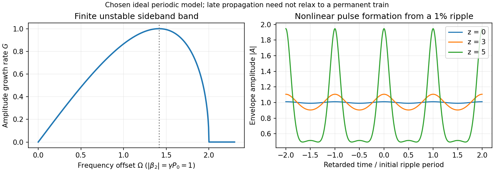

<h1 id="1/solution">Solution</h1>

↑ **Parent:** [1](../1.md)

Put $g=\gamma P_0$. For a temporally uniform envelope, $A_z=igA$ and $A_{TT}=0$, so the propagation equation reduces to $-gA+\gamma P_0A=0$. Thus **the [power](../../../../power.md) stays $P_0$ and the accumulated nonlinear [wave phase](../../../../phase-waves.md) is $g z$**. The [optical Kerr effect](../../../../optical-kerr-effect.md) gives an intensity-dependent [refractive index](../../../../refractive-index.md), and hence [self-phase modulation](../../../../self-phase-modulation.md). For the usual [power](../../../../power.md) normalization $\gamma\simeq n_2\omega_0/(cA_{\rm eff})$, with effective guided-mode area $A_{\rm eff}$. Losslessness preserves the background [power](../../../../power.md); it does not remove the [self-phase modulation](../../../../self-phase-modulation.md). The carrier [wave phase](../../../../phase-waves.md) has already been factored out.

Write $A=(\sqrt{P_0}+\epsilon)e^{igz}$. To first order,

$$
|\sqrt{P_0}+\epsilon|^2(\sqrt{P_0}+\epsilon)
=P_0^{3/2}+P_0(2\epsilon+\epsilon^*)+O(|\epsilon|^2).
$$

Cancelling the background and its phase derivative leaves

$$
i\epsilon_z-\frac{\beta_2}{2}\epsilon_{TT}+g(\epsilon+\epsilon^*)=0.
$$

The last term couples a [perturbation](../../../../perturbation.md) to its [complex conjugate](../../../../complex-conjugate.md): the pump can transfer [energy](../../../../energy-split.md) into a pair of sidebands. It is not an independent [wave phase](../../../../phase-waves.md) of each Fourier component. This [sideband coupling](../../../../sideband-coupling.md) is the linear origin of [fibre modulational instability](../../../../fibre-modulational-instability.md).

For real $K,\Omega,c_1,c_2$, put $d=\beta_2\Omega^2/2$. Matching the two exponential coefficients gives

$$
\begin{pmatrix}d+g-K&g\\g&d+g+K\end{pmatrix}
\begin{pmatrix}c_1\\c_2\end{pmatrix}=0.
$$

A nonzero pair requires a zero [determinant](../../../../determinant.md), hence

$$
\boxed{K^2=d(d+2g)=\frac{\beta_2^2\Omega^2}{4}
\left(\Omega^2+\frac{4g}{\beta_2}\right).}
$$

For unstable complex $K$, the real-coefficient assumption is too restrictive. The consistent pair is $\epsilon=u e^{iKz-i\Omega T}+v^*e^{-iK^*z+i\Omega T}$, with complex $u,v$. Its equations give the same [determinant](../../../../determinant.md) and allow the growing and decaying branches. Merely inserting imaginary $K$ while treating the two original coefficients as real would not respect [complex conjugation](../../../../complex-conjugation.md).

For $P_0>0$ and nonzero $\beta_2,\gamma$, exponential growth requires **$\beta_2\gamma<0$** and

$$
0<\Omega^2<-\frac{4\gamma P_0}{\beta_2}.
$$

For ordinary positive Kerr nonlinearity this means anomalous [group velocity dispersion](../../../../group-velocity-dispersion.md), $\beta_2<0$. Define $\Omega_c=\sqrt{4g/|\beta_2|}$. The growing branch is $K=-iG$, with [amplitude](../../../../wave-amplitude.md) growth rate

$$
G(\Omega)=\frac{|\beta_2||\Omega|}{2}\sqrt{\Omega_c^2-\Omega^2},\qquad
\boxed{|\Omega|_{\max}=\Omega_c/\sqrt2,\quad G_{\max}=g.}
$$

Sideband [power](../../../../power.md) grows at rate $2G$, rather than $G$. The cutoff and zero-frequency modes have no exponential growth; in a degenerate zero-frequency sector a secular phase response can remain. Positive dispersion with positive $\gamma$ gives real $K$ and oscillatory [perturbations](../../../../perturbation.md).

Initially small ripples grow into pronounced [intensity](../../../../intensity-physics.md) peaks and deplete the uniform background. Dispersion and [self-phase modulation](../../../../self-phase-modulation.md) can then support localized bright pulses. A [fundamental temporal bright soliton](../../../../fundamental-temporal-bright-soliton.md) obeys $\gamma P_sT_0^2=|\beta_2|$, so its width is comparable to $1/\Omega_c$ when its peak [power](../../../../power.md) is comparable to the original [power](../../../../power.md). The dominant ripple spacing is $2\pi/|\Omega|_{\max}$, not simply $1/\Omega_c$. Propagation distance $z$ is the evolution variable; $T$ measures time within the envelope. An ideal conservative fibre need not settle permanently into a unique pulse train: nonlinear compression, interactions and recurrence depend on the seed and boundary conditions.

**[Figure 1](#1/image-original-instability-gain-and-calculated-nonlinear-growth-of-a-weak-periodic-modulation-in-a-focusing-fibre-model). Original instability gain and calculated nonlinear growth of a weak periodic modulation in a focusing fibre model**.

## ↑ Ancestors (13)

1. [1](../1.md)
2. [Paper 1](../../paper-1-split.md)
3. [2014](../../split.md)
4. [Past exam of the nonlinear Optics and Quantum States of Light course of the University of Cambridge](../../../split.md)
5. [Nonlinear Optics and Quantum States of Light course of the University of Cambridge](../../../../nonlinear-optics-and-quantum-states-of-light-course-of-the-university-of-cambridge.md)
6. [Physics course of the year 4 of the natural sciences course of the University of Cambridge](../../../../physics-course-of-the-year-4-of-the-natural-sciences-course-of-the-university-of-cambridge.md)
7. [Year 4 of the natural sciences course of the University of Cambridge](../../../../year-4-of-the-natural-sciences-course-of-the-university-of-cambridge.md)
8. [Year of the natural sciences course of the University of Cambridge](../../../../year-of-the-natural-sciences-course-of-the-university-of-cambridge.md)
9. [Natural sciences course of the University of Cambridge](../../../../natural-sciences-course-of-the-university-of-cambridge.md)
10. [Course of the University of Cambridge](../../../../course-of-the-university-of-cambridge.md)
11. [University of Cambridge](../../../../university-of-cambridge-split.md)
12. [List of universities](../../../../list-of-universities.md)
13. [Codex Wiki](../../../../split.md)
