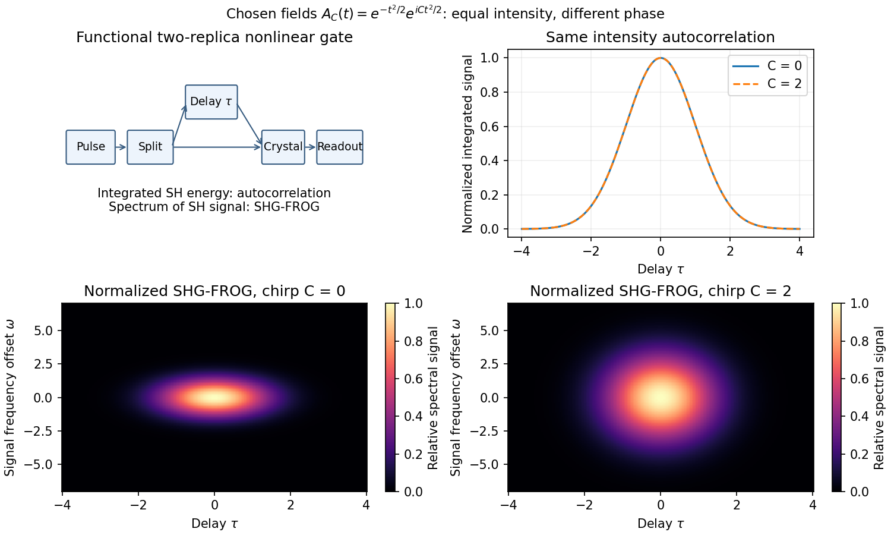

<h1 id="3/b/solution">Solution</h1>

↑ **Parent:** [B](../b.md)

A detector too slow to resolve a femtosecond field can measure its integrated nonlinear response instead. Split the pulse, delay one replica, overlap both in a thin phase-matched crystal, and select the sum-frequency signal. For negligible depletion and sufficiently broad [phase matching](../../../../../phase-matching.md), the cross-generated field is proportional to $A(t)A(t-\tau)$; integrated signal gives the [second-harmonic intensity autocorrelation](../../../../../second-harmonic-intensity-autocorrelation.md)

$$
C(\tau)\propto\int|A(t)A(t-\tau)|^2\,dt=\int I(t)I(t-\tau)\,dt.
$$

A noncollinear geometry can reject each replica's individual second harmonic. The optical response supplies the fast gate while the detector integrates slowly. Crystal thickness, [group-velocity mismatch](../../../../../group-velocity-mismatch.md), spectral acceptance, beam overlap and delay calibration limit resolution.

For a [Gaussian pulse](../../../../../gaussian-pulse.md) specified by its [intensity](../../../../../intensity-physics.md) profile, the autocorrelation's [full width at half maximum](../../../../../full-width-at-half-maximum.md) is $\sqrt2$ times the [intensity](../../../../../intensity-physics.md) [full width at half maximum](../../../../../full-width-at-half-maximum.md). For a sech-squared [intensity](../../../../../intensity-physics.md) profile the ratio is about $1.543$. These are model-dependent conversion factors. An [intensity autocorrelation](../../../../../intensity-autocorrelation.md) is symmetric in delay and loses phase information; different pulses can share it. An [interferometric autocorrelation](../../../../../interferometric-autocorrelation.md) retains rapid carrier fringes but still does not generally reconstruct an arbitrary complex field uniquely.

[frequency-resolved optical gating](../../../../../frequency-resolved-optical-gating.md) also resolves the gated signal's spectrum, giving a two-dimensional delay-frequency record. For [second-harmonic frequency-resolved optical gating](../../../../../second-harmonic-frequency-resolved-optical-gating.md),

$$
I_{\rm FROG}(\omega,\tau)\propto
\left|\int A(t)A(t-\tau)e^{-i\omega t}\,dt\right|^2,
$$

where $\omega$ is measured relative to the signal's carrier. An iterative retrieval seeks an envelope whose predicted record matches the measurement. Alternatively, [polarization-gating frequency-resolved optical gating](../../../../../polarization-gating-frequency-resolved-optical-gating.md) uses the [optical Kerr effect](../../../../../optical-kerr-effect.md) to gate the probe by a delayed replica's [intensity](../../../../../intensity-physics.md), with signal envelope proportional to $A(t)|A(t-\tau)|^2$. The original [FROG](../../../../../frequency-resolved-optical-gating.md) work introduced nonlinear optical gating plus spectral resolution to characterize arbitrary femtosecond pulses.[1993, abstract: nonlinear gating and spectrogram construction](../../../../../characterization-of-arbitrary-femtosecond-pulses-using-frequency-resolved-optical-gating-by-daniel-j-kane-and-rick-trebino.md)

Absolute [wave phase](../../../../../phase-waves.md) and absolute time origin remain undetermined by these [intensity](../../../../../intensity-physics.md) records. The SHG record also cannot distinguish $A(t)$ from $A^*(-t)$, so its time-direction ambiguity remains. Retrieval agreement, an independently measured spectrum, adequate signal dynamic range and gate-response calibration are practical consistency checks. A pulse train that changes between shots can yield an averaged record that no single pulse faithfully represents. Thus nonlinear gating solves the detector-speed problem but does not remove [inverse problem](../../../../../inverse-problem-split.md) ambiguities or experimental limitations.

**[Figure 3](#3/b/image-original-nonlinear-pulse-gating-layout-and-a-calculated-gaussian-chirp-example-distinguishing-autocorrelation-from-spectral-gating). Original nonlinear pulse-gating layout and a calculated Gaussian chirp example distinguishing autocorrelation from spectral gating**.

## ↑ Ancestors (14)

1. [B](../b.md)
2. [3](../../3.md)
3. [Paper 1](../../../paper-1-split.md)
4. [2014](../../../split.md)
5. [Past exam of the nonlinear Optics and Quantum States of Light course of the University of Cambridge](../../../../split.md)
6. [Nonlinear Optics and Quantum States of Light course of the University of Cambridge](../../../../../nonlinear-optics-and-quantum-states-of-light-course-of-the-university-of-cambridge.md)
7. [Physics course of the year 4 of the natural sciences course of the University of Cambridge](../../../../../physics-course-of-the-year-4-of-the-natural-sciences-course-of-the-university-of-cambridge.md)
8. [Year 4 of the natural sciences course of the University of Cambridge](../../../../../year-4-of-the-natural-sciences-course-of-the-university-of-cambridge.md)
9. [Year of the natural sciences course of the University of Cambridge](../../../../../year-of-the-natural-sciences-course-of-the-university-of-cambridge.md)
10. [Natural sciences course of the University of Cambridge](../../../../../natural-sciences-course-of-the-university-of-cambridge.md)
11. [Course of the University of Cambridge](../../../../../course-of-the-university-of-cambridge.md)
12. [University of Cambridge](../../../../../university-of-cambridge-split.md)
13. [List of universities](../../../../../list-of-universities.md)
14. [Codex Wiki](../../../../../split.md)
