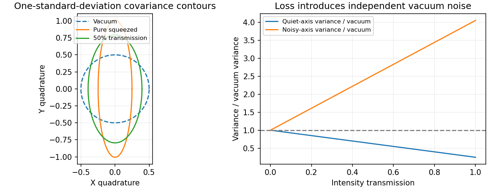

<h1 id="3/c/solution">Solution</h1>

↑ **Parent:** [C](../c.md)

For $X=(a+a^\dagger)/2$ and $Y=(a-a^\dagger)/(2i)$, $[X,Y]=i/2$, so $\Delta X\Delta Y\geq1/4$. Vacuum and [coherent states](../../../../../coherent-state.md) have [variance](../../../../../variance-split.md) $1/4$ in either [optical quadrature](../../../../../optical-quadrature.md). [quadrature squeezing](../../../../../quadrature-squeezing.md) means that some rotated [optical quadrature](../../../../../optical-quadrature.md) has [variance](../../../../../variance-split.md) below this reference, with compensating noise elsewhere. A reduced second moment about zero is not the correct test when the field's mean is displaced.

For $S(\zeta)=\exp[(\zeta^*a^2-\zeta a^{\dagger2})/2]$ and $\zeta=re^{i\theta}$, the quiet principal axis of the [optical squeezed vacuum](../../../../../optical-squeezed-vacuum.md) is at angle $\theta/2$ under the squeeze-operator convention used above, and

$$
\boxed{\operatorname{Var}X_{\theta/2}=\tfrac14e^{-2r},\qquad
\operatorname{Var}X_{\theta/2+\pi/2}=\tfrac14e^{2r}.}
$$

The pure [Gaussian quantum state](../../../../../gaussian-quantum-state.md) saturates the uncertainty product. Displacement moves its centre without changing its [covariance ellipse](../../../../../covariance-ellipse.md); [squeezed thermal states](../../../../../squeezed-thermal-state.md) instead have a larger uncertainty product. The [optical squeezed vacuum](../../../../../optical-squeezed-vacuum.md) has zero mean field, even [photon-number parity](../../../../../photon-number-parity.md) and mean occupation $\sinh^2r$; it need not have sub-Poissonian [photon statistics](../../../../../photon-statistics.md). [number squeezing](../../../../../number-squeezing.md) and [quadrature squeezing](../../../../../quadrature-squeezing.md) are different conditions.

Degenerate parametric amplification generates single-mode squeezing; a [two-mode squeezed vacuum](../../../../../two-mode-squeezed-vacuum.md) instead has correlated occupations and joint [quadrature squeezing](../../../../../quadrature-squeezing.md). Either individual mode of an ideal two-mode state is thermal after the other is ignored, not individually squeezed. [balanced homodyne detection](../../../../../balanced-homodyne-detection.md) measures the noise versus [local oscillator](../../../../../local-oscillator.md) phase. Reference phase drift admixes the anti-squeezed [optical quadrature](../../../../../optical-quadrature.md), while electronic noise and detector imbalance need separate checks.

For an optical loss channel with efficiency $\eta$ and vacuum entering the unused port, [optical squeezing degradation by loss](../../../../../optical-squeezing-degradation-by-loss.md) gives

$$
\boxed{V_{\rm out}=\eta V_{\rm in}+(1-\eta)/4.}
$$

The linear-loss limit follows directly by writing the output field as $\sqrt\eta\,a+\sqrt{1-\eta}\,v$ with independent vacuum mode $v$. Loss therefore places a floor under measured squeezing. Squeezed input can improve phase-sensitive measurements when aligned with the measured [optical quadrature](../../../../../optical-quadrature.md); it does not reduce every noise source or both conjugate uncertainties at once.

**[Figure 4](#3/c/image-original-optical-quadrature-covariance-ellipses-and-the-effect-of-vacuum-loss-on-squeezed-variance). Original optical-quadrature covariance ellipses and the effect of vacuum loss on squeezed variance**.

## ↑ Ancestors (14)

1. [C](../c.md)
2. [3](../../3.md)
3. [Paper 1](../../../paper-1-split.md)
4. [2014](../../../split.md)
5. [Past exam of the nonlinear Optics and Quantum States of Light course of the University of Cambridge](../../../../split.md)
6. [Nonlinear Optics and Quantum States of Light course of the University of Cambridge](../../../../../nonlinear-optics-and-quantum-states-of-light-course-of-the-university-of-cambridge.md)
7. [Physics course of the year 4 of the natural sciences course of the University of Cambridge](../../../../../physics-course-of-the-year-4-of-the-natural-sciences-course-of-the-university-of-cambridge.md)
8. [Year 4 of the natural sciences course of the University of Cambridge](../../../../../year-4-of-the-natural-sciences-course-of-the-university-of-cambridge.md)
9. [Year of the natural sciences course of the University of Cambridge](../../../../../year-of-the-natural-sciences-course-of-the-university-of-cambridge.md)
10. [Natural sciences course of the University of Cambridge](../../../../../natural-sciences-course-of-the-university-of-cambridge.md)
11. [Course of the University of Cambridge](../../../../../course-of-the-university-of-cambridge.md)
12. [University of Cambridge](../../../../../university-of-cambridge-split.md)
13. [List of universities](../../../../../list-of-universities.md)
14. [Codex Wiki](../../../../../split.md)
