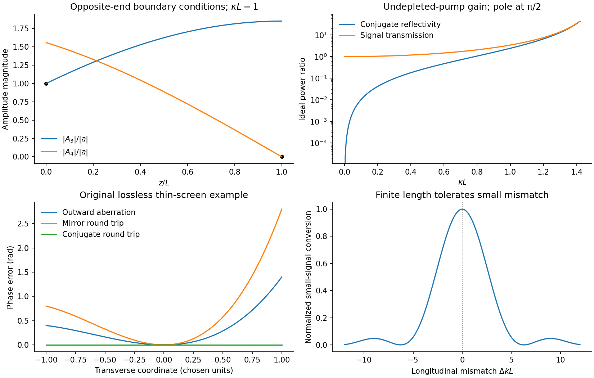

<h1 id="1/solution">Solution</h1>

↑ **Parent:** [1](../1.md)

The polarization generated by the relevant third-order [nonlinear optical susceptibility](../../../../nonlinear-optical-susceptibility.md) is proportional to $E_1E_2E_3^*$. Multiplication of its temporal and spatial [wave phase](../../../../phase-waves.md) factors gives

$$
\omega_4=2\omega_P-\omega_3,\qquad
\mathbf k_{\rm source}=\mathbf k_1+\mathbf k_2-\mathbf k_3.
$$

The two opposing pump arrows in the original diagram mean $\mathbf k_2=-\mathbf k_1$. Thus **the mixing source points along $-\mathbf k_3$**, and its conjugate signal amplitude drives a backward field. This is [counterpropagating-pump phase matching](../../../../counterpropagating-pump-phase-matching.md) in [four-wave mixing](../../../../four-wave-mixing.md).

There is a [phase matching](../../../../phase-matching.md) qualification to the initial [frequency](../../../../frequency.md) statement. In the stipulated nondispersive isotropic medium, $|\mathbf k_j|=n\omega_j/c$. Exact equality of the backward free-wave vector to $-\mathbf k_3$ therefore requires $\omega_4=\omega_3$, hence $\omega_3=\omega_P$. For unequal [frequencies](../../../../frequency.md) the backward direction remains the geometry suggested by the source, but the longitudinal [phase mismatch](../../../../phase-mismatch.md) has magnitude $2n|\omega_P-\omega_3|/c$. Efficient generation over a finite length requires that mismatch times $L$ be small; a [sinc function](../../../../sinc-function.md) factor suppresses conversion otherwise. Nondispersion does not remove the magnitude mismatch. The remainder of the calculation is explicitly [degenerate four-wave mixing](../../../../degenerate-four-wave-mixing.md), so this difficulty disappears.

At the pump frequency, for the strong field $E_1$, **[self-phase modulation](../../../../self-phase-modulation.md) and [cross-phase modulation](../../../../cross-phase-modulation.md) by $E_2$ dominate** the weak signal's influence. They change its propagation [wave phase](../../../../phase-waves.md) through its own [intensity](../../../../intensity-physics.md) and the other pump's [intensity](../../../../intensity-physics.md). With continuous uniform [plane waves](../../../../plane-wave.md), these are nonlinear [wave phase](../../../../phase-waves.md) shifts; finite pulses acquire temporal chirp, and finite transverse beams can acquire a lens. No universal factor of two should be assigned between the two shifts without specifying their polarization contraction and the field-amplitude convention.

Write $u=\widetilde A_3$ and $v=\widetilde A_4$. Differentiating the exponential substitutions cancels the terms proportional to $2\kappa$:

$$
e^{2i\kappa z}(u'+2i\kappa u)=2i\kappa e^{2i\kappa z}u+i\kappa e^{2i\kappa z}v^*,
$$

$$
e^{-2i\kappa z}(v'-2i\kappa v)=-2i\kappa e^{-2i\kappa z}v-i\kappa e^{-2i\kappa z}u^*.
$$

Consequently **$u'=i\kappa v^*$ and $v'=-i\kappa u^*$**. Conjugate the latter before eliminating a field: $(v^*)'=i\kappa u$, so $u''=-\kappa^2u$. The [backward four-wave-mixing boundary problem](../../../../backward-four-wave-mixing-boundary-problem.md) requires opposite-end [boundary conditions](../../../../boundary-condition.md): $u(0)=a$, where $a=A_3(0)$, and $v(L)=0$. The transfer matrix is

$$
\begin{pmatrix}u(z)\\v^*(z)\end{pmatrix}
=\begin{pmatrix}\cos\kappa z&i\sin\kappa z\\i\sin\kappa z&\cos\kappa z\end{pmatrix}
\begin{pmatrix}a\\b\end{pmatrix},\qquad b=v^*(0).
$$

At $L$, $0=ia\sin\kappa L+b\cos\kappa L$, so $b=-ia\tan\kappa L$. Substitution gives

$$
u(z)=a\frac{\cos[\kappa(L-z)]}{\cos\kappa L},\qquad
v(z)=ia^*\frac{\sin[\kappa(L-z)]}{\cos\kappa L},
$$

$$
\boxed{A_3(z)=a\frac{\cos[\kappa(L-z)]}{\cos\kappa L}e^{2i\kappa z},\qquad
A_4(z)=ia^*\frac{\sin[\kappa(L-z)]}{\cos\kappa L}e^{-2i\kappa z}.}
$$

**The printed target expression for $A_4$ has the opposite overall sign.** This is present in the original PDF, not just the transcription. With its stated first-order equations, the derivative at the far face must be $v'(L)=-i\kappa a^*/\cos\kappa L$. The boxed result has that derivative; the printed expression has its negative. Reversing the convention for the mixing coefficient could reverse the generated phase, but would also change the coupled equations. The result above satisfies the equations and both [boundary conditions](../../../../boundary-condition.md) together.

At the entrance, **$A_4(0)=ia^*\tan\kappa L$**, so the returned amplitude is proportional to the complex conjugate of the signal. An ordinary ideal mirror gives $ra$, with a fixed reflection coefficient $r$, rather than $a^*$. The mixing pumps supply both the extra [energy](../../../../energy-split.md) and a [wave phase](../../../../phase-waves.md) reference. The ideal conjugate reflectivity and signal transmission are

$$
R_{\rm pc}=\tan^2\kappa L,\qquad T=\sec^2\kappa L,\qquad T-R_{\rm pc}=1.
$$

The constancy of $|u|^2+|v|^2$ along the medium is another direct check. The relation between the incoming signal and outgoing waves allows net output [energy](../../../../energy-split.md) to come from the pumps. As $\kappa L\to\pi/2$, the [undepleted-pump approximation](../../../../undepleted-pump-approximation.md) fails: the predicted fields would extract an appreciable pump fraction. This is the ideal [four-wave-mixing oscillation threshold](../../../../four-wave-mixing-oscillation-threshold.md); saturation, pump depletion and noise seeding replace the divergent linearized solution. It is not an unlimited source of reflected power. Amplified phase-conjugated propagation and parametric oscillation are also the effects identified in the primary analysis by [Amnon Yariv](../../../../amnon-yariv.md) and [David M. Pepper](../../../../david-m-pepper.md).[abstract, amplified conjugate propagation and parametric oscillation](../../../../amplified-reflection-phase-conjugation-and-oscillation-in-degenerate-four-wave-mixing-by-amnon-yariv-and-david-m-pepper.md)

**[Figure 1](#1/image-calculated-backward-wave-profiles-ideal-gain-and-cancellation-of-an-original-phase-screen-example). Calculated backward-wave profiles, ideal gain, and cancellation of an original phase-screen example**.

For the aberrating linear medium, assume its [permittivity](../../../../permittivity-split.md) is real and stationary at this [frequency](../../../../frequency.md). Taking the complex conjugate of the forward-envelope equation gives

$$
(A_3^*)''+\left[\frac{\omega^2\epsilon(z)}{c^2}-k_3^2\right]A_3^*-2ik_3(A_3^*)'=0.
$$

This is the backward-envelope equation with carrier $e^{-ik_3z}$. Launching the conjugate boundary field therefore permits retracing of the distorted wave. In a transverse lossless [phase screen](../../../../phase-screen.md) model, let transmission be $t(x)=e^{i\psi(x)}$. A return proportional to $(tU)^*$ acquires $t$ on its second passage and becomes $t(tU)^*=U^*$. Thus the aberration phase cancels. A mirror instead gives $rt^2U$, adding the aberration twice; merely reversing the central propagation direction does not reverse the wavefront phase.

The one-dimensional printed equation describes longitudinal variation; genuine transverse aberrations require the corresponding transverse [Helmholtz equation](../../../../helmholtz-equation.md) or paraxial operator, for which the same real-coefficient conjugation argument applies. Exact reconstruction requires adequate [aperture](../../../../aperture.md), the correct conjugate amplitude and polarization, uniform pump-product phase, and an unchanged reciprocal lossless medium. [Absorption](../../../../absorption-electromagnetic-radiation.md), missing scattered modes or a changed aberrator prevent a universal reconstruction. This is [phase conjugation](../../../../phase-conjugation.md) and [thin phase-plate cancellation by phase conjugation](../../../../thin-phase-plate-cancellation-by-phase-conjugation.md) under specified conditions, rather than reversal of every possible propagation loss.

## ↑ Ancestors (13)

1. [1](../1.md)
2. [Paper 1](../../paper-1-split.md)
3. [2015](../../split.md)
4. [Past exam of the nonlinear Optics and Quantum States of Light course of the University of Cambridge](../../../split.md)
5. [Nonlinear Optics and Quantum States of Light course of the University of Cambridge](../../../../nonlinear-optics-and-quantum-states-of-light-course-of-the-university-of-cambridge.md)
6. [Physics course of the year 4 of the natural sciences course of the University of Cambridge](../../../../physics-course-of-the-year-4-of-the-natural-sciences-course-of-the-university-of-cambridge.md)
7. [Year 4 of the natural sciences course of the University of Cambridge](../../../../year-4-of-the-natural-sciences-course-of-the-university-of-cambridge.md)
8. [Year of the natural sciences course of the University of Cambridge](../../../../year-of-the-natural-sciences-course-of-the-university-of-cambridge.md)
9. [Natural sciences course of the University of Cambridge](../../../../natural-sciences-course-of-the-university-of-cambridge.md)
10. [Course of the University of Cambridge](../../../../course-of-the-university-of-cambridge.md)
11. [University of Cambridge](../../../../university-of-cambridge-split.md)
12. [List of universities](../../../../list-of-universities.md)
13. [Codex Wiki](../../../../split.md)
