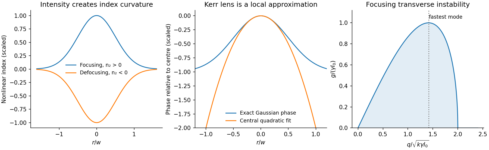

<h1 id="2/a/solution">Solution</h1>

↑ **Parent:** [A](../a.md)

A finite beam has an [intensity](../../../../../intensity-physics.md) gradient across its wavefront. In an instantaneous optical Kerr model, $n(r)=n_0+n_2I(r)$. A bright centre therefore sees a larger index for $n_2>0$, accumulating more phase than the wings and producing [self-focusing](../../../../../self-focusing.md). Negative $n_2$ gives [self-defocusing](../../../../../self-defocusing.md). For a short medium and Gaussian $I(r)=I_0e^{-2r^2/w^2}$, expand the nonlinear phase near the axis:

$$
\Delta\varphi(r)=k_0n_2I_0L-\frac{2k_0n_2I_0L}{w^2}r^2+\cdots,
\qquad k_0=\omega/c.
$$

Compare with the in-medium thin-lens phase $-kr^2/(2f)$, where $k=n_0k_0$. The [Kerr lens](../../../../../kerr-lens.md) has **$1/f=4n_2I_0L/(n_0w^2)$**. This local quadratic fit describes the central lens, not the whole Gaussian phase or a guaranteed aberration-free focus.

Propagation combines [diffraction](../../../../../diffraction.md) with the nonlinear phase. Choose $|A|^2=I$ and a scalar paraxial envelope, giving

$$
i\partial_zA+\frac{1}{2k}\nabla_\perp^2A+\gamma|A|^2A=0,\qquad \gamma=k_0n_2.
$$

The [diffraction](../../../../../diffraction.md) length is of order $kw^2$, while the nonlinear length is $1/(|\gamma|I_0)$. Their competition depends on total beam power as well as spot size. In two transverse dimensions, balancing them gives a critical power scale **$P_{\rm cr}\sim\lambda_0^2/(n_0n_2)$** for positive $n_2$; the numerical constant requires a specified transverse profile and critical solution. In the ideal unsaturated cubic model, sufficiently strong focusing can collapse rather than form a stable beam. Real saturation, [absorption](../../../../../absorption-electromagnetic-radiation.md), ionization or nonparaxial propagation can stop that ideal singularity; the appropriate mechanism depends on the material and pulse regime.

A broad focusing beam can also break into filaments. Perturb the uniform solution $A_0e^{i\gamma I_0z}$ by real amplitude and phase components with transverse wave number $q$. Linearization gives the [transverse modulational instability](../../../../../transverse-modulational-instability.md) rate

$$
\boxed{g^2=\frac{q^2}{2k}\left(2\gamma I_0-\frac{q^2}{2k}\right).}
$$

For positive $\gamma$, modes with $0<q^2<4k\gamma I_0$ grow. [diffraction](../../../../../diffraction.md) suppresses very fine perturbations. A finite beam's boundaries and available propagation length limit which filaments develop. The defocusing sign has no growing band in this simple instantaneous local model.

A [spatial optical soliton](../../../../../spatial-optical-soliton.md) instead has a profile whose nonlinear focusing balances [diffraction](../../../../../diffraction.md). A one-transverse-dimensional cubic focusing model supports a stationary bright solution; the existence of that solution does not establish robust two-dimensional cubic self-trapping. A beam can also act on another finite beam through [cross-phase modulation](../../../../../cross-phase-modulation.md), producing an induced lens or steering it towards a high-index region. Unequal polarization response can rotate or reshape the profile. Temporal [self-phase modulation](../../../../../self-phase-modulation.md) is a related consequence of a time-dependent [intensity](../../../../../intensity-physics.md), but should be distinguished from these transverse effects.

**[Figure 2](#2/a/image-original-gaussian-kerr-lens-phase-and-the-focusing-model-s-transverse-instability-band). Original Gaussian Kerr-lens phase and the focusing model's transverse instability band**.

For an experimental check, vary power at fixed input waist and compare near- and far-field profiles with a low-power [diffraction](../../../../../diffraction.md) reference. Repeat with a second beam blocked to separate [cross-phase modulation](../../../../../cross-phase-modulation.md) from self-action. Vary pulse duration or repetition rate to test thermal lensing against a prompt electronic response, and monitor transmission to distinguish nonlinear refraction from preferential [absorption](../../../../../absorption-electromagnetic-radiation.md). A smaller output spot alone does not establish a soliton or a pure Kerr response.

## ↑ Ancestors (14)

1. [A](../a.md)
2. [2](../../2.md)
3. [Paper 1](../../../paper-1-split.md)
4. [2015](../../../split.md)
5. [Past exam of the nonlinear Optics and Quantum States of Light course of the University of Cambridge](../../../../split.md)
6. [Nonlinear Optics and Quantum States of Light course of the University of Cambridge](../../../../../nonlinear-optics-and-quantum-states-of-light-course-of-the-university-of-cambridge.md)
7. [Physics course of the year 4 of the natural sciences course of the University of Cambridge](../../../../../physics-course-of-the-year-4-of-the-natural-sciences-course-of-the-university-of-cambridge.md)
8. [Year 4 of the natural sciences course of the University of Cambridge](../../../../../year-4-of-the-natural-sciences-course-of-the-university-of-cambridge.md)
9. [Year of the natural sciences course of the University of Cambridge](../../../../../year-of-the-natural-sciences-course-of-the-university-of-cambridge.md)
10. [Natural sciences course of the University of Cambridge](../../../../../natural-sciences-course-of-the-university-of-cambridge.md)
11. [Course of the University of Cambridge](../../../../../course-of-the-university-of-cambridge.md)
12. [University of Cambridge](../../../../../university-of-cambridge-split.md)
13. [List of universities](../../../../../list-of-universities.md)
14. [Codex Wiki](../../../../../split.md)
