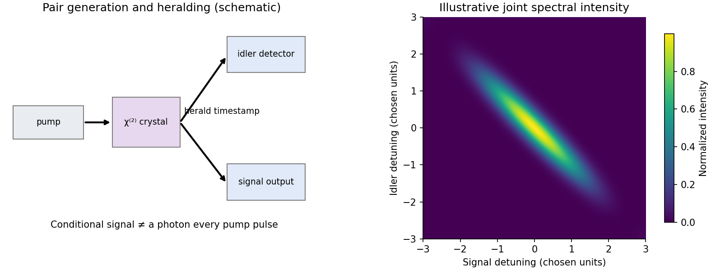

<h1 id="2/c/solution">Solution</h1>

↑ **Parent:** [C](../c.md)

[spontaneous parametric down-conversion](../../../../../spontaneous-parametric-down-conversion.md) uses a second-order nonlinear polarization to convert pump [energy](../../../../../energy-split.md) into correlated signal and idler [photons](../../../../../photon.md). With a classical undepleted pump, a single-mode interaction-picture model is

$$
H_I=i\hbar(\kappa a_s^\dagger a_i^\dagger-\kappa^*a_sa_i).
$$

The creation term acts on the signal/idler vacuum, so no classical signal seed is required. The pump supplies the emitted [energy](../../../../../energy-split.md); vacuum fluctuations are not an extra [energy](../../../../../energy-split.md) source. In the small-gain limit the [SPDC pair state](../../../../../spdc-pair-state.md) is

$$
|\Psi\rangle=|0,0\rangle+\kappa t|1,1\rangle+O(|\kappa t|^2),
$$

with normalization corrections understood at second order. More generally it is a [two-mode squeezed vacuum](../../../../../two-mode-squeezed-vacuum.md) with correlated pair numbers. A classical calculation with both generated fields exactly zero would miss the spontaneous start.

Efficient generation requires $\omega_p=\omega_s+\omega_i$ and approximate wave-vector matching $\mathbf k_p=\mathbf k_s+\mathbf k_i$. [birefringence](../../../../../birefringence.md) or a reciprocal grating vector in quasi-phase matching can compensate dispersion. In a continuum-mode treatment the pair amplitude includes

$$
\Phi(\omega_s,\omega_i)\propto\alpha_p(\omega_s+\omega_i)
L\operatorname{sinc}\left(\frac{\Delta kL}{2}\right)e^{i\Delta kL/2}.
$$

The pump spectrum constrains the sum [frequency](../../../../../frequency.md), while [phase matching](../../../../../phase-matching.md) constrains the allowed [frequency](../../../../../frequency.md) combinations and emission directions. [type-I phase matching](../../../../../type-i-phase-matching.md) produces daughters in the same polarization class; [type-II phase matching](../../../../../type-ii-phase-matching.md) produces orthogonal ordinary/extraordinary classes. Correlation of pair numbers or orthogonal polarizations does not alone guarantee a polarization-entangled state in two chosen output paths.

One application is a [heralded single-photon source](../../../../../heralded-single-photon-source.md): detect one partner and condition measurements on the other. Low gain suppresses multiple-pair contamination, whose probability begins at fourth order in the gain. Efficient collection and low detector noise matter. Spectral entanglement with an unresolved herald can leave the partner mixed; engineering or filtering the joint spectrum improves purity at a possible cost in brightness. Heralding does not make a [photon](../../../../../photon.md) appear in every pump pulse.

A second application is entangled-pair generation for [quantum communication](../../../../../quantum-communication.md) and tests of [Bell inequalities](../../../../../bell-inequality.md). If the assignments $H_sV_i$ and $V_sH_i$ are indistinguishable except for polarization, their amplitudes can form $(|H_sV_i\rangle+e^{i\varphi}|V_sH_i\rangle)/\sqrt2$. Walk-off, group delay or [frequency](../../../../../frequency.md) labels can reveal which assignment occurred and destroy polarization interference. Their compensation is part of preparing the state, not merely an improvement in count rate.

A primary example pumped a 3-mm beta-barium-borate crystal with a $351.1\,\mathrm{nm}$ argon-ion [laser](../../../../../laser-split.md). Collecting the two intersections of its type-II emission cones selected paired output directions. Half-wave rotation and compensating birefringent crystals reduced temporal walk-off, and polarization analysers with avalanche photodiodes measured coincidence fringes. Varying analyser settings tested the correlations; accidentals, mode distinguishability and detector/collection assumptions limited interpretation. The reported visibility exceeded 97 percent and supported a Bell violation under the stated auxiliary assumptions, rather than a loophole-free claim.[pp. 4337–4340, Figs. 1–2, compensation, detectors and coincidence correlations](../../../../../new-high-intensity-source-of-polarization-entangled-photon-pairs-by-paul-g-kwiat-and-others.md)

**[Figure 3](#2/c/image-original-down-conversion-and-heralding-schematic-with-an-illustrative-joint-frequency-selection-model). Original down-conversion and heralding schematic with an illustrative joint-frequency selection model**.

Other uses include preparing interfering [photons](../../../../../photon.md) for quantum-information experiments, correlation-based imaging, and pair-based detector calibration. All rely on specified spatial and spectral modes and coincidence statistics. A pump-blocked background run, delayed-coincidence estimate, gain dependence and polarization/temporal-overlap scans distinguish correlated pairs from fluorescence, detector dark counts and accidental coincidences. The useful resource is the controlled joint [quantum state](../../../../../quantum-state.md), not simply two bright output beams.

## ↑ Ancestors (14)

1. [C](../c.md)
2. [2](../../2.md)
3. [Paper 1](../../../paper-1-split.md)
4. [2015](../../../split.md)
5. [Past exam of the nonlinear Optics and Quantum States of Light course of the University of Cambridge](../../../../split.md)
6. [Nonlinear Optics and Quantum States of Light course of the University of Cambridge](../../../../../nonlinear-optics-and-quantum-states-of-light-course-of-the-university-of-cambridge.md)
7. [Physics course of the year 4 of the natural sciences course of the University of Cambridge](../../../../../physics-course-of-the-year-4-of-the-natural-sciences-course-of-the-university-of-cambridge.md)
8. [Year 4 of the natural sciences course of the University of Cambridge](../../../../../year-4-of-the-natural-sciences-course-of-the-university-of-cambridge.md)
9. [Year of the natural sciences course of the University of Cambridge](../../../../../year-of-the-natural-sciences-course-of-the-university-of-cambridge.md)
10. [Natural sciences course of the University of Cambridge](../../../../../natural-sciences-course-of-the-university-of-cambridge.md)
11. [Course of the University of Cambridge](../../../../../course-of-the-university-of-cambridge.md)
12. [University of Cambridge](../../../../../university-of-cambridge-split.md)
13. [List of universities](../../../../../list-of-universities.md)
14. [Codex Wiki](../../../../../split.md)
