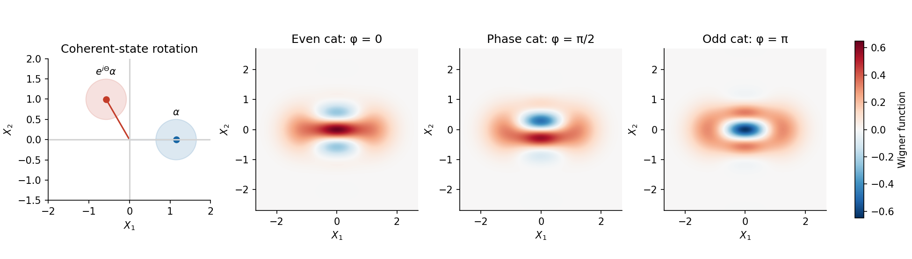
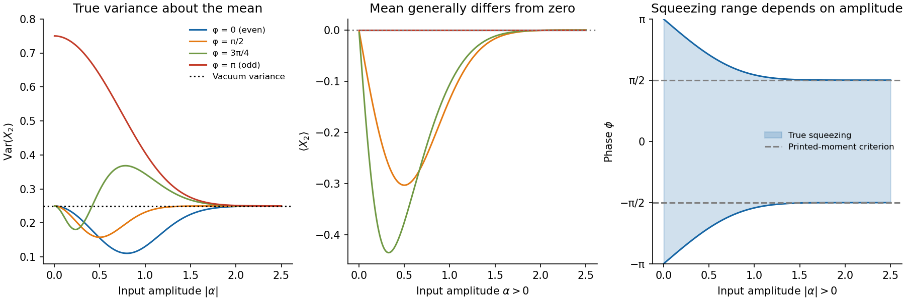

<h1 id="3/solution">Solution</h1>

↑ **Parent:** [3](../3.md)

An ideal [cross-Kerr interaction](../../../../cross-kerr-interaction.md) between two single modes is $H_{\rm int}=\hbar\chi n_1n_2$, with $n_j=a_j^\dagger a_j$. The [number operators](../../../../number-operator.md) commute with the interaction, so this coupling changes phases without transferring [photons](../../../../photon.md) between the modes. To implement the specified positive conditional phase, use

$$
\boxed{H_{\rm int}=-\hbar g\,n_1n_{2V},\qquad U=e^{i\Theta n_1n_{2V}},\quad \Theta=gt,}
$$

where $n_{2V}=|V\rangle\langle V|$ within the one-photon polarization subspace. The horizontal branch has zero interacting occupation. Since $e^{i\Theta n}|\alpha\rangle=|e^{i\Theta}\alpha\rangle$, the specified conditional rotation follows. This is an ideal lossless single-mode model; an actual travelling-wave medium's bandwidth, loss and noise are not established by writing this [Hamiltonian](../../../../hamiltonian.md).

Use $X_1=(a+a^\dagger)/2$ and $X_2=(a-a^\dagger)/(2i)$. A [coherent state](../../../../coherent-state.md) has centre $(\operatorname{Re}\alpha,\operatorname{Im}\alpha)$ and [variance](../../../../variance-split.md) $1/4$ in either [optical quadrature](../../../../optical-quadrature.md). Multiplication of $\alpha$ by $e^{i\Theta}$ rotates that centre anticlockwise through $\Theta$, keeping the [coherent state](../../../../coherent-state.md) noise disk unchanged. For real positive $\alpha$ the two centres are $(\alpha,0)$ and $(\alpha\cos\Theta,\alpha\sin\Theta)$.

Normalize the initial [polarization of an electromagnetic wave](../../../../polarization-of-an-electromagnetic-wave.md) qubit. The output of the medium is

$$
\boxed{|\Psi\rangle=\frac1{\sqrt2}\left(|\alpha\rangle|H\rangle+e^{i\phi}|\beta\rangle|V\rangle\right),\qquad
\beta=e^{i\Theta}\alpha.}
$$

The joint state is generally an [entangled state](../../../../entangled-state.md). The overlap magnitude is $|\langle\alpha|\beta\rangle|=e^{-2|\alpha|^2\sin^2(\Theta/2)}$. The state factorizes when the amplitudes coincide, while nearly distinguishable amplitudes make the polarization nearly maximally entangled with the optical mode. Before any polarization conditioning, tracing out mode 2 gives the mixture $(|\alpha\rangle\langle\alpha|+|\beta\rangle\langle\beta|)/2$, with no interference between branches.

Include the normalization factors in the [half-wave plate](../../../../half-wave-plate.md) map: $|H\rangle\mapsto(|H\rangle+|V\rangle)/\sqrt2$ and $|V\rangle\mapsto(-|H\rangle+|V\rangle)/\sqrt2$. The transformed joint state is

$$
\frac12\left[(|\alpha\rangle-e^{i\phi}|\beta\rangle)|H\rangle+
(|\alpha\rangle+e^{i\phi}|\beta\rangle)|V\rangle\right].
$$

Conditioning on a vertical result and setting $\Theta=\pi$ therefore prepares

$$
\boxed{|\psi\rangle=N\left(|\alpha\rangle+e^{i\phi}|-\alpha\rangle\right).}
$$

This pure [optical cat state](../../../../schrodinger-cat-state.md) is the conditional output; it is not the unconditioned reduced state immediately after the Kerr medium. The measurement erases the polarization label, allowing the two amplitudes to interfere. The calculated [optical Wigner functions](../../../../optical-wigner-function.md) below display the resulting fringes; their negative regions are quasiprobability, not negative detection probabilities. These illustrative plots choose $α=1.15$: the rotation panel uses $Θ=2π/3$, while the cat panels use the conditional Kerr rotation $Θ=π$ and three different relative phases $φ$.

The [coherent-state overlap](../../../../coherent-state-overlap.md) follows by expanding in the [Fock basis](../../../../fock-basis.md):

$$
\langle\beta|\alpha\rangle=e^{-(|\alpha|^2+|\beta|^2)/2}\sum_{n=0}^\infty\frac{(\beta^*\alpha)^n}{n!}
=e^{-(|\alpha|^2+|\beta|^2)/2+\beta^*\alpha}.
$$

Thus $s=\langle\alpha|-\alpha\rangle=e^{-2|\alpha|^2}$ and

$$
\boxed{N=[2(1+s\cos\phi)]^{-1/2},\qquad p_V=\frac{1+s\cos\phi}{2}.}
$$

The [postselection probability for Kerr-cat preparation](../../../../postselection-probability-for-kerr-cat-preparation.md) includes both the normalized input qubit and the [wave plate](../../../../waveplate.md). At $\alpha=0,\phi=\pi$ the vertical branch has zero probability and no normalized conditional state. For the remaining calculation take $\alpha$ real, as required.

**[Figure 4](#3/image-original-coherent-state-rotation-and-calculated-phase-space-interference-of-three-conditional-cat-states). Original coherent-state rotation and calculated phase-space interference of three conditional cat states**.

Using $a|\pm\alpha\rangle=\pm\alpha|\pm\alpha\rangle$, put $D=1+s\cos\phi$. Directly evaluating diagonal and cross terms gives

$$
\langle a\rangle=-\frac{i\alpha s\sin\phi}{D},\qquad
\langle a^2\rangle=\alpha^2,\qquad
\langle n\rangle=\alpha^2\frac{1-s\cos\phi}{D}.
$$

The last quantity is the mean [photon number](../../../../photon-number.md) in the conditional cat, which differs from the input [coherent state](../../../../coherent-state.md) mean $\alpha^2$. Since $aa^\dagger=n+1$,

$$
\langle X_2^2\rangle=\frac14\langle2n+1-a^2-a^{\dagger2}\rangle
=\frac14-\frac{\alpha^2s\cos\phi}{D}.
$$

However, its first moment is

$$
\boxed{\langle X_2\rangle=-\frac{\alpha s\sin\phi}{D},}
$$

which is **generally nonzero**. The original PDF's assertion of a zero mean for arbitrary $\phi$ is inconsistent with its stated pure state. Consequently its displayed expression is the second moment, not the general [variance](../../../../variance-split.md). The [phase-dependent cat-state quadrature variance](../../../../phase-dependent-cat-state-quadrature-variance.md) is

$$
\boxed{\operatorname{Var}X_2=\langle X_2^2\rangle-\langle X_2\rangle^2
=\frac14-\frac{\alpha^2s(\cos\phi+s)}{(1+s\cos\phi)^2}.}
$$

The printed result does become the [variance](../../../../variance-split.md) for $\sin\phi=0$, notably the even and [odd cat states](../../../../odd-coherent-state-superposition.md). It could also describe an ensemble mixing equal weights of $+\phi$ and $-\phi$: that different state's mean vanishes while its second moment is unchanged. Such phase averaging is not part of the specified pure-state preparation.

For nonzero finite $\alpha$, $0<s<1$ and $D>0$. The correct [quadrature squeezing](../../../../quadrature-squeezing.md) condition in this quadrature is therefore

$$
\boxed{\cos\phi>-e^{-2\alpha^2}.}
$$

For a representative phase in $-\pi<\phi\leq\pi$, this is $|\phi|<\arccos(-e^{-2\alpha^2})$. If instead one applies the printed second moment as a [variance](../../../../variance-split.md), the resulting condition is $\cos\phi>0$, or $|\phi|<\pi/2$ modulo $2\pi$. That is sufficient, but not necessary, for the actual pure state's squeezing. For example, at $\phi=\pi/2$, $\langle X_2^2\rangle=1/4$ while **$\operatorname{Var}X_2=1/4-\alpha^2e^{-4\alpha^2}<1/4$**. This explicitly tests the difference.

For a fixed phase other than $\pi$ modulo $2\pi$, expand

$$
|\alpha\rangle+e^{i\phi}|-\alpha\rangle=e^{-\alpha^2/2}\left[(1+e^{i\phi})|0\rangle+\alpha(1-e^{i\phi})|1\rangle+O(\alpha^2)\right].
$$

As the input mean number $\alpha^2\to0$, the normalized state tends to vacuum, $\langle X_2\rangle\sim-\alpha\tan(\phi/2)$ and

$$
\operatorname{Var}X_2=\frac14-\frac{\alpha^2}{1+\cos\phi}+O(\alpha^4).
$$

This expansion is nonuniform near the odd-cat phase. At exactly $\phi=\pi$ the vacuum terms cancel and the normalized [odd coherent-state superposition](../../../../odd-coherent-state-superposition.md) tends to $|1\rangle$, giving **$\operatorname{Var}X_2\to3/4$**, while its postselection probability tends to zero. The [even coherent-state superposition](../../../../even-coherent-state-superposition.md) at $\phi=0$ instead contains only even [photon numbers](../../../../photon-number.md) and tends smoothly to vacuum.

At large input mean number, $s\to0$, the two [coherent state](../../../../coherent-state.md) branches become nearly orthogonal, and **$\operatorname{Var}X_2\to1/4$** for every fixed phase. The mean tends to zero as well. This does not make the state an incoherent mixture: phase-space interference still distinguishes the ideal [quantum superposition](../../../../quantum-superposition.md), although its contribution to this low-order moment is exponentially small. The [loss of coherence in an optical cat state](../../../../loss-of-coherence-in-an-optical-cat-state.md) arises when ordinary loss reveals the branch to the environment and suppresses that interference, with factor $e^{-2(1-\eta)\alpha^2}$ for transmissivity $\eta$.

For the especially simple even cat,

$$
\operatorname{Var}X_2=\frac14-\frac{\alpha^2}{e^{2\alpha^2}+1}.
$$

It starts at $1/4$, falls to about **$0.1108$ at $|\alpha|\simeq0.7995$**, and returns towards $1/4$ from below. The odd-cat curve decreases from $3/4$ towards $1/4$ from above. Other fixed-phase curves have the small- and large-amplitude limits derived above; for negative $\cos\phi$, squeezing ends when $e^{-2\alpha^2}=-\cos\phi$. In [balanced homodyne detection](../../../../balanced-homodyne-detection.md), centre each quadrature distribution on its measured mean before inferring its [variance](../../../../variance-split.md).

**[Figure 5](#3/image-calculated-cat-state-quadrature-means-true-variances-and-the-amplitude-dependent-squeezing-boundary). Calculated cat-state quadrature means, true variances, and the amplitude-dependent squeezing boundary**.

## ↑ Ancestors (13)

1. [3](../3.md)
2. [Paper 1](../../paper-1-split.md)
3. [2015](../../split.md)
4. [Past exam of the nonlinear Optics and Quantum States of Light course of the University of Cambridge](../../../split.md)
5. [Nonlinear Optics and Quantum States of Light course of the University of Cambridge](../../../../nonlinear-optics-and-quantum-states-of-light-course-of-the-university-of-cambridge.md)
6. [Physics course of the year 4 of the natural sciences course of the University of Cambridge](../../../../physics-course-of-the-year-4-of-the-natural-sciences-course-of-the-university-of-cambridge.md)
7. [Year 4 of the natural sciences course of the University of Cambridge](../../../../year-4-of-the-natural-sciences-course-of-the-university-of-cambridge.md)
8. [Year of the natural sciences course of the University of Cambridge](../../../../year-of-the-natural-sciences-course-of-the-university-of-cambridge.md)
9. [Natural sciences course of the University of Cambridge](../../../../natural-sciences-course-of-the-university-of-cambridge.md)
10. [Course of the University of Cambridge](../../../../course-of-the-university-of-cambridge.md)
11. [University of Cambridge](../../../../university-of-cambridge-split.md)
12. [List of universities](../../../../list-of-universities.md)
13. [Codex Wiki](../../../../split.md)
