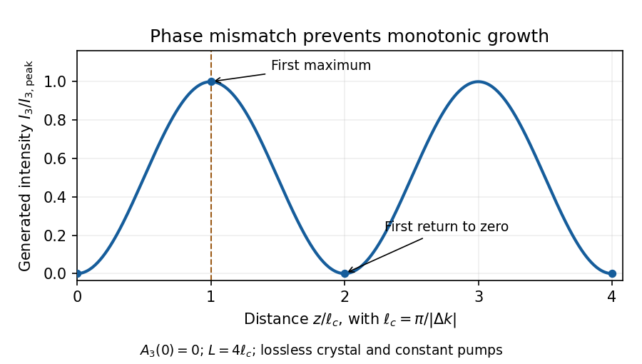

<h1 id="1/solution">Solution</h1>

↑ **Parent:** [1](../1.md)

The process is **[sum-frequency generation](../../../../sum-frequency-generation.md), with $\omega_3=\omega_1+\omega_2$**. The same reversible [three-wave mixing](../../../../three-wave-mixing.md) interaction permits the reverse conversion when the higher-frequency field supplies the pump. The second-order nonlinear polarization couples the three waves; its effective coefficient includes the crystal orientation and polarizations.

One efficiency limit is [phase mismatch](../../../../phase-mismatch.md): contributions generated at different positions acquire different phases and can cancel. A second practical limit is [spatial walk-off](../../../../spatial-walk-off.md), which reduces the overlap of finite beams in a birefringent crystal. A beam radius $w$ and relative walk-off angle $\rho$ give an overlap length of order $w/|\tan\rho|$. Absorption and scattering provide further losses. Group-velocity mismatch matters for pulses, and pump depletion eventually invalidates an undepleted-pump calculation; none of these effects should be silently included in the ideal lossless plane-wave equations.

Define $\kappa_j=2d_{\rm eff}\omega_j/(n_jc)$ and hold $A_1,A_2$ constant. Direct integration of the driven equation gives

$$
\boxed{A_3(z)=A_3(0)+\kappa_3A_1A_2\frac{e^{i\Delta kz}-1}{\Delta k}
=A_3(0)+i\kappa_3A_1A_2z\,e^{i\Delta kz/2}\operatorname{sinc}\frac{\Delta kz}{2},}
$$

where $\operatorname{sinc}x=\sin x/x$. The second expression has a continuous phase-matched limit. If the generated field is initially absent,

$$
\boxed{I_3(z)=\frac{2d_{\rm eff}^2\omega_3^2}{\epsilon_0c^3n_1n_2n_3}I_1I_2z^2\operatorname{sinc}^2\frac{\Delta kz}{2}.}
$$

For $\Delta k\ne0$ this is proportional to $\sin^2(\Delta kz/2)$: the first maximum is at the [nonlinear optical coherence length](../../../../nonlinear-optical-coherence-length.md) $\ell_c=\pi/|\Delta k|$, and the first subsequent zero is at $2\ell_c$. A seed $A_3(0)\ne0$ adds interference with the generated amplitude and can change that pattern. At exact [phase matching](../../../../phase-matching.md), the unseeded result grows as $z^2$ only while pump depletion remains negligible.

**[Figure 1](#1/image-unseeded-sum-frequency-intensity-with-nonzero-phase-mismatch-and-undepleted-pumps). Unseeded sum-frequency intensity with nonzero phase mismatch and undepleted pumps**. Original ideal-model calculation normalized to its first maximum. The crystal length is chosen as four coherence lengths; no measured conversion efficiency is implied.

To retain depletion consistently, differentiate each intensity before inserting the coupled equations:

$$
\frac{dI_j}{dz}=2n_jc\epsilon_0\left(A_j^*\frac{dA_j}{dz}+A_j\frac{dA_j^*}{dz}\right).
$$

For real $d_{\rm eff}$ in the lossless convention, put $Q=A_1A_2A_3^*e^{i\Delta kz}$. The result is

$$
\boxed{\frac{dI_1}{dz}=8\epsilon_0d_{\rm eff}\omega_1\operatorname{Im}Q,\quad
\frac{dI_2}{dz}=8\epsilon_0d_{\rm eff}\omega_2\operatorname{Im}Q,\quad
\frac{dI_3}{dz}=-8\epsilon_0d_{\rm eff}\omega_3\operatorname{Im}Q.}
$$

The signs follow the printed amplitude equations. In initial up-conversion, the newly generated $A_3$ makes $\operatorname{Im}Q<0$, so the two input intensities decrease while the sum-frequency intensity increases. Adding the derivatives gives zero because $\omega_1+\omega_2-\omega_3=0$. **The total intensity is conserved**, even though the three individual intensities change.

The [Manley-Rowe relations](../../../../manley-rowe-relations.md) are

$$
\frac1{\omega_1}\frac{dI_1}{dz}=\frac1{\omega_2}\frac{dI_2}{dz}=-\frac1{\omega_3}\frac{dI_3}{dz}.
$$

Dividing an intensity by $\hbar\omega_j$ gives photon flux density. A conversion event removes one photon from each lower-frequency mode and adds one to the upper mode, or does the reverse. Therefore $C_1/\hbar$ and $C_2/\hbar$ count conserved sums of photon fluxes, while $C_3/\hbar$ counts the conserved lower-frequency difference. They are not three independent invariants: $C_3=C_2-C_1$. Energy conservation is also recovered as $I=\omega_1C_2+\omega_2C_1$.

The unweighted combinations generally fail because the exchanged photons have different energies. Explicitly,

$$
D_1'=-8\epsilon_0d_{\rm eff}\omega_1\operatorname{Im}Q,\qquad
D_2'=-8\epsilon_0d_{\rm eff}\omega_2\operatorname{Im}Q,\qquad
D_3'=8\epsilon_0d_{\rm eff}(\omega_1-\omega_2)\operatorname{Im}Q.
$$

The qualification “generally” matters: $D_3$ is conserved for equal lower frequencies in a distinct-mode degenerate case, and every derivative vanishes when there is no exchange. The equations establish nonconservation for generic unequal-frequency interaction, not for all special solutions.

## ↑ Ancestors (13)

1. [1](../1.md)
2. [Paper 1](../../paper-1-split.md)
3. [2016](../../split.md)
4. [Past exam of the nonlinear Optics and Quantum States of Light course of the University of Cambridge](../../../split.md)
5. [Nonlinear Optics and Quantum States of Light course of the University of Cambridge](../../../../nonlinear-optics-and-quantum-states-of-light-course-of-the-university-of-cambridge.md)
6. [Physics course of the year 4 of the natural sciences course of the University of Cambridge](../../../../physics-course-of-the-year-4-of-the-natural-sciences-course-of-the-university-of-cambridge.md)
7. [Year 4 of the natural sciences course of the University of Cambridge](../../../../year-4-of-the-natural-sciences-course-of-the-university-of-cambridge.md)
8. [Year of the natural sciences course of the University of Cambridge](../../../../year-of-the-natural-sciences-course-of-the-university-of-cambridge.md)
9. [Natural sciences course of the University of Cambridge](../../../../natural-sciences-course-of-the-university-of-cambridge.md)
10. [Course of the University of Cambridge](../../../../course-of-the-university-of-cambridge.md)
11. [University of Cambridge](../../../../university-of-cambridge-split.md)
12. [List of universities](../../../../list-of-universities.md)
13. [Codex Wiki](../../../../split.md)
