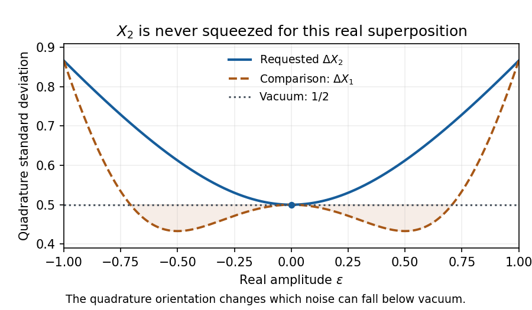
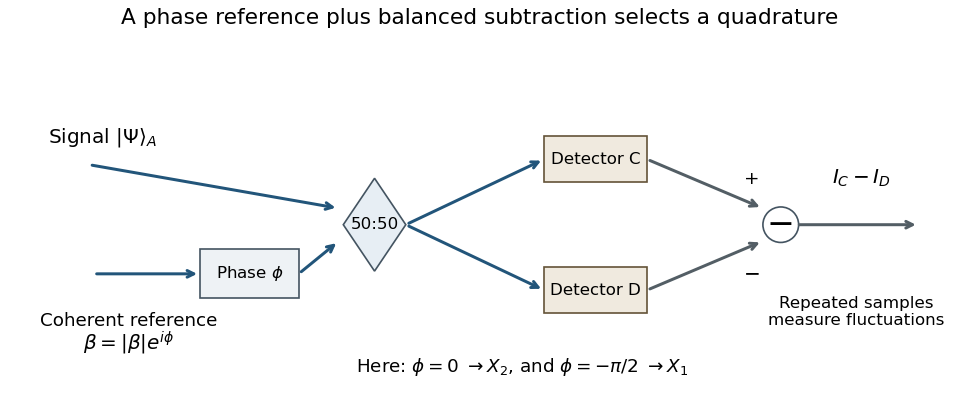

<h1 id="3/solution">Solution</h1>

↑ **Parent:** [3](../3.md)

An [optical squeezed vacuum](../../../../optical-squeezed-vacuum.md) has zero mean field, nonzero mean photon number $\sinh^2r$, and unequal noise in two principal [optical quadratures](../../../../optical-quadrature.md). With $X_1=(a+a^\dagger)/2$ and $X_2=(a-a^\dagger)/(2i)$, the vacuum variance is $1/4$ and $[X_1,X_2]=i/2$. In axes aligned with the squeezing,

$$
\boxed{(\Delta X_1)^2=\frac14e^{-2r},\qquad (\Delta X_2)^2=\frac14e^{2r},\qquad
\langle n\rangle=\sinh^2r.}
$$

The ideal pure state saturates $\Delta X_1\Delta X_2=1/4$. A below-threshold degenerate optical parametric amplifier or oscillator can generate it: a coherent pump drives pair creation into a mode, and the pump phase selects the squeezed quadrature. Loss mixes in vacuum noise, while technical phase fluctuations mix the squeezed and antisqueezed axes.

For the stated vacuum–one-photon superposition, normalization requires $|\epsilon|\le1$. Direct Fock-basis matrix elements give

$$
\langle a\rangle=\epsilon\sqrt{1-\epsilon^2},\quad \langle a^2\rangle=0,\quad
\langle a^\dagger a\rangle=\epsilon^2,\quad \langle X_2\rangle=0.
$$

Using $aa^\dagger=a^\dagger a+1$,

$$
\langle X_2^2\rangle=-\frac14\langle a^2+a^{\dagger2}-aa^\dagger-a^\dagger a\rangle
=\frac{1+2\epsilon^2}{4}.
$$

Consequently **there is no squeezing of the specified quadrature**:

$$
\boxed{\Delta X_2=\frac12\sqrt{1+2\epsilon^2}\ge\frac12.}
$$

It equals the vacuum uncertainty only at $\epsilon=0$ and reaches $\sqrt3/2$ at $\epsilon=\pm1$. The curve is even in $\epsilon$. The orientation matters: the same real superposition has $(\Delta X_1)^2=1/4-\epsilon^2/2+\epsilon^4$, which is below $1/4$ for $0<\epsilon^2<1/2$. This does not turn it into a Gaussian squeezed vacuum; it simply illustrates [quadrature squeezing of a vacuum–one-photon superposition](../../../../quadrature-squeezing-of-a-vacuum-one-photon-superposition.md).

**[Figure 2](#3/image-the-specified-x2-uncertainty-never-falls-below-vacuum-noise). The specified X2 uncertainty never falls below vacuum noise**. Original Fock-state calculation. The X1 curve is an additional comparison showing that squeezing depends on quadrature orientation.

For the printed [beam splitter](../../../../beam-splitter.md) convention, expansion gives the operator identities

$$
c^\dagger c=\frac12\left(a^\dagger a+b^\dagger b+ia^\dagger b-ib^\dagger a\right),\qquad
d^\dagger d=\frac12\left(a^\dagger a+b^\dagger b-ia^\dagger b+ib^\dagger a\right).
$$

Thus

$$
\boxed{I_{CD}=i(a^\dagger b-ab^\dagger),}
$$

where different input modes commute. The source's equality mixing an expectation on one side with an operator on the other is understood as this operator identity, or with expectation brackets on both sides. The mean difference reveals phase-sensitive mutual coherence between inputs; it is not by itself a photon-number correlation measurement of the usual Hanbury Brown–Twiss type. Repeated fluctuations, rather than one mean value, are needed to infer quadrature uncertainty.

For the independent coherent local oscillator, replace $b,b^\dagger$ by $\beta,\beta^*$ in the mean. The effective signal operator is

$$
\boxed{X_m(\phi)=i|\beta|\left(e^{i\phi}a^\dagger-e^{-i\phi}a\right)
=2|\beta|\left(\cos\phi\,X_2-\sin\phi\,X_1\right).}
$$

Therefore **$\phi=0$ measures $X_2$, and $\phi=-\pi/2$ measures $X_1$**, each multiplied by $2|\beta|$. Choosing $\phi=\pi/2$ measures $-X_1$. These phase choices follow the specified complex beam-splitter matrix; importing a different beam-splitter convention would shift them.

This is [balanced homodyne detection](../../../../balanced-homodyne-detection.md). A stable strong local oscillator supplies the phase reference, the signal and oscillator meet at a 50:50 beam splitter, and matched photodetector currents are subtracted. Varying the reference phase selects different quadrature projections. Recording their distributions supplies more information than their means and supports [optical homodyne tomography](../../../../optical-homodyne-tomography.md).

**[Figure 3](#3/image-balanced-homodyne-detection-measures-a-phase-selected-signal-quadrature). Balanced homodyne detection measures a phase-selected signal quadrature**. Original measurement schematic using the beam-splitter convention of this calculation. Gain matching, phase control and repeated photocurrent measurements are needed to estimate noise.

The strong-reference limit also needs a noise qualification. Define $X_\vartheta=X_1\cos\vartheta+X_2\sin\vartheta$, with $\vartheta=\phi+\pi/2$. For independent signal and coherent reference, an exact ideal-detector calculation gives

$$
\operatorname{Var}I_{CD}=4|\beta|^2\operatorname{Var}X_\vartheta+\langle n_a\rangle.
$$

One derivation writes $b=\beta+\delta b$, where $\delta b$ is in vacuum. The reference-amplitude term gives the first contribution; the remaining vacuum term contributes $\langle a^\dagger a\rangle$. Thus the normalized variance approaches the signal quadrature variance when the reference is sufficiently strong relative to the signal. A finite reference is not exactly a classical noiseless field.

A single detector can also carry quadrature information, but its mean alone still does not determine the variance. It measures $n_C=(n_a+n_b+I_{CD})/2$, retaining the large reference background and its fluctuations. For fixed signal moments and a large coherent reference,

$$
\operatorname{Var}n_C=|\beta|^2\left(\operatorname{Var}X_\vartheta+\frac14\right)+O(|\beta|).
$$

The additional vacuum-level term and the uncancelled reference power must be calibrated. In practice the reference may also have much larger classical intensity noise. Balanced subtraction cancels the common total-power term and strongly rejects common-mode technical noise while retaining the phase-sensitive difference. Detector imbalance, unequal efficiencies and reference phase noise limit that advantage. It is therefore the more direct and usually more sensitive quadrature-noise measurement, rather than a claim that a single-port measurement contains no useful information.

## ↑ Ancestors (13)

1. [3](../3.md)
2. [Paper 1](../../paper-1-split.md)
3. [2016](../../split.md)
4. [Past exam of the nonlinear Optics and Quantum States of Light course of the University of Cambridge](../../../split.md)
5. [Nonlinear Optics and Quantum States of Light course of the University of Cambridge](../../../../nonlinear-optics-and-quantum-states-of-light-course-of-the-university-of-cambridge.md)
6. [Physics course of the year 4 of the natural sciences course of the University of Cambridge](../../../../physics-course-of-the-year-4-of-the-natural-sciences-course-of-the-university-of-cambridge.md)
7. [Year 4 of the natural sciences course of the University of Cambridge](../../../../year-4-of-the-natural-sciences-course-of-the-university-of-cambridge.md)
8. [Year of the natural sciences course of the University of Cambridge](../../../../year-of-the-natural-sciences-course-of-the-university-of-cambridge.md)
9. [Natural sciences course of the University of Cambridge](../../../../natural-sciences-course-of-the-university-of-cambridge.md)
10. [Course of the University of Cambridge](../../../../course-of-the-university-of-cambridge.md)
11. [University of Cambridge](../../../../university-of-cambridge-split.md)
12. [List of universities](../../../../list-of-universities.md)
13. [Codex Wiki](../../../../split.md)
