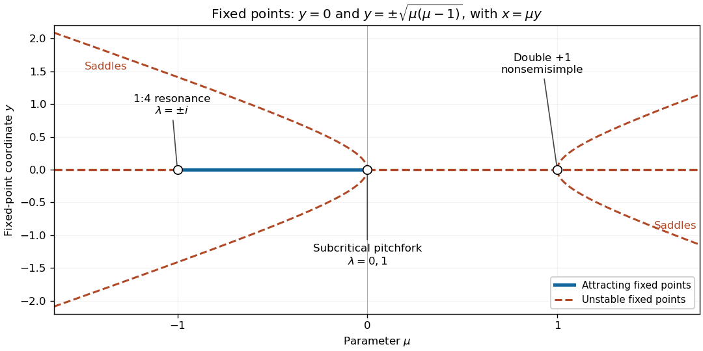

# 2023

↑ **Parent:** [Past exam of the nonlinear systems course of the University of Oxford](../past-exam-of-the-nonlinear-systems-course-of-the-university-of-oxford.md)

Original solutions to all three questions of the [nonlinear systems course of the University of Oxford](../university-of-oxford.md#nonlinear-systems-course-of-the-university-of-oxford) Part B examination, held on 30 May 2023. Source: [released examination PDF, bundle pages 236–238; paper pages 1–3](https://www.whatdotheyknow.com/request/request_for_mathematics_examinat/response/3129786/attach/3/FOI%20202507%20740%20Data.pdf#page=236). Numbering follows the original paper. In Question 1 the displayed [centre manifold](../dynamical-systems.md#center-manifold) dynamics are a truncated local approximation; the neglected terms are specified below. At Question 2's parameter value $\mu=-1$, the [fixed-point multipliers](../discrete-dynamical-system.md#multiplier-of-a-periodic-orbit-of-an-iteration) have a [strong resonance of a planar map](../bifurcation-theory.md#strong-resonance-of-a-planar-map).

**Table of contents**

- [1](#1)
  - [a](#1/a)
    - [Solution](#1/a/solution)
  - [b](#1/b)
    - [Solution](#1/b/solution)
  - [c](#1/c)
    - [Solution](#1/c/solution)
- [2](#2)
  - [a](#2/a)
    - [Solution](#2/a/solution)
  - [b](#2/b)
    - [Solution](#2/b/solution)
  - [c](#2/c)
    - [Solution](#2/c/solution)
  - [d](#2/d)
    - [Solution](#2/d/solution)
- [3](#3)
  - [a](#3/a)
    - [i](#3/a/i)
      - [Solution](#3/a/i/solution)
    - [ii](#3/a/ii)
      - [Solution](#3/a/ii/solution)
    - [iii](#3/a/iii)
      - [Solution](#3/a/iii/solution)
  - [b](#3/b)
    - [Solution](#3/b/solution)
  - [c](#3/c)
    - [i](#3/c/i)
      - [Solution](#3/c/i/solution)
    - [ii](#3/c/ii)
      - [Solution](#3/c/ii/solution)
    - [iii](#3/c/iii)
      - [Solution](#3/c/iii/solution)

## 1

↑ **Parent:** [2023](2023.md)

<h3 id="1/a">a</h3>

↑ **Parent:** [1](#1)

<h4 id="1/a/solution">Solution</h4>

↑ **Parent:** [A](#1/a)

At a [fixed point](../function.md#fixed-point), the first equation gives $y=0$, the second then gives $x=0$, and the third gives $z=-\mu$. Thus there is exactly one [equilibrium](../dynamical-systems.md#equilibrium-point-of-a-dynamical-system) for every real $\mu$:

$$
\boxed{(x,y,z)=(0,0,-\mu).}
$$

The [Jacobian matrix](../multivariable-calculus.md#jacobian-matrix) there is

$$
J=\begin{pmatrix}0&1&0\\-1&5\epsilon\mu&0\\0&0&-1\end{pmatrix},\qquad
\det(\lambda I-J)=(\lambda+1)(\lambda^2-5\epsilon\mu\lambda+1).
$$

One [eigenvalue](../linear-operator-theory.md#eigenvalue) is $-1$. The other two have product one and sum $5\epsilon\mu$. For $\mu<0$ their real parts are negative, so the [equilibrium](../dynamical-systems.md#equilibrium-point-of-a-dynamical-system) is [asymptotically stable](../dynamical-systems.md#asymptotic-stability); for $\mu>0$ both real parts are positive, leaving two unstable directions and one stable direction. At $\mu=0$ the [eigenvalues](../linear-operator-theory.md#eigenvalue) are $-1,i,-i$, with

$$
\left.\frac{d}{d\mu}\operatorname{Re}\lambda_\pm\right|_{\mu=0}=\frac{5\epsilon}{2}>0.
$$

Therefore **the only local [bifurcation](../bifurcation-theory.md#bifurcation) of this [equilibrium](../dynamical-systems.md#equilibrium-point-of-a-dynamical-system) is a [Hopf bifurcation](../bifurcation-theory.md#hopf-bifurcation) at $\mu=0$**. A repeated real [eigenvalue](../linear-operator-theory.md#eigenvalue) away from zero does not itself cause a [bifurcation](../bifurcation-theory.md#bifurcation): the [equilibrium](../dynamical-systems.md#equilibrium-point-of-a-dynamical-system) remains [hyperbolic](../dynamical-systems.md#hyperbolic-equilibrium-point) there.

The cubic [centre manifold](../dynamical-systems.md#center-manifold) calculation below gives the [Hopf normal form](../bifurcation-theory.md#hopf-normal-form) radial coefficient $-9\epsilon/8<0$, so this is a [supercritical Hopf bifurcation](../bifurcation-theory.md#supercritical-hopf-bifurcation). Small attracting [periodic orbits](../dynamical-systems.md#periodic-orbit) occur on the $\mu>0$ side. In particular, at $\mu=0$ the leading cubic radial drift is inward, although [linear stability](../dynamical-systems.md#linear-stability) alone cannot decide that boundary case.

<h3 id="1/b">b</h3>

↑ **Parent:** [1](#1)

<h4 id="1/b/solution">Solution</h4>

↑ **Parent:** [B](#1/b)

Adjoin $\dot\mu=0$ and put $w=z+\mu$. The [extended centre manifold](../dynamical-systems.md#extended-centre-manifold-for-a-parameter) is a graph $w=H(x,y,\mu)$ tangent to $w=0$ at the origin. The equations become

$$
\dot x=y,\qquad \dot y=-x+5\epsilon\mu y-5\epsilon y w,\qquad \dot w=-w+x^2,\qquad \dot\mu=0.
$$

Here $\epsilon>0$ is fixed. The [centre-manifold invariance equation](../dynamical-systems.md#centre-manifold-invariance-equation), obtained by the [chain rule](../calculus.md#chain-rule), is

$$
H_x y+H_y(-x+5\epsilon\mu y-5\epsilon yH)=-H+x^2.
$$

Write $H=H_2+O(\rho^3)$, where $\rho=|x|+|y|+|\mu|$ and $H_2$ is a homogeneous quadratic [polynomial](../polynomial.md). To quadratic order the [centre-manifold invariance equation](../dynamical-systems.md#centre-manifold-invariance-equation) is

$$
y\partial_xH_2-x\partial_yH_2=-H_2+x^2.
$$

The terms $\mu x,\mu y,\mu^2$ have zero [coefficients](../vector-space.md#coefficient): their equations are homogeneous, and the operator $1+y\partial_x-x\partial_y$ is invertible on these quadratic [polynomials](../polynomial.md). For $H_2=ax^2+bxy+cy^2$, comparison of [coefficients](../vector-space.md#coefficient) gives

$$
-b=1-a,\qquad 2a-2c=-b,\qquad b=-c.
$$

Hence $a=3/5$, $b=-2/5$ and $c=2/5$, giving

$$
\boxed{z=-\mu+\frac35x^2-\frac25xy+\frac25y^2+O(\rho^3).}
$$

Substitution into the $y$ equation gives

$$
\boxed{\dot x=y,\qquad
\dot y=-x+\epsilon(5\mu y-3x^2y+2xy^2-2y^3)+O(\rho^4).}
$$

The constant in the [big O notation](../real-analysis.md#big-o-notation) may depend on fixed $\epsilon$. Thus the equations printed in part (b) are the retained terms of the local [Taylor series](../calculus.md#taylor-series), rather than an exact identity for the full reduced [vector field](../multivariable-calculus.md#vector-field).

For the [Hopf bifurcation](../bifurcation-theory.md#hopf-bifurcation) classification in part (a), set $\mu=0$ and use $x=r\cos\theta$, $y=-r\sin\theta$. The radial derivative is $\dot r=(x\dot x+y\dot y)/r$. Its cubic angular mean is

$$
\frac{\epsilon}{r}\left\langle-3x^2y^2+2xy^3-2y^4\right\rangle
=-\epsilon r^3\left(\frac38+\frac68\right)=-\frac{9\epsilon}{8}r^3.
$$

Here $\langle\cdot\rangle$ denotes the mean over one revolution. Removing the oscillatory cubic terms by a [near-identity transformation](../bifurcation-theory.md#near-identity-transformation) gives this same cubic radial coefficient in the [Hopf normal form](../bifurcation-theory.md#hopf-normal-form). The linear radial coefficient is $5\epsilon\mu/2$.

<h3 id="1/c">c</h3>

↑ **Parent:** [1](#1)

<h4 id="1/c/solution">Solution</h4>

↑ **Parent:** [C](#1/c)

Apply the [Poincaré-Lindstedt method](../singular-perturbation.md#poincare-lindstedt-method) to the truncated system from part (b). Since $y=\dot x$, its scalar equation is

$$
\ddot x+x=\epsilon\left(5\mu\dot x-3x^2\dot x+2x\dot x^2-2\dot x^3\right).
$$

Introduce the stretched time $\tau=\omega t$, with [asymptotic expansions](../asymptotic-expansion.md)

$$
\omega=1+\epsilon\omega_1+O(\epsilon^2),\qquad
x(t)=X(\tau)=A\cos\tau+\epsilon X_1(\tau)+O(\epsilon^2).
$$

Primes in this part mean [derivatives](../calculus.md#derivative) with respect to $\tau$. At first order,

$$
X_1''+X_1=2\omega_1A\cos\tau-5\mu A\sin\tau
+3A^3\cos^2\tau\sin\tau+2A^3\cos\tau\sin^2\tau+2A^3\sin^3\tau.
$$

The [trigonometric identities](../geometry-and-topology.md#trigonometric-identity)

$$
\cos^2\tau\sin\tau=\frac{\sin\tau+\sin3\tau}{4},\qquad
\cos\tau\sin^2\tau=\frac{\cos\tau-\cos3\tau}{4},\qquad
\sin^3\tau=\frac{3\sin\tau-\sin3\tau}{4}
$$

reduce this to

$$
X_1''+X_1=
\left(2\omega_1A+\frac{A^3}{2}\right)\cos\tau
+\left(-5\mu A+\frac{9A^3}{4}\right)\sin\tau
-\frac{A^3}{2}\cos3\tau+\frac{A^3}{4}\sin3\tau.
$$

A periodic $X_1$ cannot have a [secular term](../singular-perturbation.md#secular-term), so both fundamental-harmonic [coefficients](../vector-space.md#coefficient) must vanish. Taking $A>0$ gives

$$
\boxed{A^2=\frac{20\mu}{9},\qquad \omega_1=-\frac{A^2}{4}=-\frac{5\mu}{9}.}
$$

In particular $\mu>0$ is necessary. Once these conditions hold, a bounded particular correction is

$$
X_1=\frac{A^3}{16}\cos3\tau-\frac{A^3}{32}\sin3\tau;
$$

adding fundamental sine and cosine terms adjusts the [phase](../wave.md#phase-waves) and the first correction to the [amplitude](../wave.md#wave-amplitude). Consequently the required leading [periodic orbit](../dynamical-systems.md#periodic-orbit) is

$$
\boxed{x=A\cos(\omega t)+O(\epsilon),\quad
y=-A\omega\sin(\omega t)+O(\epsilon),\quad
\omega=1-\frac{5\mu\epsilon}{9}+O(\epsilon^2).}
$$

Here $A$ is the leading [amplitude](../wave.md#wave-amplitude), not an assertion that the exact finite-$\epsilon$ [amplitude](../wave.md#wave-amplitude) is independent of $\epsilon$.

To justify existence beyond formal cancellation, the leading radial displacement in a [Poincaré return map](../dynamical-systems.md#poincare-map) is $2\pi\epsilon B(r)$, where

$$
B(r)=\frac{5\mu}{2}r-\frac98r^3.
$$

At the positive root $A$, $B'(A)=-5\mu\ne0$. The [implicit function theorem](../multivariable-calculus.md#implicit-function-theorem), applied after dividing the displacement by $\epsilon$, continues this root to a [periodic orbit](../dynamical-systems.md#periodic-orbit) for sufficiently small positive $\epsilon$. Its radial [Floquet multiplier](../dynamical-systems.md#floquet-multiplier) is $1-10\pi\mu\epsilon+O(\epsilon^2)$, so it is attracting. These statements apply to the truncated system with fixed $\mu>0$; its interpretation as a local approximation to the original three-dimensional system also requires $\mu$ small, so that $A=O(\sqrt\mu)$ stays near the [Hopf bifurcation](../bifurcation-theory.md#hopf-bifurcation).

## 2

↑ **Parent:** [2023](2023.md)

<h3 id="2/a">a</h3>

↑ **Parent:** [2](#2)

<h4 id="2/a/solution">Solution</h4>

↑ **Parent:** [A](#2/a)

The [fixed point](../function.md#fixed-point) equations give $x=\mu y$ and

$$
0=-\mu x+\mu y+y^3=y\bigl(y^2+\mu-\mu^2\bigr).
$$

Thus the origin exists for every real $\mu$. The nonzero [fixed points](../function.md#fixed-point) are

$$
\boxed{(x,y)=\left(\pm\mu\sqrt{\mu(\mu-1)},\ \pm\sqrt{\mu(\mu-1)}\right),\qquad \mu<0\ \text{or}\ \mu>1,}
$$

with the same sign in both positions. At $\mu=0$ or $\mu=1$ these expressions coalesce with the origin and do not give additional [fixed points](../function.md#fixed-point). There are no nonzero real [fixed points](../function.md#fixed-point) for $0<\mu<1$.

<h3 id="2/b">b</h3>

↑ **Parent:** [2](#2)

<h4 id="2/b/solution">Solution</h4>

↑ **Parent:** [B](#2/b)

The [Jacobian matrix](../multivariable-calculus.md#jacobian-matrix) at the origin and its [characteristic polynomial](../linear-operator-theory.md#characteristic-polynomial) are

$$
M_0=\begin{pmatrix}0&\mu\\-\mu&1+\mu\end{pmatrix},\qquad
p(\lambda)=\lambda^2-(1+\mu)\lambda+\mu^2.
$$

The [fixed-point multipliers](../discrete-dynamical-system.md#multiplier-of-a-periodic-orbit-of-an-iteration) are

$$
\lambda_\pm=\frac{1+\mu\pm\sqrt{(1-\mu)(1+3\mu)}}{2}.
$$

By the [Jury stability criterion](../discrete-dynamical-system.md#jury-stability-criterion), both lie strictly inside the [unit circle](../complex-analysis.md#complex-unit-circle) exactly when

$$
|\mu^2|<1,\qquad p(1)=\mu(\mu-1)>0,\qquad p(-1)=\mu^2+\mu+2>0.
$$

The last condition always holds, since $\mu^2+\mu+2=(\mu+1/2)^2+7/4$. Therefore **the origin is [asymptotically stable](../dynamical-systems.md#asymptotic-stability) exactly for $-1<\mu<0$ among the hyperbolic parameter values**.

For completeness, its [linear stability](../dynamical-systems.md#linear-stability) throughout the parameter line is as follows. When $\mu<-1$, the complex-conjugate [Floquet multipliers](../dynamical-systems.md#floquet-multiplier) have [modulus](../complex-analysis.md#modulus) $|\mu|>1$, so the origin repels. When $-1<\mu<-1/3$, their [modulus](../complex-analysis.md#modulus) is $|\mu|<1$, so it attracts with oscillation. At $\mu=-1/3$ the repeated [Floquet multiplier](../dynamical-systems.md#floquet-multiplier) is $1/3$, still attracting. For $-1/3<\mu<0$, both [Floquet multipliers](../dynamical-systems.md#floquet-multiplier) are real and in $(0,1)$. For $0<\mu<1$, $p(1)<0$ and $p(0)>0$, so one [Floquet multiplier](../dynamical-systems.md#floquet-multiplier) lies in $(0,1)$ and the other exceeds one: the origin is a [saddle fixed point of a map](../dynamical-systems.md#saddle-fixed-point-of-a-map). For $\mu>1$, the complex-conjugate [Floquet multipliers](../dynamical-systems.md#floquet-multiplier) have [modulus](../complex-analysis.md#modulus) $\mu>1$, so it repels.

Possible changes at the [unit circle](../complex-analysis.md#complex-unit-circle) are exhausted by $p(1)=0$, $p(-1)=0$, or a nonreal pair with product one. They give

$$
\boxed{\mu=-1,\quad0,\quad1.}
$$

At $\mu=0$ the [Floquet multipliers](../dynamical-systems.md#floquet-multiplier) are $0,1$; the nonzero [fixed point](../function.md#fixed-point) branches in part (a) meet the origin, and part (c) identifies a [subcritical pitchfork bifurcation](../bifurcation-theory.md#subcritical-pitchfork-bifurcation). Indeed at $\mu=0$ the exact restricted map is $y\mapsto y+y^3$, which makes the origin unstable despite its neutral linear direction.

At $\mu=-1$ the [Floquet multipliers](../dynamical-systems.md#floquet-multiplier) are $i,-i$: this is a 1:4 [strong resonance of a planar map](../bifurcation-theory.md#strong-resonance-of-a-planar-map), coinciding with the change from repelling to attracting as $\mu$ increases. A generic nonresonant [Neimark–Sacker bifurcation](../bifurcation-theory.md#neimark-sacker-bifurcation) conclusion would be unjustified. At $\mu=1$ there is a double [Floquet multiplier](../dynamical-systems.md#floquet-multiplier) $+1$; the matrix has a nontrivial [Jordan block](../linear-operator-theory.md#jordan-block), and the two further nonzero [fixed point](../function.md#fixed-point) branches meet the origin. [Linear stability](../dynamical-systems.md#linear-stability) alone is inconclusive at these unit-modulus boundary values. The repeated [Floquet multiplier](../dynamical-systems.md#floquet-multiplier) at $\mu=-1/3$ is strictly inside the [unit circle](../complex-analysis.md#complex-unit-circle) and gives no [bifurcation](../bifurcation-theory.md#bifurcation).

<h3 id="2/c">c</h3>

↑ **Parent:** [2](#2)

<h4 id="2/c/solution">Solution</h4>

↑ **Parent:** [C](#2/c)

Adjoin $\mu_{n+1}=\mu_n$. At the origin the stable direction is the $x$ axis, with [Floquet multiplier](../dynamical-systems.md#floquet-multiplier) zero, while the $y$ and parameter directions have [Floquet multiplier](../dynamical-systems.md#floquet-multiplier) one. By the [centre manifold theorem for a discrete dynamical system](../dynamical-systems.md#centre-manifold-theorem-for-a-discrete-dynamical-system), write the [extended centre manifold](../dynamical-systems.md#extended-centre-manifold-for-a-parameter) as

$$
x=h(y,\mu),\qquad h(0,0)=0,\qquad Dh(0,0)=0.
$$

On it the scalar map is $Y=(1+\mu)y-\mu h(y,\mu)+y^3$. Its discrete [centre-manifold invariance equation](../dynamical-systems.md#centre-manifold-invariance-equation) is

$$
h(Y,\mu)=\mu y.
$$

Put $h=h_2+O(\rho^3)$ with $\rho=|y|+|\mu|$. Since $Y=y+O(\rho^2)$, the quadratic equation is simply $h_2(y,\mu)=\mu y$. Thus

$$
\boxed{x=\mu y+O(\rho^3).}
$$

In particular, setting the stable variable identically to zero would lose the leading parameter correction. The reduced map through total degree three is

$$
\boxed{y_{n+1}=y_n+\mu y_n-\mu^2y_n+y_n^3+O(\rho^4).}
$$

In the natural [pitchfork bifurcation](../bifurcation-theory.md#pitchfork-bifurcation-normal-form) scaling $\mu=O(y^2)$ this has leading form $y_{n+1}=y_n+\mu y_n+y_n^3$. Its nonzero [fixed points](../function.md#fixed-point) satisfy $y^2\sim-\mu$, and their reduced [fixed-point multipliers](../discrete-dynamical-system.md#multiplier-of-a-periodic-orbit-of-an-iteration) satisfy $1-2\mu+O(\mu^2)>1$ for small $\mu<0$. The transverse [Floquet multiplier](../dynamical-systems.md#floquet-multiplier) remains inside the [unit circle](../complex-analysis.md#complex-unit-circle). Therefore **the [bifurcation](../bifurcation-theory.md#bifurcation) at $\mu=0$ is a [subcritical pitchfork bifurcation](../bifurcation-theory.md#subcritical-pitchfork-bifurcation): the origin attracts for small negative $\mu$, each nonzero branch is a [saddle fixed point of a map](../dynamical-systems.md#saddle-fixed-point-of-a-map), and the origin is a [saddle fixed point of a map](../dynamical-systems.md#saddle-fixed-point-of-a-map) for small positive $\mu$**.

An exact check uses the full [Jacobian matrix](../multivariable-calculus.md#jacobian-matrix) on either nonzero branch. Its [trace](../linear-algebra.md#matrix-trace) is $T_*=1-2\mu+3\mu^2$ and its [determinant](../multilinear-algebra.md#determinant) is $D_*=\mu^2$. Thus

$$
p_*(1)=1-T_*+D_*=2\mu(1-\mu)<0
$$

whenever a nonzero branch exists. Also $p_*(0)=\mu^2>0$, so one real [Floquet multiplier](../dynamical-systems.md#floquet-multiplier) lies in $(0,1)$ and the other in $(1,\infty)$. This proves that each nonzero branch is a [saddle fixed point of a map](../dynamical-systems.md#saddle-fixed-point-of-a-map) throughout $\mu<0$ and $\mu>1$, in particular near the requested [bifurcation](../bifurcation-theory.md#bifurcation).

<h3 id="2/d">d</h3>

↑ **Parent:** [2](#2)

<h4 id="2/d/solution">Solution</h4>

↑ **Parent:** [D](#2/d)

Use $y$ vertically and $\mu$ horizontally in the [bifurcation diagram](../bifurcation-theory.md#bifurcation-diagram); the other coordinate is recovered from $x=\mu y$. The origin is the horizontal branch $y=0$. Draw it solid on $-1<\mu<0$, where it is [asymptotically stable](../dynamical-systems.md#asymptotic-stability), and dashed on the remaining [hyperbolic](../dynamical-systems.md#hyperbolic-equilibrium-point) intervals, where it is unstable. Its three [nonhyperbolic fixed points](../dynamical-systems.md#nonhyperbolic-equilibrium) in parameter space are marked at $\mu=-1,0,1$; open markers distinguish these boundary cases from the strict [linear stability](../dynamical-systems.md#linear-stability) classifications on the intervening intervals.

The nonzero [fixed point](../function.md#fixed-point) branches are $y=\pm\sqrt{\mu(\mu-1)}$ for $\mu<0$ and $\mu>1$. Each is dashed because it is a [saddle fixed point of a map](../dynamical-systems.md#saddle-fixed-point-of-a-map), as proved in part (c). Near zero their shape is $y\sim\pm\sqrt{-\mu}$: the unstable branches lie on the same parameter side as the attracting origin, displaying the [subcritical pitchfork bifurcation](../bifurcation-theory.md#subcritical-pitchfork-bifurcation). The branches issuing from $\mu=1$ have $y\sim\pm\sqrt{\mu-1}$. At $\mu=-1$ no additional [fixed point](../function.md#fixed-point) branch appears; the [Floquet multipliers](../dynamical-systems.md#floquet-multiplier) cross the [unit circle](../complex-analysis.md#complex-unit-circle) at $\pm i$.

**[Figure 1](#2/d/image-fixed-point-bifurcation-diagram-solid-denotes-attracting-dashed-denotes-unstable-and-open-circles-mark-the-three-unit-circle-crossings-at-the-origin-nonzero-branches-are-saddles). Fixed-point bifurcation diagram: solid denotes attracting, dashed denotes unstable, and open circles mark the three unit-circle crossings at the origin. Nonzero branches are saddles.**

## 3

↑ **Parent:** [2023](2023.md)

<h3 id="3/a">a</h3>

↑ **Parent:** [3](#3)

<h4 id="3/a/i">i</h4>

↑ **Parent:** [A](#3/a)

<h5 id="3/a/i/solution">Solution</h5>

↑ **Parent:** [I](#3/a/i)

For the [left shift](../dynamical-systems.md#left-shift), $\sigma^p(s)=s$ precisely when the [binary sequence](../sequence-and-series.md#bitstream) is obtained by repeating its first $p$ symbols. There are exactly $2^p$ such [sequences](../sequence-and-series.md#sequence), although some have smaller least period. Hence the set of all periodic [sequences](../sequence-and-series.md#sequence) is a [countable union](../set.md#countable-union) of finite sets and is at most countable. Passing from periodic points to [periodic orbits](../dynamical-systems.md#periodic-orbit) cannot increase this cardinality.

To prove infinitude, for every integer $p\geq1$ take the repeated word $(0^{p-1}1)^\infty$. Its least period is $p$, because its ones are separated by exactly $p$ positions; a smaller positive period would carry a one to a zero. Distinct least periods give distinct [periodic orbits](../dynamical-systems.md#periodic-orbit). Thus **there are countably infinitely many [periodic orbits](../dynamical-systems.md#periodic-orbit)**.

<h4 id="3/a/ii">ii</h4>

↑ **Parent:** [A](#3/a)

<h5 id="3/a/ii/solution">Solution</h5>

↑ **Parent:** [Ii](#3/a/ii)

The space $\Sigma$ of all infinite [binary sequences](../sequence-and-series.md#bitstream) is [uncountable](../cardinal-number.md#uncountable-set) by the [Cantor diagonal argument](../cardinal-number.md#cantor-s-diagonal-argument): given any list $s^{(1)},s^{(2)},\ldots$, the [sequence](../sequence-and-series.md#sequence) $t_i=1-s_i^{(i)}$ differs from its $i$th entry at position $i$, so it is absent from the list. Part (i) shows that only countably many [sequences](../sequence-and-series.md#sequence) are periodic. Their complement is therefore [uncountable](../cardinal-number.md#uncountable-set).

Each [forward orbit](../dynamical-systems.md#forward-orbit) $\{\sigma^n(s):n\geq0\}$ is countable. If there were only countably many nonperiodic [forward orbits](../dynamical-systems.md#forward-orbit), their union together with the periodic points would be countable, contradicting the preceding argument. Hence **there are uncountably many nonperiodic [orbits](../dynamical-systems.md#orbit-dynamical-system)**, rather than merely uncountably many nonperiodic starting points.

One can also exclude eventual periodicity. An eventually periodic [sequence](../sequence-and-series.md#sequence) is specified by a finite initial word and a finite repeating word, so only countably many exist. Removing all of them still leaves an [uncountable set](../cardinal-number.md#uncountable-set). This proves the assertion even if “nonperiodic” is understood to exclude [orbits](../dynamical-systems.md#orbit-dynamical-system) that eventually enter a [periodic orbit](../dynamical-systems.md#periodic-orbit).

<h4 id="3/a/iii">iii</h4>

↑ **Parent:** [A](#3/a)

<h5 id="3/a/iii/solution">Solution</h5>

↑ **Parent:** [Iii](#3/a/iii)

Construct one infinite [binary sequence](../sequence-and-series.md#bitstream) $u$ by concatenating every binary word of length one, then every word of length two, then every word of length three, and so on, in [lexicographic order](../extremal-set-theory.md#lexicographic-order) within each length. Every finite binary word occurs somewhere in $u$.

Given any target [sequence](../sequence-and-series.md#sequence) $s$ and any $\eta>0$, choose $N$ such that $2^{-N}<\eta$. The word $s_1\cdots s_N$ occurs in $u$, beginning after some $k$ symbols. Thus $\sigma^ku$ agrees with $s$ in its first $N$ positions, and the prescribed [metric](../topological-analysis.md#metric) gives

$$
d(\sigma^ku,s)\leq\sum_{i>N}2^{-i}=2^{-N}<\eta.
$$

Every open [open ball](../topology.md#open-ball) about every point therefore meets the [forward orbit](../dynamical-systems.md#forward-orbit) of $u$. **This [forward orbit](../dynamical-systems.md#forward-orbit) is [dense](../topology.md#dense-set) in $\Sigma$.** The argument identifies finite-prefix [cylinder sets](../geometry-and-topology.md#cylinder-set) as arbitrarily small neighborhoods in this [metric](../topological-analysis.md#metric); no binary-expansion convention for real numbers is needed.

<h3 id="3/b">b</h3>

↑ **Parent:** [3](#3)

<h4 id="3/b/solution">Solution</h4>

↑ **Parent:** [B](#3/b)

For the real [logistic map](../discrete-dynamical-system.md#logistic-map), $f(x)=x$ factors as

$$
x\bigl(\mu-1-\mu x\bigr)=0.
$$

There is always the [fixed point](../function.md#fixed-point) $x_0=0$. If $\mu\ne0$ there is also $x_*=1-1/\mu$, distinct from zero unless $\mu=1$. At $\mu=0$ the map is constant and zero is its only [fixed point](../function.md#fixed-point). Negative $\mu$ must be retained because the paper specifies $x\in\mathbb R$.

Since $f'(x)=\mu(1-2x)$, the [fixed-point multipliers](../discrete-dynamical-system.md#multiplier-of-a-periodic-orbit-of-an-iteration) are

$$
\lambda_0=\mu,\qquad \lambda_*=2-\mu.
$$

The [fixed point stability for an iteration](../dynamical-systems.md#fixed-point-stability-for-an-iteration) criterion gives **$x_0$ attracting for $-1<\mu<1$, and $x_*$ attracting for $1<\mu<3$**. The respective [fixed points](../function.md#fixed-point) are repelling when $|\mu|>1$ and $|2-\mu|>1$. At the unit-modulus boundaries the linear criterion needs a nonlinear supplement.

At $\mu=1$, the two [fixed point](../function.md#fixed-point) branches meet and exchange stability: this is a [transcritical bifurcation](../dynamical-systems.md#transcritical-bifurcation). Explicitly, with $\delta=\mu-1$,

$$
f(x)-x=\delta x-(1+\delta)x^2,
$$

which has the required nonzero parameter and quadratic terms. At the critical value itself, $f(x)=x-x^2$ attracts small positive points and pushes negative points away, so the merged [fixed point](../function.md#fixed-point) is not stable from both sides.

At $\mu=-1$ the origin’s [fixed-point multiplier](../discrete-dynamical-system.md#multiplier-of-a-periodic-orbit-of-an-iteration) crosses $-1$, while at $\mu=3$ the nonzero [fixed-point multiplier](../discrete-dynamical-system.md#multiplier-of-a-periodic-orbit-of-an-iteration) crosses $-1$. Both are [period-doubling bifurcations](../discrete-dynamical-system.md#period-doubling-bifurcation). To check existence and stability of the new [periodic orbit](../dynamical-systems.md#periodic-orbit), factor the second [iteration of a map](../discrete-dynamical-system.md#iterated-function):

$$
f^2(x)-x=-x(\mu x-\mu+1)
\left(\mu^2x^2-\mu(\mu+1)x+\mu+1\right).
$$

The two non-fixed roots are

$$
q_\pm=\frac{\mu+1\pm\sqrt{(\mu-3)(\mu+1)}}{2\mu}.
$$

They form a real [period-two orbit](../dynamical-systems.md#period-two-orbit) for $\mu<-1$ or $\mu>3$. Its [periodic-orbit multiplier](../discrete-dynamical-system.md#multiplier-of-a-periodic-orbit-of-an-iteration) is

$$
f'(q_-)f'(q_+)=4+2\mu-\mu^2.
$$

It is less than one in [absolute value](../real-analysis.md#absolute-value) just below $-1$ and just above $3$, respectively. Thus these are [supercritical bifurcations](../bifurcation-theory.md#supercritical-bifurcation) in the direction where the parent [fixed point](../function.md#fixed-point) loses stability. At the critical values the [fixed points](../function.md#fixed-point) themselves are weakly attracting: at $\mu=-1$, $f^2(x)=x-2x^3+x^4$; at $\mu=3$, setting $u=x-2/3$ gives $u\mapsto u-18u^3-27u^4$ after two steps. Both shrink sufficiently small nonzero [absolute values](../real-analysis.md#absolute-value). The [bifurcation](../bifurcation-theory.md#bifurcation) values for finite [fixed points](../function.md#fixed-point) are therefore

$$
\boxed{\mu=-1\text{ (period doubling)},\quad1\text{ (transcritical)},\quad3\text{ (period doubling)}.}
$$

The disappearance of the formula for $x_*$ at $\mu=0$ corresponds to that branch going to infinity, not a local [bifurcation](../bifurcation-theory.md#bifurcation) at a finite [fixed point](../function.md#fixed-point).

<h3 id="3/c">c</h3>

↑ **Parent:** [3](#3)

<h4 id="3/c/i">i</h4>

↑ **Parent:** [C](#3/c)

<h5 id="3/c/i/solution">Solution</h5>

↑ **Parent:** [I](#3/c/i)

Solving $\mu x(1-x)=1$ by the [quadratic formula](../polynomial.md#quadratic-formula) gives

$$
x_\pm=\frac12\pm\sqrt{\frac14-\frac1\mu}.
$$

For $\mu>4$, $0<x_-<1/2<x_+<1$. On $L=[0,x_-]$ the [derivative](../calculus.md#derivative) $f'(x)=\mu(1-2x)$ is strictly positive, while on $R=[x_+,1]$ it is strictly negative. Thus the restrictions are strictly [monotonic functions](../calculus.md#monotonic-function). Their endpoint values are

$$
f(0)=0,\quad f(x_-)=1,\qquad f(x_+)=1,\quad f(1)=0.
$$

By [continuity](../calculus.md#continuous-function) and strict [monotonicity](../calculus.md#monotonic-function), **each restriction maps its interval bijectively onto $[0,1]$**, with opposite orientations. The corresponding [inverse functions](../function.md#inverse-function) are

$$
\boxed{g_L(v)=\frac{1-\sqrt{1-4v/\mu}}2,\qquad
g_R(v)=\frac{1+\sqrt{1-4v/\mu}}2,\qquad 0\leq v\leq1.}
$$

<h4 id="3/c/ii">ii</h4>

↑ **Parent:** [C](#3/c)

<h5 id="3/c/ii/solution">Solution</h5>

↑ **Parent:** [Ii](#3/c/ii)

Write $G=g_{s_1}\circ\cdots\circ g_{s_{n-1}}$. Because $g_{s_n}([0,1])\subseteq[0,1]$, taking the image under the same [function composition](../function.md#function-composition) gives

$$
\boxed{I_{s_1\cdots s_n}=G(g_{s_n}([0,1]))\subseteq G([0,1])=I_{s_1\cdots s_{n-1}}.}
$$

This uses preservation of set inclusion by every [function](../function.md), so decreasing [inverse branches](../function.md#inverse-branch) cause no difficulty. Since $f\circ g_L=f\circ g_R=\operatorname{id}_{[0,1]}$, cancellation of the first [inverse branch](../function.md#inverse-branch) gives the equality of images

$$
\boxed{f(I_{s_1\cdots s_n})=I_{s_2\cdots s_n}.}
$$

These compact [intervals](../real-analysis.md#interval-mathematics) are [itinerary cylinders](../discrete-dynamical-system.md#itinerary-cylinder): their symbols record successive positions under [iteration of a map](../discrete-dynamical-system.md#iterated-function). In particular,

$$
\boxed{x\in I_{LLR}\ \Longrightarrow\ x\in L,\quad f(x)\in L,\quad f^2(x)\in R.}
$$

Conversely these three memberships allow successive substitution of the appropriate [inverse branches](../function.md#inverse-branch), and therefore characterize $I_{LLR}$ exactly.

<h4 id="3/c/iii">iii</h4>

↑ **Parent:** [C](#3/c)

<h5 id="3/c/iii/solution">Solution</h5>

↑ **Parent:** [Iii](#3/c/iii)

The set $I^n$ consists precisely of points whose first $n$ positions $x,f(x),\ldots,f^{n-1}(x)$ all lie in $L\cup R$. Hence

$$
\Lambda=\{x\in[0,1]: f^k(x)\in L\cup R\text{ for every }k\geq0\}.
$$

Deleting the first position preserves this condition, proving $f(\Lambda)\subseteq\Lambda$. For the reverse inclusion, if $y\in\Lambda$, take $x=g_L(y)$. Then $x\in L$ and $f^k(x)=f^{k-1}(y)\in L\cup R$ for every $k\geq1$. Thus $x\in\Lambda$ and $f(x)=y$. In fact both [inverse branches](../function.md#inverse-branch) give preimages in $\Lambda$. Therefore

$$
\boxed{f(\Lambda)=\Lambda,}
$$

which proves full invariance, not merely forward invariance.

For any infinite symbolic [sequence](../sequence-and-series.md#sequence) $s$, the [itinerary cylinders](../discrete-dynamical-system.md#itinerary-cylinder) $I_{s_1\cdots s_n}$ are nonempty compact [nested intervals](../real-analysis.md#nested-intervals). The [nested interval theorem](../real-analysis.md#nested-interval-theorem) gives at least one point in their intersection. Every $x\in\Lambda$ has a unique itinerary because $L\cap R=\varnothing$. To justify that the itinerary also determines a unique point, it suffices to show the [interval](../real-analysis.md#interval-mathematics) lengths shrink. The fact that [logistic inverse branches contract in an angular coordinate](../discrete-dynamical-system.md#logistic-inverse-branches-contract-in-an-angular-coordinate) works for every $\mu>4$; a direct claim that $|g_L'|,|g_R'|<1$ in the original coordinate would fail for some $\mu$ just above four.

Use the [homeomorphism](../topology.md#homeomorphism) $h(u)=\sin^2(\pi u/2)$ of $[0,1]$. The transformed [inverse branches](../function.md#inverse-branch) are

$$
G_L(u)=h^{-1}(g_L(h(u)))=\frac1\pi\arcsin\left(\frac2{\sqrt\mu}\sin\frac{\pi u}{2}\right),\qquad
G_R(u)=1-G_L(u).
$$

Their [derivatives](../calculus.md#derivative) satisfy

$$
|G_L'(u)|=|G_R'(u)|=
\frac{\cos(\pi u/2)}{\sqrt\mu\sqrt{1-(4/\mu)\sin^2(\pi u/2)}}\leq\frac1{\sqrt\mu}<1.
$$

The inequality follows by squaring and using $4/\mu<1$. Thus every length-$n$ transformed [itinerary cylinder](../discrete-dynamical-system.md#itinerary-cylinder) has length at most $\mu^{-n/2}$. Since $|h'|\leq\pi/2$, its original [interval](../real-analysis.md#interval-mathematics) has length at most $(\pi/2)\mu^{-n/2}$ and shrinks to a point. This gives the claimed one-to-one identification with the one-sided [full shift](../dynamical-systems.md#full-shift).

Finally part (ii) gives

$$
f(x)\in\bigcap_{n\geq2} I_{s_2\cdots s_n},\qquad
\boxed{s_1s_2s_3\cdots\ \longmapsto\ s_2s_3\cdots.}
$$

Thus $f$ acts by the [left shift](../dynamical-systems.md#left-shift). The identification is a [topological conjugacy](../dynamical-systems.md#topological-conjugacy): matching long prefixes forces closeness by the shrinking estimate, while distinct finite [itinerary cylinders](../discrete-dynamical-system.md#itinerary-cylinder) are disjoint compact sets and so their inverse coding is [continuous](../calculus.md#continuous-function). In particular $f$ need not be one-to-one on $\Lambda$, just as a one-sided [left shift](../dynamical-systems.md#left-shift) has two possible first symbols before any given tail.

## ↑ Ancestors (9)

1. [Past exam of the nonlinear systems course of the University of Oxford](../past-exam-of-the-nonlinear-systems-course-of-the-university-of-oxford.md)
2. [Nonlinear systems course of the University of Oxford](../university-of-oxford.md#nonlinear-systems-course-of-the-university-of-oxford)
3. [Year 3 of the mathematics course of the University of Oxford](../university-of-oxford.md#year-3-of-the-mathematics-course-of-the-university-of-oxford)
4. [Mathematics course of the University of Oxford](../university-of-oxford.md#mathematics-course-of-the-university-of-oxford)
5. [Undergraduate course of the University of Oxford](../university-of-oxford.md#undergraduate-course-of-the-university-of-oxford)
6. [Course of the University of Oxford](../university-of-oxford.md#course-of-the-university-of-oxford)
7. [University of Oxford](../university-of-oxford.md)
8. [List of universities](../README.md#list-of-universities)
9. [Codex Wiki](../README.md)
