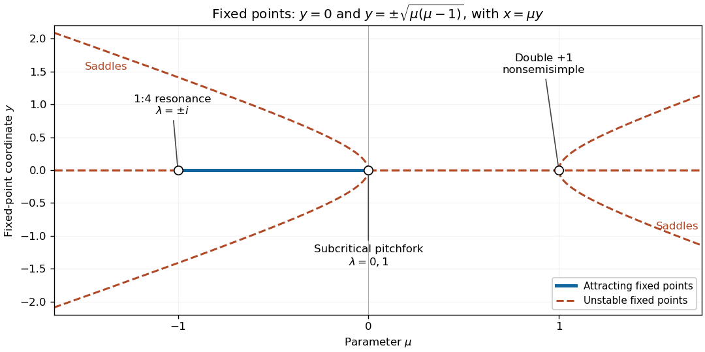

<h1 id="2/d/solution">Solution</h1>

↑ **Parent:** [D](../d.md)

Use $y$ vertically and $\mu$ horizontally in the [bifurcation diagram](../../../../bifurcation-diagram.md); the other coordinate is recovered from $x=\mu y$. The origin is the horizontal branch $y=0$. Draw it solid on $-1<\mu<0$, where it is [asymptotically stable](../../../../asymptotic-stability.md), and dashed on the remaining [hyperbolic](../../../../hyperbolic-equilibrium-point.md) intervals, where it is unstable. Its three [nonhyperbolic fixed points](../../../../nonhyperbolic-equilibrium.md) in parameter space are marked at $\mu=-1,0,1$; open markers distinguish these boundary cases from the strict [linear stability](../../../../linear-stability.md) classifications on the intervening intervals.

The nonzero [fixed point](../../../../fixed-point.md) branches are $y=\pm\sqrt{\mu(\mu-1)}$ for $\mu<0$ and $\mu>1$. Each is dashed because it is a [saddle fixed point of a map](../../../../saddle-fixed-point-of-a-map.md), as proved in part (c). Near zero their shape is $y\sim\pm\sqrt{-\mu}$: the unstable branches lie on the same parameter side as the attracting origin, displaying the [subcritical pitchfork bifurcation](../../../../subcritical-pitchfork-bifurcation.md). The branches issuing from $\mu=1$ have $y\sim\pm\sqrt{\mu-1}$. At $\mu=-1$ no additional [fixed point](../../../../fixed-point.md) branch appears; the [Floquet multipliers](../../../../floquet-multiplier.md) cross the [unit circle](../../../../complex-unit-circle.md) at $\pm i$.

**[Figure 1](#2/d/image-fixed-point-bifurcation-diagram-solid-denotes-attracting-dashed-denotes-unstable-and-open-circles-mark-the-three-unit-circle-crossings-at-the-origin-nonzero-branches-are-saddles). Fixed-point bifurcation diagram: solid denotes attracting, dashed denotes unstable, and open circles mark the three unit-circle crossings at the origin. Nonzero branches are saddles.**

## ↑ Ancestors (12)

1. [D](../d.md)
2. [2](../../2.md)
3. [2023](../../../2023-split.md)
4. [Past exam of the nonlinear systems course of the University of Oxford](../../../split.md)
5. [Nonlinear systems course of the University of Oxford](../../../../nonlinear-systems-course-of-the-university-of-oxford.md)
6. [Year 3 of the mathematics course of the University of Oxford](../../../../year-3-of-the-mathematics-course-of-the-university-of-oxford.md)
7. [Mathematics course of the University of Oxford](../../../../mathematics-course-of-the-university-of-oxford.md)
8. [Undergraduate course of the University of Oxford](../../../../undergraduate-course-of-the-university-of-oxford.md)
9. [Course of the University of Oxford](../../../../course-of-the-university-of-oxford.md)
10. [University of Oxford](../../../../university-of-oxford-split.md)
11. [List of universities](../../../../list-of-universities.md)
12. [Codex Wiki](../../../../split.md)
