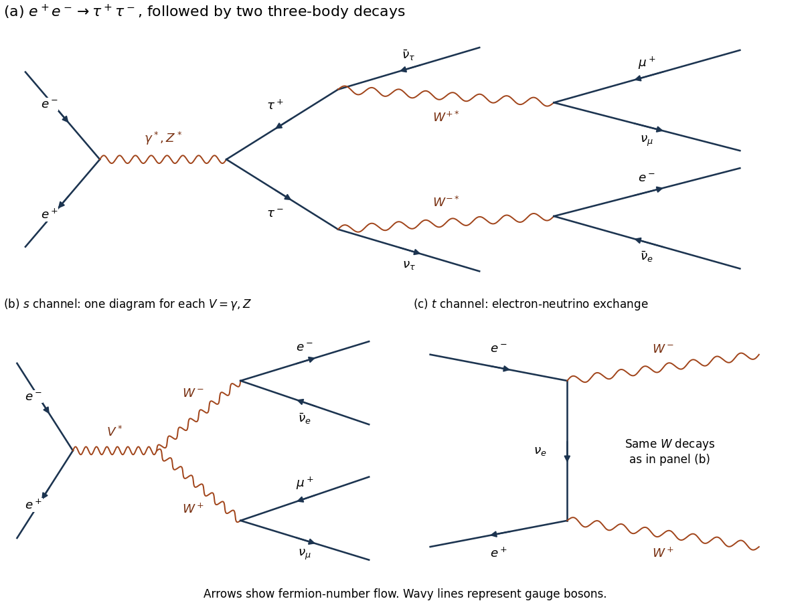
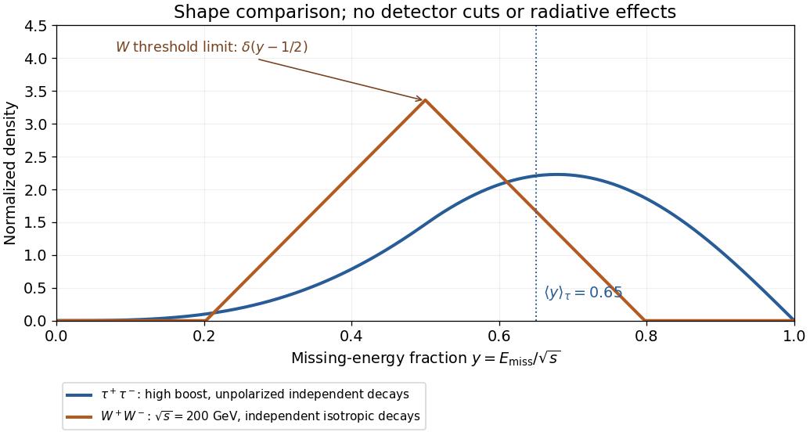

<h1 id="1/b/solution">Solution</h1>

↑ **Parent:** [B](../b.md)

**Two mechanisms are a [tau lepton](../../../../tau-particle.md) pair with two leptonic decays, and a [W boson](../../../../w-boson.md) pair with two leptonic decays.** With equal beam [energies](../../../../energy-split.md), the laboratory is the [centre-of-mass frame](../../../../center-of-momentum-frame.md), and [four-momentum conservation](../../../../four-momentum-conservation.md) gives $E_{\rm miss}=\sqrt{s}-E_{e^-}-E_{\mu^+}$ in [natural units](../../../../natural-units.md).

For the first mechanism,

$$
e^+e^-\to\gamma^*,Z^*\to\tau^+\tau^-,\qquad
\tau^+\to\mu^+\nu_\mu\bar\nu_\tau,\qquad
\tau^-\to e^-\bar\nu_e\nu_\tau.
$$

There are four escaping [neutrinos](../../../../neutrino.md). Each [tau lepton](../../../../tau-particle.md) decay proceeds through a virtual [W boson](../../../../w-boson.md). The fixed-charge final state has [branching fraction](../../../../branching-fraction.md) $B_\mu B_e$; the factor two for the inclusive $e^\pm\mu^\mp$ sample does not apply when the charges are specified.

For the second mechanism,

$$
e^+e^-\to W^+W^-,\qquad
W^+\to\mu^+\nu_\mu,\qquad W^-\to e^-\bar\nu_e.
$$

There are two escaping [neutrinos](../../../../neutrino.md). The leading [Feynman diagrams](../../../../feynman-diagram.md) comprise both $s$-channel [photon](../../../../photon.md)/[Z boson](../../../../z-boson.md) exchange and $t$-channel [electron neutrino](../../../../electron-neutrino.md) exchange. Their [scattering amplitudes](../../../../scattering-amplitude.md) interfere; the complete set is needed for a consistent high-[energy](../../../../energy-split.md) prediction. In particular, the neutrino-exchange diagram alone does not define an independently observable production rate.

**[Figure 1](#1/b/image-tau-pair-decay-and-the-three-leading-w-pair-production-diagrams). Tau-pair decay and the three leading W-pair production diagrams**.

A [tau lepton](../../../../tau-particle.md) pair has enhanced production at the [Z boson](../../../../z-boson.md) [particle resonance](../../../../particle-resonance.md), $\sqrt{s}\simeq91\,\mathrm{GeV}$. The four-[neutrino](../../../../neutrino.md) [missing energy](../../../../missing-energy.md) has a broad continuous distribution. To derive a useful schematic, neglect daughter [masses](../../../../mass.md) and parent [spin](../../../../spin.md) correlations. In an unpolarized [tau lepton](../../../../tau-particle.md) rest frame, the [Michel spectrum](../../../../michel-spectrum.md) for $x=2E_\ell^*/m_\tau$ is

$$
f(x)=2x^2(3-2x),\qquad0\leq x\leq1,\qquad \langle x\rangle=\frac7{10}.
$$

A [Lorentz boost](../../../../lorentz-boost.md) gives $E_\ell/E_\tau=x(1+\beta_\tau u)/2$, with $u=\cos\theta^*$ uniform on $[-1,1]$ in this approximation. For $\beta_\tau\simeq1$, the charged-daughter [probability density function](../../../../probability-density-function.md) in $z=E_\ell/E_\tau$ is

$$
g(z)=\int_z^1\frac{f(x)}{x}\,dx
=\frac53-3z^2+\frac43z^3,\qquad0\leq z\leq1.
$$

For two independent decays, $y=E_{\rm miss}/\sqrt{s}=1-(z_1+z_2)/2$ has the [convolution](../../../../convolution.md)

$$
p_\tau(y)=2\int_{\max(0,1-2y)}^{\min(1,2-2y)}
g(z)g(2-2y-z)\,dz,\qquad0\leq y\leq1,
$$

and $\langle y\rangle=0.65$. It vanishes at both endpoints and peaks on the larger-missing-[energy](../../../../energy-split.md) side. This is a shape illustration, not the exact polarized [Z boson](../../../../z-boson.md) prediction; [spin](../../../../spin.md) correlations, acceptance, and radiative effects alter it.

The [W boson](../../../../w-boson.md) process turns on near $\sqrt{s}=2m_W\simeq161\,\mathrm{GeV}$. At exact on-shell [production threshold](../../../../particle-production-threshold.md), each [neutrino](../../../../neutrino.md) has [energy](../../../../energy-split.md) $m_W/2$, so

$$
\boxed{E_{\rm miss}=m_W=\frac{\sqrt{s}}2\quad\text{at threshold}.}
$$

The [cross section](../../../../cross-section-physics.md) vanishes at the ideal two-body threshold, so this narrow limiting spectrum must not be called the maximum-rate spectrum. The large [W boson](../../../../w-boson.md)-pair rate occurs above threshold, around $200\,\mathrm{GeV}$. There $\beta_W=\sqrt{1-4m_W^2/s}$ and each [neutrino](../../../../neutrino.md) has

$$
E_\nu=\frac{\sqrt{s}}4(1+\beta_W\cos\theta^*),\qquad
\frac{\sqrt{s}}4(1-\beta_W)\leq E_\nu\leq\frac{\sqrt{s}}4(1+\beta_W).
$$

Thus

$$
\boxed{\frac{1-\beta_W}{2}\leq\frac{E_{\rm miss}}{\sqrt{s}}\leq\frac{1+\beta_W}{2}.}
$$

An isotropic independent-decay schematic is triangular, centered at $E_{\rm miss}/\sqrt{s}=1/2$, with endpoints approximately $0.20$ and $0.80$ at $200\,\mathrm{GeV}$. Actual [W boson](../../../../w-boson.md) [particle polarizations](../../../../particle-polarization.md) and their correlations change this shape; their [V-A interaction](../../../../v-a-interaction.md) is not isotropic for a fixed [helicity](../../../../helicity.md). The finite [decay width](../../../../decay-width.md), beam spread, and radiation also smear the edges.

**[Figure 2](#1/b/image-missing-energy-shapes-for-explicitly-stated-spin-averaged-decay-approximations). Missing-energy shapes for explicitly stated spin-averaged decay approximations**.

The phrase “maximum rate” also needs a production regime: a [Z boson](../../../../z-boson.md) peak is a resonant maximum, whereas pure [photon](../../../../photon.md)-mediated [tau lepton](../../../../tau-particle.md) production has its continuum maximum near $4.2\,\mathrm{GeV}$. Indeed, $\sigma_\gamma\propto\beta_\tau(3-\beta_\tau^2)/s$ has $s=(1+\sqrt{21})m_\tau^2$. The displayed high-boost curve describes the resonant regime; at the continuum maximum use $\beta_\tau\simeq0.532$ in the boost formula. An observed event-rate maximum additionally depends on [collider luminosity](../../../../collider-luminosity.md) and [detection efficiency](../../../../detection-efficiency.md).

## ↑ Ancestors (12)

1. [B](../b.md)
2. [1](../../1.md)
3. [2021](../../../2021-split.md)
4. [Past exam of the nuclear and particle physics course of the University of Oxford](../../../split.md)
5. [Nuclear and particle physics course of the University of Oxford](../../../../nuclear-and-particle-physics-course-of-the-university-of-oxford.md)
6. [Year 3 of the physics course of the University of Oxford](../../../../year-3-of-the-physics-course-of-the-university-of-oxford.md)
7. [Physics course of the University of Oxford](../../../../physics-course-of-the-university-of-oxford.md)
8. [Undergraduate course of the University of Oxford](../../../../undergraduate-course-of-the-university-of-oxford.md)
9. [Course of the University of Oxford](../../../../course-of-the-university-of-oxford.md)
10. [University of Oxford](../../../../university-of-oxford-split.md)
11. [List of universities](../../../../list-of-universities.md)
12. [Codex Wiki](../../../../split.md)
