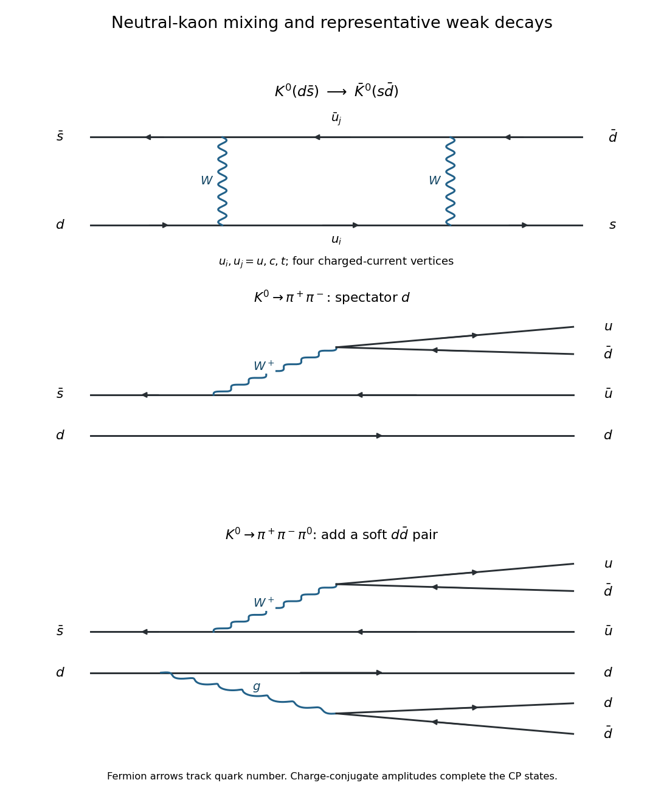
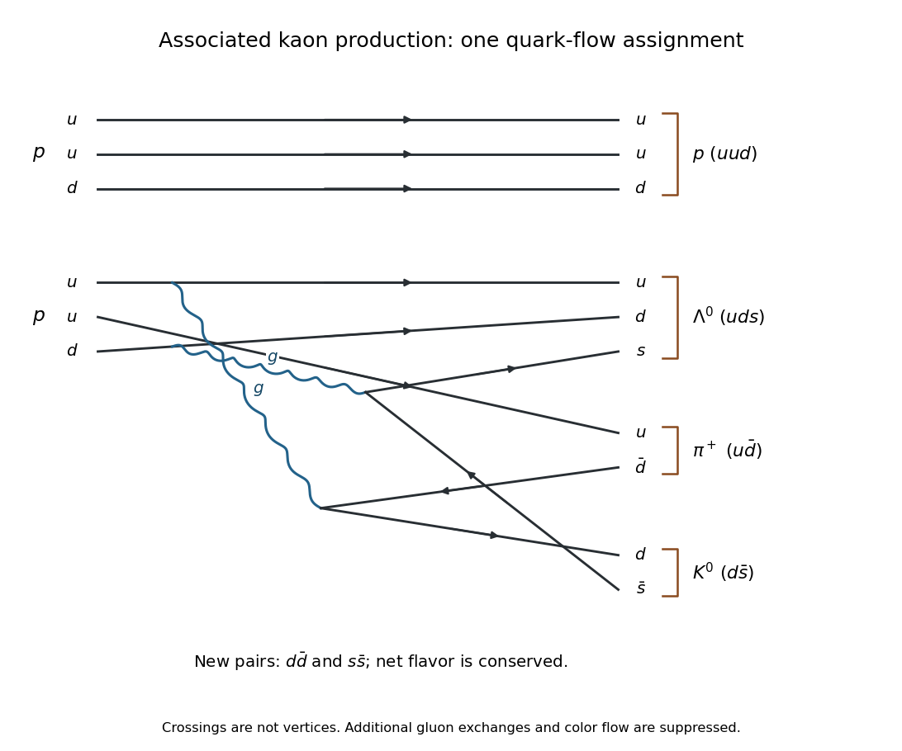
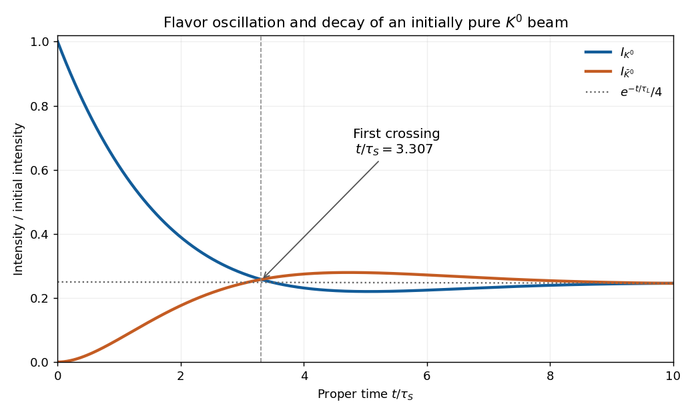
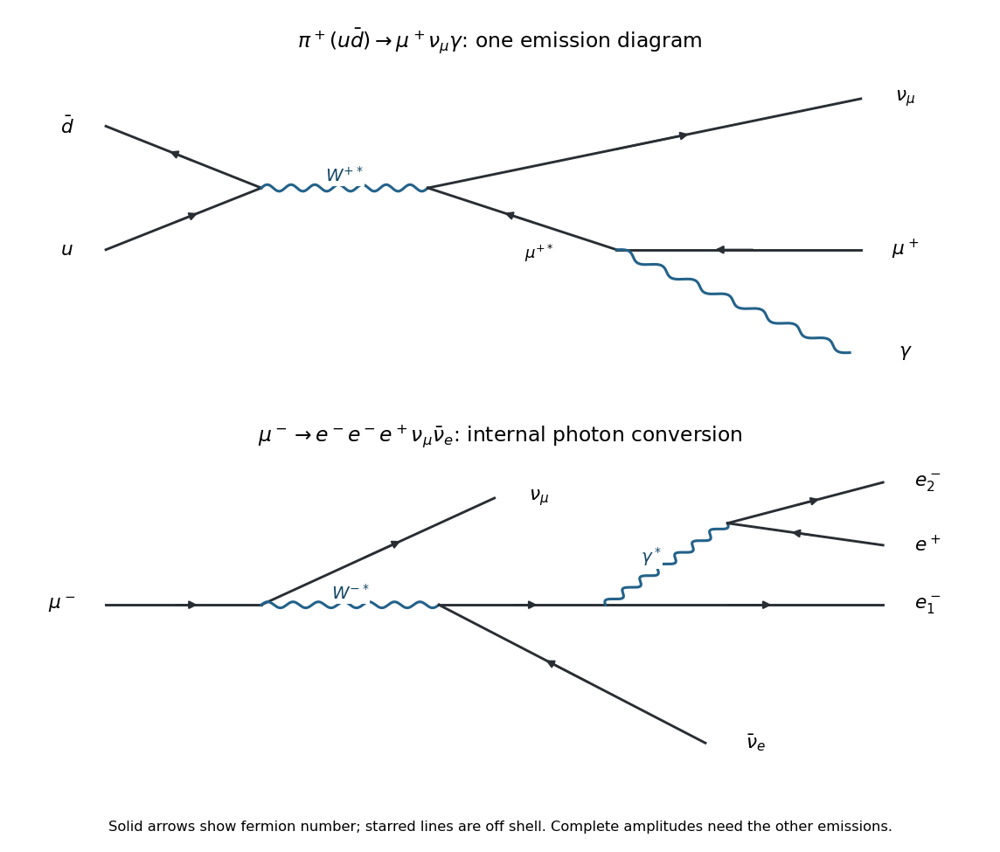
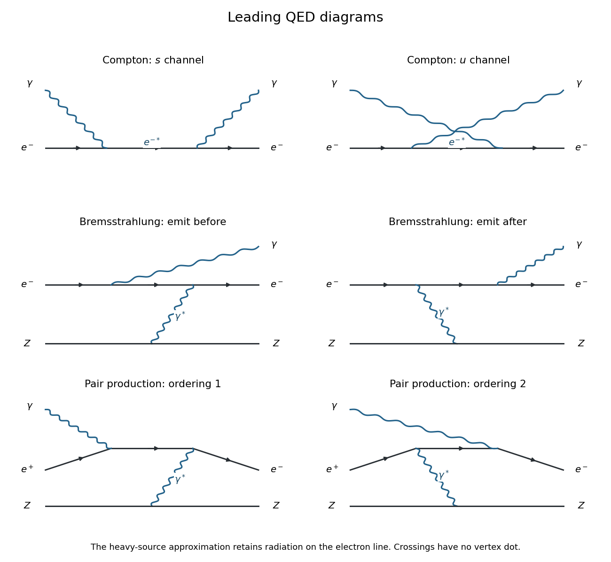
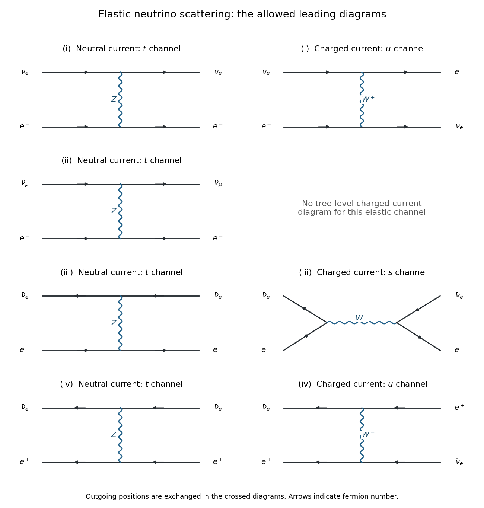
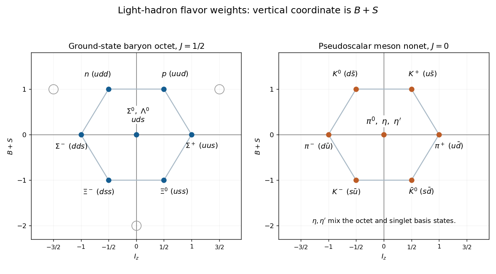

# 2022

↑ **Parent:** [Past exam of the nuclear and particle physics course of the University of Oxford](../past-exam-of-the-nuclear-and-particle-physics-course-of-the-university-of-oxford.md)

Source: [https://www.whatdotheyknow.com/request/oxford_physics_past_papers_2/response/2340696/attach/10/Physics%20Papers%202021.pdf?cookie_passthrough=1](https://www.whatdotheyknow.com/request/oxford_physics_past_papers_2/response/2340696/attach/10/Physics%20Papers%202021.pdf?cookie_passthrough=1)

Source bundle pages 134–138. The paper cover establishes 2022; the attachment filename uses 2021. All times in the [kaon](../physics.md#kaon) calculations are [proper times](../special-relativity.md#proper-time), unless a laboratory conversion is explicitly made. The [CP symmetry](../quantum-field-theory.md#cp-symmetry) approximation is used where the paper identifies the physical short- and long-lived states with [kaon CP eigenstates](../physics.md#kaon-cp-eigenstates).

**Table of contents**

- [1](#1)
  - [a](#1/a)
    - [Solution](#1/a/solution)
  - [b](#1/b)
    - [Solution](#1/b/solution)
  - [c](#1/c)
    - [Solution](#1/c/solution)
  - [d](#1/d)
    - [Solution](#1/d/solution)
  - [e](#1/e)
    - [Solution](#1/e/solution)
- [2](#2)
  - [a](#2/a)
    - [Solution](#2/a/solution)
  - [b](#2/b)
    - [Solution](#2/b/solution)
  - [c](#2/c)
    - [Solution](#2/c/solution)
  - [d](#2/d)
    - [Solution](#2/d/solution)
  - [e](#2/e)
    - [Solution](#2/e/solution)
  - [f](#2/f)
    - [i](#2/f/i)
      - [Solution](#2/f/i/solution)
    - [ii](#2/f/ii)
      - [Solution](#2/f/ii/solution)
    - [iii](#2/f/iii)
      - [Solution](#2/f/iii/solution)
    - [iv](#2/f/iv)
      - [Solution](#2/f/iv/solution)
  - [g](#2/g)
    - [Solution](#2/g/solution)
- [3](#3)
  - [a](#3/a)
    - [Solution](#3/a/solution)
  - [b](#3/b)
    - [Solution](#3/b/solution)
  - [c](#3/c)
    - [Solution](#3/c/solution)
  - [d](#3/d)
    - [i](#3/d/i)
      - [Solution](#3/d/i/solution)
    - [ii](#3/d/ii)
      - [Solution](#3/d/ii/solution)
    - [iii](#3/d/iii)
      - [Solution](#3/d/iii/solution)
- [4](#4)
  - [a](#4/a)
    - [Solution](#4/a/solution)
  - [b](#4/b)
    - [Solution](#4/b/solution)
  - [c](#4/c)
    - [Solution](#4/c/solution)
  - [d](#4/d)
    - [Solution](#4/d/solution)
  - [e](#4/e)
    - [Solution](#4/e/solution)
  - [f](#4/f)
    - [Solution](#4/f/solution)
  - [g](#4/g)
    - [Solution](#4/g/solution)

## 1

↑ **Parent:** [2022](2022.md)

<h3 id="1/a">a</h3>

↑ **Parent:** [1](#1)

<h4 id="1/a/solution">Solution</h4>

↑ **Parent:** [A](#1/a)

With the [valence quark](../standard-model.md#valence-quark) assignments $K^0=d\bar s$ and $\bar K^0=s\bar d$, [neutral kaon mixing](../physics.md#neutral-kaon-mixing) changes [strangeness](../standard-model.md#strangeness) by two units. A representative leading [Standard Model](../standard-model.md) contribution is a [box Feynman diagram](../perturbative-quantum-field-theory.md#box-feynman-diagram) with two [W bosons](../standard-model.md#w-boson) and two internal up-type [quarks](../standard-model.md#quark):

$$
d\longrightarrow u_i\longrightarrow s,\qquad
\bar s\longrightarrow\bar u_j\longrightarrow\bar d,
\qquad u_i,u_j\in\{u,c,t\}.
$$

The two lines exchange the two [W bosons](../standard-model.md#w-boson). There are four [weak charged current](../standard-model.md#charged-current) [interaction vertices](../perturbative-quantum-field-theory.md#interaction-vertex), so the [scattering amplitude](../quantum-scattering.md#scattering-amplitude) is fourth order in the weak [gauge coupling](../relativistic-quantum-field.md#gauge-coupling), or second order in the [Fermi constant](../quantum-field-theory.md#fermi-constant). The full result sums the internal [quark flavors](../standard-model.md#quark-flavor) with their [Cabibbo-Kobayashi-Maskawa matrix](../standard-model.md#cabibbo-kobayashi-maskawa-matrix) factors; one box alone illustrates the mechanism.

**[Figure 1](#1/a/image-representative-charged-current-box-and-two-and-three-pion-kaon-decay-diagrams). Representative charged-current box and two- and three-pion kaon decay diagrams**.

<h3 id="1/b">b</h3>

↑ **Parent:** [1](#1)

<h4 id="1/b/solution">Solution</h4>

↑ **Parent:** [B](#1/b)

A [kaon](../physics.md#kaon) is a [pseudoscalar meson](../physics.md#pseudoscalar-meson), with [intrinsic parity](../quantum-field-theory.md#intrinsic-parity) $-1$. At rest, $P|\pm\rangle=-|\pm\rangle$. Combining this with the specified [CP](../quantum-field-theory.md#cp-symmetry) [eigenvalues](../linear-operator-theory.md#eigenvalue) gives

$$
\boxed{C|+\rangle=-|+\rangle,\qquad C|-\rangle=+|-\rangle.}
$$

Equivalently, in the [exchange-positive CP convention for neutral kaon mixing](../physics.md#exchange-positive-cp-convention-for-neutral-kaon-mixing) fixed by the question, $C|K^0\rangle=-|\bar K^0\rangle$ and $C|\bar K^0\rangle=-|K^0\rangle$. This sign is a convention for the flavor states; the specified [CP](../quantum-field-theory.md#cp-symmetry) [eigenvalues](../linear-operator-theory.md#eigenvalue) and physical predictions must be kept consistent with it.

For two spin-zero [pions](../standard-model.md#pion), conservation of total [angular momentum](../momentum.md#angular-momentum) fixes the relative [orbital angular momentum](../quantum-mechanics.md#orbital-angular-momentum) to zero. The resulting $\pi^+\pi^-$ or $\pi^0\pi^0$ state has [CP](../quantum-field-theory.md#cp-symmetry) $+1$. The lowest [partial waves](../quantum-scattering.md#partial-wave) of $\pi^+\pi^-\pi^0$ and $3\pi^0$ have [CP](../quantum-field-theory.md#cp-symmetry) $-1$. Thus the dominant nonleptonic assignments in the [CP symmetry](../quantum-field-theory.md#cp-symmetry) approximation are

$$
\boxed{|K_S\rangle\simeq|+\rangle\to2\pi,\qquad
|K_L\rangle\simeq|-\rangle\to3\pi.}
$$

The two-[pion](../standard-model.md#pion) mode has substantially more available [kinetic energy](../energy.md#kinetic-energy) and larger [Lorentz-invariant phase space](../relativistic-quantum-field.md#lorentz-invariant-phase-space); the three-[pion](../standard-model.md#pion) mode has an additional final particle and lies closer to its [decay threshold](../physics.md#decay-threshold). This helps explain why the [CP](../quantum-field-theory.md#cp-symmetry)-odd state has the longer [mean lifetime](../relativistic-quantum-field.md#mean-lifetime-physics). The actual [mean lifetimes](../relativistic-quantum-field.md#mean-lifetime-physics) also depend on the [decay amplitudes](../relativistic-quantum-field.md#decay-amplitude) and on semileptonic channels, so counting final particles alone is not a quantitative prediction.

The middle panel of the figure in part (a) shows $\bar s\to\bar uW^+$, $W^+\to u\bar d$, with the $d$ as a [spectator quark](../standard-model.md#spectator-quark). The outgoing $d\bar u$ and $u\bar d$ form $\pi^-$ and $\pi^+$. In the bottom panel, an additional [gluon](../standard-model.md#gluon) produces $d\bar d$, supplying the neutral [pion](../standard-model.md#pion) component for $\pi^+\pi^-\pi^0$. The charge-conjugate diagrams supply the other component of each of the [kaon CP eigenstates](../physics.md#kaon-cp-eigenstates). The drawn [gluon](../standard-model.md#gluon) splitting represents nonperturbative [hadronization](../standard-model.md#hadronization), rather than a quantitatively reliable perturbative prediction at the [kaon](../physics.md#kaon) scale.

These multiplicities describe the dominant low-[orbital angular momentum](../quantum-mechanics.md#orbital-angular-momentum) modes, not an absolute rule for every three-[pion](../standard-model.md#pion) configuration. In $\pi^+\pi^-\pi^0$, odd [orbital angular momentum](../quantum-mechanics.md#orbital-angular-momentum) values of the charged pair and of its motion relative to $\pi^0$ can couple to total zero and give [CP](../quantum-field-theory.md#cp-symmetry) $+1$, but are strongly suppressed near [decay threshold](../physics.md#decay-threshold). Physical $K_L\to2\pi$ also occurs through [CP violation](../quantum-field-theory.md#cp-violation).

<h3 id="1/c">c</h3>

↑ **Parent:** [1](#1)

<h4 id="1/c/solution">Solution</h4>

↑ **Parent:** [C](#1/c)

Put $M_f=m_p+m_{\pi^+}+m_\Lambda+m_{K^0}$. In [natural units](../mathematical-physics.md#natural-units), a stationary target [proton](../physics.md#proton) and a beam [proton](../physics.md#proton) of total [energy](../energy.md) $E_b$ have the [Mandelstam invariant](../special-relativity.md#mandelstam-variables)

$$
s=(p_b+p_t)^2=2m_p^2+2m_pE_b.
$$

At [fixed-target production threshold](../special-relativity.md#fixed-target-production-threshold) the final particles have zero relative [momentum](../momentum.md) in their [centre-of-mass frame](../special-relativity.md#center-of-momentum-frame), so $s=M_f^2$. Restoring $c$, the total beam [energy](../energy.md) and its [kinetic energy](../energy.md#kinetic-energy) are

$$
\boxed{E_{b,\mathrm{thr}}=\frac{M_f^2-2m_p^2}{2m_p}c^2,\qquad
T_{b,\mathrm{thr}}=\frac{M_f^2-4m_p^2}{2m_p}c^2.}
$$

Using rounded [masses](../classical-mechanics.md#mass) in $\mathrm{MeV}/c^2$, $(938.27,139.57,1115.68,497.61)$, gives $E_{b,\mathrm{thr}}\simeq2.921\,\mathrm{GeV}$ and $T_{b,\mathrm{thr}}\simeq1.983\,\mathrm{GeV}$.

One possible [strong interaction](../standard-model.md#strong-interaction) [quark-line flavour rearrangement](../standard-model.md#quark-line-flavour-rearrangement) is

$$
(uud)+(uud)\longrightarrow
\underbrace{uud}_{p}+\underbrace{uds}_{\Lambda^0}
+\underbrace{u\bar d}_{\pi^+}+\underbrace{d\bar s}_{K^0}.
$$

It needs newly created $d\bar d$ and $s\bar s$ pairs, with no net change of any [quark flavor](../standard-model.md#quark-flavor). For example, keep the first $uud$ as the outgoing [proton](../physics.md#proton); allocate the second incoming $u,d$ and the new $s$ to $\Lambda^0$, the remaining incoming $u$ and new $\bar d$ to $\pi^+$, and the new $d,\bar s$ to $K^0$. Two [gluon](../standard-model.md#gluon) splittings illustrate this flow. This is a possible [hadronization](../standard-model.md#hadronization) topology, not a unique perturbative description of the [proton](../physics.md#proton) collision.

**[Figure 2](#1/c/image-one-flavor-conserving-quark-flow-assignment-for-associated-neutral-kaon-production). One flavor-conserving quark-flow assignment for associated neutral-kaon production**.

After several short [mean lifetimes](../relativistic-quantum-field.md#mean-lifetime-physics), the surviving coherent beam is approximately $|K_L\rangle=(|K^0\rangle-|\bar K^0\rangle)/\sqrt2$. In ordinary matter the [forward scattering amplitudes](../quantum-scattering.md#forward-scattering-amplitude) of $K^0$ and $\bar K^0$ differ. For example, the $s$ in a [neutral antikaon](../physics.md#neutral-antikaon) can enter a strange [baryon](../physics.md#baryon) through strong absorption; the opposite [strangeness](../standard-model.md#strangeness) assignment has different available channels. If their forward [transmission amplitudes](../quantum-scattering.md#transmission-amplitude) through a thin block are $t_0$ and $\bar t_0$, respectively, then

$$
\boxed{|K_L\rangle\longmapsto
\frac{t_0+\bar t_0}{2}|K_L\rangle+
\frac{t_0-\bar t_0}{2}|K_S\rangle.}
$$

Thus the transmitted forward beam contains a regenerated short-lived component, with prompt two-[pion](../standard-model.md#pion) decays after the block. Differential absorption changes the intensities as well as the relative phase. Scattered particles outside the forward beam can provide an incoherent component. This [neutral kaon regeneration](../quantum-field-theory.md#neutral-kaon-regeneration) does not require [CP violation](../quantum-field-theory.md#cp-violation): the material itself distinguishes matter and antimatter.

<h3 id="1/d">d</h3>

↑ **Parent:** [1](#1)

<h4 id="1/d/solution">Solution</h4>

↑ **Parent:** [D](#1/d)

For a narrow unstable state, the effective [Hamiltonian](../hamiltonian-mechanics.md#hamiltonian) has the complex [eigenvalue](../linear-operator-theory.md#eigenvalue) $m_j-i\Gamma_j/2$. With [natural units](../mathematical-physics.md#natural-units) and $\Gamma_j=1/\tau_j$, its [Schrödinger equation](../mathematical-physics.md#schrodinger-equation) gives

$$
A_j(t)=A_j(0)e^{-im_jt}e^{-t/(2\tau_j)},\qquad j=S,L.
$$

The first factor is the ordinary [energy](../energy.md) phase; squaring the second gives the [exponential decay](../analysis.md#exponential-decay) of the survival [probability](../probability-theory.md#probability), $e^{-t/\tau_j}$. This assumes the approximately constant [decay rate](../relativistic-quantum-field.md#decay-width) regime; exact very early and very late behavior need not be exponential.

Writing the surviving state as $A_S(t)|K_S\rangle+A_L(t)|K_L\rangle$, invert the two [kaon CP eigenstates](../physics.md#kaon-cp-eigenstates) definitions:

$$
\boxed{A_{K^0}(t)=\frac{A_S(t)+A_L(t)}{\sqrt2},\qquad
A_{\bar K^0}(t)=\frac{A_S(t)-A_L(t)}{\sqrt2}.}
$$

Here $t$ is the [proper time](../special-relativity.md#proper-time). For a relativistic beam of fixed [Lorentz factor](../special-relativity.md#lorentz-factor) $\gamma$, substitute $t=t_{\mathrm{lab}}/\gamma$; in ordinary units the [mass](../classical-mechanics.md#mass) phase is $m_jc^2t/\hbar$.

<h3 id="1/e">e</h3>

↑ **Parent:** [1](#1)

<h4 id="1/e/solution">Solution</h4>

↑ **Parent:** [E](#1/e)

Normalize the incident intensity to one. Since $|K^0\rangle=(|K_S\rangle+|K_L\rangle)/\sqrt2$, the initial [probability amplitudes](../wave-function.md#probability-amplitude) are $A_S(0)=A_L(0)=1/\sqrt2$. Define $g_j=e^{-im_jt}e^{-t/(2\tau_j)}$. The flavor [probability amplitudes](../wave-function.md#probability-amplitude) are $(g_S+g_L)/2$ and $(g_S-g_L)/2$. Their absolute squares are

$$
\boxed{I_{K^0}(t)=\frac14\left[e^{-t/\tau_S}+e^{-t/\tau_L}
+2e^{-\frac t2(1/\tau_S+1/\tau_L)}\cos(\Delta m\,t)\right],}
$$

$$
\boxed{I_{\bar K^0}(t)=\frac14\left[e^{-t/\tau_S}+e^{-t/\tau_L}
-2e^{-\frac t2(1/\tau_S+1/\tau_L)}\cos(\Delta m\,t)\right],}
$$

where $\Delta m=m_L-m_S$ in [natural units](../mathematical-physics.md#natural-units). Thus $A=B=1/4$ for both, $\phi=\Delta m\,t$, and

$$
\boxed{C_{K^0}(t)=\tfrac12e^{-\frac t2(1/\tau_S+1/\tau_L)},\qquad
C_{\bar K^0}(t)=-\tfrac12e^{-\frac t2(1/\tau_S+1/\tau_L)}.}
$$

Multiplying all three coefficients by the incident intensity gives any other normalization. Crucially, **$C$ is time dependent**. The printed template cannot hold with all of $A,B,C$ constant. For example, a nonzero constant $C$ would leave an undamped oscillation at arbitrarily late times, even after both unstable components have decayed.

In seconds, $\phi=\Delta m\,c^2t/\hbar$. With $x=t/\tau_S$, the supplied [mass](../classical-mechanics.md#mass) difference and [mean lifetimes](../relativistic-quantum-field.md#mean-lifetime-physics) give

$$
r_\tau=\tau_S/\tau_L=0.00172934,\qquad
\phi=0.474975x,
$$

$$
I_{K^0,\bar K^0}(x)=\frac14\left[e^{-x}+e^{-r_\tau x}
\mathbin{\pm}2e^{-(1+r_\tau)x/2}\cos(0.474975x)\right].
$$

Initially the intensities are one and zero. Their sum is $\tfrac12(e^{-x}+e^{-r_\tau x})$, so these are unconditioned survival intensities, not [probabilities](../probability-theory.md#probability) conditioned on survival. The curves first meet at $x=\pi/(2\times0.474975)\simeq3.307$. Thereafter the [neutral antikaon](../physics.md#neutral-antikaon) component briefly exceeds the $K^0$ component, before the [interference](../physical-optics.md#interference-wave-propagation) dies away and both approach the surviving long-lived intensity $e^{-r_\tau x}/4$.

**[Figure 3](#1/e/image-neutral-kaon-flavor-intensities-for-an-initially-pure-neutral-kaon-beam-versus-proper-time). Neutral-kaon flavor intensities for an initially pure neutral-kaon beam, versus proper time**.

## 2

↑ **Parent:** [2022](2022.md)

<h3 id="2/a">a</h3>

↑ **Parent:** [2](#2)

<h4 id="2/a/solution">Solution</h4>

↑ **Parent:** [A](#2/a)

In [Fermi's golden rule](../quantum-mechanics.md#fermi-s-golden-rule),

$$
\Gamma=\frac{2\pi}{\hbar}|M|^2\rho,
$$

$\Gamma$ is a transition [decay rate](../relativistic-quantum-field.md#decay-width), measured in inverse time; $\hbar$ is the [reduced Planck constant](../quantum-mechanics.md#reduced-planck-constant); $M=\langle f|H_{\mathrm{int}}|i\rangle$ is the transition [matrix element](../vector-space.md#matrix-element) of the interaction part of the [Hamiltonian](../hamiltonian-mechanics.md#hamiltonian); and $\rho$ is the final [density of states](../quantum-ideal-gas-statistics.md#density-of-states) per unit [energy](../energy.md), evaluated subject to [conservation of energy](../mathematical-physics.md#conservation-of-energy). Final [spin](../angular-momentum-operator.md#spin) and other discrete labels must be summed, with initial labels averaged when the preparation requires it. If $M$ varies across the final [phase space](../hamiltonian-mechanics.md#phase-space), $|M|^2\rho$ denotes the corresponding integral rather than a product of constants.

A convention warning: many [quantum field theory](../quantum-field-theory.md) texts use $\Gamma$ for an [energy](../energy.md) [decay width](../relativistic-quantum-field.md#decay-width). That convention is $\Gamma_{\mathrm{width}}=\hbar\Gamma_{\mathrm{rate}}$; the formula as printed uses the rate convention.

<h3 id="2/b">b</h3>

↑ **Parent:** [2](#2)

<h4 id="2/b/solution">Solution</h4>

↑ **Parent:** [B](#2/b)

A representative [Feynman diagram](../perturbative-quantum-field-theory.md#feynman-diagram) annihilates $u\bar d$ into $W^{+*}$, producing $\nu_\mu$ and an off-shell $\mu^+$; the charged [antilepton](../standard-model.md#antilepton) emits a [photon](../quantum-mechanics.md#photon) and becomes the outgoing $\mu^+$. The top panel below shows this contribution. A complete [gauge-invariant](../relativistic-quantum-field.md#gauge-invariance) [decay amplitude](../relativistic-quantum-field.md#decay-amplitude) includes radiation from the charged hadronic side, together with structure-dependent terms. The physical separation into inner [bremsstrahlung](../electromagnetic-radiation.md#bremsstrahlung), structure-dependent radiation, and their [interference](../physical-optics.md#interference-wave-propagation) is explicit in the standard [radiative pion decay](../standard-model.md#radiative-pion-decay) description.[Section 62.1, equations (62.1)–(62.4): decomposition into inner bremsstrahlung, structure-dependent radiation and interference](../physics-bibliography.md#radiative-pion-and-kaon-decay-form-factors-in-the-2025-review-of-particle-physics)

**[Figure 4](#2/b/image-representative-radiative-pion-decay-and-internal-conversion-muon-decay-diagrams). Representative radiative pion decay and internal-conversion muon decay diagrams**.

Here is an explicit finite **model of [phase space](../hamiltonian-mechanics.md#phase-space) alone**, with its assumptions exposed. Neglect the [neutrino](../standard-model.md#neutrino) [mass](../classical-mechanics.md#mass), treat the [photon](../quantum-mechanics.md#photon) as massless, and replace the spin-summed invariant [decay amplitudes](../relativistic-quantum-field.md#decay-amplitude) by constants over the available [Lorentz-invariant phase space](../relativistic-quantum-field.md#lorentz-invariant-phase-space). Write $M=m_\pi$, $m=m_\mu$, $r=m^2/M^2$, and use [natural units](../mathematical-physics.md#natural-units). The [three-body phase space with one massive daughter](../relativistic-quantum-field.md#three-body-phase-space-with-one-massive-daughter) follows by factoring through an intermediate invariant squared [mass](../classical-mechanics.md#mass) $s$:

$$
\Phi_3(M;m,0,0)=\frac{1}{128\pi^3M^2}
\int_{m^2}^{M^2}\frac{(M^2-s)(s-m^2)}{s}\,ds
=\frac{M^2}{256\pi^3}(1-r^2+2r\ln r).
$$

The two-body comparison has $\Phi_2(M;m,0)=(1-r)/(8\pi)$. Since $\Gamma_n=\overline{|\mathcal M_n|^2}\Phi_n/(2M)$, assuming $\overline{|\mathcal M_3|^2}/\overline{|\mathcal M_2|^2}=\kappa e^2/M^2$ gives

$$
\boxed{\frac{\Gamma_{\mu\nu\gamma}}{\Gamma_{\mu\nu}}
\simeq\frac{\kappa\alpha_{\mathrm{em}}}{8\pi}
\frac{1-r^2+2r\ln r}{1-r}.}
$$

Here $\kappa$ is a dimensionless constant encapsulating the assumed [matrix element](../vector-space.md#matrix-element) ratio, and $\alpha_{\mathrm{em}}$ is the [fine-structure constant](../perturbative-quantum-field-theory.md#fine-structure-constant). If the two-body mode dominates, this ratio approximates the radiative [branching fraction](../relativistic-quantum-field.md#branching-fraction). Near $m=M$, $1-r^2+2r\ln r=(1-r)^3/3+O((1-r)^4)$, displaying the extra [phase space](../hamiltonian-mechanics.md#phase-space) suppression.

**This model is not a prediction of a physical uncut radiative branching fraction.** Actual inner [bremsstrahlung](../electromagnetic-radiation.md#bremsstrahlung) has a soft-[photon](../quantum-mechanics.md#photon) singularity, so a count of events with a separately observed [photon](../quantum-mechanics.md#photon) requires a positive [photon](../quantum-mechanics.md#photon) [energy](../energy.md) cut. To see both the missing input and the [mass](../classical-mechanics.md#mass) dependence explicitly, the leading soft-[photon](../quantum-mechanics.md#photon) result for $E_{\mathrm{cut}}<E_\gamma<E_{\mathrm{soft}}\ll E_{\max}$ is

$$
\boxed{\frac{\Gamma_{\gamma,\mathrm{soft}}}{\Gamma_{\mu\nu}}
\simeq\frac{\alpha_{\mathrm{em}}}{\pi}
\left[\frac{1+r}{1-r}\ln\frac1r-2\right]
\ln\frac{E_{\mathrm{soft}}}{E_{\mathrm{cut}}},\quad
E_{\max}=\frac{M^2-m^2}{2M}.}
$$

The coefficient follows from the radiation factor $e[p_\mu\cdot\epsilon/(p_\mu\cdot k)-p_\pi\cdot\epsilon/(p_\pi\cdot k)]$: angular integration gives $\beta^{-1}\ln[(1+\beta)/(1-\beta)]-2$, where $\beta=(1-r)/(1+r)$, and the soft [energy](../energy.md) integral is $\int dE_\gamma/E_\gamma$. Thus a finite physical number cannot be deduced from the two [masses](../classical-mechanics.md#mass) and [phase space](../hamiltonian-mechanics.md#phase-space) alone. The [infrared divergence](../quantum-field-theory.md#infrared-divergence) cancels only when the corresponding unresolved real radiation and virtual [radiative corrections](../perturbative-quantum-field-theory.md#radiative-correction) are combined in an inclusive observable.

<h3 id="2/c">c</h3>

↑ **Parent:** [2](#2)

<h4 id="2/c/solution">Solution</h4>

↑ **Parent:** [C](#2/c)

For a three-body leptonic decay through the [Fermi interaction](../quantum-field-theory.md#fermi-interaction), neglecting daughter [masses](../classical-mechanics.md#mass) and [radiative corrections](../perturbative-quantum-field-theory.md#radiative-correction), [lepton universality](../standard-model.md#lepton-universality) gives

$$
\Gamma(\ell^-\to\ell^{\prime-}\bar\nu_{\ell'}\nu_\ell)
=\frac{G_F^2m_\ell^5}{192\pi^3}
$$

in [natural units](../mathematical-physics.md#natural-units). Therefore scaling the [muon decay](../standard-model.md#muon-decay) rate by $m_\tau^5/m_\mu^5$ predicts only one leptonic channel, not the total [tau lepton](../standard-model.md#tau-particle) [decay rate](../relativistic-quantum-field.md#decay-width).

The [tau lepton](../standard-model.md#tau-particle) has two allowed charged-lepton channels, $e^-\bar\nu_e\nu_\tau$ and $\mu^-\bar\nu_\mu\nu_\tau$, as well as hadronic channels from $W^{-*}\to d\bar u,s\bar u$. Each allowed [quark](../standard-model.md#quark) channel has three [color charge](../standard-model.md#color-charge) choices and its [Cabibbo-Kobayashi-Maskawa matrix](../standard-model.md#cabibbo-kobayashi-maskawa-matrix) factor. Charm production is kinematically inaccessible in a physical hadronic final state at this [mass](../classical-mechanics.md#mass). Treating the inclusive hadronic channels by a simple [quark-hadron duality](../standard-model.md#quark-hadron-duality) estimate,

$$
N_{\mathrm{eff}}\simeq2+3(|V_{ud}|^2+|V_{us}|^2)\simeq5.
$$

Thus, using $m_\mu\simeq105.7\,\mathrm{MeV}/c^2$ and $m_\tau\simeq1777\,\mathrm{MeV}/c^2$,

$$
\boxed{\tau_\tau\simeq\frac{2.2\times10^{-6}\,\mathrm s}{5}
\left(\frac{105.7}{1777}\right)^5\simeq3.3\times10^{-13}\,\mathrm s.}
$$

Finite daughter [masses](../classical-mechanics.md#mass), hadronic [decay thresholds](../physics.md#decay-threshold) and resonances, [Quantum chromodynamics](../standard-model.md#quantum-chromodynamics) [radiative corrections](../perturbative-quantum-field-theory.md#radiative-correction), and electroweak [radiative corrections](../perturbative-quantum-field-theory.md#radiative-correction) refine this estimate. The threefold [color multiplicity in a decay width](../standard-model.md#color-multiplicity-in-a-decay-width) and extra decay channels are the main correction to naive fifth-power scaling.

<h3 id="2/d">d</h3>

↑ **Parent:** [2](#2)

<h4 id="2/d/solution">Solution</h4>

↑ **Parent:** [D](#2/d)

[Feynman diagrams](../perturbative-quantum-field-theory.md#feynman-diagram) organize the perturbative calculation of the [matrix element](../vector-space.md#matrix-element) in [Fermi's golden rule](../quantum-mechanics.md#fermi-s-golden-rule). Each external line labels an incoming or outgoing particle state; each internal line contributes a [propagator](../quantum-field-theory.md#propagator) for a generally off-shell intermediate field; and each [interaction vertex](../perturbative-quantum-field-theory.md#interaction-vertex) contributes a coupling and the appropriate [spin](../angular-momentum-operator.md#spin), [momentum](../momentum.md) and internal-symmetry structure. All indistinguishable allowed diagrams must be summed as [probability amplitudes](../wave-function.md#probability-amplitude) before taking the absolute square, so their [interference](../physical-optics.md#interference-wave-propagation) contributes to the rate.

In the [radiative pion decay](../standard-model.md#radiative-pion-decay) diagram in part (b), solid arrowed lines are [fermions](../tensor-product-of-quantum-systems.md#fermion); the wavy line joining the hadronic and leptonic vertices is a [W boson](../standard-model.md#w-boson) [propagator](../quantum-field-theory.md#propagator); and the wavy outgoing line is an external [photon](../quantum-mechanics.md#photon). Arrows track fermion number, so an outgoing [antimuon](../standard-model.md#antimuon) has an arrow towards its production vertex. Each vertex conserves [four-momentum](../special-relativity.md#four-momentum); an internal [propagator](../quantum-field-theory.md#propagator) need not satisfy the on-shell [energy–momentum relation](../special-relativity.md#energy-momentum-relation). A closed [loop Feynman diagram](../perturbative-quantum-field-theory.md#loop-feynman-diagram) additionally requires an integration over an internal [four-momentum](../special-relativity.md#four-momentum).

The final [Lorentz-invariant phase space](../relativistic-quantum-field.md#lorentz-invariant-phase-space), conservation [Dirac delta functions](../distribution-theory.md#dirac-delta-function), and the initial-state normalization or incident [flux](../mathematical-physics.md#flux) turn the squared [scattering amplitude](../quantum-scattering.md#scattering-amplitude) into a [decay rate](../relativistic-quantum-field.md#decay-width) or [cross section](../physics.md#cross-section-physics). A diagram supplies the dynamics; it is not itself the final [density of states](../quantum-ideal-gas-statistics.md#density-of-states).

<h3 id="2/e">e</h3>

↑ **Parent:** [2](#2)

<h4 id="2/e/solution">Solution</h4>

↑ **Parent:** [E](#2/e)

The following are the leading [quantum electrodynamics](../perturbative-quantum-field-theory.md#quantum-electrodynamics) diagrams. Solid arrows indicate fermion-number flow, and wavy lines indicate [photons](../quantum-mechanics.md#photon). The heavy source line represents a charged [nucleus](../atomic-nucleus.md); its recoil allows [four-momentum conservation](../special-relativity.md#four-momentum-conservation).

**[Figure 5](#2/e/image-leading-compton-electron-line-bremsstrahlung-and-nuclear-field-pair-production-diagrams). Leading Compton, electron-line bremsstrahlung and nuclear-field pair-production diagrams**.

For [Compton scattering](../mathematical-physics.md#compton-scattering), $e^-\gamma\to e^-\gamma$, there are two diagrams: absorption of the incident [photon](../quantum-mechanics.md#photon) followed along the [electron](../physics.md#electron) line by emission of the outgoing [photon](../quantum-mechanics.md#photon), and the opposite ordering. These are the $s$- and $u$-channel [electron](../physics.md#electron) [propagators](../quantum-field-theory.md#propagator). Both [scattering amplitudes](../quantum-scattering.md#scattering-amplitude) are order $e^2$.

For [bremsstrahlung](../electromagnetic-radiation.md#bremsstrahlung), $e^-Z\to e^-Z\gamma$, a virtual [photon](../quantum-mechanics.md#photon) transfers [momentum](../momentum.md) between the [electron](../physics.md#electron) and the source. The real [photon](../quantum-mechanics.md#photon) is emitted before or after this interaction along the [electron](../physics.md#electron) line. These two dominant external-field diagrams have [scattering amplitudes](../quantum-scattering.md#scattering-amplitude) of order $Ze^3$. A full finite-mass charged-target calculation also includes radiation from the target; it is suppressed in the heavy stationary-source approximation used here.

For nuclear-field [pair production](../perturbative-quantum-field-theory.md#pair-production), $\gamma Z\to e^-e^+Z$, crossing the preceding diagrams gives two order-$Ze^3$ contributions, with the incoming real [photon](../quantum-mechanics.md#photon) and the exchanged virtual [photon](../quantum-mechanics.md#photon) in either order along the pair's fermion line. An isolated real [photon](../quantum-mechanics.md#photon) cannot produce a massive pair in vacuum: its invariant squared [mass](../classical-mechanics.md#mass) is zero, whereas the pair has invariant squared [mass](../classical-mechanics.md#mass) at least $4m_e^2$. The source absorbs recoil [momentum](../momentum.md).

<h3 id="2/f">f</h3>

↑ **Parent:** [2](#2)

<h4 id="2/f/i">i</h4>

↑ **Parent:** [F](#2/f)

<h5 id="2/f/i/solution">Solution</h5>

↑ **Parent:** [I](#2/f/i)

There is a $t$-channel [Z boson](../standard-model.md#z-boson) contribution and a crossed, $u$-channel [W boson](../standard-model.md#w-boson) contribution. The latter pairs the incoming [electron neutrino](../standard-model.md#electron-neutrino) with the outgoing [electron](../physics.md#electron), and the incoming [electron](../physics.md#electron) with the outgoing [electron neutrino](../standard-model.md#electron-neutrino). Both contribute coherently to the same elastic final state.

**[Figure 6](#2/f/i/image-neutral-and-charged-current-diagrams-for-the-four-elastic-neutrino-scattering-channels). Neutral- and charged-current diagrams for the four elastic neutrino scattering channels**.

For a concrete comparison, take unpolarized targets, the same [Mandelstam invariant](../special-relativity.md#mandelstam-variables) $s$ in all four reactions, and $m_e^2\ll s\ll m_W^2$. In a stationary-[electron](../physics.md#electron) experiment this includes $E_\nu\gg m_e$ with $s\simeq2m_eE_\nu$. Define $x=\sin^2\theta_W$, using the [weak mixing angle](../standard-model.md#weinberg-angle), and $\sigma_*=G_F^2s/\pi$. The [weak neutral current](../standard-model.md#neutral-current) has chiral couplings $g_L=x-1/2$, $g_R=x$; the [weak charged current](../standard-model.md#charged-current) shifts $g_L$ by one. Consequently

$$
\boxed{\sigma_{\mathrm{i}}=\sigma_*\left[(x+\tfrac12)^2+\frac{x^2}{3}\right].}
$$

The factor $1/3$ comes from integrating the opposite-chirality angular weight: in the massless limit $\int_0^1(1-y)^2dy=1/3$. Thus the relative rate depends on the chiral couplings and their [interference](../physical-optics.md#interference-wave-propagation), rather than simply on the number of diagrams.

<h4 id="2/f/ii">ii</h4>

↑ **Parent:** [F](#2/f)

<h5 id="2/f/ii/solution">Solution</h5>

↑ **Parent:** [Ii](#2/f/ii)

Only $t$-channel [Z boson](../standard-model.md#z-boson) exchange contributes at leading order. A [W boson](../standard-model.md#w-boson) would connect $\nu_\mu$ to $\mu^-$, rather than to $e^-$, and therefore does not supply this elastic channel. With the assumptions and normalization of part (i),

$$
\boxed{\sigma_{\mathrm{ii}}=\sigma_*\left[(x-\tfrac12)^2+\frac{x^2}{3}\right].}
$$

For the illustrative value $x=0.231$, the dimensionless factors in parts (i) and (ii) are $0.5521$ and $0.09015$. The electron-flavor reaction is therefore about $6.1$ times as large in this limit. This uses the [weak flavour selection in neutrino-electron scattering](../standard-model.md#weak-flavour-selection-in-neutrino-electron-scattering), not a hypothetical flavor-changing neutral vertex.

<h4 id="2/f/iii">iii</h4>

↑ **Parent:** [F](#2/f)

<h5 id="2/f/iii/solution">Solution</h5>

↑ **Parent:** [Iii](#2/f/iii)

Both $t$-channel [Z boson](../standard-model.md#z-boson) exchange and $s$-channel annihilation $e^-\bar\nu_e\to W^{-*}\to e^-\bar\nu_e$ occur. Replacing the incident [neutrino](../standard-model.md#neutrino) by an [antineutrino](../standard-model.md#antineutrino) interchanges the two chiral angular weights. In the same contact-interaction regime,

$$
\boxed{\sigma_{\mathrm{iii}}=\sigma_*\left[x^2+\frac{(x+\tfrac12)^2}{3}\right].}
$$

At $x=0.231$ the factor is $0.2315$, between parts (i) and (ii). The comparison is energy dependent outside this regime: near $s=m_W^2$, the annihilation channel has a [W boson](../standard-model.md#w-boson) resonance, and the low-[energy](../energy.md) formula is inapplicable.

<h4 id="2/f/iv">iv</h4>

↑ **Parent:** [F](#2/f)

<h5 id="2/f/iv/solution">Solution</h5>

↑ **Parent:** [Iv](#2/f/iv)

This is the charge-and-parity-conjugate reaction of part (i). There are $t$-channel [Z boson](../standard-model.md#z-boson) and crossed [W boson](../standard-model.md#w-boson) contributions, with all fermion arrows reversed relative to part (i). For matched unpolarized [kinematics](../classical-mechanics.md#kinematics) and negligible [CP violation](../quantum-field-theory.md#cp-violation),

$$
\boxed{\sigma_{\mathrm{iv}}=\sigma_{\mathrm{i}}.}
$$

Combining all four results in the regime specified in part (i),

$$
\boxed{\sigma_{\mathrm{i}}:\sigma_{\mathrm{ii}}:\sigma_{\mathrm{iii}}:\sigma_{\mathrm{iv}}
\simeq6.12:1:2.57:6.12.}
$$

In particular, conjugating both initial particles restores the part-(i) rate; conjugating the [neutrino](../standard-model.md#neutrino) alone does not. Initial [spin polarization](../angular-momentum-operator.md#spin-polarization) and energies near a weak-boson [mass](../classical-mechanics.md#mass) require a separate comparison.

<h3 id="2/g">g</h3>

↑ **Parent:** [2](#2)

<h4 id="2/g/solution">Solution</h4>

↑ **Parent:** [G](#2/g)

**The decay is allowed in the [Standard Model](../standard-model.md).** Begin with ordinary [muon decay](../standard-model.md#muon-decay), $\mu^-\to\nu_\mu W^{-*}$, $W^{-*}\to e^-\bar\nu_e$. The outgoing [electron](../physics.md#electron) can emit a virtual [photon](../quantum-mechanics.md#photon) that converts to $e^-e^+$. The bottom panel of the figure in part (b) shows one representative diagram. Radiation from other charged lines and exchange of the identical final [electrons](../physics.md#electron) complete the [decay amplitude](../relativistic-quantum-field.md#decay-amplitude).

The final total [electric charge](../electric-charge.md) is $-1$. Its electron-family [lepton number](../standard-model.md#lepton-number) is $1+1-1-1=0$, and its muon-family [lepton number](../standard-model.md#lepton-number) is $1$, matching the initial [muon](../standard-model.md#muon). The extra pair therefore violates no relevant [Standard Model](../standard-model.md) selection rule. It is also kinematically allowed since $m_\mu>3m_e$. The virtual pair costs two electromagnetic vertices: the [decay amplitude](../relativistic-quantum-field.md#decay-amplitude) is order $G_Fe^2$, and the [decay rate](../relativistic-quantum-field.md#decay-width) is suppressed by roughly two powers of the [fine-structure constant](../perturbative-quantum-field-theory.md#fine-structure-constant), with additional [phase space](../hamiltonian-mechanics.md#phase-space) and logarithmic factors.

## 3

↑ **Parent:** [2022](2022.md)

<h3 id="3/a">a</h3>

↑ **Parent:** [3](#3)

<h4 id="3/a/solution">Solution</h4>

↑ **Parent:** [A](#3/a)

Let $M_P$ and $M_D$ denote neutral atomic [rest masses](../special-relativity.md#invariant-mass) for the appropriate parent and daughter, and initially neglect electronic [binding energy](../energy.md#binding-energy) corrections and daughter excitation. The [Q values](../energy.md#q-value) are

$$
\boxed{Q_{\beta^-}=(M_P-M_D)c^2,\qquad
Q_{\beta^+}=(M_P-M_D-2m_e)c^2,\qquad
Q_{\mathrm{EC}}=(M_P-M_D)c^2.}
$$

For [beta-minus decay](../physics.md#beta-minus-decay), the daughter [nucleus](../atomic-nucleus.md) has one extra positive charge. Its neutral atom contains one more [electron](../physics.md#electron) than the neutral parent, cancelling the emitted [electron](../physics.md#electron)'s [rest mass](../special-relativity.md#invariant-mass) in the atomic accounting. For [beta-plus decay](../physics.md#beta-plus-decay), the neutral parent contains one more [electron](../physics.md#electron) than the neutral daughter; together with the emitted [Positron](../physics.md#positron), this gives the $2m_e$ subtraction. Thus [beta-plus decay](../physics.md#beta-plus-decay) requires an atomic [mass](../classical-mechanics.md#mass) difference exceeding $2m_ec^2$, whereas [electron capture](../physics.md#electron-capture) need not.

For [electron capture](../physics.md#electron-capture), the captured bound [electron](../physics.md#electron) is already included in $M_P$. Capture from a shell leaving an atomic hole of excitation [energy](../energy.md) $E_{\mathrm{hole}}$, and a nuclear excited state of [energy](../energy.md) $E_x$, gives approximately

$$
E_\nu=Q_{\mathrm{EC}}-E_x-E_{\mathrm{hole}}-T_{\mathrm{recoil}}.
$$

The hole's [energy](../energy.md) later appears as atomic radiation or [Auger electrons](../atomic-physics.md#auger-electron). Subtract $E_x$ for either [beta decay](../physics.md#beta-decay) as well. Exact endpoints also depend on daughter ionization and small atomic [binding energy](../energy.md#binding-energy) changes; the boxed expressions are the conventional leading atomic-[mass](../classical-mechanics.md#mass) formulas.

<h3 id="3/b">b</h3>

↑ **Parent:** [3](#3)

<h4 id="3/b/solution">Solution</h4>

↑ **Parent:** [B](#3/b)

For a parent at rest, [momentum conservation](../momentum.md#momentum-conservation) gives equal and opposite daughter and [alpha particle](../atomic-nucleus.md#alpha-particle) [momenta](../momentum.md). In the nonrelativistic recoil approximation,

$$
Q=T_\alpha+T_D=\frac{p^2}{2m_\alpha}+\frac{p^2}{2M_D},\qquad
\boxed{T_\alpha=Q\frac{M_D}{M_D+m_\alpha}.}
$$

Approximating nuclear [masses](../classical-mechanics.md#mass) by their [mass numbers](../chemical-substance.md#mass-number), $M_D\simeq(A-4)m_u$ and $m_\alpha\simeq4m_u$, gives

$$
\boxed{T_\alpha\simeq\frac{A-4}{A}Q.}
$$

The printed phrase “atomic number $A$” must here mean **[mass number](../chemical-substance.md#mass-number)**. [Atomic number](../chemical-substance.md#atomic-number) alone does not determine the recoil fraction. For example, ${}^{210}\mathrm{Po}$ and ${}^{212}\mathrm{Po}$ have the same [atomic number](../chemical-substance.md#atomic-number) $84$, but the approximate fractions are $206/210$ and $208/212$, respectively.

For completeness, exact [relativistic two-body decay](../special-relativity.md#relativistic-two-body-decay) [kinematics](../classical-mechanics.md#kinematics) gives

$$
T_\alpha=\left(\frac{M_P^2+m_\alpha^2-M_D^2}{2M_P}-m_\alpha\right)c^2
=Q\frac{M_D+Q/(2c^2)}{M_P},
$$

where $M_P=M_D+m_\alpha+Q/c^2$. Expanding for $Q\ll M_Pc^2$ recovers the recoil-sharing expression.

<h3 id="3/c">c</h3>

↑ **Parent:** [3](#3)

<h4 id="3/c/solution">Solution</h4>

↑ **Parent:** [C](#3/c)

Model [alpha decay](../physics.md#alpha-decay) as a preformed [alpha particle](../atomic-nucleus.md#alpha-particle) making repeated escape attempts from a short-range nuclear potential well, then undergoing [quantum tunnelling](../quantum-mechanics.md#quantum-tunnelling) through the external [Coulomb potential](../electrostatics.md#coulomb-potential-energy). Write the daughter [atomic number](../chemical-substance.md#atomic-number) as $Z_D$, the nuclear radius as $R$, and the relative [reduced mass](../classical-mechanics.md#reduced-mass) as $\mu$. For zero [orbital angular momentum](../quantum-mechanics.md#orbital-angular-momentum), the [WKB approximation](../analysis.md#wkb-approximation) gives

$$
P_{\mathrm{tun}}\simeq e^{-G},\qquad
G=\frac2\hbar\int_R^{r_2}\sqrt{2\mu(V(r)-Q)}\,dr,
\qquad V(r)=\frac{k}{r},\quad
k=\frac{2Z_De^2}{4\pi\epsilon_0},\quad r_2=\frac{k}{Q}.
$$

Set $v=\sqrt{2Q/\mu}$ and $r=r_2\sin^2\theta$. Then

$$
G=\frac{2\sqrt{2\mu Q}\,r_2}{\hbar}
\left[\arccos\sqrt{\frac R{r_2}}-
\sqrt{\frac R{r_2}\left(1-\frac R{r_2}\right)}\right].
$$

When $R/r_2\ll1$, the leading term is

$$
G\simeq\frac{2\pi k}{\hbar v}
=\frac{Z_De^2}{\epsilon_0\hbar v},\qquad
\boxed{\tau\simeq(P_\alpha\nu_{\mathrm{attempt}})^{-1}
\exp\left(\frac{Z_De^2}{\epsilon_0\hbar v}\right).}
$$

Here $P_\alpha$ is the [alpha preformation probability](../physics.md#alpha-preformation-probability) and $\nu_{\mathrm{attempt}}$ the attempt frequency. The stated proportionality retains only the dominant barrier exponent. It assumes a thick classically forbidden barrier, nonrelativistic relative motion, a spherical unscreened external [Coulomb potential](../electrostatics.md#coulomb-potential-energy), and slowly varying prefactors. Finite $R$, changes in [alpha preformation probability](../physics.md#alpha-preformation-probability), and a [centrifugal barrier](../mathematical-physics.md#centrifugal-barrier) for nonzero [orbital angular momentum](../quantum-mechanics.md#orbital-angular-momentum) produce significant corrections. The precise charge in the barrier is $Z_D=Z_P-2$; using the parent charge is an approximation for large $Z_P$. The measured [alpha particle](../atomic-nucleus.md#alpha-particle) speed approximates $v$ only when daughter recoil is negligible.

<h3 id="3/d">d</h3>

↑ **Parent:** [3](#3)

<h4 id="3/d/i">i</h4>

↑ **Parent:** [D](#3/d)

<h5 id="3/d/i/solution">Solution</h5>

↑ **Parent:** [I](#3/d/i)

For a closed unit-branching [radioactive decay chain](../physics.md#decay-chain), the [rate equations](../mathematical-biology.md#rate-equation) are

$$
\frac{dN_a}{dt}=-\lambda_aN_a,\qquad
\frac{dN_b}{dt}=\lambda_aN_a-\lambda_bN_b.
$$

The first gives $N_a=N_{a0}e^{-\lambda_at}$. Multiply the second by its [integrating factor](../linear-ordinary-differential-equation.md#integrating-factor) $e^{\lambda_bt}$:

$$
\frac{d}{dt}(N_be^{\lambda_bt})
=\lambda_aN_{a0}e^{(\lambda_b-\lambda_a)t}.
$$

Integrate from zero to $t$. For $\lambda_a\ne\lambda_b$,

$$
N_b=N_{b0}e^{-\lambda_bt}
+\frac{\lambda_aN_{a0}}{\lambda_b-\lambda_a}
(e^{-\lambda_at}-e^{-\lambda_bt}),
$$

so

$$
\boxed{\alpha=\frac{\lambda_aN_{a0}}{\lambda_b-\lambda_a},\qquad
\beta=N_{b0}-\frac{\lambda_aN_{a0}}{\lambda_b-\lambda_a}.}
$$

The coefficients can individually be negative; the physical population is nonnegative because the production integral is nonnegative. For equal [nuclear decay constants](../physics.md#nuclear-decay-constant) $\lambda_a=\lambda_b=\lambda$, the finite limit is

$$
\boxed{N_b=(N_{b0}+\lambda N_{a0}t)e^{-\lambda t}.}
$$

A sum of two constant-coefficient copies of the same [exponential function](../calculus.md#exponential-function) cannot represent this limit; the $t$ factor is essential.

<h4 id="3/d/ii">ii</h4>

↑ **Parent:** [D](#3/d)

<h5 id="3/d/ii/solution">Solution</h5>

↑ **Parent:** [Ii](#3/d/ii)

For $N_{b0}=0$, differentiate the distinct-[nuclear decay constant](../physics.md#nuclear-decay-constant) result:

$$
\dot N_b=\frac{\lambda_aN_{a0}}{\lambda_b-\lambda_a}
(-\lambda_ae^{-\lambda_at}+\lambda_be^{-\lambda_bt}).
$$

Equating the production and loss terms gives $e^{(\lambda_b-\lambda_a)t}=\lambda_b/\lambda_a$, hence

$$
\boxed{t_{\max}=\frac{\ln(\lambda_b/\lambda_a)}{\lambda_b-\lambda_a}.}
$$

For positive [nuclear decay constants](../physics.md#nuclear-decay-constant) and $N_{a0}>0$, this is positive regardless of their ordering. Initially $\dot N_b>0$, while $N_b\to0$ at late times; the stationary point is the unique maximum. At that time $\lambda_aN_a=\lambda_bN_b$. If the [nuclear decay constants](../physics.md#nuclear-decay-constant) are equal, differentiating $\lambda N_{a0}te^{-\lambda t}$ gives $\boxed{t_{\max}=1/\lambda}$, also the continuous limit of the expression above.

<h4 id="3/d/iii">iii</h4>

↑ **Parent:** [D](#3/d)

<h5 id="3/d/iii/solution">Solution</h5>

↑ **Parent:** [Iii](#3/d/iii)

A stable terminal product obeys $\dot N_c=\lambda_bN_b$. Conservation of the number of chain members gives $N_a+N_b+N_c=N_{a0}+N_{c0}$ when $N_{b0}=0$. Therefore, for distinct [nuclear decay constants](../physics.md#nuclear-decay-constant),

$$
\boxed{N_c(t)=N_{c0}+N_{a0}\left[1-
\frac{\lambda_be^{-\lambda_at}-\lambda_ae^{-\lambda_bt}}
{\lambda_b-\lambda_a}\right].}
$$

Set $N_{c0}=0$ for an initially absent terminal product. For equal [nuclear decay constants](../physics.md#nuclear-decay-constant),

$$
\boxed{N_c(t)=N_{c0}+N_{a0}[1-(1+\lambda t)e^{-\lambda t}].}
$$

Both expressions have $\dot N_c(0)=0$ because the intermediate population initially vanishes; their leading growth is $\tfrac12N_{a0}\lambda_a\lambda_bt^2$. For positive [nuclear decay constants](../physics.md#nuclear-decay-constant), $N_c$ increases monotonically to $N_{c0}+N_{a0}$.

## 4

↑ **Parent:** [2022](2022.md)

<h3 id="4/a">a</h3>

↑ **Parent:** [4](#4)

<h4 id="4/a/solution">Solution</h4>

↑ **Parent:** [A](#4/a)

Each [quark](../standard-model.md#quark) has [baryon number](../standard-model.md#baryon-number) $1/3$, and each [antiquark](../standard-model.md#antiquark) has [baryon number](../standard-model.md#baryon-number) $-1/3$. A strange [quark](../standard-model.md#quark) has [strangeness](../standard-model.md#strangeness) $-1$, a strange [antiquark](../standard-model.md#antiquark) has [strangeness](../standard-model.md#strangeness) $+1$, and the light $u,d$ have zero [strangeness](../standard-model.md#strangeness). The [isospin](../standard-model.md#isospin) projections of $u,d,s$ are $+1/2,-1/2,0$, with the opposite values for their [antiquarks](../standard-model.md#antiquark). Thus

$$
B=\frac{n_q-n_{\bar q}}3,\qquad
S=n_{\bar s}-n_s,\qquad
I_z=\frac{n_u-n_d-n_{\bar u}+n_{\bar d}}2.
$$

For three [valence quarks](../standard-model.md#valence-quark), $B=1$ and $Y=B+S=1-n_s$. The [baryon octet](../standard-model.md#baryon-octet) is reproduced by the following [quark model](../physics.md#quark-model) assignments:

| [Baryon](../physics.md#baryon) | [Valence quarks](../standard-model.md#valence-quark) | $I_z$ | $B+S$ |
| --- | --- | --- | --- |
| [Neutron](../neutron.md) $n$ | $udd$ | $-1/2$ | $1$ |
| [Proton](../physics.md#proton) $p$ | $uud$ | $+1/2$ | $1$ |
| [Sigma baryon](../physics.md#sigma-baryon) $\Sigma^-$ | $dds$ | $-1$ | $0$ |
| [Sigma baryon](../physics.md#sigma-baryon) $\Sigma^0$ | $uds$ | $0$ | $0$ |
| [Lambda baryon](../physics.md#lambda-baryon) $\Lambda^0$ | $uds$ | $0$ | $0$ |
| [Sigma baryon](../physics.md#sigma-baryon) $\Sigma^+$ | $uus$ | $+1$ | $0$ |
| [Xi baryon](../physics.md#xi-baryon) $\Xi^-$ | $dss$ | $-1/2$ | $-1$ |
| [Xi baryon](../physics.md#xi-baryon) $\Xi^0$ | $uss$ | $+1/2$ | $-1$ |

Consequently the top-left and top-right states in the source diagram are $\boxed{X=n,\quad Y=p}$. Here the source's label $Y$ means the unknown particle at the top right; the conventional symbol $Y=B+S$ elsewhere in this solution denotes [flavor hypercharge](../standard-model.md#flavor-hypercharge).

**[Figure 7](#4/a/image-original-baryon-octet-and-pseudoscalar-meson-nonet-weight-diagrams-in-the-full-hypercharge-convention). Original baryon-octet and pseudoscalar-meson-nonet weight diagrams in the full hypercharge convention**.

<h3 id="4/b">b</h3>

↑ **Parent:** [4](#4)

<h4 id="4/b/solution">Solution</h4>

↑ **Parent:** [B](#4/b)

The diagram refers to [ground state](../quantum-mechanics.md#ground-state), $L=0$, [color singlet](../standard-model.md#colour-singlet) [baryons](../physics.md#baryon). Their spatial [wavefunction](../wave-function.md) is symmetric and their color [wavefunction](../wave-function.md) is antisymmetric. The [Pauli exclusion principle](../tensor-product-of-quantum-systems.md#pauli-exclusion-principle) therefore requires a symmetric combined spin-and-flavor [wavefunction](../wave-function.md). One cannot independently attach every three-spin coupling to each flavor assignment.

For three spin-$1/2$ particles, there are formally two ways to couple to total [spin](../angular-momentum-operator.md#spin) $1/2$. In the [ground state](../quantum-mechanics.md#ground-state) [quark model](../physics.md#quark-model) these are tied to the corresponding mixed-symmetry flavor functions. Their required symmetric combination yields one physical spin-$1/2$ flavor octet, not two independent species at each peripheral weight. In [spin-flavor symmetry](../physics.md#spin-flavour-symmetry) notation,

$$
\mathbf{56}_{SU(6)}=(\mathbf{10},\mathbf4)\oplus(\mathbf8,\mathbf2)
$$

under flavor $SU(3)$ and spin $SU(2)$. Thus there is one peripheral species in the [baryon octet](../standard-model.md#baryon-octet), each still possessing its two ordinary spin projections. The two abstract flavor-octet copies in $\mathbf3\otimes\mathbf3\otimes\mathbf3$ do not double the physical [ground state](../quantum-mechanics.md#ground-state) octet.

At the dotted positions, the flavor content would be $uuu$, $ddd$ or $sss$. These flavor [wavefunctions](../wave-function.md) are completely symmetric. The spin [wavefunction](../wave-function.md) must then also be completely symmetric, which means total [spin](../angular-momentum-operator.md#spin) $3/2$, not $1/2$. The corresponding [baryon decuplet](../standard-model.md#baryon-decuplet) states are $\Delta^{++}$, $\Delta^-$ and $\Omega^-$. This exclusion is for the stated [ground state](../quantum-mechanics.md#ground-state) spin-$1/2$ multiplet; it is not an exclusion of all excited [baryons](../physics.md#baryon) at those weights.

<h3 id="4/c">c</h3>

↑ **Parent:** [4](#4)

<h4 id="4/c/solution">Solution</h4>

↑ **Parent:** [C](#4/c)

Both central [baryons](../physics.md#baryon) have [valence quarks](../standard-model.md#valence-quark) $uds$, [baryon number](../standard-model.md#baryon-number) $1$, [strangeness](../standard-model.md#strangeness) $-1$ and [isospin](../standard-model.md#isospin) projection zero. Their total [isospins](../standard-model.md#isospin) differ:

$$
\boxed{\Sigma^0:\ I=1,\ I_z=0;\qquad
\Lambda^0:\ I=0,\ I_z=0.}
$$

The $ud$ flavor part is symmetric for the [Sigma baryon](../physics.md#sigma-baryon) and antisymmetric for the [Lambda baryon](../physics.md#lambda-baryon). In the usual [ground state](../quantum-mechanics.md#ground-state) coupling, the associated $ud$ pair has [spin](../angular-momentum-operator.md#spin) one for $\Sigma^0$ and [spin](../angular-momentum-operator.md#spin) zero for $\Lambda^0$, with the strange [quark](../standard-model.md#quark) giving total [spin](../angular-momentum-operator.md#spin) $1/2$ in both cases. Distinct total [isospin](../standard-model.md#isospin) makes these orthogonal states despite their coincident position in the [weight diagram](../semisimple-lie-algebra.md#weight-diagram).

<h3 id="4/d">d</h3>

↑ **Parent:** [4](#4)

<h4 id="4/d/solution">Solution</h4>

↑ **Parent:** [D](#4/d)

Measured half-integer [spin](../angular-momentum-operator.md#spin) and fermionic behavior rule out a simple [quark](../standard-model.md#quark)-[antiquark](../standard-model.md#antiquark) pair: two spin-$1/2$ constituents have integer total [spin](../angular-momentum-operator.md#spin), and adding integer [orbital angular momentum](../quantum-mechanics.md#orbital-angular-momentum) does not change that. Their measured [baryon number](../standard-model.md#baryon-number) $B=1$, inferred through production and conservation bookkeeping, corresponds to $n_q-n_{\bar q}=3$. Their pattern of [electric charges](../electric-charge.md), [strangeness](../standard-model.md#strangeness) and [isospin](../standard-model.md#isospin) then agrees with three light [valence quarks](../standard-model.md#valence-quark).

[Baryon magnetic moments](../physics.md#baryon-magnetic-moment) provide a more detailed check. The additive [quark model](../physics.md#quark-model) gives, for example,

$$
\mu_p=\frac43\mu_u-\frac13\mu_d,\qquad
\mu_n=\frac43\mu_d-\frac13\mu_u.
$$

Approximately equal up and down constituent [masses](../classical-mechanics.md#mass) give $\mu_u\simeq-2\mu_d$, hence $\mu_p/\mu_n\simeq-3/2$, close to the measured ratio of about $-1.46$.

These observations support three **valence** [quarks](../standard-model.md#quark); they do not prove the absence of extra [quark](../standard-model.md#quark)-[antiquark](../standard-model.md#antiquark) pairs. For instance, $qqqq\bar q$ also has $B=1$ and can have half-integer [spin](../angular-momentum-operator.md#spin). Ordinary [Quantum chromodynamics](../standard-model.md#quantum-chromodynamics) [baryons](../physics.md#baryon) also contain sea pairs and [gluons](../standard-model.md#gluon). The stronger interpretation that the measurements exclude every [antiquark](../standard-model.md#antiquark) component is therefore false.

<h3 id="4/e">e</h3>

↑ **Parent:** [4](#4)

<h4 id="4/e/solution">Solution</h4>

↑ **Parent:** [E](#4/e)

Write the charge in units of $e$ as $Q=aI_z+b(B+S)$. The [proton](../physics.md#proton) and [neutron](../neutron.md) have $(I_z,B+S)=(1/2,1)$ and $(-1/2,1)$, so their measured charges imply $1=a/2+b$ and $0=-a/2+b$. Thus $a=1$, $b=1/2$:

$$
\boxed{Q=I_z+\frac{B+S}{2}.}
$$

This is the [Gell-Mann--Nishijima formula](../standard-model.md#gell-mann-nishijima-formula), with the full [flavor hypercharge](../standard-model.md#flavor-hypercharge) $Y=B+S$. Applying the [quark](../standard-model.md#quark) [baryon number](../standard-model.md#baryon-number) $1/3$ and the [isospin](../standard-model.md#isospin) and [strangeness](../standard-model.md#strangeness) assignments from part (a),

$$
\boxed{Q_u=\frac12+\frac16=\frac23,\quad
Q_d=-\frac12+\frac16=-\frac13,\quad
Q_s=0+\frac{1/3-1}{2}=-\frac13.}
$$

Physical [electric charges](../electric-charge.md) are these numbers multiplied by the positive elementary charge $e$.

<h3 id="4/f">f</h3>

↑ **Parent:** [4](#4)

<h4 id="4/f/solution">Solution</h4>

↑ **Parent:** [F](#4/f)

The observed dominant two-body transition is $\boxed{\Sigma^0\to\Lambda^0\gamma}$. Both [baryons](../physics.md#baryon) have [valence quarks](../standard-model.md#valence-quark) $uds$ and the same [strangeness](../standard-model.md#strangeness); an [electromagnetic interaction](../electromagnetism.md#electromagnetic-interaction) transition is therefore possible. Their [mass](../classical-mechanics.md#mass) difference is only about $77\,\mathrm{MeV}/c^2$, below the lightest [pion](../standard-model.md#pion) [mass](../classical-mechanics.md#mass), so no additional on-shell strongly interacting particle fits. A [photon](../quantum-mechanics.md#photon) is neutral and massless, and can carry the required [angular momentum](../momentum.md#angular-momentum) through a [magnetic dipole transition](../atomic-physics.md#magnetic-dipole-transition) between the two positive-[parity](../quantum-mechanics.md#parity) spin-$1/2$ states. A single [neutrino](../standard-model.md#neutrino) would violate [lepton number](../standard-model.md#lepton-number) and would not give the required fermion parity.

At rest, [four-momentum conservation](../special-relativity.md#four-momentum-conservation) gives $p_\Lambda=p_\Sigma-k$ and $k^2=0$. Thus

$$
M_\Lambda^2c^4=M_\Sigma^2c^4-2M_\Sigma c^2E_\gamma,
\qquad
\boxed{E_\gamma=\frac{M_\Sigma^2-M_\Lambda^2}{2M_\Sigma}c^2.}
$$

The result is slightly below $(M_\Sigma-M_\Lambda)c^2$ because the [Lambda baryon](../physics.md#lambda-baryon) recoils; rounded [masses](../classical-mechanics.md#mass) give about $74.5\,\mathrm{MeV}$.

The channels $n\pi^0$ and $p\pi^-$ are actually kinematically open: their total [rest energies](../special-relativity.md#rest-energy) are about $1075$ and $1078\,\mathrm{MeV}$, below $M_\Sigma c^2\simeq1193\,\mathrm{MeV}$. Their suppression is therefore **not** a [decay threshold](../physics.md#decay-threshold) prohibition. Each changes [strangeness](../standard-model.md#strangeness) from $-1$ to zero and so requires a [weak interaction](../standard-model.md#weak-interaction). The much faster allowed electromagnetic transition makes such weak [branching fractions](../relativistic-quantum-field.md#branching-fraction) extremely small. “Not observed” should be understood as overwhelming electromagnetic competition, not an exact ban in the [Standard Model](../standard-model.md). The photon identification likewise uses the known low-[energy](../energy.md) spectrum and dominant transition mechanism, not neutrality alone.

<h3 id="4/g">g</h3>

↑ **Parent:** [4](#4)

<h4 id="4/g/solution">Solution</h4>

↑ **Parent:** [G](#4/g)

A [ground state](../quantum-mechanics.md#ground-state) spin-zero [meson](../physics.md#meson) is a [color singlet](../standard-model.md#colour-singlet) $q\bar q$ with $L=0$ and constituent [spin](../angular-momentum-operator.md#spin) zero, hence a [pseudoscalar meson](../physics.md#pseudoscalar-meson). The nine flavor combinations form $\mathbf3\otimes\bar{\mathbf3}=\mathbf8\oplus\mathbf1$. Here $B=0$, so the vertical coordinate $B+S$ equals [strangeness](../standard-model.md#strangeness). The six peripheral weights in the right panel of the figure in part (a) are

| [Meson](../physics.md#meson) | [Valence quarks](../standard-model.md#valence-quark) | $I_z$ | $B+S$ |
| --- | --- | --- | --- |
| [Pion](../standard-model.md#pion) $\pi^+$ | $u\bar d$ | $1$ | $0$ |
| [Pion](../standard-model.md#pion) $\pi^-$ | $d\bar u$ | $-1$ | $0$ |
| [Kaon](../physics.md#kaon) $K^+$ | $u\bar s$ | $1/2$ | $1$ |
| [Kaon](../physics.md#kaon) $K^0$ | $d\bar s$ | $-1/2$ | $1$ |
| [Kaon](../physics.md#kaon) $K^-$ | $s\bar u$ | $-1/2$ | $-1$ |
| [Neutral antikaon](../physics.md#neutral-antikaon) $\bar K^0$ | $s\bar d$ | $1/2$ | $-1$ |

At the center, $u\bar u,d\bar d,s\bar s$ all have $I_z=S=0$. A useful orthonormal flavor basis is

$$
\boxed{|\pi^0\rangle=\frac{|u\bar u\rangle-|d\bar d\rangle}{\sqrt2},\qquad
|\eta_8\rangle=\frac{|u\bar u\rangle+|d\bar d\rangle-2|s\bar s\rangle}{\sqrt6},\qquad
|\eta_1\rangle=\frac{|u\bar u\rangle+|d\bar d\rangle+|s\bar s\rangle}{\sqrt3}.}
$$

The [neutral pion](../standard-model.md#neutral-pion) has $I=1$; $\eta_8$ and $\eta_1$ have $I=0$. The [Eta octet state](../standard-model.md#eta-octet-state) belongs to the octet, while $\eta_1$ is the flavor singlet. The physical [eta and eta prime mesons](../physics.md#eta-and-eta-prime-mesons) are predominantly mixtures of these two isoscalar basis states,

$$
|\eta\rangle=\cos\theta\,|\eta_8\rangle-\sin\theta\,|\eta_1\rangle,\qquad
|\eta'\rangle=\sin\theta\,|\eta_8\rangle+\cos\theta\,|\eta_1\rangle.
$$

Unequal [quark masses](../standard-model.md#quark-mass) and the [chiral anomaly](../relativistic-quantum-field.md#chiral-anomaly) prevent exact flavor symmetry and a degenerate nonet. The three central physical species are consequently $\pi^0,\eta,\eta'$, rather than three separately observable pure diagonal flavor pairs. Small isospin-breaking admixtures are neglected here.

## ↑ Ancestors (9)

1. [Past exam of the nuclear and particle physics course of the University of Oxford](../past-exam-of-the-nuclear-and-particle-physics-course-of-the-university-of-oxford.md)
2. [Nuclear and particle physics course of the University of Oxford](../university-of-oxford.md#nuclear-and-particle-physics-course-of-the-university-of-oxford)
3. [Year 3 of the physics course of the University of Oxford](../university-of-oxford.md#year-3-of-the-physics-course-of-the-university-of-oxford)
4. [Physics course of the University of Oxford](../university-of-oxford.md#physics-course-of-the-university-of-oxford)
5. [Undergraduate course of the University of Oxford](../university-of-oxford.md#undergraduate-course-of-the-university-of-oxford)
6. [Course of the University of Oxford](../university-of-oxford.md#course-of-the-university-of-oxford)
7. [University of Oxford](../university-of-oxford.md)
8. [List of universities](../README.md#list-of-universities)
9. [Codex Wiki](../README.md)
