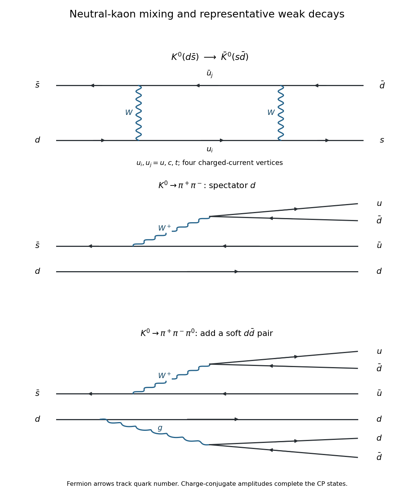

<h1 id="1/a/solution">Solution</h1>

↑ **Parent:** [A](../a.md)

With the [valence quark](../../../../valence-quark.md) assignments $K^0=d\bar s$ and $\bar K^0=s\bar d$, [neutral kaon mixing](../../../../neutral-kaon-mixing.md) changes [strangeness](../../../../strangeness.md) by two units. A representative leading [Standard Model](../../../../standard-model-split.md) contribution is a [box Feynman diagram](../../../../box-feynman-diagram.md) with two [W bosons](../../../../w-boson.md) and two internal up-type [quarks](../../../../quark.md):

$$
d\longrightarrow u_i\longrightarrow s,\qquad
\bar s\longrightarrow\bar u_j\longrightarrow\bar d,
\qquad u_i,u_j\in\{u,c,t\}.
$$

The two lines exchange the two [W bosons](../../../../w-boson.md). There are four [weak charged current](../../../../charged-current.md) [interaction vertices](../../../../interaction-vertex.md), so the [scattering amplitude](../../../../scattering-amplitude.md) is fourth order in the weak [gauge coupling](../../../../gauge-coupling.md), or second order in the [Fermi constant](../../../../fermi-constant.md). The full result sums the internal [quark flavors](../../../../quark-flavor.md) with their [Cabibbo-Kobayashi-Maskawa matrix](../../../../cabibbo-kobayashi-maskawa-matrix.md) factors; one box alone illustrates the mechanism.

**[Figure 1](#1/a/image-representative-charged-current-box-and-two-and-three-pion-kaon-decay-diagrams). Representative charged-current box and two- and three-pion kaon decay diagrams**.

## ↑ Ancestors (12)

1. [A](../a.md)
2. [1](../../1.md)
3. [2022](../../../2022-split.md)
4. [Past exam of the nuclear and particle physics course of the University of Oxford](../../../split.md)
5. [Nuclear and particle physics course of the University of Oxford](../../../../nuclear-and-particle-physics-course-of-the-university-of-oxford.md)
6. [Year 3 of the physics course of the University of Oxford](../../../../year-3-of-the-physics-course-of-the-university-of-oxford.md)
7. [Physics course of the University of Oxford](../../../../physics-course-of-the-university-of-oxford.md)
8. [Undergraduate course of the University of Oxford](../../../../undergraduate-course-of-the-university-of-oxford.md)
9. [Course of the University of Oxford](../../../../course-of-the-university-of-oxford.md)
10. [University of Oxford](../../../../university-of-oxford-split.md)
11. [List of universities](../../../../list-of-universities.md)
12. [Codex Wiki](../../../../split.md)
