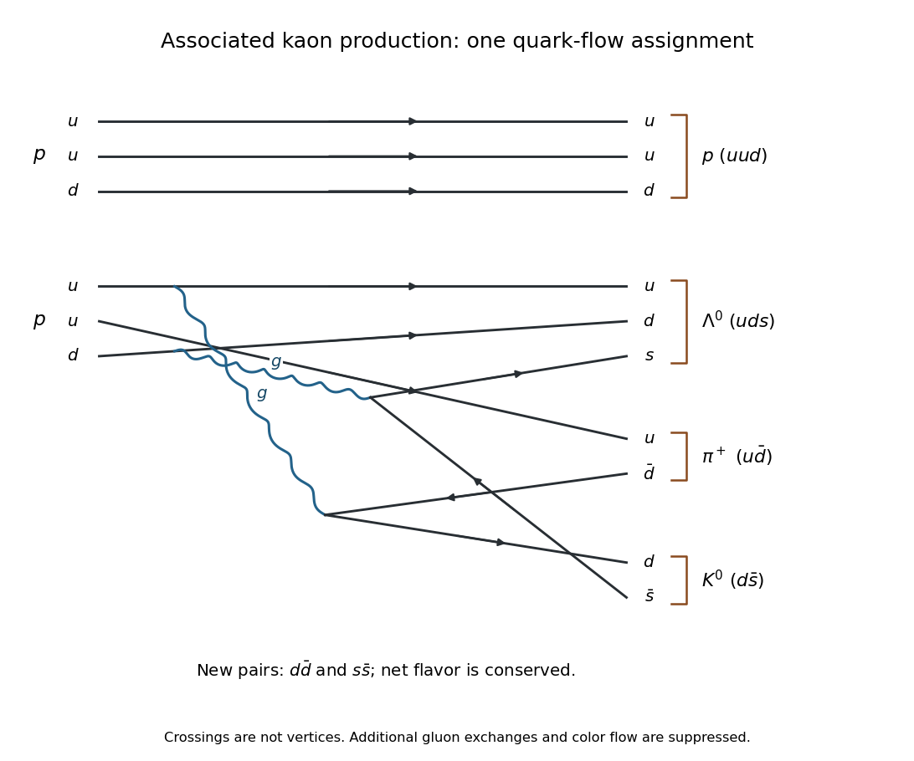

<h1 id="1/c/solution">Solution</h1>

↑ **Parent:** [C](../c.md)

Put $M_f=m_p+m_{\pi^+}+m_\Lambda+m_{K^0}$. In [natural units](../../../../natural-units.md), a stationary target [proton](../../../../proton.md) and a beam [proton](../../../../proton.md) of total [energy](../../../../energy-split.md) $E_b$ have the [Mandelstam invariant](../../../../mandelstam-variables.md)

$$
s=(p_b+p_t)^2=2m_p^2+2m_pE_b.
$$

At [fixed-target production threshold](../../../../fixed-target-production-threshold.md) the final particles have zero relative [momentum](../../../../momentum-split.md) in their [centre-of-mass frame](../../../../center-of-momentum-frame.md), so $s=M_f^2$. Restoring $c$, the total beam [energy](../../../../energy-split.md) and its [kinetic energy](../../../../kinetic-energy.md) are

$$
\boxed{E_{b,\mathrm{thr}}=\frac{M_f^2-2m_p^2}{2m_p}c^2,\qquad
T_{b,\mathrm{thr}}=\frac{M_f^2-4m_p^2}{2m_p}c^2.}
$$

Using rounded [masses](../../../../mass.md) in $\mathrm{MeV}/c^2$, $(938.27,139.57,1115.68,497.61)$, gives $E_{b,\mathrm{thr}}\simeq2.921\,\mathrm{GeV}$ and $T_{b,\mathrm{thr}}\simeq1.983\,\mathrm{GeV}$.

One possible [strong interaction](../../../../strong-interaction.md) [quark-line flavour rearrangement](../../../../quark-line-flavour-rearrangement.md) is

$$
(uud)+(uud)\longrightarrow
\underbrace{uud}_{p}+\underbrace{uds}_{\Lambda^0}
+\underbrace{u\bar d}_{\pi^+}+\underbrace{d\bar s}_{K^0}.
$$

It needs newly created $d\bar d$ and $s\bar s$ pairs, with no net change of any [quark flavor](../../../../quark-flavor.md). For example, keep the first $uud$ as the outgoing [proton](../../../../proton.md); allocate the second incoming $u,d$ and the new $s$ to $\Lambda^0$, the remaining incoming $u$ and new $\bar d$ to $\pi^+$, and the new $d,\bar s$ to $K^0$. Two [gluon](../../../../gluon.md) splittings illustrate this flow. This is a possible [hadronization](../../../../hadronization.md) topology, not a unique perturbative description of the [proton](../../../../proton.md) collision.

**[Figure 2](#1/c/image-one-flavor-conserving-quark-flow-assignment-for-associated-neutral-kaon-production). One flavor-conserving quark-flow assignment for associated neutral-kaon production**.

After several short [mean lifetimes](../../../../mean-lifetime-physics.md), the surviving coherent beam is approximately $|K_L\rangle=(|K^0\rangle-|\bar K^0\rangle)/\sqrt2$. In ordinary matter the [forward scattering amplitudes](../../../../forward-scattering-amplitude.md) of $K^0$ and $\bar K^0$ differ. For example, the $s$ in a [neutral antikaon](../../../../neutral-antikaon.md) can enter a strange [baryon](../../../../baryon.md) through strong absorption; the opposite [strangeness](../../../../strangeness.md) assignment has different available channels. If their forward [transmission amplitudes](../../../../transmission-amplitude.md) through a thin block are $t_0$ and $\bar t_0$, respectively, then

$$
\boxed{|K_L\rangle\longmapsto
\frac{t_0+\bar t_0}{2}|K_L\rangle+
\frac{t_0-\bar t_0}{2}|K_S\rangle.}
$$

Thus the transmitted forward beam contains a regenerated short-lived component, with prompt two-[pion](../../../../pion.md) decays after the block. Differential absorption changes the intensities as well as the relative phase. Scattered particles outside the forward beam can provide an incoherent component. This [neutral kaon regeneration](../../../../neutral-kaon-regeneration.md) does not require [CP violation](../../../../cp-violation.md): the material itself distinguishes matter and antimatter.

## ↑ Ancestors (12)

1. [C](../c.md)
2. [1](../../1.md)
3. [2022](../../../2022-split.md)
4. [Past exam of the nuclear and particle physics course of the University of Oxford](../../../split.md)
5. [Nuclear and particle physics course of the University of Oxford](../../../../nuclear-and-particle-physics-course-of-the-university-of-oxford.md)
6. [Year 3 of the physics course of the University of Oxford](../../../../year-3-of-the-physics-course-of-the-university-of-oxford.md)
7. [Physics course of the University of Oxford](../../../../physics-course-of-the-university-of-oxford.md)
8. [Undergraduate course of the University of Oxford](../../../../undergraduate-course-of-the-university-of-oxford.md)
9. [Course of the University of Oxford](../../../../course-of-the-university-of-oxford.md)
10. [University of Oxford](../../../../university-of-oxford-split.md)
11. [List of universities](../../../../list-of-universities.md)
12. [Codex Wiki](../../../../split.md)
