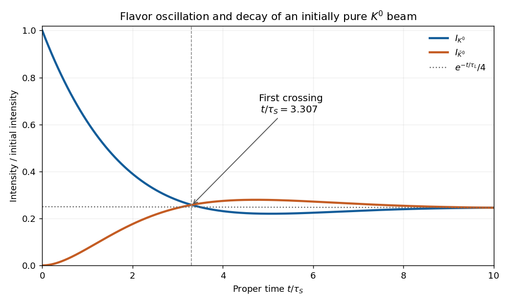

<h1 id="1/e/solution">Solution</h1>

↑ **Parent:** [E](../e.md)

Normalize the incident intensity to one. Since $|K^0\rangle=(|K_S\rangle+|K_L\rangle)/\sqrt2$, the initial [probability amplitudes](../../../../probability-amplitude.md) are $A_S(0)=A_L(0)=1/\sqrt2$. Define $g_j=e^{-im_jt}e^{-t/(2\tau_j)}$. The flavor [probability amplitudes](../../../../probability-amplitude.md) are $(g_S+g_L)/2$ and $(g_S-g_L)/2$. Their absolute squares are

$$
\boxed{I_{K^0}(t)=\frac14\left[e^{-t/\tau_S}+e^{-t/\tau_L}
+2e^{-\frac t2(1/\tau_S+1/\tau_L)}\cos(\Delta m\,t)\right],}
$$

$$
\boxed{I_{\bar K^0}(t)=\frac14\left[e^{-t/\tau_S}+e^{-t/\tau_L}
-2e^{-\frac t2(1/\tau_S+1/\tau_L)}\cos(\Delta m\,t)\right],}
$$

where $\Delta m=m_L-m_S$ in [natural units](../../../../natural-units.md). Thus $A=B=1/4$ for both, $\phi=\Delta m\,t$, and

$$
\boxed{C_{K^0}(t)=\tfrac12e^{-\frac t2(1/\tau_S+1/\tau_L)},\qquad
C_{\bar K^0}(t)=-\tfrac12e^{-\frac t2(1/\tau_S+1/\tau_L)}.}
$$

Multiplying all three coefficients by the incident intensity gives any other normalization. Crucially, **$C$ is time dependent**. The printed template cannot hold with all of $A,B,C$ constant. For example, a nonzero constant $C$ would leave an undamped oscillation at arbitrarily late times, even after both unstable components have decayed.

In seconds, $\phi=\Delta m\,c^2t/\hbar$. With $x=t/\tau_S$, the supplied [mass](../../../../mass.md) difference and [mean lifetimes](../../../../mean-lifetime-physics.md) give

$$
r_\tau=\tau_S/\tau_L=0.00172934,\qquad
\phi=0.474975x,
$$

$$
I_{K^0,\bar K^0}(x)=\frac14\left[e^{-x}+e^{-r_\tau x}
\mathbin{\pm}2e^{-(1+r_\tau)x/2}\cos(0.474975x)\right].
$$

Initially the intensities are one and zero. Their sum is $\tfrac12(e^{-x}+e^{-r_\tau x})$, so these are unconditioned survival intensities, not [probabilities](../../../../probability.md) conditioned on survival. The curves first meet at $x=\pi/(2\times0.474975)\simeq3.307$. Thereafter the [neutral antikaon](../../../../neutral-antikaon.md) component briefly exceeds the $K^0$ component, before the [interference](../../../../interference-wave-propagation.md) dies away and both approach the surviving long-lived intensity $e^{-r_\tau x}/4$.

**[Figure 3](#1/e/image-neutral-kaon-flavor-intensities-for-an-initially-pure-neutral-kaon-beam-versus-proper-time). Neutral-kaon flavor intensities for an initially pure neutral-kaon beam, versus proper time**.

## ↑ Ancestors (12)

1. [E](../e.md)
2. [1](../../1.md)
3. [2022](../../../2022-split.md)
4. [Past exam of the nuclear and particle physics course of the University of Oxford](../../../split.md)
5. [Nuclear and particle physics course of the University of Oxford](../../../../nuclear-and-particle-physics-course-of-the-university-of-oxford.md)
6. [Year 3 of the physics course of the University of Oxford](../../../../year-3-of-the-physics-course-of-the-university-of-oxford.md)
7. [Physics course of the University of Oxford](../../../../physics-course-of-the-university-of-oxford.md)
8. [Undergraduate course of the University of Oxford](../../../../undergraduate-course-of-the-university-of-oxford.md)
9. [Course of the University of Oxford](../../../../course-of-the-university-of-oxford.md)
10. [University of Oxford](../../../../university-of-oxford-split.md)
11. [List of universities](../../../../list-of-universities.md)
12. [Codex Wiki](../../../../split.md)
