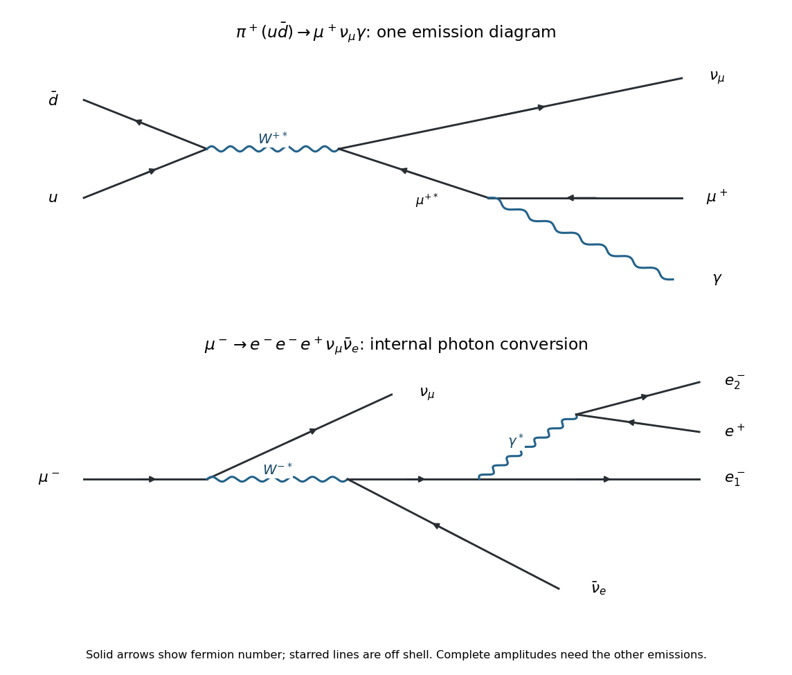

<h1 id="2/b/solution">Solution</h1>

↑ **Parent:** [B](../b.md)

A representative [Feynman diagram](../../../../feynman-diagram.md) annihilates $u\bar d$ into $W^{+*}$, producing $\nu_\mu$ and an off-shell $\mu^+$; the charged [antilepton](../../../../antilepton.md) emits a [photon](../../../../photon.md) and becomes the outgoing $\mu^+$. The top panel below shows this contribution. A complete [gauge-invariant](../../../../gauge-invariance.md) [decay amplitude](../../../../decay-amplitude.md) includes radiation from the charged hadronic side, together with structure-dependent terms. The physical separation into inner [bremsstrahlung](../../../../bremsstrahlung.md), structure-dependent radiation, and their [interference](../../../../interference-wave-propagation.md) is explicit in the standard [radiative pion decay](../../../../radiative-pion-decay.md) description.[Section 62.1, equations (62.1)–(62.4): decomposition into inner bremsstrahlung, structure-dependent radiation and interference](../../../../radiative-pion-and-kaon-decay-form-factors-in-the-2025-review-of-particle-physics.md)

**[Figure 4](#2/b/image-representative-radiative-pion-decay-and-internal-conversion-muon-decay-diagrams). Representative radiative pion decay and internal-conversion muon decay diagrams**.

Here is an explicit finite **model of [phase space](../../../../phase-space.md) alone**, with its assumptions exposed. Neglect the [neutrino](../../../../neutrino.md) [mass](../../../../mass.md), treat the [photon](../../../../photon.md) as massless, and replace the spin-summed invariant [decay amplitudes](../../../../decay-amplitude.md) by constants over the available [Lorentz-invariant phase space](../../../../lorentz-invariant-phase-space.md). Write $M=m_\pi$, $m=m_\mu$, $r=m^2/M^2$, and use [natural units](../../../../natural-units.md). The [three-body phase space with one massive daughter](../../../../three-body-phase-space-with-one-massive-daughter.md) follows by factoring through an intermediate invariant squared [mass](../../../../mass.md) $s$:

$$
\Phi_3(M;m,0,0)=\frac{1}{128\pi^3M^2}
\int_{m^2}^{M^2}\frac{(M^2-s)(s-m^2)}{s}\,ds
=\frac{M^2}{256\pi^3}(1-r^2+2r\ln r).
$$

The two-body comparison has $\Phi_2(M;m,0)=(1-r)/(8\pi)$. Since $\Gamma_n=\overline{|\mathcal M_n|^2}\Phi_n/(2M)$, assuming $\overline{|\mathcal M_3|^2}/\overline{|\mathcal M_2|^2}=\kappa e^2/M^2$ gives

$$
\boxed{\frac{\Gamma_{\mu\nu\gamma}}{\Gamma_{\mu\nu}}
\simeq\frac{\kappa\alpha_{\mathrm{em}}}{8\pi}
\frac{1-r^2+2r\ln r}{1-r}.}
$$

Here $\kappa$ is a dimensionless constant encapsulating the assumed [matrix element](../../../../matrix-element.md) ratio, and $\alpha_{\mathrm{em}}$ is the [fine-structure constant](../../../../fine-structure-constant.md). If the two-body mode dominates, this ratio approximates the radiative [branching fraction](../../../../branching-fraction.md). Near $m=M$, $1-r^2+2r\ln r=(1-r)^3/3+O((1-r)^4)$, displaying the extra [phase space](../../../../phase-space.md) suppression.

**This model is not a prediction of a physical uncut radiative branching fraction.** Actual inner [bremsstrahlung](../../../../bremsstrahlung.md) has a soft-[photon](../../../../photon.md) singularity, so a count of events with a separately observed [photon](../../../../photon.md) requires a positive [photon](../../../../photon.md) [energy](../../../../energy-split.md) cut. To see both the missing input and the [mass](../../../../mass.md) dependence explicitly, the leading soft-[photon](../../../../photon.md) result for $E_{\mathrm{cut}}<E_\gamma<E_{\mathrm{soft}}\ll E_{\max}$ is

$$
\boxed{\frac{\Gamma_{\gamma,\mathrm{soft}}}{\Gamma_{\mu\nu}}
\simeq\frac{\alpha_{\mathrm{em}}}{\pi}
\left[\frac{1+r}{1-r}\ln\frac1r-2\right]
\ln\frac{E_{\mathrm{soft}}}{E_{\mathrm{cut}}},\quad
E_{\max}=\frac{M^2-m^2}{2M}.}
$$

The coefficient follows from the radiation factor $e[p_\mu\cdot\epsilon/(p_\mu\cdot k)-p_\pi\cdot\epsilon/(p_\pi\cdot k)]$: angular integration gives $\beta^{-1}\ln[(1+\beta)/(1-\beta)]-2$, where $\beta=(1-r)/(1+r)$, and the soft [energy](../../../../energy-split.md) integral is $\int dE_\gamma/E_\gamma$. Thus a finite physical number cannot be deduced from the two [masses](../../../../mass.md) and [phase space](../../../../phase-space.md) alone. The [infrared divergence](../../../../infrared-divergence.md) cancels only when the corresponding unresolved real radiation and virtual [radiative corrections](../../../../radiative-correction.md) are combined in an inclusive observable.

## ↑ Ancestors (12)

1. [B](../b.md)
2. [2](../../2.md)
3. [2022](../../../2022-split.md)
4. [Past exam of the nuclear and particle physics course of the University of Oxford](../../../split.md)
5. [Nuclear and particle physics course of the University of Oxford](../../../../nuclear-and-particle-physics-course-of-the-university-of-oxford.md)
6. [Year 3 of the physics course of the University of Oxford](../../../../year-3-of-the-physics-course-of-the-university-of-oxford.md)
7. [Physics course of the University of Oxford](../../../../physics-course-of-the-university-of-oxford.md)
8. [Undergraduate course of the University of Oxford](../../../../undergraduate-course-of-the-university-of-oxford.md)
9. [Course of the University of Oxford](../../../../course-of-the-university-of-oxford.md)
10. [University of Oxford](../../../../university-of-oxford-split.md)
11. [List of universities](../../../../list-of-universities.md)
12. [Codex Wiki](../../../../split.md)
