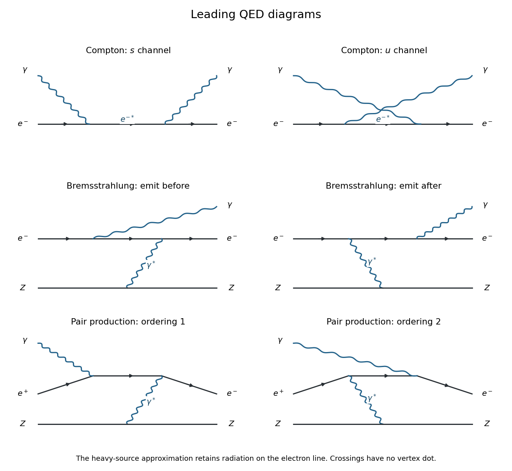

<h1 id="2/e/solution">Solution</h1>

↑ **Parent:** [E](../e.md)

The following are the leading [quantum electrodynamics](../../../../quantum-electrodynamics.md) diagrams. Solid arrows indicate fermion-number flow, and wavy lines indicate [photons](../../../../photon.md). The heavy source line represents a charged [nucleus](../../../../atomic-nucleus-split.md); its recoil allows [four-momentum conservation](../../../../four-momentum-conservation.md).

**[Figure 5](#2/e/image-leading-compton-electron-line-bremsstrahlung-and-nuclear-field-pair-production-diagrams). Leading Compton, electron-line bremsstrahlung and nuclear-field pair-production diagrams**.

For [Compton scattering](../../../../compton-scattering.md), $e^-\gamma\to e^-\gamma$, there are two diagrams: absorption of the incident [photon](../../../../photon.md) followed along the [electron](../../../../electron.md) line by emission of the outgoing [photon](../../../../photon.md), and the opposite ordering. These are the $s$- and $u$-channel [electron](../../../../electron.md) [propagators](../../../../propagator.md). Both [scattering amplitudes](../../../../scattering-amplitude.md) are order $e^2$.

For [bremsstrahlung](../../../../bremsstrahlung.md), $e^-Z\to e^-Z\gamma$, a virtual [photon](../../../../photon.md) transfers [momentum](../../../../momentum-split.md) between the [electron](../../../../electron.md) and the source. The real [photon](../../../../photon.md) is emitted before or after this interaction along the [electron](../../../../electron.md) line. These two dominant external-field diagrams have [scattering amplitudes](../../../../scattering-amplitude.md) of order $Ze^3$. A full finite-mass charged-target calculation also includes radiation from the target; it is suppressed in the heavy stationary-source approximation used here.

For nuclear-field [pair production](../../../../pair-production.md), $\gamma Z\to e^-e^+Z$, crossing the preceding diagrams gives two order-$Ze^3$ contributions, with the incoming real [photon](../../../../photon.md) and the exchanged virtual [photon](../../../../photon.md) in either order along the pair's fermion line. An isolated real [photon](../../../../photon.md) cannot produce a massive pair in vacuum: its invariant squared [mass](../../../../mass.md) is zero, whereas the pair has invariant squared [mass](../../../../mass.md) at least $4m_e^2$. The source absorbs recoil [momentum](../../../../momentum-split.md).

## ↑ Ancestors (12)

1. [E](../e.md)
2. [2](../../2.md)
3. [2022](../../../2022-split.md)
4. [Past exam of the nuclear and particle physics course of the University of Oxford](../../../split.md)
5. [Nuclear and particle physics course of the University of Oxford](../../../../nuclear-and-particle-physics-course-of-the-university-of-oxford.md)
6. [Year 3 of the physics course of the University of Oxford](../../../../year-3-of-the-physics-course-of-the-university-of-oxford.md)
7. [Physics course of the University of Oxford](../../../../physics-course-of-the-university-of-oxford.md)
8. [Undergraduate course of the University of Oxford](../../../../undergraduate-course-of-the-university-of-oxford.md)
9. [Course of the University of Oxford](../../../../course-of-the-university-of-oxford.md)
10. [University of Oxford](../../../../university-of-oxford-split.md)
11. [List of universities](../../../../list-of-universities.md)
12. [Codex Wiki](../../../../split.md)
