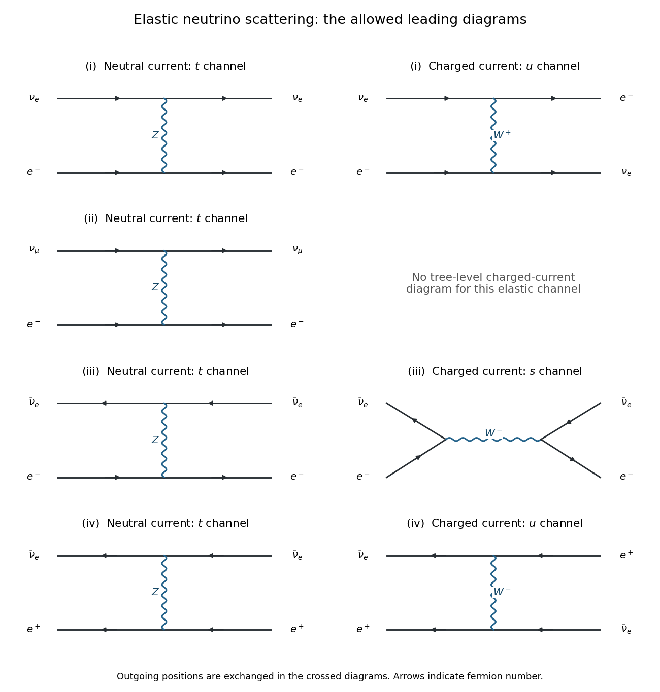

<h1 id="2/f/i/solution">Solution</h1>

↑ **Parent:** [I](../i.md)

There is a $t$-channel [Z boson](../../../../../z-boson.md) contribution and a crossed, $u$-channel [W boson](../../../../../w-boson.md) contribution. The latter pairs the incoming [electron neutrino](../../../../../electron-neutrino.md) with the outgoing [electron](../../../../../electron.md), and the incoming [electron](../../../../../electron.md) with the outgoing [electron neutrino](../../../../../electron-neutrino.md). Both contribute coherently to the same elastic final state.

**[Figure 6](#2/f/i/image-neutral-and-charged-current-diagrams-for-the-four-elastic-neutrino-scattering-channels). Neutral- and charged-current diagrams for the four elastic neutrino scattering channels**.

For a concrete comparison, take unpolarized targets, the same [Mandelstam invariant](../../../../../mandelstam-variables.md) $s$ in all four reactions, and $m_e^2\ll s\ll m_W^2$. In a stationary-[electron](../../../../../electron.md) experiment this includes $E_\nu\gg m_e$ with $s\simeq2m_eE_\nu$. Define $x=\sin^2\theta_W$, using the [weak mixing angle](../../../../../weinberg-angle.md), and $\sigma_*=G_F^2s/\pi$. The [weak neutral current](../../../../../neutral-current.md) has chiral couplings $g_L=x-1/2$, $g_R=x$; the [weak charged current](../../../../../charged-current.md) shifts $g_L$ by one. Consequently

$$
\boxed{\sigma_{\mathrm{i}}=\sigma_*\left[(x+\tfrac12)^2+\frac{x^2}{3}\right].}
$$

The factor $1/3$ comes from integrating the opposite-chirality angular weight: in the massless limit $\int_0^1(1-y)^2dy=1/3$. Thus the relative rate depends on the chiral couplings and their [interference](../../../../../interference-wave-propagation.md), rather than simply on the number of diagrams.

## ↑ Ancestors (13)

1. [I](../i.md)
2. [F](../../f.md)
3. [2](../../../2.md)
4. [2022](../../../../2022-split.md)
5. [Past exam of the nuclear and particle physics course of the University of Oxford](../../../../split.md)
6. [Nuclear and particle physics course of the University of Oxford](../../../../../nuclear-and-particle-physics-course-of-the-university-of-oxford.md)
7. [Year 3 of the physics course of the University of Oxford](../../../../../year-3-of-the-physics-course-of-the-university-of-oxford.md)
8. [Physics course of the University of Oxford](../../../../../physics-course-of-the-university-of-oxford.md)
9. [Undergraduate course of the University of Oxford](../../../../../undergraduate-course-of-the-university-of-oxford.md)
10. [Course of the University of Oxford](../../../../../course-of-the-university-of-oxford.md)
11. [University of Oxford](../../../../../university-of-oxford-split.md)
12. [List of universities](../../../../../list-of-universities.md)
13. [Codex Wiki](../../../../../split.md)
