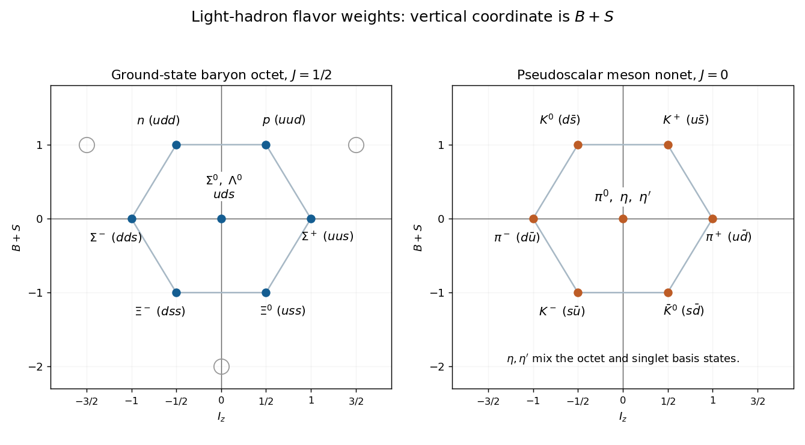

<h1 id="4/a/solution">Solution</h1>

↑ **Parent:** [A](../a.md)

Each [quark](../../../../quark.md) has [baryon number](../../../../baryon-number.md) $1/3$, and each [antiquark](../../../../antiquark.md) has [baryon number](../../../../baryon-number.md) $-1/3$. A strange [quark](../../../../quark.md) has [strangeness](../../../../strangeness.md) $-1$, a strange [antiquark](../../../../antiquark.md) has [strangeness](../../../../strangeness.md) $+1$, and the light $u,d$ have zero [strangeness](../../../../strangeness.md). The [isospin](../../../../isospin.md) projections of $u,d,s$ are $+1/2,-1/2,0$, with the opposite values for their [antiquarks](../../../../antiquark.md). Thus

$$
B=\frac{n_q-n_{\bar q}}3,\qquad
S=n_{\bar s}-n_s,\qquad
I_z=\frac{n_u-n_d-n_{\bar u}+n_{\bar d}}2.
$$

For three [valence quarks](../../../../valence-quark.md), $B=1$ and $Y=B+S=1-n_s$. The [baryon octet](../../../../baryon-octet.md) is reproduced by the following [quark model](../../../../quark-model.md) assignments:

| [Baryon](../../../../baryon.md) | [Valence quarks](../../../../valence-quark.md) | $I_z$ | $B+S$ |
| --- | --- | --- | --- |
| [Neutron](../../../../neutron-split.md) $n$ | $udd$ | $-1/2$ | $1$ |
| [Proton](../../../../proton.md) $p$ | $uud$ | $+1/2$ | $1$ |
| [Sigma baryon](../../../../sigma-baryon.md) $\Sigma^-$ | $dds$ | $-1$ | $0$ |
| [Sigma baryon](../../../../sigma-baryon.md) $\Sigma^0$ | $uds$ | $0$ | $0$ |
| [Lambda baryon](../../../../lambda-baryon.md) $\Lambda^0$ | $uds$ | $0$ | $0$ |
| [Sigma baryon](../../../../sigma-baryon.md) $\Sigma^+$ | $uus$ | $+1$ | $0$ |
| [Xi baryon](../../../../xi-baryon.md) $\Xi^-$ | $dss$ | $-1/2$ | $-1$ |
| [Xi baryon](../../../../xi-baryon.md) $\Xi^0$ | $uss$ | $+1/2$ | $-1$ |

Consequently the top-left and top-right states in the source diagram are $\boxed{X=n,\quad Y=p}$. Here the source's label $Y$ means the unknown particle at the top right; the conventional symbol $Y=B+S$ elsewhere in this solution denotes [flavor hypercharge](../../../../flavor-hypercharge.md).

**[Figure 7](#4/a/image-original-baryon-octet-and-pseudoscalar-meson-nonet-weight-diagrams-in-the-full-hypercharge-convention). Original baryon-octet and pseudoscalar-meson-nonet weight diagrams in the full hypercharge convention**.

## ↑ Ancestors (12)

1. [A](../a.md)
2. [4](../../4.md)
3. [2022](../../../2022-split.md)
4. [Past exam of the nuclear and particle physics course of the University of Oxford](../../../split.md)
5. [Nuclear and particle physics course of the University of Oxford](../../../../nuclear-and-particle-physics-course-of-the-university-of-oxford.md)
6. [Year 3 of the physics course of the University of Oxford](../../../../year-3-of-the-physics-course-of-the-university-of-oxford.md)
7. [Physics course of the University of Oxford](../../../../physics-course-of-the-university-of-oxford.md)
8. [Undergraduate course of the University of Oxford](../../../../undergraduate-course-of-the-university-of-oxford.md)
9. [Course of the University of Oxford](../../../../course-of-the-university-of-oxford.md)
10. [University of Oxford](../../../../university-of-oxford-split.md)
11. [List of universities](../../../../list-of-universities.md)
12. [Codex Wiki](../../../../split.md)
